# Graphics Programming for Absolute Beginners

**A gentle introduction for people who have never written code before**

---

## Welcome!

You're about to learn how computer graphics work — the technology behind video games, animated movies like those from Pixar, and even VR experiences.

**Here's the honest truth:** This stuff is complicated. Really complicated. But we're going to start from zero and build up slowly. If you feel confused, that's normal. Just keep reading.

---

## Part 1: What Are We Even Building?

### The Big Picture

Imagine you're watching a movie like *Toy Story* or playing a game like *Minecraft*. What you see on screen looks like a 3D world, right?

**Here's the secret:** Your screen is completely flat. It's just a 2D rectangle with millions of tiny colored dots called **pixels** (short for "picture elements").

Everything you see — characters, buildings, trees, light — is actually just millions of pixels being colored very carefully, 60 times every second.

### The Graphics Programmer's Job

Your job as a graphics programmer is to figure out:

> "For every single pixel on the screen, what color should it be right now?"

That's it. That's the whole job. But answering that question requires some clever thinking...

---

### An Analogy: The Digital Artist

Imagine you have **1 million tiny artists** sitting inside your computer. Each artist is responsible for exactly **one pixel** on your screen.

Every frame (1/60th of a second), you yell to all your artists:

> *"Okay! There's a red cube in the middle of the room, the light is coming from the left, and the camera is slightly above it. TELL ME WHAT COLOR YOUR PIXEL IS!"*

And all 1 million artists simultaneously calculate their answer.

- Some say: "My pixel is on the cube surface, facing the light... so I'm **bright red**!"
- Some say: "My pixel is on the cube but in shadow... so I'm **dark red**!"
- Some say: "My pixel isn't on the cube at all... it's the background... so I'm **black**!"

All 1 million answers come back instantly, and boom — you have an image!

### That's Your GPU

That "team of 1 million artists" inside your computer is called the **GPU** (Graphics Processing Unit).

- **CPU** (Central Processing Unit): Like a genius professor — can do complex tasks, but only a few at a time
- **GPU** (Graphics Processing Unit): Like 1,000 hard-working students — each is slower than the professor, but together they can finish simple tasks in massive parallel

For graphics, we need the GPU because we need to do the same simple math ("what color is this pixel?") millions of times simultaneously.

---

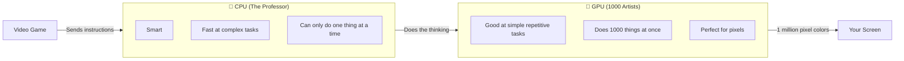

---

### Try This: See Your Pixels

Your screen is made of pixels. Let's prove it:

1. Take a phone or tablet
2. Open any photo
3. Zoom in... keep zooming... keep zooming...
4. Eventually, you'll see little squares

Those squares are pixels! Each one is just one solid color. But when you zoom out, your brain blends them together into a smooth image.

**Graphics programming** is just figuring out what color each square should be.

---

## Part 2: Understanding 3D on a 2D Screen

### The Core Problem

How do we show a 3D world on a 2D screen?

**Answer:** We fake it. We use tricks your brain falls for.

---

### Trick 1: Perspective (Things Get Smaller)

In the real world, things that are far away look smaller. Artists have used this trick for hundreds of years.

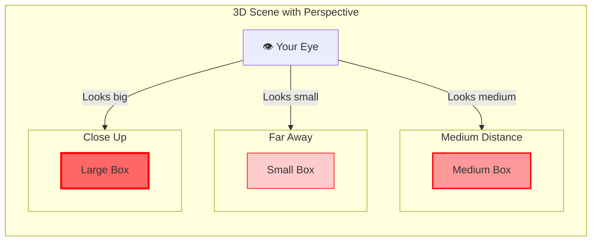

**How it works:** We calculate the angle from the camera to each object. Smaller angle = farther away = smaller on screen.

```
           (far away)
            ___
           /   \     ← Small box
          |_____|

        _________
       /         \   ← Medium box
      |___________|

    _____________
   /             \ ← Large box (close!)
  |_______________|
```

In graphics, we calculate **how far away** each object is, then make it proportionally smaller.

---

### Trick 2: Hidden Surfaces

If something is in front of something else, you can't see the thing behind it.

```
    You  →   [Box A]   [Box B]
                 ║
                 ║ You can't see Box B!
                 ║ Box A blocks it
```

In graphics, we have to figure out what's in front and only draw that. The rest stays hidden.

---

### Trick 3: Lighting and Shading

A plain red circle looks flat:

```
    🔴 Plain red = flat circle
```

But add shading (lighter on one side, darker on the other):

```
    ◐ Light on left, shadow on right = 3D sphere!
```

Your brain goes: "Oh! That variation in color means it's a 3D sphere with light hitting it!"

Graphics programmers are obsessed with **lighting** — making sure every pixel's color reflects how light would bounce off it in real life.

---

## Part 3: The Graphics Pipeline (Simple Version)

### What's a "Pipeline"?

A pipeline is just a series of steps. Think of it like an assembly line in a factory:

```
Raw materials → Step 1 → Step 2 → Step 3 → ... → Finished product
```

For graphics, our "raw materials" are 3D models (like characters, buildings, trees). The "finished product" is a 2D image on your screen.

---

### The Graphics Pipeline: Assembly Line

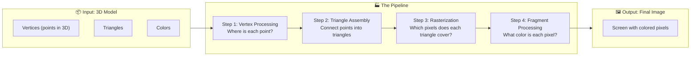

Let's break down each step...

---

### Step 1: Vertices (The Skeleton)

Everything in 3D graphics is made of **vertices** (say: "VER-tih-seez"). A vertex is just a point in 3D space.

**Think of it like connect-the-dots:**

```
        * (vertex 3)

    * (vertex 1)    * (vertex 2)
```

Each vertex has an **(x, y, z)** position telling us where it is in 3D space.

---

### Step 2: Triangles (The Skin)

We connect vertices with triangles. Why triangles? Because they're the simplest shape that always works:

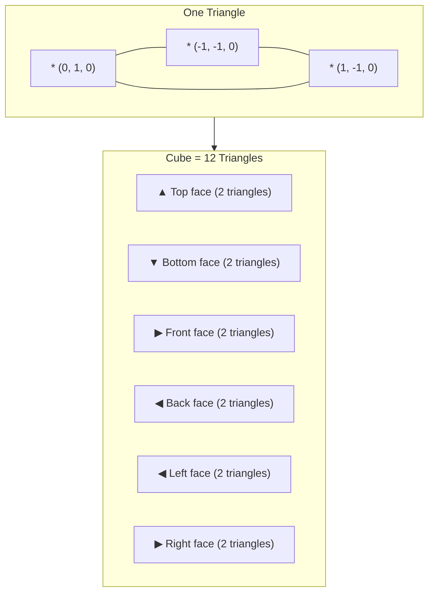

```
      /\
     /  \    ← Three points = one triangle
    /____\
```

Any 3D shape can be built from triangles:

- A cube = 12 triangles (2 per face) ✓
- A sphere = thousands of tiny triangles
- A human character = hundreds of thousands of triangles

**More triangles = smoother shape, but more work for your GPU**

---

### Step 3: Rasterization (The Tricky Part)

Now we have 3D triangles. But our screen is 2D pixels. How do we match them up?

**Rasterization** answers: "For each triangle, which pixels does it cover?"

```mermaid
flowchart LR
    subgraph Input["Input: 3D Triangle"]
        V1["Vertex 1<br/>(x1, y1, z1)"]
        V2["Vertex 2<br/>(x2, y2, z2)"]
        V3["Vertex 3<br/>(x3, y3, z3)"]
    end

    subgraph Raster["Rasterization"]
        direction TB
        Q1["Which pixels<br/>does this triangle<br/>cover?"]
        Q2["Test each pixel:<br/>Is it inside<br/>the triangle?"]
    end

    subgraph Grid["Pixel Grid"]
        direction TB
        row1["⬛ ⬛ 🟥 🟥 ⬛"]
        row2["⬛ 🟥 🟥 🟥 ⬛"]
        row3["⬛ ⬛ 🟥 🟥 ⬛"]
        row4["⬛ ⬛ ⬛ ⬛ ⬛"]
    end

    subgraph Output["Output: Fragment List"]
        F1["Fragment 1:<br/>pixel (2,0),<br/>depth=0.5"]
        F2["Fragment 2:<br/>pixel (2,1),<br/>depth=0.6"]
        F3["..."]
    end

    Input --> Raster --> Grid --> Output

    style V1 fill:#e1f5ff,stroke:#0288d1,stroke-width:2px,color:#01579b
    style V2 fill:#e1f5ff,stroke:#0288d1,stroke-width:2px,color:#01579b
    style V3 fill:#e1f5ff,stroke:#0288d1,stroke-width:2px,color:#01579b
    style F1 fill:#ffcdd2,stroke:#c62828,stroke-width:2px,color:#b71c1c
    style F2 fill:#ffcdd2,stroke:#c62828,stroke-width:2px,color:#b71c1c
```

```
3D Triangle (tilted)           2D Screen Pixels

    /|                          ⬛ ⬛ ⬛ ⬛
   / |                          ⬛ 🟥 🟥 🟥   ← These pixels turn red
  /__|                          ⬛ 🟥 🟥 🟥
                                ⬛ ⬛ ⬛ ⬛
```

The GPU is super fast at figuring out which pixels each triangle "touches."

---

### Step 4: Shading (The Color)

For every pixel covered by a triangle, we calculate:

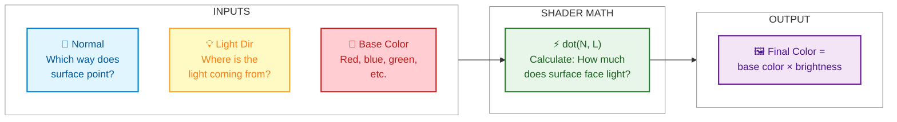

1. **What's the base color?** (red, blue, etc.)
2. **Where's the light?** (is this pixel facing the light or in shadow?)
3. **What's the surface like?** (shiny metal? dull fabric?)
4. **What's the final color?** (combine all the above)

This final calculation is called **shading**.

---

## Part 4: Understanding Coordinates

### The 3D Coordinate System

To describe where things are in 3D space, we use three numbers: **X, Y, Z**

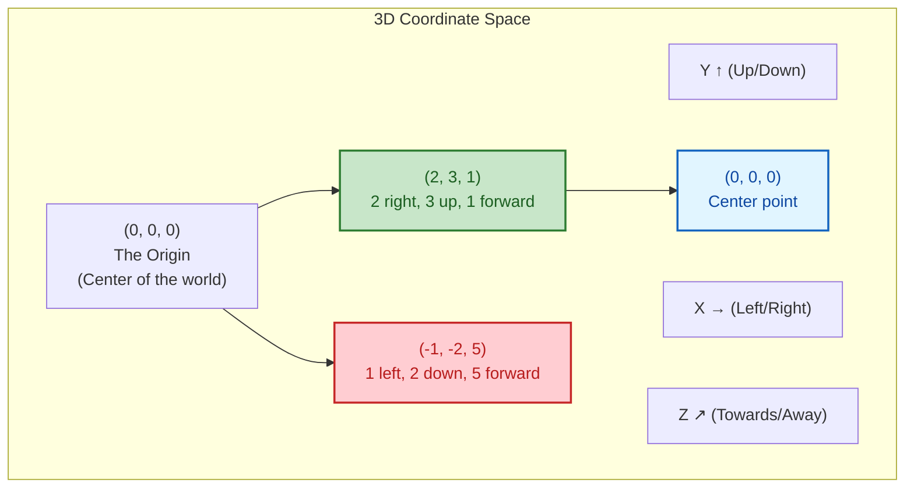

```
        Y (up)
        ↑
        |
        |
        |
        |________→ X (right)
       /
      /
     /
    ↓
   Z (towards you)
```

- **X**: Left-right (positive = right, negative = left)
- **Y**: Up-down (positive = up, negative = down)
- **Z**: Forward-backward (positive = towards you, negative = away)

**Every vertex is just: (X, Y, Z)**

```
Vertex A = (2, 3, 1)  ← 2 units right, 3 units up, 1 unit forward
Vertex B = (0, 0, 0)  ← Right at the center (the "origin")
Vertex C = (-1, -2, 5) ← 1 left, 2 down, 5 forward
```

---

### Screen Coordinates (2D)

When we finally show things on screen, we only need **X, Y**:

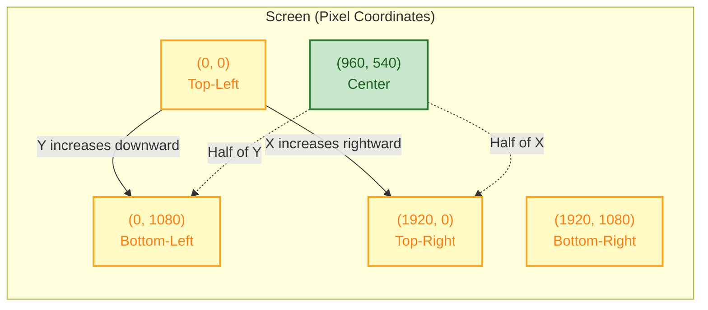

```
        Y (down on screen!)
        ↓
    ┌───┴───┐
    │       │
    │ Screen│
    │       │
    └───────┘
    ←─────→
      X (right)
```

**Weird fact:** In Vulkan, Y goes **down** (not up!). (0,0) is the top-left corner of your screen. This is different from OpenGL, where Y points up!

---

## Part 5: What Is Vulkan?

### The Problem

If you wanted to make a game 30 years ago, you might write code like:

```cpp
drawTriangle(vertex1, vertex2, vertex3, RED);
```

Simple! But slow. The CPU would do everything.

Today, we want the GPU to do the work. But how do you tell the GPU what to do? The GPU is a completely separate piece of hardware with its own memory and rules.

---

### The Solution: Graphics APIs

An **API** (Application Programming Interface) is just a way for two programs to talk to each other.

A **Graphics API** is how your game code talks to your GPU:

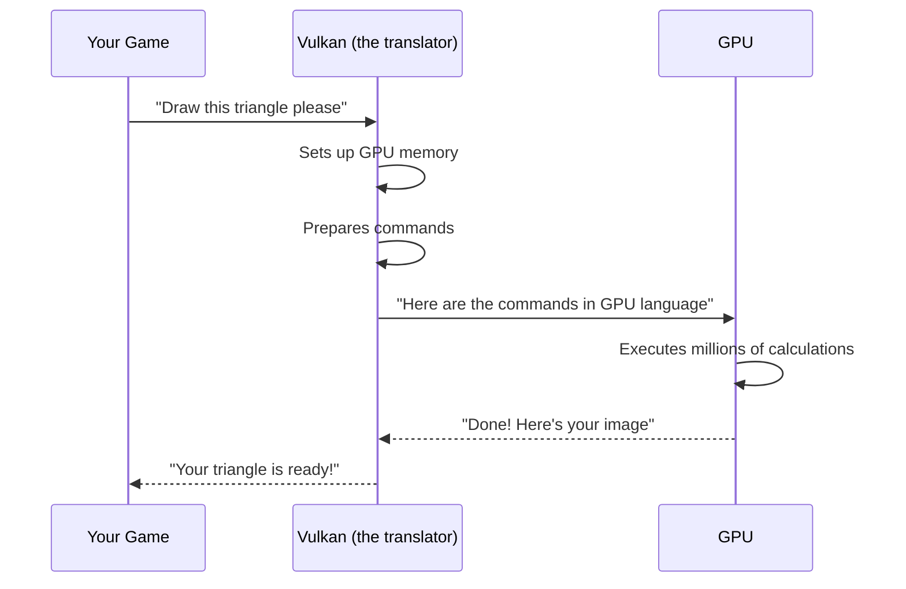

---

### Enter Vulkan

**Vulkan** is one of several graphics APIs. It was created by the Khronos Group (the same people who made OpenGL).

**Why Vulkan?**

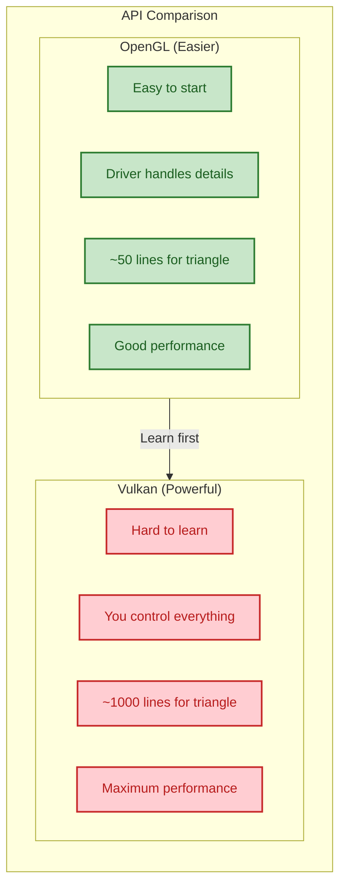

| API | What It's Like |
|-----|----------------|
| **OpenGL** | Automatic transmission — easy to drive, but you don't have much control |
| **Vulkan** | Manual transmission — harder to learn, but you control everything and go faster |

Vulkan gives you:
- **Maximum performance** (you control exactly what the GPU does)
- **Explicit control** (nothing happens behind your back)
- **Cross-platform** (works on Windows, Linux, Android, etc.)

**The tradeoff:** Vulkan is **hard**. You have to set up everything manually.

---

### The Vulkan Setup Nightmare

In OpenGL, drawing a triangle might take 50 lines of code.

In Vulkan, drawing a triangle takes about **1000 lines of code**.

Why? Because you have to explicitly:
1. Create the Vulkan instance
2. Select a physical GPU
3. Create a logical device
4. Set up queues
5. Create a swapchain
6. Create render passes
7. Create framebuffers
8. Create command pools and buffers
9. Record commands
10. Submit and present

...and about 50 other things.

**Good news:** Once you set it up once, you can reuse that code forever.

---

## Part 6: What Is USD?

### The Problem: Too Many 3D Tools

Making a 3D movie or game involves many different tools:

- **Modeling** (Maya, Blender) → Makes characters
- **Animation** (Maya, Houdini) → Makes them move
- **Texturing** (Substance, Mari) → Adds colors and details
- **Lighting** (Katana, Houdini) → Adds lights
- **Rendering** (RenderMan, V-Ray) → Creates final images

**Big problem:** Each tool stores 3D data differently. Getting a character from Maya into Houdini into a game engine used to be a nightmare.

---

### The Solution: USD

**USD** (Universal Scene Description) is like a "universal file format" for 3D scenes.

Think of it like **PDF for 3D**:
- PDF = Any app can open a document and it looks the same
- USD = Any app can open a 3D scene and it looks the same

Pixar created USD because they were using dozens of different tools to make movies. They needed a way to pass scenes between tools without losing information.

---

### USD Analogy: Layer Cake

USD uses a **layered** system, kind of like:

1. **Photoshop layers**: You can stack images on top of each other
2. **Git for code**: You can track changes and merge different versions

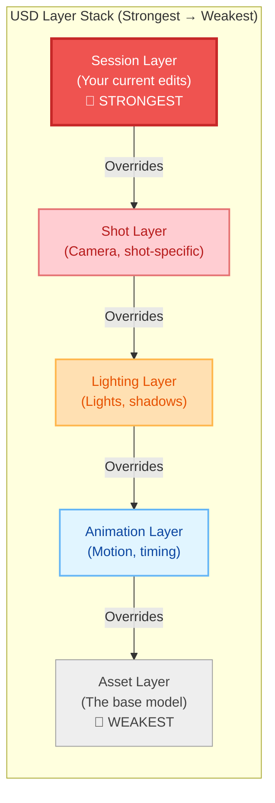

```
┌─────────────────────────────┐
│   Session Layer (your edits) │  ← Strongest (wins conflicts)
├─────────────────────────────┤
│   Shot Layer (camera angle)  │
├─────────────────────────────┤
│   Lighting Layer (lights)    │
├─────────────────────────────┤
│   Animation Layer (motion)   │
├─────────────────────────────┤
│   Asset Layer (the model)    │  ← Weakest (base data)
└─────────────────────────────┘
```

Each layer can **override** the layers below it:

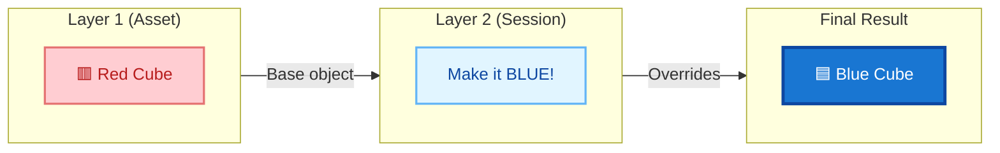

```
Layer 1: "Make the cube red"
Layer 2: "Make the cube BLUE" ← This wins!

Final result: Blue cube
```

This lets different people work on different parts without overwriting each other!

---

### USD in Practice

Here's how a studio might use USD:

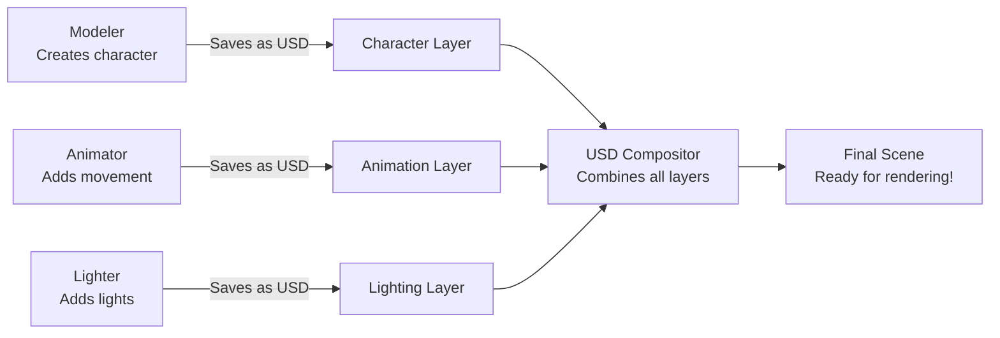

Anyone can open any layer, make changes, and save — without breaking what others have done.

---

## Part 7: Your First Concepts Dictionary

Here are the most important terms, explained simply:

### The Basics

| Term | Simple Explanation |
|------|-------------------|
| **Pixel** | One tiny colored dot on your screen. Your screen has millions of them. |
| **GPU** | "Graphics Processing Unit" — A chip in your computer that's really good at doing the same simple math millions of times at once. |
| **CPU** | "Central Processing Unit" — The main brain of your computer. Smart but can only do one thing at a time. |
| **3D Model** | A digital object made of points (vertices) connected by triangles. |
| **Vertex** | One point in 3D space, written as (X, Y, Z). |
| **Triangle** | Three vertices connected together. The building block of 3D graphics. |
| **Mesh** | A bunch of triangles connected to form a shape (like a character or building). |
| **Shader** | A tiny program that runs on the GPU to calculate pixel colors. |

### The Pipeline

| Term | Simple Explanation |
|------|-------------------|
| **Graphics Pipeline** | The assembly line that turns 3D models into 2D images. |
| **Rasterization** | Figuring out which pixels on screen each 3D triangle covers. |
| **Shading** | Calculating the final color of each pixel based on lights and materials. |
| **Frame** | One complete image. Games show 60 frames per second (fps). |
| **Framebuffer** | Memory that holds the final image before it's shown on screen. |

### APIs and Tools

| Term | Simple Explanation |
|------|-------------------|
| **API** | "Application Programming Interface" — A way for programs to talk to each other. |
| **Vulkan** | A graphics API that gives you direct control over the GPU. Hard to learn but very fast. |
| **OpenGL** | An older graphics API. Easier than Vulkan but less control. |
| **DirectX** | Microsoft's graphics API (Windows only). |
| **USD** | "Universal Scene Description" — A file format for sharing 3D scenes between tools. |

### Math You'll See

| Term | Simple Explanation |
|------|-------------------|
| **Vector** | An arrow with a direction and length. Used for positions, velocities, directions. |
| **Matrix** | A grid of numbers used to transform (move, rotate, scale) objects. |
| **Dot Product** | A math operation that tells you how much two vectors align. Used for lighting! |
| **Cross Product** | A math operation that gives you a vector perpendicular to two other vectors. Used for finding surface normals. |
| **Normal** | An arrow pointing straight out from a surface. Used to calculate how light hits it. |

---

## Part 8: Learning Path

If you're starting from zero, here's the recommended order:

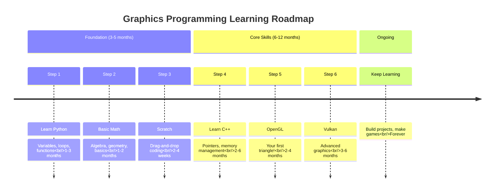

### Step 1: Learn Basic Programming (1-3 months)
- **Python** is easiest for beginners
- Learn: variables, loops, functions, basic math
- Free resource: [Python.org Tutorial](https://www.python.org/about/gettingstarted)

### Step 2: Learn Basic Math (1-2 months)
You don't need advanced math, but you should be comfortable with:
- Basic algebra (x, y variables)
- Basic geometry (triangles, angles)
- **Trigonometry helps but isn't required to start**

### Step 3: Make Something Simple (2-4 weeks)
- Try **Scratch** (drag-and-drop coding)
- Make a simple animation
- Get comfortable with "thinking like a programmer"

### Step 4: Learn C++ Gently (2-6 months)
C++ is the language of graphics programming. It's harder than Python but more powerful.
- Start with basic syntax
- Learn pointers and memory (this is crucial!)
- Free resource: [LearnCpp.com](https://www.learncpp.com)

### Step 5: Start Graphics! (Ongoing)
- Begin with **OpenGL** (easier than Vulkan)
- Follow tutorials like [LearnOpenGL.com](https://learnopengl.com)
- Make a spinning cube, then add lighting, then textures

### Step 6: Graduate to Vulkan (6-12 months)
Once you understand graphics basics, Vulkan will make much more sense.
- Follow [Vulkan Tutorial](https://vulkan-tutorial.com)
- Build your own Vulkan engine (like this USD Vulkan Engine!)

---

## Part 9: Common Questions

### Q: Do I need to be good at math?
**A:** You need basic algebra and geometry. Advanced math (calculus, linear algebra) helps but you can learn as you go.

### Q: Do I need a powerful computer?
**A:** To learn? No. Any computer with a graphics card can run simple graphics programs. You'll need a better GPU for complex scenes later.

### Q: How long until I can make a game?
**A:**
- **Simple 2D game:** 3-6 months of learning
- **Simple 3D game:** 6-12 months
- **Complex 3D game:** Years (but start simple!)

### Q: Why is graphics programming so hard?
**A:** Because you're controlling every single pixel on the screen. That's millions of calculations, 60 times per second. The complexity comes from managing all that data efficiently.

### Q: Is it worth it?
**A:** If you love seeing your creations come to life on screen — absolutely yes. There's nothing like watching something you built move and interact in real-time.

---

## Part 10: Hands-On Exercises (No Coding Required!)

These exercises help you understand graphics concepts without writing code.

### Exercise 1: Draw a 3D Cube on Paper

**Goal:** Understand how 3D objects are made from 2D shapes.

1. Draw a square
2. Draw another square slightly offset and above it
3. Connect the corners with lines
4. You now have a 3D cube!

```
    _________
   /         /|
  /_________/ |
  |         | |
  |         | |
  |_________|/
```

**Graphics insight:** Your cube is just 6 squares (faces), and each square could be 2 triangles. So a cube = 12 triangles!

---

### Exercise 2: Pixel Art Your Name

**Goal:** Understand how images are made of pixels.

1. Get graph paper (or draw a grid)
2. Make each square = 1 pixel
3. Color squares to write your name
4. Look at it from far away — it looks smooth!

**Graphics insight:** All digital images are just grids of colored squares. More squares = higher resolution.

---

### Exercise 3: Light and Shadow Experiment

**Goal:** Understand how lighting works.

1. Get a small object (apple, ball, cup)
2. Turn off room lights, use ONE flashlight
3. Shine light from the side
4. Observe:
   - Side facing light: bright
   - Side away from light: dark
   - Shadow on the table

**Graphics insight:** This is exactly what shaders calculate! For each pixel, they ask: "How much does this point face the light?"

---

### Exercise 4: Coordinate System Practice

**Goal:** Get comfortable with X, Y, Z coordinates.

Stand in the middle of a room. Define:
- **X axis**: Line from your left shoulder to right shoulder
- **Y axis**: Line from your feet to head
- **Z axis**: Line from your chest forward

Now identify coordinates:
- Your nose is at approximately (0, 5, 1) if you're 5 feet tall and 1 foot forward from center
- A door 10 feet right, 0 feet up, 5 feet forward = (10, 0, 5)
- A light on ceiling, 3 feet right, 8 feet up, 2 feet forward = (3, 8, 2)

**Graphics insight:** Every vertex in a 3D model is just (X, Y, Z) like this!

---

## Part 11: Visual Guide to a Simple Scene

Let's trace through exactly what happens when you render a simple scene: **one red cube in front of a blue background.**

```mermaid
flowchart TB
    subgraph Input["INPUT: Your Scene Data"]
        V1["Vertex 1: -1, -1, 1"]
        V2["Vertex 2: 1, -1, 1"]
        V3["Vertex 3: 1, 1, 1"]
        V4["... 6 more vertices"]
        Color["Color: 1, 0, 0 RED"]
    end

    subgraph Stage1["STAGE 1: Vertex Processing"]
        direction LR
        S1A["Where is this vertex<br/>in world space?"]
        S1B["Where is it<br/>from camera?"]
        S1C["Where on screen<br/>should it appear?"]
    end

    subgraph Stage2["STAGE 2: Triangle Assembly"]
        T1["Triangle 1:<br/>Vertices 1, 2, 3"]
        T2["Triangle 2:<br/>Vertices 2, 3, 4"]
        T3["... 10 more triangles<br/>for a cube"]
    end

    subgraph Stage3["STAGE 3: Rasterization"]
        direction LR
        R1["Which pixels does<br/>this triangle cover?"]
        R2["Pixel 100, 50: YES"]
        R3["Pixel 101, 50: YES"]
        R4["Pixel 102, 50: NO"]
    end

    subgraph Stage4["STAGE 4: Fragment Shading"]
        direction LR
        F1["Light position: 5, 5, 5"]
        F2["Surface normal: 0, 0, 1"]
        F3["Dot product: 0.7"]
        F4["Final color: 0.7, 0, 0<br/>(dimmed red)"]
    end

    subgraph Output["OUTPUT: Final Framebuffer"]
        direction LR
        P1["Pixel: 0, 0, 0 BLACK"]
        P2["Pixel: 180, 0, 0 DARK RED"]
        P3["Pixel: 255, 0, 0 BRIGHT RED"]
        P4["Pixel: 0, 0, 255 BLUE<br/>(background)"]
    end

    Input --> Stage1 --> Stage2 --> Stage3 --> Stage4 --> Output
```

### What Just Happened?

1. **Vertices** told us where the cube's corners are
2. **Triangles** connected corners into faces
3. **Rasterization** found which pixels each face covers
4. **Shading** calculated each pixel's color based on light

All 4 stages happen for every single frame, 60 times per second!

---

## Part 12: Understanding Shaders (The GPU's Little Programs)

**Shaders** are tiny programs that run on the GPU. They're where the magic happens.

### Vertex Shader: "Where Does This Point Go?"

Runs once per vertex. Its job: calculate where each vertex ends up on screen.

```glsl
// Simplified vertex shader
input vec3 position;        // The vertex's (x, y, z)
input mat4 modelViewProj;   // Camera transform matrix

void main() {
    // Move the vertex to the right place on screen
    gl_Position = modelViewProj * vec4(position, 1.0);
}
```

**Translation:** "Take this 3D position, apply the camera transforms, tell me where it should be on the 2D screen."

---

### Fragment Shader: "What Color Is This Pixel?"

Runs once per pixel (fragment). Its job: calculate the final color.

```glsl
// Simplified fragment shader
input vec3 normal;          // Which way does surface face?
input vec3 lightDir;        // Where is the light?
uniform vec3 objectColor;   // What color is the object?

void main() {
    // How much does surface face the light? (-1 to 1)
    float brightness = dot(normal, lightDir);

    // Make sure it's not negative (0 to 1)
    brightness = max(brightness, 0.0);

    // Final color = object color × brightness
    gl_FragColor = vec4(objectColor * brightness, 1.0);
}
```

**Translation:** "Calculate how much light hits this point based on which way it faces. Brighter if facing light, darker if facing away."

---

### Shader Analogy: The Paint-by-Numbers

Imagine a paint-by-numbers picture:

1. **Vertex Shader** = Draws the outline of each region
2. **Fragment Shader** = Fills in each numbered region with the right color

The GPU has thousands of "painters" working simultaneously, each filling in their own little region (pixel)!

---

## Part 13: Common Confusions Explained

### Confusion 1: "Why is Y sometimes up and sometimes down?"

Great question! Different systems use different conventions:

| System | Y Direction | Reason |
|--------|-------------|--------|
| **3D World Space** | Up (+Y) | Matches how we think about the world |
| **Math/Graphing** | Up (+Y) | Standard Cartesian coordinates |
| **Screen/Pixel Space** | Down (+Y) | Historical: CRT scans top-to-bottom |
| **Vulkan NDC** | Down (+Y) | Matches screen space (unlike OpenGL) |

**The key:** Know which coordinate system you're in and convert between them!

---

### Confusion 2: "What's the difference between a vertex and a pixel?"

- **Vertex** = A point in 3D space, defined by (X, Y, Z). There might be 8 vertices in a cube.
- **Pixel** = A dot on your 2D screen. There might be 2 million pixels on screen.

The pipeline **converts** vertices into pixels via rasterization.

---

### Confusion 3: "Why triangles? Why not squares or circles?"

Three reasons:

1. **Triangles are always flat:** Any 3 points always form a flat plane. 4 points might not!
2. **Triangles can approximate any shape:** Tiny triangles can make smooth curves
3. **Hardware is optimized for triangles:** GPUs are designed to render triangles fast

```
    *                   *---*---*---*
   / \                  \ / \ / \ /  ← Tiny triangles
  *---*         →        *---*---*
 /     \                  \ / \ / \ /
*-------*                  *---*---*
Flat!                 (Looks like a curve)
```

---

### Confusion 4: "What's the difference between Vulkan and OpenGL?"

Think of it like cars:

| Aspect | OpenGL | Vulkan |
|--------|--------|--------|
| **Driving** | Automatic | Manual |
| **Ease** | Easier to learn | Harder to learn |
| **Control** | Driver decides | You decide everything |
| **Performance** | Good | Excellent |
| **Code needed** | ~50 lines for triangle | ~1000 lines for triangle |
| **When to use** | Learning, small projects | Professional, max performance |

**Start with OpenGL to learn concepts. Graduate to Vulkan for professional work.**

---

## Part 14: The "Aha!" Moment Checklist

As you learn graphics, look for these moments when things suddenly click:

- [ ] **The Coordinate System Aha!** "Oh, (X, Y, Z) is just like finding a seat in a theater!"
- [ ] **The Triangle Aha!** "Wait, everything is just triangles? Even curved surfaces?"
- [ ] **The Rasterization Aha!** "So we're just figuring out which pixels each triangle covers?"
- [ ] **The Lighting Aha!** "Brightness depends on the angle between surface and light!"
- [ ] **The Pipeline Aha!** "It's an assembly line: vertices → triangles → pixels → colors!"
- [ ] **The GPU Aha!** "The GPU is fast because it does thousands of calculations at once!"
- [ ] **The Shader Aha!** "Shaders are just tiny programs that calculate one thing each!"

When you hit these moments, celebrate! You're understanding.

---

## Final Thoughts

Graphics programming sits at the intersection of:

- **Art** (making things look beautiful)
- **Math** (calculating positions and colors)
- **Engineering** (making it run fast)

It's challenging, but that's what makes it rewarding. Every game you play, every animated movie you watch — someone had to figure out how to make those pixels light up just right.

**You're learning how to create worlds.**

---

## Resources to Continue Learning

### Beginner-Friendly
- **[Scratchapixel](https://scratchapixel.com)** — Gentle introduction to rendering concepts
- **[LearnOpenGL.com](https://learnopengl.com)** — Start with "Getting Started" section
- **[The Cherno's YouTube](https://www.youtube.com/c/TheChernoProject)** — Game engine series

### Intermediate
- **[Vulkan Tutorial](https://vulkan-tutorial.com)** — Comprehensive Vulkan guide
- **[Ray Tracing in One Weekend](https://raytracing.github.io)** — Learn how rendering works

### USD Specific
- **[USD Core Concepts](https://openusd.org/release/intro.html)** — Official USD intro
- **[Pixar's USD Tutorials](https://graphics.pixar.com/usd/docs.html)** — From the creators

---

**Remember:** Everyone started as a beginner. The best graphics programmers you know were once confused beginners, staring at terms they didn't understand. Keep going, keep asking questions, and have fun creating!

---

*"The only way to learn a new programming language is by writing programs in it."* — Dennis Ritchie

The same applies to graphics programming: **make things. Break things. Fix them. Make more things.**

Good luck! 🎮✨
