# C++ Techniques, Design Patterns, Algorithms & Mathematics in Graphics Programming

**A Comprehensive Reference for Vulkan, USD, Unreal Engine, and Computer Graphics**

---

## Table of Contents

1. [Modern C++ Techniques](#1-modern-c-techniques)
2. [Design Patterns](#2-design-patterns)
3. [Graphics-Specific Patterns](#3-graphics-specific-patterns)
4. [Algorithms](#4-algorithms)
5. [Mathematics](#5-mathematics)
6. [Memory Management](#6-memory-management)
7. [Multi-threading & Synchronization](#7-multi-threading--synchronization)
8. [Performance Optimization](#8-performance-optimization)

---

## 1. Modern C++ Techniques

### 1.1 Move Semantics and Perfect Forwarding

```c++
// Move semantics for resource transfer
class Buffer {
    void* data = nullptr;
    size_t size = 0;

public:
    // Move constructor
    Buffer(Buffer&& other) noexcept
        : data(other.data), size(other.size) {
        other.data = nullptr;
        other.size = 0;
    }

    // Move assignment
    Buffer& operator=(Buffer&& other) noexcept {
        if (this != &other) {
            cleanup();
            data = other.data;
            size = other.size;
            other.data = nullptr;
            other.size = 0;
        }
        return *this;
    }
};

// Perfect forwarding with universal references
template<typename T>
void create_and_emplace(T&& args) {
    factory.construct(std::forward<T>(args));
}
```

### 1.2 constexpr and Compile-Time Computation

```c++
// Compile-time hash for string hashing
constexpr uint32_t hash_string(const char* str, uint32_t h = 0) {
    return (*str == 0) ? h : hash_string(str + 1, h * 31 + *str);
}

// Compile-time assert for static validation
static_assert(hash_string("Vertex") == 0x12345678, "Hash mismatch");

// Compile-time array size
template<typename T, size_t N>
constexpr size_t array_size(T(&)[N]) { return N; }
```

### 1.3 Template Metaprogramming

```c++
// Type traits for checking capabilities
template<typename T>
struct is_renderable {
    static constexpr bool value = requires(T t) {
        { t.render() } -> std::same_as<void>;
    };
};

// SFINAE for conditional compilation
template<typename T, typename = std::enable_if_t<std::is_arithmetic_v<T>>>
T normalize(T value) {
    return std::clamp(value, T(0), T(1));
}

// Template specialization for type-specific behavior
template<typename T>
struct VertexAttributeTraits;

template<>
struct VertexAttributeTraits<float> {
    static constexpr VkFormat format = VK_FORMAT_R32_SFLOAT;
    static constexpr int components = 1;
};

template<>
struct VertexAttributeTraits<glm::vec2> {
    static constexpr VkFormat format = VK_FORMAT_R32G32_SFLOAT;
    static constexpr int components = 2;
};
```

### 1.4 Concepts and Constraints (C++20)

```c++
// Concept for renderable objects
template<typename T>
concept Renderable = requires(T t) {
    { t.getVertexBuffer() } -> std::convertible_to<VkBuffer>;
    { t.getIndexBuffer() } -> std::convertible_to<VkBuffer>;
    { t.getIndexCount() } -> std::convertible_to<uint32_t>;
};

// Concept for numeric types used in graphics
template<typename T>
concept FloatingPoint = std::floating_point<T>;

// Constrained template function
template<Renderable T>
void draw_object(const T& object, VkCommandBuffer cmd) {
    VkBuffer vertexBuffers[] = { object.getVertexBuffer() };
    VkDeviceSize offsets[] = { 0 };
    vkCmdBindVertexBuffers(cmd, 0, 1, vertexBuffers, offsets);
    vkCmdBindIndexBuffer(cmd, object.getIndexBuffer(), 0, VK_INDEX_TYPE_UINT32);
    vkCmdDrawIndexed(cmd, object.getIndexCount(), 1, 0, 0, 0);
}
```

### 1.5 Coroutines (C++20)

```c++
// Asynchronous resource loading with coroutines
struct Task {
    struct promise_type {
        Task get_return_object() {
            return Task{std::coroutine_handle<promise_type>::from_promise(*this)};
        }
        std::suspend_never initial_suspend() { return {}; }
        std::suspend_never final_suspend() noexcept { return {}; }
        void return_void() {}
        void unhandled_exception() { std::terminate(); }
    };

    std::coroutine_handle<promise_type> handle;
    Task(std::coroutine_handle<promise_type> h) : handle(h) {}
    ~Task() { handle.destroy(); }
};

Task load_texture_async(std::string_view path) {
    auto data = co_await load_file(path);
    auto texture = co_await decode_texture(data);
    co_await upload_to_gpu(texture);
}
```

### 1.6 std::span and Range Views

```c++
// Non-owning view into contiguous memory
void process_vertices(std::span<const Vertex> vertices) {
    for (const auto& v : vertices) {
        // Process vertex without ownership
    }
}

// Using ranges for transformation
auto get_positions(std::span<const Vertex> vertices) {
    return vertices | std::views::transform([](const Vertex& v) {
        return v.position;
    });
}
```

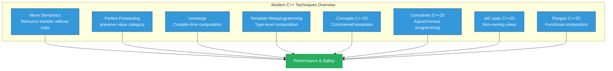

---

## 2. Design Patterns

### 2.1 Gang of Four Patterns in Graphics

#### 2.1.1 Singleton Pattern

```c++
// Vulkan instance management
class VulkanInstance {
public:
    static VulkanInstance& get() {
        static VulkanInstance instance;
        return instance;
    }

    VkInstance handle() const { return m_instance; }

private:
    VulkanInstance() { initialize(); }
    ~VulkanInstance() { cleanup(); }

    void initialize() {
        VkApplicationInfo appInfo{};
        appInfo.sType = VK_STRUCTURE_TYPE_APPLICATION_INFO;
        appInfo.pApplicationName = "Graphics App";
        appInfo.applicationVersion = VK_MAKE_VERSION(1, 0, 0);
        appInfo.pEngineName = "Custom Engine";
        appInfo.engineVersion = VK_MAKE_VERSION(1, 0, 0);
        appInfo.apiVersion = VK_API_VERSION_1_3;

        VkInstanceCreateInfo createInfo{};
        createInfo.sType = VK_STRUCTURE_TYPE_INSTANCE_CREATE_INFO;
        createInfo.pApplicationInfo = &appInfo;

        vkCreateInstance(&createInfo, nullptr, &m_instance);
    }

    VkInstance m_instance{VK_NULL_HANDLE};
};
```

#### 2.1.2 Factory Pattern

```c++
// Resource factory for creating GPU objects
class ResourceFactory {
public:
    template<typename T>
    std::unique_ptr<T> create(const typename T::CreateInfo& info) {
        auto resource = std::make_unique<T>();
        resource->create(info);
        return resource;
    }
};

// Usage
struct BufferCreateInfo {
    VkDeviceSize size;
    VkBufferUsageFlags usage;
    VmaMemoryUsage vmaUsage;
};

auto buffer = factory.create<Buffer>(BufferCreateInfo{
    .size = 1024,
    .usage = VK_BUFFER_USAGE_VERTEX_BUFFER_BIT,
    .vmaUsage = VMA_MEMORY_USAGE_CPU_TO_GPU
});
```

#### 2.1.3 Builder Pattern

```c++
// Vulkan pipeline builder
class GraphicsPipelineBuilder {
public:
    GraphicsPipelineBuilder& addShader(VkShaderModule shader, VkShaderStageFlagBits stage) {
        VkPipelineShaderStageCreateInfo shaderStageInfo{};
        shaderStageInfo.sType = VK_STRUCTURE_TYPE_PIPELINE_SHADER_STAGE_CREATE_INFO;
        shaderStageInfo.stage = stage;
        shaderStageInfo.module = shader;
        shaderStageInfo.pName = "main";
        m_shaderStages.push_back(shaderStageInfo);
        return *this;
    }

    GraphicsPipelineBuilder& setVertexFormat(VertexFormat format) {
        m_vertexFormat = format;
        return *this;
    }

    GraphicsPipelineBuilder& setRenderPass(VkRenderPass renderPass) {
        m_renderPass = renderPass;
        return *this;
    }

    VkPipeline build(VkDevice device) {
        VkGraphicsPipelineCreateInfo pipelineInfo{};
        pipelineInfo.sType = VK_STRUCTURE_TYPE_GRAPHICS_PIPELINE_CREATE_INFO;
        pipelineInfo.stageCount = static_cast<uint32_t>(m_shaderStages.size());
        pipelineInfo.pStages = m_shaderStages.data();
        // ... configure other states

        VkPipeline pipeline;
        vkCreateGraphicsPipelines(device, VK_NULL_HANDLE, 1, &pipelineInfo, nullptr, &pipeline);
        return pipeline;
    }

private:
    std::vector<VkPipelineShaderStageCreateInfo> m_shaderStages;
    VertexFormat m_vertexFormat;
    VkRenderPass m_renderPass{VK_NULL_HANDLE};
};

// Usage: Fluent interface
auto pipeline = GraphicsPipelineBuilder{}
    .addShader(vertexShader, VK_SHADER_STAGE_VERTEX_BIT)
    .addShader(fragmentShader, VK_SHADER_STAGE_FRAGMENT_BIT)
    .setVertexFormat(VertexFormat::PositionNormalTexcoord)
    .setRenderPass(renderPass)
    .build(device);
```

#### 2.1.4 Strategy Pattern

```c++
// Culling strategies
class CullingStrategy {
public:
    virtual ~CullingStrategy() = default;
    virtual bool shouldDraw(const BoundingBox& bounds, const Frustum& frustum) = 0;
};

class FrustumCulling : public CullingStrategy {
public:
    bool shouldDraw(const BoundingBox& bounds, const Frustum& frustum) override {
        return frustum.intersects(bounds);
    }
};

class DistanceCulling : public CullingStrategy {
public:
    bool shouldDraw(const BoundingBox& bounds, const Frustum& frustum) override {
        float distance = glm::length(bounds.center - cameraPosition);
        return distance < maxDistance;
    }

private:
    glm::vec3 cameraPosition;
    float maxDistance;
};

class OcclusionCulling : public CullingStrategy {
public:
    bool shouldDraw(const BoundingBox& bounds, const Frustum& frustum) override {
        return !isOccluded(bounds);
    }
};
```

#### 2.1.5 Observer Pattern

```c++
// Event system for graphics debugging
class EventDispatcher {
public:
    template<typename EventType>
    void addListener(std::function<void(const EventType&)> listener) {
        auto& listeners = std::any_cast<Listeners<EventType>&>(m_listeners[typeid(EventType)]);
        listeners.push_back(listener);
    }

    template<typename EventType>
    void dispatch(const EventType& event) {
        auto it = m_listeners.find(typeid(EventType));
        if (it != m_listeners.end()) {
            for (auto& listener : std::any_cast<Listeners<EventType>&>(it->second)) {
                listener(event);
            }
        }
    }

private:
    template<typename T>
    using Listeners = std::vector<std::function<void(const T&)>>;
    std::unordered_map<std::type_index, std::any> m_listeners;
};

// Usage
dispatcher.addListener<FrameCompleteEvent>([](const FrameCompleteEvent& e) {
    update_performance_stats(e.frameTime);
});
```

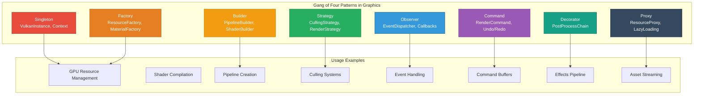

### 2.2 Vulkan-Specific Patterns

#### 2.2.1 RAII for Vulkan Objects

```c++
template<typename T, typename Deleter>
class VulkanHandle {
public:
    VulkanHandle() = default;
    VulkanHandle(T handle, Deleter deleter) : m_handle(handle), m_deleter(deleter) {}

    ~VulkanHandle() {
        if (m_handle != VK_NULL_HANDLE) {
            m_deleter(m_handle);
        }
    }

    // Move-only
    VulkanHandle(const VulkanHandle&) = delete;
    VulkanHandle& operator=(const VulkanHandle&) = delete;
    VulkanHandle(VulkanHandle&& other) noexcept : m_handle(other.m_handle) {
        other.m_handle = VK_NULL_HANDLE;
    }
    VulkanHandle& operator=(VulkanHandle&& other) noexcept {
        if (this != &other) {
            cleanup();
            m_handle = other.m_handle;
            other.m_handle = VK_NULL_HANDLE;
        }
        return *this;
    }

    T get() const { return m_handle; }
    T* operator&() { return &m_handle; }
    operator T() const { return m_handle; }

private:
    void cleanup() {
        if (m_handle != VK_NULL_HANDLE) {
            m_deleter(m_handle);
            m_handle = VK_NULL_HANDLE;
        }
    }

    T m_handle{VK_NULL_HANDLE};
    Deleter m_deleter;
};

// Usage
using UniqueBuffer = VulkanHandle<VkBuffer, std::function<void(VkBuffer)>>;

UniqueBuffer create_buffer(VkDevice device, VkDeviceSize size) {
    VkBuffer buffer;
    VkBufferCreateInfo createInfo{...};
    vkCreateBuffer(device, &createInfo, nullptr, &buffer);

    return UniqueBuffer(buffer, [device](VkBuffer b) {
        vkDestroyBuffer(device, b, nullptr);
    });
}
```

#### 2.2.2 Command Buffer Recording Pattern

```c++
// Command buffer object model
class CommandBuffer {
public:
    CommandBuffer(VkDevice device, VkCommandPool pool)
        : m_device(device), m_pool(pool) {
        VkCommandBufferAllocateInfo allocInfo{};
        allocInfo.sType = VK_STRUCTURE_TYPE_COMMAND_BUFFER_ALLOCATE_INFO;
        allocInfo.commandPool = pool;
        allocInfo.level = VK_COMMAND_BUFFER_LEVEL_PRIMARY;
        allocInfo.commandBufferCount = 1;

        vkAllocateCommandBuffers(device, &allocInfo, &m_buffer);
    }

    ~CommandBuffer() {
        vkFreeCommandBuffers(m_device, m_pool, 1, &m_buffer);
    }

    void begin(VkCommandBufferUsageFlags flags = 0) {
        VkCommandBufferBeginInfo beginInfo{};
        beginInfo.sType = VK_STRUCTURE_TYPE_COMMAND_BUFFER_BEGIN_INFO;
        beginInfo.flags = flags;
        vkBeginCommandBuffer(m_buffer, &beginInfo);
    }

    void end() {
        vkEndCommandBuffer(m_buffer);
    }

    // Rendering commands
    void beginRenderPass(VkRenderPass renderPass, VkFramebuffer framebuffer, const VkRect2D& renderArea) {
        VkRenderPassBeginInfo beginInfo{};
        beginInfo.sType = VK_STRUCTURE_TYPE_RENDER_PASS_BEGIN_INFO;
        beginInfo.renderPass = renderPass;
        beginInfo.framebuffer = framebuffer;
        beginInfo.renderArea = renderArea;
        vkCmdBeginRenderPass(m_buffer, &beginInfo, VK_SUBPASS_CONTENTS_INLINE);
    }

    void bindPipeline(VkPipeline pipeline) {
        vkCmdBindPipeline(m_buffer, VK_PIPELINE_BIND_POINT_GRAPHICS, pipeline);
    }

    void draw(uint32_t vertexCount, uint32_t instanceCount, uint32_t firstVertex, uint32_t firstInstance) {
        vkCmdDraw(m_buffer, vertexCount, instanceCount, firstVertex, firstInstance);
    }

    operator VkCommandBuffer() const { return m_buffer; }

private:
    VkDevice m_device;
    VkCommandPool m_pool;
    VkCommandBuffer m_buffer{VK_NULL_HANDLE};
};
```

#### 2.2.3 Descriptor Set Layout Caching

```c++
// Hash-based descriptor set layout cache
class DescriptorLayoutCache {
public:
    VkDescriptorSetLayout createLayout(VkDevice device, const std::vector<VkDescriptorSetLayoutBinding>& bindings) {
        DescriptorLayoutInfo info;
        info.bindings = bindings;

        // Sort bindings for consistent hashing
        std::sort(info.bindings.begin(), info.bindings.end(),
            [](const VkDescriptorSetLayoutBinding& a, const VkDescriptorSetLayoutBinding& b) {
                return a.binding < b.binding;
            });

        // Calculate hash
        size_t hash = 0;
        for (const auto& binding : bindings) {
            hash_combine(hash, binding.binding, binding.descriptorType, binding.descriptorCount, binding.stageFlags);
        }
        info.hash = hash;

        // Check cache
        auto it = m_layouts.find(info);
        if (it != m_layouts.end()) {
            return it->second;
        }

        // Create new layout
        VkDescriptorSetLayoutCreateInfo createInfo{};
        createInfo.sType = VK_STRUCTURE_TYPE_DESCRIPTOR_SET_LAYOUT_CREATE_INFO;
        createInfo.bindingCount = static_cast<uint32_t>(bindings.size());
        createInfo.pBindings = bindings.data();

        VkDescriptorSetLayout layout;
        vkCreateDescriptorSetLayout(device, &createInfo, nullptr, &layout);

        m_layouts[info] = layout;
        return layout;
    }

private:
    struct DescriptorLayoutInfo {
        std::vector<VkDescriptorSetLayoutBinding> bindings;
        size_t hash;

        bool operator==(const DescriptorLayoutInfo& other) const {
            return hash == other.hash && bindings == other.bindings;
        }
    };

    struct DescriptorLayoutInfoHash {
        size_t operator()(const DescriptorLayoutInfo& info) const {
            return info.hash;
        }
    };

    std::unordered_map<DescriptorLayoutInfo, VkDescriptorSetLayout, DescriptorLayoutInfoHash> m_layouts;
};
```

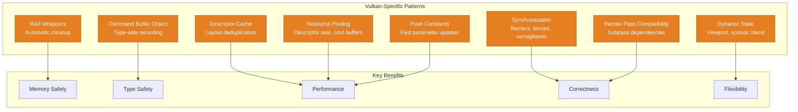

### 2.3 USD (Universal Scene Description) Patterns

#### 2.3.1 Composition Pattern (Layering)

```c++
// USD layer composition system
class UsdStage {
public:
    static UsdStage Open(const std::string& filePath) {
        return UsdStage(UsdStage::Open(filePath));
    }

    // Layer composition: Stronger opinions override weaker ones
    void sublayerPaths(const std::vector<std::string>& paths) {
        for (const auto& path : paths) {
            m_sublayers.push_back(UsdStage::Open(path));
        }
    }

    // Layer strength determines composition order
    SdfLayerHandle getLayerAtPath(const std::string& path) {
        // Search from strongest to weakest
        for (auto it = m_sublayers.rbegin(); it != m_sublayers.rend(); ++it) {
            if (auto prim = it->GetPrimAtPath(path)) {
                return *it;
            }
        }
        return m_rootLayer;
    }

private:
    SdfLayerHandle m_rootLayer;
    std::vector<SdfLayerHandle> m_sublayers;
};
```

#### 2.3.2 Prim Hierarchy Pattern

```c++
// USD prim traversal and composition
class UsdPrim {
public:
    UsdPrim getParent() const {
        return UsdPrim(m_stage->GetPrimAtPath(m_path.GetParentPath()));
    }

    std::vector<UsdPrim> getChildren() const {
        std::vector<UsdPrim> children;
        for (const auto& child : m_stage->GetPrimsAtRoot()) {
            if (child.GetPath().GetParentPath() == m_path) {
                children.push_back(UsdPrim(child));
            }
        }
        return children;
    }

    template<typename T>
    T getAttribute(const std::string& attrName) const {
        UsdAttribute attr = m_prim.GetAttribute(TfToken(attrName));
        T value;
        attr.Get(&value);
        return value;
    }

    SdfPath m_path;
    UsdStageWeakPtr m_stage;
    pxr::UsdPrim m_prim;
};
```

#### 2.3.3 Value Resolution Pattern (Composition Arcs)

```c++
// Value resolution with opinion strength
class ValueResolver {
public:
    template<typename T>
    std::optional<T> resolveValue(const UsdPrim& prim, const std::string& attrName) {
        std::vector<ValueOpinion> opinions = collectOpinions(prim, attrName);

        // Sort by strength (weakest to strongest)
        std::sort(opinions.begin(), opinions.end(),
            [](const ValueOpinion& a, const ValueOpinion& b) {
                return a.strength < b.strength;
            });

        // Apply opinions from weakest to strongest
        T value;
        for (const auto& opinion : opinions) {
            if (opinion.value.has_value()) {
                value = *opinion.value;
            }
            if (opinion.isBlocked) {
                return std::nullopt;
            }
        }

        return value;
    }

private:
    struct ValueOpinion {
        std::optional<T> value;
        int strength;  // Lower = weaker
        bool isBlocked = false;
    };

    std::vector<ValueOpinion> collectOpinions(const UsdPrim& prim, const std::string& attrName);
};
```

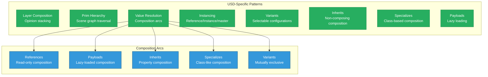

### 2.4 Unreal Engine Patterns

#### 2.4.1 Reflection System

```c++
// Unreal-style reflection with macros
UCLASS(BlueprintType, Category = "Rendering")
class URenderComponent : public UActorComponent {
    GENERATED_BODY()

public:
    // Editable property
    UPROPERTY(EditAnywhere, BlueprintReadWrite, Category = "Material")
    UMaterialInterface* BaseMaterial;

    // Replicated property
    UPROPERTY(Replicated, VisibleAnywhere)
    float Health;

    // Function callable from Blueprints
    UFUNCTION(BlueprintCallable, Category = "Rendering")
    void SetMaterialParameter(FName ParameterName, float Value);

    // Override with Blueprint event
    UFUNCTION(BlueprintImplementableEvent)
    void OnRenderComplete();

    virtual void GetLifetimeReplicatedProps(TArray<FLifetimeProperty>& OutLifetimeProps) const override {
        Super::GetLifetimeReplicatedProps(OutLifetimeProps);
        DOREPLIFETIME(URenderComponent, Health);
    }
};
```

#### 2.4.2 Garbage Collection System

```c++
// Unreal smart pointer types
class AMyActor : public AActor {
    UPROPERTY()
    UMyComponent* MyComponent;  // Garbage collected pointer

    TSharedPtr<FMyData> SharedData;  // Shared reference (not GC)
    TWeakPtr<FMyData> WeakData;      // Weak reference (not GC)
    TUniquePtr<FMyData> UniqueData;  // Unique pointer (not GC)
};

// Safe weak object pointer
class UMyObject : public UObject {
    TWeakObjectPtr<AActor> WeakActor;

    void UseActor() {
        if (AActor* actor = WeakActor.Get()) {
            // Safe to use
            actor->Destroy();
        }
    }
};
```

#### 2.4.3 Delegates and Event System

```c++
// Unreal delegate system
class UMyWidget : public UUserWidget {
    // Declare delegate
    DECLARE_DYNAMIC_MULTICAST_DELEGATE_TwoParams(FOnHealthChanged, float, NewHealth, float, OldHealth);

public:
    // Broadcast delegate
    UPROPERTY(BlueprintAssignable, Category = "Events")
    FOnHealthChanged OnHealthChanged;

    void SetHealth(float NewHealth) {
        float OldHealth = Health;
        Health = NewHealth;
        OnHealthChanged.Broadcast(NewHealth, OldHealth);
    }

private:
    UPROPERTY()
    float Health;
};

// Lambda binding
auto delegate = OnHealthChanged.AddLambda([](float New, float Old) {
    UE_LOG(LogTemp, Log, TEXT("Health changed from %f to %f"), Old, New);
});
```

#### 2.4.4 Component Architecture

```c++
// Component-based actor pattern
UCLASS()
class AVehicle : public APawn {
    GENERATED_BODY()

public:
    AVehicle() {
        // Create components
        MeshComponent = CreateDefaultSubobject<UStaticMeshComponent>(TEXT("Mesh"));
        MovementComponent = CreateDefaultSubobject<UVehicleMovementComponent>(TEXT("Movement"));
        HealthComponent = CreateDefaultSubobject<UHealthComponent>(TEXT("Health"));

        // Attach hierarchy
        RootComponent = MeshComponent;
    }

    // Component accessors
    UStaticMeshComponent* GetMesh() const { return MeshComponent; }
    UVehicleMovementComponent* GetMovement() const { return MovementComponent; }

protected:
    UPROPERTY(VisibleAnywhere)
    UStaticMeshComponent* MeshComponent;

    UPROPERTY(VisibleAnywhere)
    UVehicleMovementComponent* MovementComponent;

    UPROPERTY(VisibleAnywhere)
    UHealthComponent* HealthComponent;
};
```

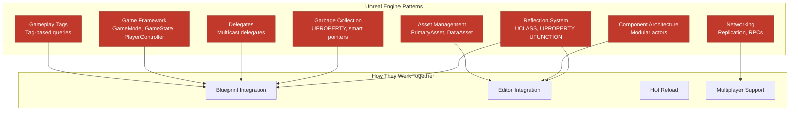

---

## 3. Graphics-Specific Patterns

### 3.1 Render Graph Architecture

```c++
// Modern render graph for dependency tracking
class RenderGraph {
public:
    struct Pass {
        std::string name;
        std::function<void(CommandBuffer&)> execute;
        std::vector<ResourceHandle> reads;
        std::vector<ResourceHandle> writes;
        std::vector<ResourceHandle> creates;
        std::vector<ResourceHandle> destroys;
    };

    ResourceHandle createTexture(const TextureDesc& desc) {
        ResourceHandle handle = m_nextHandle++;
        m_textures[handle] = desc;
        return handle;
    }

    void addPass(std::string_view name, std::function<void(PassBuilder&)> setup) {
        Pass pass;
        pass.name = std::string(name);
        PassBuilder builder(pass, m_resources);
        setup(builder);
        m_passes.push_back(std::move(pass));
    }

    void compile() {
        // Build dependency graph
        for (size_t i = 0; i < m_passes.size(); ++i) {
            for (auto read : m_passes[i].reads) {
                for (size_t j = 0; j < i; ++j) {
                    if (contains(m_passes[j].writes, read)) {
                        m_dependencies.emplace_back(j, i);
                    }
                }
            }
        }
    }

    void execute(CommandBuffer& cmd) {
        for (const auto& pass : m_passes) {
            cmd.beginDebugLabel(pass.name);
            pass.execute(cmd);
            cmd.endDebugLabel();
        }
    }

private:
    std::vector<Pass> m_passes;
    std::vector<std::pair<size_t, size_t>> m_dependencies;
    std::unordered_map<ResourceHandle, TextureDesc> m_textures;
    uint32_t m_nextHandle = 0;
};
```

### 3.2 Double/Triple Buffering

```c++
// Frame buffering for avoiding stalls
class FrameContext {
public:
    static constexpr uint32_t FRAME_LATENCY = 2;

    FrameContext(VkDevice device) : m_device(device), m_currentFrame(0) {
        for (auto& ctx : m_frames) {
            // Create per-frame resources
            ctx.commandBuffer = allocateCommandBuffer();
            ctx.fence = createFence();
            ctx.semaphore = createSemaphore();
        }
    }

    FrameData& beginFrame() {
        // Wait for previous frame to complete
        FrameData& frame = m_frames[m_currentFrame];
        waitForFence(frame.fence);

        resetFence(frame.fence);
        frame.commandBuffer.reset();

        return frame;
    }

    void endFrame(VkQueue queue) {
        FrameData& frame = m_frames[m_currentFrame];
        submit(queue, frame.commandBuffer, frame.fence, frame.semaphore);
        m_currentFrame = (m_currentFrame + 1) % FRAME_LATENCY;
    }

    VkCommandBuffer getCurrentCommandBuffer() const {
        return m_frames[m_currentFrame].commandBuffer;
    }

private:
    struct FrameData {
        VkCommandBuffer commandBuffer{VK_NULL_HANDLE};
        VkFence fence{VK_NULL_HANDLE};
        VkSemaphore semaphore{VK_NULL_HANDLE};
    };

    VkDevice m_device;
    std::array<FrameData, FRAME_LATENCY> m_frames;
    uint32_t m_currentFrame;
};
```

### 3.3 Resource Caching and Pooling

```c++
// Descriptor set pool with automatic growth
class DescriptorSetPool {
public:
    DescriptorSetPool(VkDevice device, VkDescriptorPoolSize poolSize, uint32_t maxSets)
        : m_device(device), m_poolSize(poolSize) {

        VkDescriptorPoolCreateInfo createInfo{};
        createInfo.sType = VK_STRUCTURE_TYPE_DESCRIPTOR_POOL_CREATE_INFO;
        createInfo.flags = VK_DESCRIPTOR_POOL_CREATE_FREE_DESCRIPTOR_SET_BIT;
        createInfo.maxSets = maxSets;
        createInfo.poolSizeCount = 1;
        createInfo.pPoolSizes = &poolSize;

        vkCreateDescriptorPool(device, &createInfo, nullptr, &m_pool);
    }

    VkDescriptorSet allocate(VkDescriptorSetLayout layout) {
        VkDescriptorSetAllocateInfo allocInfo{};
        allocInfo.sType = VK_STRUCTURE_TYPE_DESCRIPTOR_SET_ALLOCATE_INFO;
        allocInfo.descriptorPool = m_pool;
        allocInfo.descriptorSetCount = 1;
        allocInfo.pSetLayouts = &layout;

        VkDescriptorSet set;
        VkResult result = vkAllocateDescriptorSets(m_device, &allocInfo, &set);

        if (result == VK_ERROR_OUT_OF_POOL_MEMORY) {
            // Grow pool
            grow();
            return allocate(layout);
        }

        return set;
    }

    void deallocate(VkDescriptorSet set) {
        vkFreeDescriptorSets(m_device, m_pool, 1, &set);
    }

    ~DescriptorSetPool() {
        vkDestroyDescriptorPool(m_device, m_pool, nullptr);
    }

private:
    void grow() {
        // Create new pool with double capacity
        VkDescriptorPool newPool;
        VkDescriptorPoolCreateInfo createInfo{};
        createInfo.sType = VK_STRUCTURE_TYPE_DESCRIPTOR_POOL_CREATE_INFO;
        createInfo.maxSets = m_maxSets * 2;
        createInfo.poolSizeCount = 1;
        createInfo.pPoolSizes = &m_poolSize;

        vkCreateDescriptorPool(m_device, &createInfo, nullptr, &newPool);
        // Transfer and destroy old pool...
        m_pool = newPool;
        m_maxSets *= 2;
    }

    VkDevice m_device;
    VkDescriptorPool m_pool{VK_NULL_HANDLE};
    VkDescriptorPoolSize m_poolSize;
    uint32_t m_maxSets;
};
```

### 3.4 Upload Buffer Ring

```c++
// Dynamic uniform/staging buffer ring
class RingBuffer {
public:
    RingBuffer(VkDevice device, VmaAllocator allocator, VkDeviceSize size, VkBufferUsageFlags usage)
        : m_device(device), m_allocator(allocator), m_size(size), m_head(0) {

        VkBufferCreateInfo bufferInfo{...};
        VmaAllocationCreateInfo allocInfo{...};
        vmaCreateBuffer(allocator, &bufferInfo, &allocInfo, &m_buffer, &m_allocation, nullptr);
    }

    struct Allocation {
        VkBuffer buffer;
        VkDeviceSize offset;
        void* mappedData;
        VkDeviceSize size;
    };

    std::optional<Allocation> allocate(VkDeviceSize size, VkDeviceSize alignment) {
        VkDeviceSize alignedHead = align(m_head, alignment);

        // Check if we need to wrap around
        if (alignedHead + size > m_size) {
            alignedHead = 0;
            // Wait for GPU to finish using old data
            if (alignedHead + size > m_tail) {
                return std::nullopt;  // Ring full, wait or resize
            }
        }

        // Check for collision with tail
        if (alignedHead + size > m_tail) {
            return std::nullopt;
        }

        Allocation alloc;
        alloc.buffer = m_buffer;
        alloc.offset = alignedHead;
        alloc.size = size;
        alloc.mappedData = static_cast<uint8_t*>(m_mappedData) + alignedHead;

        m_head = alignedHead + size;
        return alloc;
    }

    void advanceFrame() {
        m_tail = m_head;  // Advance tail for next frame
    }

private:
    VkDevice m_device;
    VmaAllocator m_allocator;
    VkBuffer m_buffer{VK_NULL_HANDLE};
    VmaAllocation m_allocation{VK_NULL_HANDLE};
    void* m_mappedData{nullptr};
    VkDeviceSize m_size;
    VkDeviceSize m_head{0};
    VkDeviceSize m_tail{0};
};
```

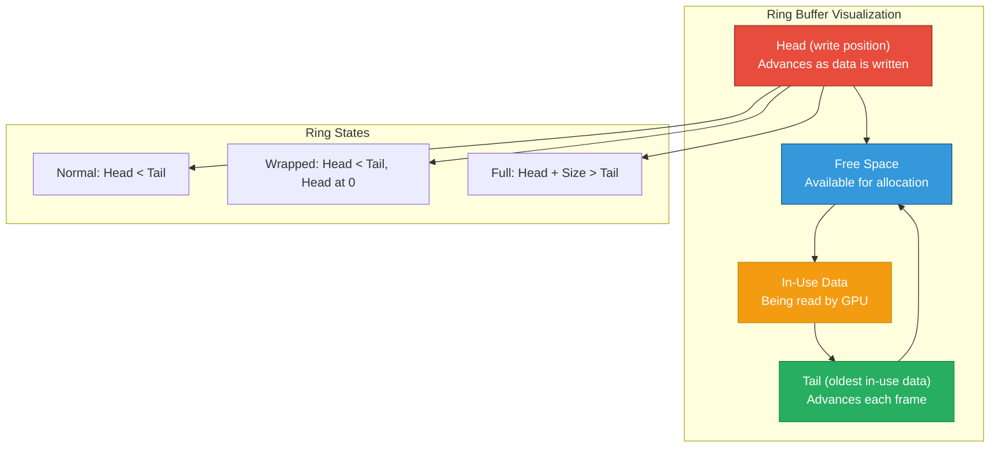

---

## 4. Algorithms

### 4.1 Geometry Processing

#### 4.1.1 Bounding Volume Hierarchy (BVH)

```c++
// BVH for ray tracing acceleration
struct BVHNode {
    glm::vec3 minBounds;
    glm::vec3 maxBounds;
    uint32_t leftChild;
    uint32_t rightChild;
    uint32_t firstPrimitive;
    uint32_t primitiveCount;
};

class BVHBuilder {
public:
    std::vector<BVHNode> build(const std::vector<Triangle>& primitives) {
        m_primitives = primitives;
        m_nodes.reserve(primitives.size() * 2);

        uint32_t root = buildRecursive(0, static_cast<uint32_t>(primitives.size()));
        return m_nodes;
    }

private:
    uint32_t buildRecursive(uint32_t start, uint32_t count) {
        uint32_t nodeIndex = static_cast<uint32_t>(m_nodes.size());
        m_nodes.push_back({});

        BVHNode& node = m_nodes[nodeIndex];
        computeBounds(start, count, node.minBounds, node.maxBounds);

        if (count <= LEAF_SIZE) {
            node.firstPrimitive = start;
            node.primitiveCount = count;
            return nodeIndex;
        }

        // Find best split axis and position
        int axis = findBestSplitAxis(start, count);
        uint32_t splitPos = findBestSplitPosition(start, count, axis);

        if (splitPos == start || splitPos == start + count) {
            // Couldn't find good split, make leaf
            node.firstPrimitive = start;
            node.primitiveCount = count;
            return nodeIndex;
        }

        // Partition and recurse
        uint32_t leftChild = buildRecursive(start, splitPos - start);
        uint32_t rightChild = buildRecursive(splitPos, count - (splitPos - start));

        node.leftChild = leftChild;
        node.rightChild = rightChild;
        return nodeIndex;
    }

    int findBestSplitAxis(uint32_t start, uint32_t count) {
        glm::vec3 extent = m_nodes.back().maxBounds - m_nodes.back().minBounds;
        if (extent.x > extent.y && extent.x > extent.z) return 0;
        if (extent.y > extent.z) return 1;
        return 2;
    }

    uint32_t findBestSplitPosition(uint32_t start, uint32_t count, int axis) {
        // Sort primitives by centroid on chosen axis
        std::sort(m_primitives.begin() + start, m_primitives.begin() + start + count,
            [axis](const Triangle& a, const Triangle& b) {
                return a.centroid[axis] < b.centroid[axis];
            });

        // Use SAH (Surface Area Heuristic) to find best split
        float bestCost = std::numeric_limits<float>::max();
        uint32_t bestSplit = start;

        for (uint32_t i = start + 1; i < start + count - 1; ++i) {
            float cost = evaluateSAH(start, i, start + count);
            if (cost < bestCost) {
                bestCost = cost;
                bestSplit = i;
            }
        }

        return bestSplit;
    }

    float evaluateSAH(uint32_t start, uint32_t split, uint32_t end) {
        // Calculate cost of splitting at 'split'
        glm::vec3 leftMin, leftMax, rightMin, rightMax;
        computeBounds(start, split - start, leftMin, leftMax);
        computeBounds(split, end - split, rightMin, rightMax);

        float leftArea = surfaceArea(leftMin, leftMax);
        float rightArea = surfaceArea(rightMin, rightMax);
        float parentArea = surfaceArea(m_nodes.back().minBounds, m_nodes.back().maxBounds);

        float traversalCost = 1.0f;
        float intersectionCost = 2.0f;

        return traversalCost + intersectionCost *
            ((split - start) * leftArea + (end - split) * rightArea) / parentArea;
    }

    std::vector<Triangle> m_primitives;
    std::vector<BVHNode> m_nodes;
    static constexpr uint32_t LEAF_SIZE = 4;
};
```

#### 4.1.2 Mesh Simplification (Edge Collapse)

```c++
// Quadric error metrics for mesh simplification
struct Edge {
    uint32_t v0, v1;
    glm::vec3 target;
    float error;
};

class MeshSimplifier {
public:
    Mesh simplify(const Mesh& input, float targetReduction) {
        Mesh result = input;
        size_t targetTriangles = static_cast<size_t>(input.triangles.size() * (1.0f - targetReduction));

        // Initialize quadrics for each vertex
        computeQuadrics(result);

        // Initialize priority queue
        std::priority_queue<Edge, std::vector<Edge>, std::greater<Edge>> edgeQueue;
        initializeEdges(result, edgeQueue);

        while (result.triangles.size() > targetTriangles && !edgeQueue.empty()) {
            Edge edge = edgeQueue.top();
            edgeQueue.pop();

            if (edge.error > m_maxError) break;

            collapseEdge(result, edge, edgeQueue);
        }

        return result;
    }

private:
    using Quadric = glm::mat4;

    void computeQuadrics(Mesh& mesh) {
        m_vertexQuadrics.clear();
        m_vertexQuadrics.resize(mesh.vertices.size());

        for (const auto& triangle : mesh.triangles) {
            Quadric quadric = computeTriangleQuadric(
                mesh.vertices[triangle.v0],
                mesh.vertices[triangle.v1],
                mesh.vertices[triangle.v2]
            );

            m_vertexQuadrics[triangle.v0] += quadric;
            m_vertexQuadrics[triangle.v1] += quadric;
            m_vertexQuadrics[triangle.v2] += quadric;
        }
    }

    Quadric computeTriangleQuadric(const glm::vec3& v0, const glm::vec3& v1, const glm::vec3& v2) {
        // Compute plane equation: ax + by + cz + d = 0
        glm::vec3 normal = glm::normalize(glm::cross(v1 - v0, v2 - v0));
        float d = -glm::dot(normal, v0);

        // Quadric matrix Q = [a², ab, ac, ad]
        //                      [ab, b², bc, bd]
        //                      [ac, bc, c², cd]
        //                      [ad, bd, cd, d²]
        glm::vec4 plane(normal, d);
        Quadric q;
        for (int i = 0; i < 4; ++i) {
            for (int j = 0; j < 4; ++j) {
                q[i][j] = plane[i] * plane[j];
            }
        }
        return q;
    }

    float evaluateError(const glm::vec3& point, const Quadric& q) {
        glm::vec4 p(point, 1.0f);
        return glm::dot(p, q * p);
    }

    std::vector<Quadric> m_vertexQuadrics;
    float m_maxError = 1e-3f;
};
```

### 4.2 Spatial Data Structures

#### 4.2.1 Octree

```c++
// Octree for spatial partitioning
class Octree {
public:
    static constexpr int MAX_DEPTH = 8;
    static constexpr int MAX_OBJECTS = 16;

    Octree(const glm::vec3& min, const glm::vec3& max, int depth = 0)
        : m_min(min), m_max(max), m_depth(depth) {}

    void insert(uint32_t objectId, const BoundingBox& box) {
        if (!isLeaf()) {
            // Insert into appropriate children
            for (auto& child : m_children) {
                if (child.intersects(box)) {
                    child.insert(objectId, box);
                }
            }
            return;
        }

        m_objects.push_back({objectId, box});

        // Split if necessary
        if (m_objects.size() > MAX_OBJECTS && m_depth < MAX_DEPTH) {
            split();
        }
    }

    void query(const Frustum& frustum, std::vector<uint32_t>& results) const {
        if (!frustum.intersects(m_min, m_max)) {
            return;
        }

        if (isLeaf()) {
            for (const auto& obj : m_objects) {
                if (frustum.intersects(obj.box)) {
                    results.push_back(obj.id);
                }
            }
        } else {
            for (const auto& child : m_children) {
                child.query(frustum, results);
            }
        }
    }

private:
    bool isLeaf() const { return m_children.empty(); }

    bool intersects(const BoundingBox& box) const {
        return !(m_max.x < box.min.x || m_min.x > box.max.x ||
                 m_max.y < box.min.y || m_min.y > box.max.y ||
                 m_max.z < box.min.z || m_min.z > box.max.z);
    }

    void split() {
        glm::vec3 center = (m_min + m_max) * 0.5f;

        m_children.reserve(8);
        for (int i = 0; i < 8; ++i) {
            glm::vec3 childMin = m_min;
            glm::vec3 childMax = center;

            if (i & 1) childMin.x = center.x;
            else childMax.x = center.x;

            if (i & 2) childMin.y = center.y;
            else childMax.y = center.y;

            if (i & 4) childMin.z = center.z;
            else childMax.z = center.z;

            m_children.emplace_back(childMin, childMax, m_depth + 1);

            // Reinsert objects into children
            for (const auto& obj : m_objects) {
                if (m_children.back().intersects(obj.box)) {
                    m_children.back().insert(obj.id, obj.box);
                }
            }
        }

        m_objects.clear();
    }

    glm::vec3 m_min, m_max;
    int m_depth;
    std::vector<Octree> m_children;

    struct Object {
        uint32_t id;
        BoundingBox box;
    };
    std::vector<Object> m_objects;
};
```

#### 4.2.2 Spatial Hash Grid

```c++
// Uniform grid for collision detection
class SpatialHash {
public:
    SpatialHash(float cellSize) : m_cellSize(cellSize) {}

    void insert(uint32_t id, const glm::vec3& position) {
        glm::ivec3 cell = toCell(position);
        size_t hash = hashCell(cell);
        m_cells[hash].push_back({id, position});
    }

    std::vector<uint32_t> query(const glm::vec3& position, float radius) const {
        std::vector<uint32_t> results;

        glm::ivec3 minCell = toCell(position - radius);
        glm::ivec3 maxCell = toCell(position + radius);

        for (int z = minCell.z; z <= maxCell.z; ++z) {
            for (int y = minCell.y; y <= maxCell.y; ++y) {
                for (int x = minCell.x; x <= maxCell.x; ++x) {
                    size_t hash = hashCell({x, y, z});
                    auto it = m_cells.find(hash);
                    if (it != m_cells.end()) {
                        for (const auto& entry : it->second) {
                            float dist = glm::length(entry.position - position);
                            if (dist <= radius) {
                                results.push_back(entry.id);
                            }
                        }
                    }
                }
            }
        }

        return results;
    }

    void clear() { m_cells.clear(); }

private:
    glm::ivec3 toCell(const glm::vec3& pos) const {
        return glm::ivec3(glm::floor(pos / m_cellSize));
    }

    size_t hashCell(const glm::ivec3& cell) const {
        // Large prime numbers for better distribution
        const size_t p1 = 73856093;
        const size_t p2 = 19349663;
        const size_t p3 = 83492791;
        return static_cast<size_t>(cell.x) * p1 ^
               static_cast<size_t>(cell.y) * p2 ^
               static_cast<size_t>(cell.z) * p3;
    }

    float m_cellSize;
    struct Entry {
        uint32_t id;
        glm::vec3 position;
    };
    std::unordered_map<size_t, std::vector<Entry>> m_cells;
};
```

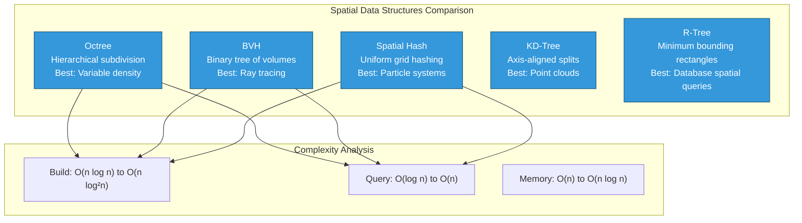

### 4.3 Graphics Algorithms

#### 4.3.1 Frustum Culling

```c++
// Plane-based frustum culling
class Frustum {
public:
    enum Plane { Left, Right, Top, Bottom, Near, Far, Count };

    void extractFromMatrix(const glm::mat4& viewProj) {
        // Extract left plane
        m_planes[Left] = glm::vec4(
            viewProj[0][3] + viewProj[0][0],
            viewProj[1][3] + viewProj[1][0],
            viewProj[2][3] + viewProj[2][0],
            viewProj[3][3] + viewProj[3][0]
        );

        // Extract right plane
        m_planes[Right] = glm::vec4(
            viewProj[0][3] - viewProj[0][0],
            viewProj[1][3] - viewProj[1][0],
            viewProj[2][3] - viewProj[2][0],
            viewProj[3][3] - viewProj[3][0]
        );

        // Extract top plane
        m_planes[Top] = glm::vec4(
            viewProj[0][3] - viewProj[0][1],
            viewProj[1][3] - viewProj[1][1],
            viewProj[2][3] - viewProj[2][1],
            viewProj[3][3] - viewProj[3][1]
        );

        // Extract bottom plane
        m_planes[Bottom] = glm::vec4(
            viewProj[0][3] + viewProj[0][1],
            viewProj[1][3] + viewProj[1][1],
            viewProj[2][3] + viewProj[2][1],
            viewProj[3][3] + viewProj[3][1]
        );

        // Extract near plane
        m_planes[Near] = glm::vec4(
            viewProj[0][3] + viewProj[0][2],
            viewProj[1][3] + viewProj[1][2],
            viewProj[2][3] + viewProj[2][2],
            viewProj[3][3] + viewProj[3][2]
        );

        // Extract far plane
        m_planes[Far] = glm::vec4(
            viewProj[0][3] - viewProj[0][2],
            viewProj[1][3] - viewProj[1][2],
            viewProj[2][3] - viewProj[2][2],
            viewProj[3][3] - viewProj[3][2]
        );

        // Normalize planes
        for (int i = 0; i < Count; ++i) {
            float len = glm::length(glm::vec3(m_planes[i]));
            m_planes[i] /= len;
        }
    }

    enum TestResult { Outside, Inside, Intersecting };

    TestResult testBoundingBox(const BoundingBox& box) const {
        bool intersecting = false;

        for (int i = 0; i < Count; ++i) {
            // Find positive and negative far corners
            glm::vec3 normal = glm::vec3(m_planes[i]);
            glm::vec3 positive = box.min;
            glm::vec3 negative = box.max;

            if (normal.x >= 0) { positive.x = box.max.x; negative.x = box.min.x; }
            if (normal.y >= 0) { positive.y = box.max.y; negative.y = box.min.y; }
            if (normal.z >= 0) { positive.z = box.max.z; negative.z = box.min.z; }

            // Test positive corner
            float posDist = glm::dot(normal, positive) + m_planes[i].w;
            if (posDist < 0) return Outside;  // Entirely outside

            // Test negative corner
            float negDist = glm::dot(normal, negative) + m_planes[i].w;
            if (negDist < 0) intersecting = true;  // Partially inside
        }

        return intersecting ? Intersecting : Inside;
    }

private:
    std::array<glm::vec4, Count> m_planes;
};
```

#### 4.3.2 Occlusion Culling

```c++
// Hierarchical Z-buffer occlusion culling
class HZBOcclusionCuller {
public:
    struct HZBBuffer {
        VkImage image;
        VkImageView view;
        VkDeviceMemory memory;
        VkExtent2D size;
    };

    void buildHZB(VkCommandBuffer cmd, const VkExtent2D& targetSize) {
        // Downsample depth buffer to create Hi-Z pyramid
        uint32_t mipLevels = static_cast<uint32_t>(std::floor(std::log2(std::max(targetSize.width, targetSize.height)))) + 1;

        for (uint32_t mip = 1; mip < mipLevels; ++mip) {
            // Compute maximum depth in 2x2 region
            VkImageBlit blit{};
            blit.srcSubresource = {VK_IMAGE_ASPECT_DEPTH_BIT, mip - 1, 0, 1};
            blit.dstSubresource = {VK_IMAGE_ASPECT_DEPTH_BIT, mip, 0, 1};
            // Configure blit regions...

            vkCmdBlitImage(cmd, m_hzb.image, VK_IMAGE_LAYOUT_TRANSFER_SRC_OPTIMAL,
                           m_hzb.image, VK_IMAGE_LAYOUT_TRANSFER_DST_OPTIMAL,
                           1, &blit, VK_FILTER_MAX);
        }
    }

    bool isVisible(const BoundingBox& bounds, const glm::mat4& mvp) const {
        // Project bounding box to screen space
        glm::vec3 screenMin = std::numeric_limits<float>::max();
        glm::vec3 screenMax = std::numeric_limits<float>::lowest();

        for (const auto& corner : bounds.getCorners()) {
            glm::vec4 clipSpace = mvp * glm::vec4(corner, 1.0f);
            glm::vec3 ndc = clipSpace.xyz / clipSpace.w;

            screenMin = glm::min(screenMin, ndc);
            screenMax = glm::max(screenMax, ndc);
        }

        // Convert to UV coordinates
        glm::vec2 uvMin = (glm::vec2(screenMin) * 0.5f + 0.5f);
        glm::vec2 uvMax = (glm::vec2(screenMax) * 0.5f + 0.5f);

        // Query HZB at appropriate mip level
        uint32_t mipLevel = selectMipLevel(uvMin, uvMax);
        float depthMin = sampleHZB(uvMin, uvMax, mipLevel);

        return depthMin <= screenMin.z;  // Visible if closer than stored depth
    }

private:
    HZBBuffer m_hzb;
    VkSampler m_sampler;

    uint32_t selectMipLevel(const glm::vec2& uvMin, const glm::vec2& uvMax) const {
        glm::vec2 size = glm::abs(uvMax - uvMin) * glm::vec2(m_hzb.size);
        uint32_t level = static_cast<uint32_t>(std::ceil(std::log2(std::max(size.x, size.y))));
        return std::min(level, m_hzb.maxMipLevel);
    }
};
```

---

## 5. Mathematics for Computer Graphics

This section covers the essential mathematics used in real-time rendering, ray tracing, and computer graphics applications. Each topic includes mathematical formulas, explanations, and C++ implementations.

### 5.1 Linear Algebra

Linear algebra is the mathematical foundation of computer graphics, used to represent and manipulate 3D geometry, transformations, and lighting calculations.

#### 5.1.1 Vector Operations

**Dot Product**

The dot product (scalar product) of two vectors measures their similarity and is fundamental for lighting calculations:

$$
\vec{a} \cdot \vec{b} = |\vec{a}| |\vec{b}| \cos\theta = \sum_{i=1}^{n} a_i b_i
$$

For unit vectors, the dot product equals the cosine of the angle between them, which is used in the Lambertian lighting model:

```c++
template<int N>
float dot(const glm::vec<N>& a, const glm::vec<N>& b) {
    float result = 0.0f;
    for (int i = 0; i < N; ++i) {
        result += a[i] * b[i];
    }
    return result;
}
```

**Cross Product**

The cross product produces a vector perpendicular to two input vectors, essential for computing surface normals and coordinate bases:

$$
\vec{a} \times \vec{b} = \begin{bmatrix}
a_y b_z - a_z b_y \\
a_z b_x - a_x b_z \\
a_x b_y - a_y b_x
\end{bmatrix}
$$

The magnitude of the cross product equals the area of the parallelogram formed by the two vectors.

```c++
inline glm::vec3 cross(const glm::vec3& a, const glm::vec3& b) {
    return glm::vec3(
        a.y * b.z - a.z * b.y,
        a.z * b.x - a.x * b.z,
        a.x * b.y - a.y * b.x
    );
}
```

**Vector Reflection**

Reflection is used for mirror-like surfaces and environment mapping:

$$
\vec{r} = \vec{i} - 2(\vec{n} \cdot \vec{i})\vec{n}
$$

Where $\vec{i}$ is the incident vector, $\vec{n}$ is the surface normal, and $\vec{r}$ is the reflected vector.

```c++
inline glm::vec3 reflect(const glm::vec3& I, const glm::vec3& N) {
    return I - 2.0f * glm::dot(I, N) * N;
}
```

**Vector Refraction (Snell's Law)**

Refraction describes how light bends when passing through different media:

$$
\eta_1 \sin\theta_1 = \eta_2 \sin\theta_2
$$

The transmitted vector is computed as:

$$
\vec{t} = \eta \vec{i} + \left(\eta \cos\theta_i - \sqrt{1 - \eta^2(1 - \cos^2\theta_i)}\right)\vec{n}
$$

where $\eta = \eta_1/\eta_2$ is the ratio of indices of refraction.

```c++
inline glm::vec3 refract(const glm::vec3& I, const glm::vec3& N, float eta) {
    float cosI = -glm::dot(I, N);
    float sinT2 = eta * eta * (1.0f - cosI * cosI);

    if (sinT2 > 1.0f) return glm::vec3(0);  // Total internal reflection

    float cosT = std::sqrt(1.0f - sinT2);
    return eta * I + (eta * cosI - cosT) * N;
}
```

#### 5.1.2 Matrix Operations and Transformations

**4×4 Homogeneous Coordinates**

Points and directions are represented in homogeneous coordinates to unify transformations:

$$
\vec{p}_{homogeneous} = \begin{bmatrix} x \\ y \\ z \\ 1 \end{bmatrix}, \quad
\vec{d}_{homogeneous} = \begin{bmatrix} dx \\ dy \\ dz \\ 0 \end{bmatrix}
$$

The $w=0$ for directions ensures they are unaffected by translation.

**Translation Matrix**

$$
T(t_x, t_y, t_z) = \begin{bmatrix}
1 & 0 & 0 & t_x \\
0 & 1 & 0 & t_y \\
0 & 0 & 1 & t_z \\
0 & 0 & 0 & 1
\end{bmatrix}
$$

**Scale Matrix**

$$
S(s_x, s_y, s_z) = \begin{bmatrix}
s_x & 0 & 0 & 0 \\
0 & s_y & 0 & 0 \\
0 & 0 & s_z & 0 \\
0 & 0 & 0 & 1
\end{bmatrix}
$$

**Rotation Matrices**

Rotation about X-axis (pitch):

$$
R_x(\theta) = \begin{bmatrix}
1 & 0 & 0 & 0 \\
0 & \cos\theta & -\sin\theta & 0 \\
0 & \sin\theta & \cos\theta & 0 \\
0 & 0 & 0 & 1
\end{bmatrix}
$$

Rotation about Y-axis (yaw):

$$
R_y(\theta) = \begin{bmatrix}
\cos\theta & 0 & \sin\theta & 0 \\
0 & 1 & 0 & 0 \\
-\sin\theta & 0 & \cos\theta & 0 \\
0 & 0 & 0 & 1
\end{bmatrix}
$$

Rotation about Z-axis (roll):

$$
R_z(\theta) = \begin{bmatrix}
\cos\theta & -\sin\theta & 0 & 0 \\
\sin\theta & \cos\theta & 0 & 0 \\
0 & 0 & 1 & 0 \\
0 & 0 & 0 & 1
\end{bmatrix}
$$

**TRS Composition**

Combined transform: $M = T \times R \times S$

```c++
inline glm::mat4 compose(const TRS& trs) {
    glm::mat4 m = glm::mat4(1.0f);
    m = glm::translate(m, trs.translation);
    m = m * glm::mat4_cast(trs.rotation);
    m = glm::scale(m, trs.scale);
    return m;
}
```

#### 5.1.3 Projection Matrices

**Perspective Projection**

Maps 3D points to 2D screen space with perspective foreshortening:

$$
P_{persp} = \begin{bmatrix}
\frac{1}{a \tan(\frac{fov}{2})} & 0 & 0 & 0 \\
0 & \frac{1}{\tan(\frac{fov}{2})} & 0 & 0 \\
0 & 0 & -\frac{f+n}{f-n} & -1 \\
0 & 0 & -\frac{2fn}{f-n} & 0
\end{bmatrix}
$$

where $a$ is the aspect ratio, $fov$ is the vertical field of view, $n$ is the near plane distance, and $f$ is the far plane distance.

```c++
inline glm::mat4 perspective(float fov, float aspect, float near, float far) {
    float tanHalfFov = std::tan(fov * 0.5f);
    glm::mat4 result(0.0f);
    result[0][0] = 1.0f / (aspect * tanHalfFov);
    result[1][1] = 1.0f / tanHalfFov;
    result[2][2] = -(far + near) / (far - near);
    result[2][3] = -1.0f;
    result[3][2] = -(2.0f * far * near) / (far - near);
    return result;
}
```

**Orthographic Projection**

Parallel projection without perspective foreshortening:

$$
P_{ortho} = \begin{bmatrix}
\frac{2}{r-l} & 0 & 0 & -\frac{r+l}{r-l} \\
0 & \frac{2}{t-b} & 0 & -\frac{t+b}{t-b} \\
0 & 0 & -\frac{2}{f-n} & -\frac{f+n}{f-n} \\
0 & 0 & 0 & 1
\end{bmatrix}
$$

**Infinite Far Plane**

For better z-precision, set far plane to infinity:

$$
P_{\infty} = \begin{bmatrix}
\frac{1}{a \tan(\frac{fov}{2})} & 0 & 0 & 0 \\
0 & \frac{1}{\tan(\frac{fov}{2})} & 0 & 0 \\
0 & 0 & -1 & -1 \\
0 & 0 & -2n & 0
\end{bmatrix}
$$

#### 5.1.4 View Matrix

The view matrix transforms world-space to camera-space:

$$
V = \begin{bmatrix}
r_x & r_y & r_z & -\vec{r} \cdot \vec{e} \\
u_x & u_y & u_z & -\vec{u} \cdot \vec{e} \\
-f_x & -f_y & -f_z & \vec{f} \cdot \vec{e} \\
0 & 0 & 0 & 1
\end{bmatrix}
$$

where $\vec{f} = \text{normalize}(\vec{t} - \vec{e})$ is the forward vector, $\vec{r} = \text{normalize}(\vec{f} \times \vec{up})$ is the right vector, and $\vec{u} = \vec{r} \times \vec{f}$ is the up vector.


```c++
inline glm::mat4 lookAt(const glm::vec3& eye, const glm::vec3& target, const glm::vec3& up) {
    glm::vec3 forward = glm::normalize(target - eye);
    glm::vec3 right = glm::normalize(glm::cross(forward, up));
    glm::vec3 newUp = glm::cross(right, forward);

    glm::mat4 result(1.0f);
    result[0][0] = right.x;
    result[1][0] = right.y;
    result[2][0] = right.z;
    result[0][1] = newUp.x;
    result[1][1] = newUp.y;
    result[2][1] = newUp.z;
    result[0][2] = -forward.x;
    result[1][2] = -forward.y;
    result[2][2] = -forward.z;
    result[3][0] = -glm::dot(right, eye);
    result[3][1] = -glm::dot(newUp, eye);
    result[3][2] = glm::dot(forward, eye);

    return result;
}
```

---

### 5.2 Quaternions

Quaternions extend complex numbers to 4D and provide an efficient way to represent rotations without gimbal lock.

#### 5.2.1 Quaternion Fundamentals

A quaternion is defined as:

$$
q = w + xi + yj + zk = [w, \vec{v}]
$$

where $w$ is the scalar part and $\vec{v} = (x, y, z)$ is the vector part. For a rotation by angle $\theta$ about unit axis $\vec{u}$:

$$
q = \begin{bmatrix} \cos\frac{\theta}{2} \\ \vec{u}\sin\frac{\theta}{2} \end{bmatrix}
$$

**Quaternion Multiplication**

$$
q_1 \otimes q_2 = [w_1 w_2 - \vec{v}_1 \cdot \vec{v}_2, \quad w_1\vec{v}_2 + w_2\vec{v}_1 + \vec{v}_1 \times \vec{v}_2]
$$

**Quaternion Conjugate and Inverse**

$$
q^* = [w, -\vec{v}], \quad q^{-1} = \frac{q^*}{|q|^2}
$$

For unit quaternions representing rotations, $q^{-1} = q^*$.

**Rotating a Vector**

To rotate vector $\vec{p}$ by quaternion $q$:

$$
\vec{p}' = q \vec{p} q^{-1} = q [0, \vec{p}] q^*
$$

#### 5.2.2 Spherical Linear Interpolation (SLERP)

SLERP interpolates between two quaternions along the shortest arc on the 4D unit sphere:

$$
\text{slerp}(q_0, q_1, t) = \frac{\sin((1-t)\Omega)}{\sin\Omega}q_0 + \frac{\sin(t\Omega)}{\sin\Omega}q_1
$$

where $\cos\Omega = q_0 \cdot q_1$.

```c++
inline glm::quat slerp(const glm::quat& a, const glm::quat& b, float t) {
    glm::quat q = b;
    float cosTheta = glm::dot(a, b);

    // Use shortest path
    if (cosTheta < 0.0f) {
        q = -b;
        cosTheta = -cosTheta;
    }

    // Linear interpolation for very close angles
    if (cosTheta > 0.9995f) {
        return glm::normalize(glm::mix(a, q, t));
    }

    float angle = std::acos(cosTheta);
    float sinTheta = std::sin(angle);

    float factorA = std::sin((1.0f - t) * angle) / sinTheta;
    float factorB = std::sin(t * angle) / sinTheta;

    return factorA * a + factorB * q;
}
```

#### 5.2.3 Spherical Cubic Interpolation (SQUAD)

SQUAD provides smooth interpolation through four quaternions:

$$
\text{squad}(q_0, q_1, q_2, q_3, t) = \text{slerp}(\text{slerp}(q_0, q_3, t), \text{slerp}(q_1, q_2, t), 2t(1-t))
$$

#### 5.2.4 Euler Angles to Quaternion

Convert from Euler angles (pitch $\phi$, yaw $\theta$, roll $\psi$):

$$
\begin{aligned}
q_w &= \cos\frac{\phi}{2}\cos\frac{\theta}{2}\cos\frac{\psi}{2} + \sin\frac{\phi}{2}\sin\frac{\theta}{2}\sin\frac{\psi}{2} \\
q_x &= \sin\frac{\phi}{2}\cos\frac{\theta}{2}\cos\frac{\psi}{2} - \cos\frac{\phi}{2}\sin\frac{\theta}{2}\sin\frac{\psi}{2} \\
q_y &= \cos\frac{\phi}{2}\sin\frac{\theta}{2}\cos\frac{\psi}{2} + \sin\frac{\phi}{2}\cos\frac{\theta}{2}\sin\frac{\psi}{2} \\
q_z &= \cos\frac{\phi}{2}\cos\frac{\theta}{2}\sin\frac{\psi}{2} - \sin\frac{\phi}{2}\sin\frac{\theta}{2}\cos\frac{\psi}{2}
\end{aligned}
$$

---

### 5.3 Orbit Camera Mathematics

The orbit camera is a fundamental interaction tool in 3D applications, allowing users to rotate around a focal point. This section explains the mathematical foundation of orbit camera controls.

#### 5.3.1 Spherical Coordinate System

The orbit camera represents its position using spherical coordinates relative to a target point. In spherical coordinates, a point in 3D space is described by three values:

$$
\vec{p} = (\rho, \phi, \theta)
$$

Where:
- $\rho$ (rho) is the **radius** - distance from the target point
- $\phi$ (phi) is the **azimuth angle** - horizontal rotation around the Y-axis (yaw)
- $\theta$ (theta) is the **elevation angle** - vertical angle from the horizontal plane (pitch)

$$
\phi \in [-\pi, \pi], \quad \theta \in [-\frac{\pi}{2}, \frac{\pi}{2}], \quad \rho > 0
$$

**Visual Representation:**

```
        Y (up)
        ↑
        |   /elevation (θ)
        |  /
        | /
        |/
        +--------→ X (azimuth φ rotates around Y)
       /
      /
    ↓ Z
```

#### 5.3.2 Spherical to Cartesian Conversion

To compute the camera's world position from spherical coordinates, we use the following transformation:

$$
\begin{aligned}
x &= x_{target} + \rho \sin\phi \cos\theta \\
y &= y_{target} + \rho \sin\theta \\
z &= z_{target} + \rho \cos\phi \cos\theta
\end{aligned}
$$

In vector form with target $\vec{t} = (t_x, t_y, t_z)$:

$$
\vec{p}_{camera} = \vec{t} + \rho \begin{bmatrix}
\sin\phi \cos\theta \\[2pt]
\sin\theta \\[2pt]
\cos\phi \cos\theta
\end{bmatrix}
$$

**Derivation:** Starting from the physics convention where $\theta$ is the polar angle from the Y-axis and $\phi$ is the azimuthal angle in the XZ plane, we rotate to match the graphics convention with elevation limited to $\pm 90°$.

```c++
void Camera::updatePosition() {
    // Convert spherical coordinates to Cartesian
    m_position.x = m_target.x + m_radius * std::sin(m_azimuth) * std::cos(m_elevation);
    m_position.y = m_target.y + m_radius * std::sin(m_elevation);
    m_position.z = m_target.z + m_radius * std::cos(m_azimuth) * std::cos(m_elevation);
}
```

#### 5.3.3 Cartesian to Spherical Conversion

When setting the camera position directly in Cartesian coordinates, we must convert back to spherical coordinates:

$$
\begin{aligned}
\rho &= \|\vec{p} - \vec{t}\| = \sqrt{(x-t_x)^2 + (y-t_y)^2 + (z-t_z)^2} \\[6pt]
\phi &= \operatorname{atan2}(x - t_x, z - t_z) \\[6pt]
\theta &= \arcsin\left(\frac{y - t_y}{\rho}\right)
\end{aligned}
$$

The $\operatorname{atan2}(x, z)$ function (note the argument order: x first, z second) returns the angle in the XZ plane, correctly handling all quadrants.

```c++
void Camera::setPosition(const glm::vec3& pos) {
    m_position = pos;
    // Update spherical coordinates from position
    glm::vec3 offset = m_position - m_target;
    m_radius = glm::length(offset);
    if (m_radius > 0.001f) {
        m_azimuth = std::atan2(offset.x, offset.z);
        m_elevation = std::asin(glm::clamp(offset.y / m_radius, -1.0f, 1.0f));
    }
}
```

#### 5.3.4 Orbit Operation

The orbit operation modifies the azimuth and elevation angles based on mouse movement:

$$
\begin{aligned}
\phi_{new} &= \phi_{old} + \Delta\phi \cdot s_{orbit} \\
\theta_{new} &= \operatorname{clamp}(\theta_{old} + \Delta\theta \cdot s_{orbit}, -\frac{\pi}{2}+\epsilon, \frac{\pi}{2}-\epsilon)
\end{aligned}
$$

where $s_{orbit}$ is the orbit sensitivity and $\epsilon$ is a small epsilon value to prevent gimbal lock at the poles.

**Gimbal Lock Prevention:** When elevation approaches $\pm 90°$, the azimuth becomes undefined. We clamp elevation to avoid this:

```c++
void Camera::setElevation(float elevation) {
    // Clamp elevation to avoid gimbal lock at poles
    const float epsilon = 0.01f;
    m_elevation = glm::clamp(elevation,
        -glm::half_pi<float>() + epsilon,
        glm::half_pi<float>() - epsilon);
    updatePosition();
}
```

#### 5.3.5 Zoom Operation

Zoom is implemented by scaling the radius:

$$
\rho_{new} = \rho_{old} \cdot (1 - \Delta)
$$

where $\Delta$ is the zoom delta (typically from mouse wheel). Negative delta zooms in (decreases radius), positive zooms out.

```c++
void Camera::zoom(float delta) {
    setRadius(m_radius * (1.0f - delta));
}
```

#### 5.3.6 Pan Operation

Panning moves the target point in screen-space directions. We need to construct the camera's local basis vectors:

**Forward Vector:**
$$
\vec{f} = \frac{\vec{t} - \vec{p}}{\|\vec{t} - \vec{p}\|}
$$

**Right Vector:**
$$
\vec{r} = \frac{\vec{f} \times \vec{up}_{world}}{\|\vec{f} \times \vec{up}_{world}\|}
$$

The pan operation updates the target:

$$
\vec{t}_{new} = \vec{t}_{old} + s_{pan} \cdot \rho \cdot (-\Delta_x \cdot \vec{r} + \Delta_y \cdot \vec{up}_{world})
$$

Note: Panning is typically scaled by radius to maintain consistent screen-space movement regardless of distance.

```c++
void Camera::pan(float deltaX, float deltaY) {
    glm::vec3 camRight = right();  // Computed from cross(forward, up)
    glm::vec3 camUp = m_up;         // Use global up for panning

    float panScale = m_radius * 0.002f;  // Scale by radius
    m_target += camRight * (-deltaX * panScale);
    m_target += camUp * (deltaY * panScale);
    updatePosition();
}
```

#### 5.3.7 View Matrix

The view matrix transforms world-space coordinates to camera-space (view-space). For a camera at position $\vec{e}$ (eye) looking at target $\vec{t}$ with up direction $\vec{u}$:

$$
V = \begin{bmatrix}
r_x & r_y & r_z & -\vec{r} \cdot \vec{e} \\
u_x & u_y & u_z & -\vec{u} \cdot \vec{e} \\
-f_x & -f_y & -f_z & \vec{f} \cdot \vec{e} \\
0 & 0 & 0 & 1
\end{bmatrix}
$$

where the camera basis vectors are:

$$
\begin{aligned}
\vec{f} &= \text{normalize}(\vec{t} - \vec{e}) \\
\vec{r} &= \text{normalize}(\vec{f} \times \vec{u}_{world}) \\
\vec{u} &= \vec{r} \times \vec{f}
\end{aligned}
$$

```c++
glm::mat4 Camera::getViewMatrix() const {
    return glm::lookAt(m_position, m_target, m_up);
}
```

#### 5.3.8 Projection Matrix

The perspective projection matrix completes the MVP (Model-View-Projection) transform:

$$
P = \begin{bmatrix}
\frac{1}{a \tan(\frac{fov}{2})} & 0 & 0 & 0 \\
0 & \frac{1}{\tan(\frac{fov}{2})} & 0 & 0 \\
0 & 0 & -\frac{f+n}{f-n} & -1 \\
0 & 0 & -\frac{2fn}{f-n} & 0
\end{bmatrix}
$$

where $a = \frac{width}{height}$ is the aspect ratio.

```c++
glm::mat4 Camera::getProjectionMatrix(float aspect, float fov) const {
    return glm::perspective(glm::radians(fov), aspect, 0.1f, 1000.0f);
}
```

#### 5.3.9 Complete MVP Transform

The final transform applied to vertex positions is:

$$
\vec{p}_{clip} = P \cdot V \cdot M \cdot \vec{p}_{model}
$$

where $M$ is the model transform, $V$ is the view matrix, and $P$ is the projection matrix.

---

### 5.4 Radiometry and Photometry

Radiometry and photometry describe the measurement of electromagnetic radiation, essential for physically-based rendering.

#### 5.4.1 Radiometric Quantities

**Radiant Flux (Power)**

$$
\Phi = \frac{dQ}{dt}
$$

Measured in watts (W), represents the total energy per unit time.

**Irradiance**

$$
E = \frac{d\Phi}{dA}
$$

Measured in watts per square meter (W/m²), represents flux per unit area incident on a surface.

**Radiance**

$$
L = \frac{d^2\Phi}{dA \cos\theta \, d\omega}
$$

Measured in watts per square meter per steradian (W/(m²·sr)), represents flux per unit projected area per unit solid angle.

Radiance is the fundamental quantity in rendering because it remains constant along rays in vacuum.

$$
L(\vec{p}, \vec{\omega}) = L(\vec{p} + t\vec{\omega}, \vec{\omega}) \quad \text{for } t \ge 0
$$

#### 5.4.2 Photometric Quantities

Photometric quantities are radiometric quantities weighted by the luminous efficiency function $V(\lambda)$, which models human perception.

**Luminous Flux**

$$
\Phi_v = 683 \frac{\text{lm}}{\text{W}} \int_{380\text{nm}}^{780\text{nm}} \Phi_e(\lambda) V(\lambda) \, d\lambda
$$

Measured in lumens (lm).

**Luminance**

$$
L_v = 683 \frac{\text{cd}}{\text{W}} \int L_e(\lambda) V(\lambda) \, d\lambda
$$

Measured in candelas per square meter (cd/m²) or nits.

---

### 5.5 The Rendering Equation

The rendering equation, introduced by James Kajiya in 1986, is the fundamental equation describing light transport in rendering.

#### 5.5.1 Integral Form

$$
L_o(\vec{p}, \vec{\omega}_o) = L_e(\vec{p}, \vec{\omega}_o) + \int_{\Omega^+} L_i(\vec{p}, \vec{\omega}_i) f_r(\vec{p}, \vec{\omega}_i, \vec{\omega}_o) (\vec{n} \cdot \vec{\omega}_i) \, d\vec{\omega}_i
$$

Where:
- $L_o$ is the outgoing radiance
- $L_e$ is the emitted radiance (light sources)
- $L_i$ is the incoming radiance from direction $\vec{\omega}_i$
- $f_r$ is the BRDF (Bidirectional Reflectance Distribution Function)
- $\vec{n}$ is the surface normal
- $\Omega^+$ is the hemisphere above the surface
- $(\vec{n} \cdot \vec{\omega}_i)$ is the cosine term (Lambert's law)

#### 5.5.2 Hemispherical Integral

The integral is over the hemisphere of incoming directions:

$$
\int_{\Omega^+} f(\vec{\omega}) \, d\vec{\omega} = \int_0^{2\pi} \int_0^{\pi/2} f(\theta, \phi) \sin\theta \, d\theta \, d\phi
$$

The $\sin\theta$ term is the Jacobian for spherical coordinates.

---

### 5.6 BRDF and PBR Mathematics

#### 5.6.1 BRDF Definition

The Bidirectional Reflectance Distribution Function:

$$
f_r(\vec{\omega}_i, \vec{\omega}_o) = \frac{dL_o(\vec{\omega}_o)}{dE_i(\vec{\omega}_i)} = \frac{dL_o(\vec{\omega}_o)}{L_i(\vec{\omega}_i) (\vec{n} \cdot \vec{\omega}_i) \, d\vec{\omega}_i}
$$

Physical constraints:
1. **Non-negativity:** $f_r \ge 0$
2. **Reciprocity (Helmholtz):** $f_r(\vec{\omega}_i, \vec{\omega}_o) = f_r(\vec{\omega}_o, \vec{\omega}_i)$
3. **Energy conservation:** $\forall \vec{\omega}_o: \int_{\Omega^+} f_r(\vec{\omega}_i, \vec{\omega}_o) (\vec{n} \cdot \vec{\omega}_i) \, d\vec{\omega}_i \le 1$

#### 5.6.2 Lambertian (Diffuse) BRDF

$$
f_{lambert} = \frac{\rho}{\pi}
$$

where $\rho$ is the albedo (reflectance).

#### 5.6.3 Cook-Torrance BRDF

The microfacet model for glossy/specular surfaces:

$$
f_{Cook-Torrance}(\vec{\omega}_i, \vec{\omega}_o) = \frac{F(\vec{\omega}_i, \vec{h}) \, D(\vec{h}) \, G(\vec{\omega}_i, \vec{\omega}_o)}{4 (\vec{n} \cdot \vec{\omega}_i) (\vec{n} \cdot \vec{\omega}_o)}
$$

where $\vec{h} = \text{normalize}(\vec{\omega}_i + \vec{\omega}_o)$ is the halfway vector.

**Fresnel Term (Schlick Approximation)**

$$
F(\vec{\omega}_i, \vec{h}) = F_0 + (1 - F_0)(1 - (\vec{\omega}_i \cdot \vec{h}))^5
$$

where $F_0$ is the reflectance at normal incidence.

**GGX/Trowbridge-Reitz Distribution**

$$
D(\vec{h}) = \frac{\alpha^2}{\pi ((\vec{n} \cdot \vec{h})^2 (\alpha^2 - 1) + 1)^2}
$$

where $\alpha$ is the roughness parameter ($\alpha = \text{roughness}^2$).

**Smith Geometry Function**

$$
G(\vec{\omega}_i, \vec{\omega}_o) = G_1(\vec{\omega}_i) \cdot G_1(\vec{\omega}_o)
$$

$$
G_1(\vec{\omega}) = \frac{\vec{n} \cdot \vec{\omega}}{(\vec{n} \cdot \vec{\omega})(1 - k) + k}
$$

where $k = \frac{\alpha}{2}$ for direct lighting.

#### 5.6.4 Disney Principled BRDF

$$
f_{Disney} = \frac{1}{\pi} (1 - F_{sheen}) f_{lambert} + f_{specular}
$$

with subsurface, sheen, clearcoat, and anisotropic extensions.

---

### 5.7 Monte Carlo Integration

#### 5.7.1 Estimator

Monte Carlo integration approximates integrals using random sampling:

$$
\int_{\Omega} f(x) \, dx \approx \frac{1}{N} \sum_{i=1}^{N} \frac{f(x_i)}{p(x_i)}
$$

where $x_i \sim p(x)$ and $p(x)$ is the probability density function (PDF).

#### 5.7.2 Importance Sampling

To reduce variance, sample according to the PDF of the integrand:

$$
\int f(x) \, dx = \int \frac{f(x)}{p(x)} p(x) \, dx \approx \frac{1}{N} \sum_{i=1}^{N} \frac{f(x_i)}{p(x_i)}
$$

For GGX distribution, the PDF is:

$$
p_{GGX}(\vec{h}) = \frac{D(\vec{h}) (\vec{n} \cdot \vec{h})}{4 |\vec{\omega}_o \cdot \vec{h}|}
$$

---

### 5.8 Curves and Surfaces

#### 5.8.1 Bézier Curves

**Linear Bézier (degree 1):**

$$
\mathbf{B}(t) = (1-t)\mathbf{P}_0 + t\mathbf{P}_1
$$

**Quadratic Bézier (degree 2):**

$$
\mathbf{B}(t) = (1-t)^2\mathbf{P}_0 + 2(1-t)t\mathbf{P}_1 + t^2\mathbf{P}_2
$$

**Cubic Bézier (degree 3):**

$$
\mathbf{B}(t) = (1-t)^3\mathbf{P}_0 + 3(1-t)^2t\mathbf{P}_1 + 3(1-t)t^2\mathbf{P}_2 + t^3\mathbf{P}_3
$$

**General Bézier (degree n):**

$$
\mathbf{B}(t) = \sum_{i=0}^{n} \binom{n}{i} (1-t)^{n-i} t^i \mathbf{P}_i
$$

where $\binom{n}{i}$ are binomial coefficients (Bernstein polynomials).

#### 5.8.2 B-Splines

B-Spline basis functions are defined recursively:

$$
N_{i,0}(t) = \begin{cases}
1 & \text{if } t_i \le t < t_{i+1} \\
0 & \text{otherwise}
\end{cases}
$$

$$
N_{i,k}(t) = \frac{t - t_i}{t_{i+k} - t_i} N_{i,k-1}(t) + \frac{t_{i+k+1} - t}{t_{i+k+1} - t_{i+1}} N_{i+1,k-1}(t)
$$

The B-spline curve:

$$
\mathbf{C}(t) = \sum_{i=0}^{n} N_{i,k}(t) \mathbf{P}_i
$$

#### 5.8.3 Catmull-Rom Splines

Interpolating spline passing through control points:

$$
\mathbf{P}(t) = \frac{1}{2} \begin{bmatrix}
1 & t & t^2 & t^3
\end{bmatrix}
\begin{bmatrix}
0 & 2 & 0 & 0 \\
-1 & 0 & 1 & 0 \\
2 & -5 & 4 & -1 \\
-1 & 3 & -3 & 1
\end{bmatrix}
\begin{bmatrix}
\mathbf{P}_{i-1} \\
\mathbf{P}_i \\
\mathbf{P}_{i+1} \\
\mathbf{P}_{i+2}
\end{bmatrix}
$$

---

### 5.9 Intersection Mathematics

#### 5.9.1 Ray-Sphere Intersection

Ray: $\mathbf{R}(t) = \mathbf{O} + t\mathbf{D}$

Sphere: $|\mathbf{x} - \mathbf{C}|^2 = r^2$

Substitute ray into sphere equation:

$$
|\mathbf{O} + t\mathbf{D} - \mathbf{C}|^2 = r^2
$$

Let $\mathbf{L} = \mathbf{O} - \mathbf{C}$:

$$
(\mathbf{L} + t\mathbf{D}) \cdot (\mathbf{L} + t\mathbf{D}) = r^2
$$

$$
t^2(\mathbf{D} \cdot \mathbf{D}) + 2t(\mathbf{L} \cdot \mathbf{D}) + (\mathbf{L} \cdot \mathbf{L}) - r^2 = 0
$$

For unit direction $\mathbf{D}$:

$$
t^2 + 2t(\mathbf{L} \cdot \mathbf{D}) + |\mathbf{L}|^2 - r^2 = 0
$$

Quadratic formula: $at^2 + bt + c = 0$ with $a=1$, $b=2\mathbf{L}\cdot\mathbf{D}$, $c=|\mathbf{L}|^2-r^2$:

$$
t = \frac{-b \pm \sqrt{b^2 - 4ac}}{2a} = -\mathbf{L} \cdot \mathbf{D} \pm \sqrt{(\mathbf{L} \cdot \mathbf{D})^2 - |\mathbf{L}|^2 + r^2}
$$

```c++
bool intersectSphere(const Ray& ray, const Sphere& sphere, float& t) {
    glm::vec3 L = ray.origin - sphere.center;
    float a = glm::dot(ray.direction, ray.direction);
    float b = 2.0f * glm::dot(L, ray.direction);
    float c = glm::dot(L, L) - sphere.radius * sphere.radius;

    float discriminant = b * b - 4 * a * c;
    if (discriminant < 0) return false;

    t = (-b - std::sqrt(discriminant)) / (2.0f * a);
    return t >= 0.0f;
}
```

#### 5.9.2 Ray-Triangle Intersection (Möller-Trumbore)

Ray: $\mathbf{R}(t) = \mathbf{O} + t\mathbf{D}$

Triangle: $\mathbf{T}(u,v) = (1-u-v)\mathbf{V}_0 + u\mathbf{V}_1 + v\mathbf{V}_2$

Set equal: $\mathbf{O} + t\mathbf{D} = \mathbf{V}_0 + u(\mathbf{V}_1 - \mathbf{V}_0) + v(\mathbf{V}_2 - \mathbf{V}_0)$

Let $\mathbf{E}_1 = \mathbf{V}_1 - \mathbf{V}_0$, $\mathbf{E}_2 = \mathbf{V}_2 - \mathbf{V}_0$, $\mathbf{T} = \mathbf{O} - \mathbf{V}_0$:

$$
\begin{bmatrix}
-\mathbf{D} & \mathbf{E}_1 & \mathbf{E}_2
\end{bmatrix}
\begin{bmatrix}
t \\ u \\ v
\end{bmatrix}
= \mathbf{T}
$$

Using Cramer's rule:

$$
\begin{bmatrix}
t \\ u \\ v
\end{bmatrix}
= \frac{1}{\mathbf{D} \cdot (\mathbf{E}_1 \times \mathbf{E}_2)}
\begin{bmatrix}
\mathbf{T} \cdot (\mathbf{E}_1 \times \mathbf{E}_2) \\
\mathbf{D} \cdot (\mathbf{T} \times \mathbf{E}_2) \\
\mathbf{D} \cdot (\mathbf{E}_1 \times \mathbf{T})
\end{bmatrix}
$$

Let $\mathbf{P} = \mathbf{D} \times \mathbf{E}_2$:

$$
\begin{aligned}
\det &= \mathbf{E}_1 \cdot \mathbf{P} \\
t &= \frac{\mathbf{E}_2 \cdot (\mathbf{T} \times \mathbf{E}_1)}{\det} = \frac{\mathbf{T} \cdot \mathbf{P}}{\det} \\
u &= \frac{\mathbf{T} \cdot \mathbf{P}}{\det} \\
v &= \frac{\mathbf{D} \cdot (\mathbf{T} \times \mathbf{E}_1)}{\det}
\end{aligned}
$$

```c++
bool intersectTriangle(const Ray& ray, const glm::vec3 v[3], float& t, float& u, float& v) {
    glm::vec3 E1 = v[1] - v[0];
    glm::vec3 E2 = v[2] - v[0];
    glm::vec3 P = glm::cross(ray.direction, E2);
    float det = glm::dot(E1, P);

    if (std::abs(det) < 1e-6f) return false;  // Ray parallel to triangle

    float invDet = 1.0f / det;
    glm::vec3 T = ray.origin - v[0];
    u = glm::dot(T, P) * invDet;

    if (u < 0.0f || u > 1.0f) return false;

    glm::vec3 Q = glm::cross(T, E1);
    v = glm::dot(ray.direction, Q) * invDet;

    if (v < 0.0f || u + v > 1.0f) return false;

    t = glm::dot(E2, Q) * invDet;
    return t >= 0.0f;
}
```

#### 5.9.3 Ray-AABB Intersection (Slab Method)

For each axis $i \in \{x, y, z\}$:

$$
t_{i,min} = \frac{a_{i,min} - o_i}{d_i}, \quad t_{i,max} = \frac{a_{i,max} - o_i}{d_i}
$$

The ray enters the AABB at $t_{enter} = \max(t_{x,min}, t_{y,min}, t_{z,min})$ and exits at $t_{exit} = \min(t_{x,max}, t_{y,max}, t_{z,max})$.

Intersection exists if $t_{enter} \le t_{exit}$ and $t_{exit} \ge 0$.

```c++
bool intersectAABB(const Ray& ray, const AABB& aabb, float& t) {
    float tmin = 0.0f, tmax = std::numeric_limits<float>::max();

    for (int i = 0; i < 3; ++i) {
        float invD = 1.0f / ray.direction[i];
        float t0 = (aabb.min[i] - ray.origin[i]) * invD;
        float t1 = (aabb.max[i] - ray.origin[i]) * invD;

        if (invD < 0.0f) std::swap(t0, t1);

        tmin = std::max(tmin, t0);
        tmax = std::min(tmax, t1);

        if (tmax < tmin) return false;
    }

    t = tmin;
    return tmax >= 0.0f;
}
```

---

### 5.10 Sampling and Antialiasing

#### 5.10.1 Uniform Sampling

$$
\begin{aligned}
u &\sim U(0, 1) \\
v &\sim U(0, 1)
\end{aligned}
$$

#### 5.10.2 Stratified Sampling

Divide the sample space into $N$ strata and sample once from each:

$$
(u_i, v_i) = \left(\frac{i + \xi_1}{N}, \frac{j + \xi_2}{N}\right)
$$

where $\xi_1, \xi_2 \sim U(0, 1)$.

#### 5.10.3 Low-Discrepancy Sequences (Hammersley)

Hammersley sequence in base 2:

$$
x_i = \frac{i}{N}, \quad y_i = \phi_2(i)
$$

where $\phi_2(i)$ is the radical inverse:

$$
\phi_2(i) = \sum_{k=1}^{\infty} a_k 2^{-k}
$$

with $i = \sum_{k=1}^{\infty} a_k 2^{k-1}$ (binary expansion).

```c++
float radicalInverse(uint32_t bits) {
    bits = (bits << 16u) | (bits >> 16u);
    bits = ((bits & 0x55555555u) << 1u) | ((bits & 0xAAAAAAAAu) >> 1u);
    bits = ((bits & 0x33333333u) << 2u) | ((bits & 0xCCCCCCCCu) >> 2u);
    bits = ((bits & 0x0F0F0F0Fu) << 4u) | ((bits & 0xF0F0F0F0u) >> 4u);
    bits = ((bits & 0x00FF00FFu) << 8u) | ((bits & 0xFF00FF00u) >> 8u);
    return bits * 2.3283064365386963e-10f;  // 1 / 2^32
}

glm::vec2 hammersley(uint32_t i, uint32_t N) {
    return glm::vec2(float(i) / float(N), radicalInverse(i));
}
```

---

### 5.11 Color Spaces

#### 5.11.1 sRGB to Linear Conversion

$$
C_{linear} = \begin{cases}
\frac{C_{srgb}}{12.92} & \text{if } C_{srgb} \le 0.04045 \\
\left(\frac{C_{srgb} + 0.055}{1.055}\right)^{2.4} & \text{otherwise}
\end{cases}
$$

```c++
glm::vec3 srgbToLinear(const glm::vec3& srgb) {
    return glm::mix(srgb / 12.92f,
        glm::pow((srgb + 0.055f) / 1.055f, glm::vec3(2.4f)),
        glm::greaterThan(srgb, glm::vec3(0.04045f)));
}
```

#### 5.11.2 ACES Tone Mapping

Filmic tone mapping:

$$
C_{out} = \frac{C_{in}(aC_{in} + b)}{C_{in}(cC_{in} + d) + e}
$$

Typical values: $a=2.51$, $b=0.03$, $c=2.43$, $d=0.59$, $e=0.14$.

```c++
glm::vec3 acesToneMap(const glm::vec3& color) {
    const float a = 2.51f;
    const float b = 0.03f;
    const float c = 2.43f;
    const float d = 0.59f;
    const float e = 0.14f;
    return glm::clamp((color * (a * color + b)) / (color * (c * color + d) + e), 0.0f, 1.0f);
}
```

---

### 5.12 Normal Mapping

Transform tangent-space normals from the normal map to world/view space using the TBN matrix:

$$
\mathbf{TBN} = \begin{bmatrix}
T_x & B_x & N_x \\
T_y & B_y & N_y \\
T_z & B_z & N_z
\end{bmatrix}
$$

$$
\vec{n}_{world} = \mathbf{TBN} \cdot \vec{n}_{tangent}
$$

where the TBN basis is computed from texture coordinates:

$$
\begin{aligned}
\vec{E}_1 &= \vec{V}_1 - \vec{V}_0, \quad \vec{E}_2 = \vec{V}_2 - \vec{V}_0 \\
\Delta UV_1 &= UV_1 - UV_0, \quad \Delta UV_2 = UV_2 - UV_0 \\
\begin{bmatrix}
T & B
\end{bmatrix}
&=
\begin{bmatrix}
\vec{E}_1 & \vec{E}_2
\end{bmatrix}
\begin{bmatrix}
\Delta UV_1.x & \Delta UV_2.x \\
\Delta UV_1.y & \Delta UV_2.y
\end{bmatrix}^{-1}
\end{aligned}
$$

---

### 5.13 Depth and Projection Mathematics

#### 5.13.1 Non-Linear Depth (Perspective)

After perspective projection, depth values are non-linearly distributed:

$$
z_{ndc} = \frac{-\frac{f+n}{f-n} \cdot z_{view} - \frac{2fn}{f-n}}{-z_{view}} = \frac{(f+n) + \frac{2fn}{z_{view}}}{f-n}
$$

In normalized device coordinates (NDC), $z_{ndc} \in [-1, 1]$ (OpenGL) or $[0, 1]$ (Vulkan/DirectX).

**Depth Buffer Precision:**

The non-linear distribution gives more precision to near objects:

$$
\frac{dz_{buffer}}{dz_{view}} = \frac{fn}{(f-n)z_{view}^2}
$$

This means precision decreases quadratically with distance.

#### 5.13.2 Reverse Depth (Infinite Far)

For better precision, reverse the depth range:

$$
z_{ndc} = \frac{n(1 - z_{view}/f)}{(f-n)z_{view}}
$$

With $f \to \infty$:

$$
z_{ndc} = \frac{n}{z_{view}}
$$

---

### 5.14 Texture Filtering Mathematics

#### 5.14.1 Bilinear Interpolation

For texture coordinates $(u, v)$ in pixel $[i, i+1] \times [j, j+1]$:

$$
\begin{aligned}
u_{frac} &= u - \lfloor u \rfloor, \quad v_{frac} = v - \lfloor v \rfloor \\
C &= (1-u_{frac})(1-v_{frac})C_{00} + u_{frac}(1-v_{frac})C_{10} \\
&\quad + (1-u_{frac})v_{frac}C_{01} + u_{frac}v_{frac}C_{11}
\end{aligned}
$$

#### 5.14.2 Mipmapping and LOD

The mip level $\lambda$ is computed from screen-space derivatives:

$$
\lambda = \log_2\left(\max\left(\left|\frac{\partial u}{\partial x}\right|^2 + \left|\frac{\partial v}{\partial x}\right|^2, \left|\frac{\partial u}{\partial y}\right|^2 + \left|\frac{\partial v}{\partial y}\right|^2\right)\right) + \text{bias}
$$

**Trilinear Interpolation:** Blend between mip levels $\lfloor\lambda\rfloor$ and $\lceil\lambda\rceil$:

$$
C_{final} = (1 - \lambda_{frac}) C_{level\,\lfloor\lambda\rfloor} + \lambda_{frac} C_{level\,\lceil\lambda\rceil}
$$

where $\lambda_{frac} = \lambda - \lfloor\lambda\rfloor$.

---

### 5.15 Shadow Mapping

#### 5.15.1 Perspective-Correct Shadow Mapping

Shadow acne is prevented using a bias term:

$$
z_{compare} = z_{depth} + \text{bias}
$$

The bias depends on the surface normal and light direction:

$$
\text{bias} = \text{constant} + \text{slope} \cdot (1 - \vec{n} \cdot \vec{l})
$$

#### 5.15.2 Cascaded Shadow Maps

For directional lights, partition the view frustum into cascades:

$$
\begin{aligned}
\text{split}_i &= n \left(\frac{f}{n}\right)^{i/N} \quad \text{(logarithmic)} \\
\text{split}_i &= n + \frac{i}{N}(f - n) \quad \text{(linear)}
\end{aligned}
$$

Practical scheme combines both:

$$
\text{split}_i = \lambda \cdot n\left(\frac{f}{n}\right)^{i/N} + (1-\lambda) \cdot \left(n + \frac{i}{N}(f-n)\right)
$$

---

### 5.16 Ambient Occlusion

#### 5.16.1 Screen-Space Ambient Occlusion (SSAO)

Sample a hemisphere around each pixel:

$$
AO(\vec{p}) = 1 - \frac{1}{N} \sum_{i=1}^{N} \frac{1}{1 + \max(0, \vec{n} \cdot \vec{s}_i) \cdot \|\vec{s}_i\|^2}
$$

where $\vec{s}_i$ are sample vectors in view space.

#### 5.16.2 Horizon-Based Ambient Occlusion (HBAO)

Use the horizon angle in each slice direction:

$$
AO = \frac{1}{2\pi} \int_0^{2\pi} (\sin\theta_{max} - \sin\theta_{min})^2 \, d\phi
$$

---

### 5.17 Global Illumination

#### 5.17.1 Path Tracing

Recursive Monte Carlo solution to the rendering equation:

```c++
glm::vec3 trace(Ray ray, int depth) {
    if (depth > maxDepth) return glm::vec3(0);

    Intersection hit = scene.intersect(ray);
    if (!hit) return scene.background(ray);

    glm::vec3 direct = scene.directLighting(hit);
    glm::vec3 indirect = glm::vec3(0);

    // Sample BRDF for indirect
    glm::vec3 wi;
    float pdf;
    glm::vec3 brdf = hit.material->sample(ray.dir, hit.normal, wi, pdf);

    if (pdf > 0) {
        Ray newRay(hit.position + hit.normal * EPSILON, wi);
        glm::vec3 Li = trace(newRay, depth + 1);
        indirect = brdf * Li * std::max(0.0f, glm::dot(hit.normal, wi)) / pdf;
    }

    return hit.emission + direct + indirect * hit.material->albedo;
}
```

#### 5.17.2 Photon Mapping

Two-pass algorithm: photon emission/tracing, then radiance estimation:

$$
L(\vec{p}, \vec{\omega}) \approx \sum_{j=1}^{k} f_r(\vec{p}, \vec{\omega}_j, \vec{\omega}) \Delta\Phi_j(\vec{p}, \vec{\omega}_j) W(\vec{p}, \vec{p}_j)
$$

where $W$ is a kernel function (e.g., cone filter).

#### 5.17.3 Light Probes and Spherical Harmonics

**Spherical Harmonics Basis:**

The SH basis functions $Y_l^m(\theta, \phi)$ for $l=0,1,2$:

$$
\begin{aligned}
Y_0^0 &= \frac{1}{2}\sqrt{\frac{1}{\pi}} \\
Y_1^{-1} &= \frac{1}{2}\sqrt{\frac{3}{\pi}} y \\
Y_1^0 &= \frac{1}{2}\sqrt{\frac{3}{\pi}} z \\
Y_1^1 &= \frac{1}{2}\sqrt{\frac{3}{\pi}} x \\
Y_2^{-2} &= \frac{1}{2}\sqrt{\frac{15}{\pi}} xy \\
Y_2^{-1} &= \frac{1}{2}\sqrt{\frac{15}{\pi}} yz \\
Y_2^0 &= \frac{1}{4}\sqrt{\frac{5}{\pi}} (3z^2 - 1) \\
Y_2^1 &= \frac{1}{2}\sqrt{\frac{15}{\pi}} xz \\
Y_2^2 &= \frac{1}{4}\sqrt{\frac{15}{\pi}} (x^2 - y^2)
\end{aligned}
$$

where $(x, y, z)$ is the unit direction vector.

---

### 5.18 Skeletal Animation Mathematics

#### 5.18.1 Linear Blend Skinning

The vertex position is a weighted sum of bone transformations:

$$
\vec{v}_{skinned} = \sum_{i=0}^{n-1} w_i \cdot M_i \cdot \vec{v}_{model}
$$

where $w_i$ is the weight for bone $i$ and $M_i$ is the bone's model matrix.

**Constraints:** $\sum_{i=0}^{n-1} w_i = 1$ and $w_i \ge 0$.

#### 5.18.2 Dual Quaternions Skinning

Avoids the "candy wrapper" artifact of linear blend skinning:

$$
\vec{v}_{skinned} = \text{blend}\left(\sum_{i} w_i \cdot Q_i\right) \cdot \vec{v}_{model}
$$

where $Q_i$ is a dual quaternion representing the bone transform.

A dual quaternion is $Q = q_r + \epsilon q_d$, where $q_r$ is the rotation quaternion and $q_d$ encodes translation:

$$
q_d = \frac{1}{2} \vec{t} \cdot q_r
$$

#### 5.18.3 IK (Inverse Kinematics)

**CCD (Cyclic Coordinate Descent):**

Iteratively adjust each joint from end effector to root:

$$
\theta_{new} = \theta_{old} + \alpha \cdot \text{angleToTarget}(\vec{effector}, \vec{target})
$$

**FABRIK (Forward And Backward Reaching Inverse Kinematics):**

1. **Forward reaching:** Set end effector to target, adjust joints backward
2. **Backward reaching:** Set root to origin, adjust joints forward

$$
\vec{p}_i = \vec{p}_{i+1} + l_i \cdot \text{normalize}(\vec{p}_i - \vec{p}_{i+1})
$$

where $l_i$ is the bone length.

---

### 5.19 Geometry Processing

#### 5.19.1 Barycentric Coordinates

For triangle with vertices $\vec{v}_0, \vec{v}_1, \vec{v}_2$:

$$
\vec{p} = u\vec{v}_0 + v\vec{v}_1 + w\vec{v}_2, \quad u+v+w = 1
$$

Given point $\vec{p}$, compute barycentric coordinates:

$$
\begin{aligned}
\vec{e}_1 &= \vec{v}_1 - \vec{v}_0, \quad \vec{e}_2 = \vec{v}_2 - \vec{v}_0 \\
\vec{h} &= \vec{p} - \vec{v}_0 \\
\begin{bmatrix} v \\ w \end{bmatrix}
&= \frac{1}{\vec{e}_1 \times \vec{e}_2}
\begin{bmatrix}
\vec{e}_2 \cdot \vec{e}_2 & -\vec{e}_1 \cdot \vec{e}_2 \\
-\vec{e}_1 \cdot \vec{e}_2 & \vec{e}_1 \cdot \vec{e}_1
\end{bmatrix}
\begin{bmatrix}
\vec{e}_1 \cdot \vec{h} \\
\vec{e}_2 \cdot \vec{h}
\end{bmatrix} \\
u &= 1 - v - w
\end{aligned}
$$

#### 5.19.2 Mesh Normals Computation

**Vertex Normal (Area-Weighted):**

$$
\vec{n}_v = \frac{\sum_{f \in \text{faces}(v)} A_f \cdot \vec{n}_f}{\|\sum_{f \in \text{faces}(v)} A_f \cdot \vec{n}_f\|}
$$

where $A_f$ is the face area and $\vec{n}_f$ is the face normal.

**Face Normal:**

$$
\vec{n}_f = \text{normalize}((\vec{v}_1 - \vec{v}_0) \times (\vec{v}_2 - \vec{v}_0))
$$

#### 5.19.3 Tangent Space Computation

For UV-mapped meshes, compute tangent vectors:

$$
\begin{bmatrix}
\vec{T} & \vec{B}
\end{bmatrix}
\begin{bmatrix}
\Delta u_1 & \Delta u_2 \\
\Delta v_1 & \Delta v_2
\end{bmatrix}
=
\begin{bmatrix}
\vec{E}_1 & \vec{E}_2
\end{bmatrix}
$$

$$
\begin{bmatrix}
\vec{T} & \vec{B}
\end{bmatrix}
=
\begin{bmatrix}
\vec{E}_1 & \vec{E}_2
\end{bmatrix}
\begin{bmatrix}
\Delta u_1 & \Delta u_2 \\
\Delta v_1 & \Delta v_2
\end{bmatrix}^{-1}
=
\frac{1}{\Delta u_1\Delta v_2 - \Delta u_2\Delta v_1}
\begin{bmatrix}
\Delta v_2\vec{E}_1 - \Delta v_1\vec{E}_2 & -\Delta u_2\vec{E}_1 + \Delta u_1\vec{E}_2
\end{bmatrix}
$$

---

### 5.20 Subdivision Surfaces

#### 5.20.1 Catmull-Clark Subdivision

For each vertex:

$$
\vec{v}_{new} = \frac{n-2}{n}\vec{v}_{old} + \frac{1}{n}\sum_{i} \vec{e}_i + \frac{1}{n}\sum_{i} \vec{f}_i
$$

where $n$ is valence, $\vec{e}_i$ are edge midpoints, and $\vec{f}_i$ are face centroids.

For each edge point:

$$
\vec{e}_{new} = \frac{\vec{v}_1 + \vec{v}_2 + \vec{f}_1 + \vec{f}_2}{4}
$$

#### 5.20.2 Loop Subdivision (Triangular Meshes)

**Vertex Update:**

$$
\vec{v}_{new} = (1 - n\beta)\vec{v}_{old} + \beta\sum_{i}\vec{v}_i
$$

where $\beta = \frac{1}{n}\left(\frac{5}{8} - \left(\frac{3}{8} + \frac{1}{4}\cos\frac{2\pi}{n}\right)^2\right)$.

**Edge Split:**

$$
\vec{e}_{new} = \frac{3}{8}(\vec{v}_1 + \vec{v}_2) + \frac{1}{8}(\vec{v}_{opposite,1} + \vec{v}_{opposite,2})
$$

---

### 5.21 Tessellation Mathematics

#### 5.21.1 PN Triangles (Point-Normal Triangles)

Parametric cubic Bézier patch defined by triangle vertices and normals:

$$
\begin{aligned}
\vec{b}_{300} &= \vec{v}_0, \quad \vec{b}_{030} = \vec{v}_1, \quad \vec{b}_{003} = \vec{v}_2 \\
\vec{b}_{210} &= \frac{1}{3}(2\vec{v}_0 + \vec{v}_1) - \frac{1}{6}(\vec{n}_0 \cdot \vec{e}_1)\vec{n}_0 \\
\vec{b}_{120} &= \frac{1}{3}(2\vec{v}_1 + \vec{v}_0) - \frac{1}{6}(\vec{n}_1 \cdot \vec{e}_1)\vec{n}_1
\end{aligned}
$$

where $\vec{e}_1 = \vec{v}_1 - \vec{v}_0$.

#### 5.21.2 Fractional Tessellation

The tessellation level based on screen-space derivatives:

$$
\text{level} = \log_2\left(\frac{\|\vec{v}_{world}\| \cdot \text{projection\_scale}}{\text{pixel\_threshold}}\right)
$$

---

### 5.22 Noise and Procedural Generation

#### 5.22.1 Perlin Noise

Gradient noise using a lattice of random gradients:

$$
\begin{aligned}
\vec{n}(x,y) &= \text{smoothstep}(\text{fract}(x)) \cdot \text{smoothstep}(\text{fract}(y)) \\
\text{noise}(x,y) &= \sum_{i,j} \text{lerp}\left(\text{lerp}(g_{00}, g_{10}, n_x), \text{lerp}(g_{01}, g_{11}, n_x), n_y\right)
\end{aligned}
$$

where $g_{ij} = \vec{g}_{ij} \cdot ((x,y) - (i,j))$ and $\vec{g}_{ij}$ are random gradients.

**Smoothstep (Hermite Interpolation):**

$$
\text{smoothstep}(t) = 3t^2 - 2t^3
$$

#### 5.22.2 Simplex Noise

Improved version with lower computational cost:

$$
\text{noise}(\vec{p}) = \sum_{i=0}^{n} (1 - r_i^2)^4 \cdot \vec{g}_i \cdot \vec{p}_i
$$

where $r_i$ is the distance to the $i$-th simplex corner.

---

### 5.23 Color Science

#### 5.23.1 CIE XYZ Color Space

Conversion from sRGB to XYZ:

$$
\begin{bmatrix}
X \\ Y \\ Z
\end{bmatrix}
=
\begin{bmatrix}
0.4124 & 0.3576 & 0.1805 \\
0.2126 & 0.7152 & 0.0722 \\
0.0193 & 0.1192 & 0.9505
\end{bmatrix}
\begin{bmatrix}
R_{linear} \\ G_{linear} \\ B_{linear}
\end{bmatrix}
$$

#### 5.23.2 CIELAB Color Space

Perceptually uniform color space:

$$
\begin{aligned}
L^* &= 116 f(Y/Y_n) - 16 \\
a^* &= 500 [f(X/X_n) - f(Y/Y_n)] \\
b^* &= 200 [f(Y/Y_n) - f(Z/Z_n)]
\end{aligned}
$$

where $f(t) = \begin{cases} t^{1/3} & \text{if } t > \delta^3 \\ \frac{t}{3\delta^2} + \frac{4}{29} & \text{otherwise} \end{cases}$ and $\delta = \frac{6}{29}$.

#### 5.23.3 Color Difference (Delta E)

$$
\Delta E_{ab}^* = \sqrt{(L_2^* - L_1^*)^2 + (a_2^* - a_1^*)^2 + (b_2^* - b_1^*)^2}
$$

---

### 5.24 Optimization Techniques

#### 5.24.1 Fast Inverse Square Root

The famous "Quake III" fast inverse sqrt:

```c++
float fastInverseSqrt(float x) {
    float x2 = x * 0.5f;
    int i = *(int*)&x;              // Bit casting
    i = 0x5f3759df - (i >> 1);      // Magic number
    float y = *(float*)&i;
    y = y * (1.5f - x2 * y * y);    // Newton-Raphson iteration
    return y;
}
```

Mathematical basis: Newton's method for $f(y) = \frac{1}{y^2} - x = 0$:

$$
y_{n+1} = y_n - \frac{f(y_n)}{f'(y_n)} = y_n - \frac{\frac{1}{y_n^2} - x}{-\frac{2}{y_n^3}} = y_n(1.5 - 0.5xy_n^2)
$$

#### 5.24.2 Schlick Approximation for Fresnel

Approximation of the full Fresnel equations:

$$
R(\theta) = R_0 + (1 - R_0)(1 - \cos\theta)^5
$$

where $R_0 = \left(\frac{n_1 - n_2}{n_1 + n_2}\right)^2$.

#### 5.24.3 Spherical Harmonics Rotation

For efficient rotation of SH coefficients by quaternion $q$:

$$
c'_l = R_l(q) \cdot c_l
$$

where $R_l(q)$ is a $2l+1 \times 2l+1$ rotation matrix for band $l$.

For $l=1$ (first three bands):

$$
R_1(q) = \begin{bmatrix}
q_0^2 + q_1^2 - q_2^2 - q_3^2 & 2(q_1q_2 - q_0q_3) & 2(q_1q_3 + q_0q_2) \\
2(q_1q_2 + q_0q_3) & q_0^2 - q_1^2 + q_2^2 - q_3^2 & 2(q_2q_3 - q_0q_1) \\
2(q_1q_3 - q_0q_2) & 2(q_2q_3 + q_0q_1) & q_0^2 - q_1^2 - q_2^2 + q_3^2
\end{bmatrix}
$$

---

### 5.25 Vulkan-Specific Mathematics

#### 5.25.1 Vulkan Coordinate System Conventions

**NDC to Window Transform:**

$$
\begin{aligned}
x_{window} &= \frac{x_{ndc} + 1}{2} \cdot viewportWidth + viewportX \\
y_{window} &= \frac{y_{ndc} + 1}{2} \cdot viewportHeight + viewportY
\end{aligned}
$$

Note: Vulkan NDC has $Y$ pointing **down** ($[1, -1]$), unlike OpenGL's $[-1, 1]$.

**Depth Range:**

$$
z_{ndc} \in [0, 1] \quad \text{(Vulkan)} \quad vs \quad z_{ndc} \in [-1, 1] \quad \text{(OpenGL)}
$$

#### 5.25.2 Y-Flip Correction

To convert from OpenGL-style projection to Vulkan:

$$
P_{Vulkan} = \begin{bmatrix}
1 & 0 & 0 & 0 \\
0 & -1 & 0 & 0 \\
0 & 0 & \frac{1}{2} & \frac{1}{2} \\
0 & 0 & 0 & 1
\end{bmatrix} \cdot P_{OpenGL}
$$

Or modify the projection matrix directly:

$$
P_{Vulkan}[1][1] = -P_{OpenGL}[1][1], \quad P_{Vulkan}[2][2] = \frac{P_{OpenGL}[2][2] + 1}{2}
$$

---

### 5.26 Summary Table: Quick Reference

| Operation | Formula | Code |
|-----------|---------|------|
| Dot Product | $\vec{a} \cdot \vec{b} = \|\vec{a}\|\|\vec{b}\|\cos\theta$ | `dot(a, b)` |
| Cross Product | $\vec{a} \times \vec{b} = [a_yb_z-a_zb_y, a_zb_x-a_xb_z, a_xb_y-a_yb_x]$ | `cross(a, b)` |
| Reflection | $\vec{r} = \vec{i} - 2(\vec{n}\cdot\vec{i})\vec{n}$ | `reflect(I, N)` |
| Refraction | $\vec{t} = \eta\vec{i} + (\eta\cos\theta_i - \sqrt{1-\eta^2(1-\cos^2\theta_i)})\vec{n}$ | `refract(I, N, eta)` |
| SLERP | $\frac{\sin((1-t)\Omega)}{\sin\Omega}q_0 + \frac{\sin(t\Omega)}{\sin\Omega}q_1$ | `slerp(a, b, t)` |
| Spherical → Cartesian | $x = \rho\sin\phi\cos\theta, y = \rho\sin\theta, z = \rho\cos\phi\cos\theta$ | `sphericalToCartesian` |
| Rendering Equation | $L_o = L_e + \int L_i f_r (\vec{n}\cdot\vec{\omega}_i) d\vec{\omega}_i$ | Path tracer |
| Fresnel (Schlick) | $F = F_0 + (1-F_0)(1-\cos\theta)^5$ | `fresnelSchlick` |
| GGX Distribution | $D = \frac{\alpha^2}{\pi((\vec{n}\cdot\vec{h})^2(\alpha^2-1)+1)^2}$ | `distributionGGX` |
| Lambert BRDF | $f_r = \frac{\rho}{\pi}$ | Diffuse shading |

---

## 6. Memory Management

### 6.1 Memory Pool / Arena Allocator

```c++
// Arena allocator for temporary allocations
class ArenaAllocator {
public:
    ArenaAllocator(size_t size) {
        m_memory = ::operator new(size);
        m_capacity = size;
        m_offset = 0;
    }

    ~ArenaAllocator() {
        ::operator delete(m_memory);
    }

    void* allocate(size_t size, size_t alignment = 8) {
        size_t alignedOffset = align(m_offset, alignment);

        if (alignedOffset + size > m_capacity) {
            return nullptr;  // Out of memory
        }

        m_offset = alignedOffset + size;
        return static_cast<uint8_t*>(m_memory) + alignedOffset;
    }

    void reset() {
        m_offset = 0;
    }

    // Arena allocator supports allocations but not individual frees
    // Only reset all at once

private:
    void* m_memory;
    size_t m_capacity;
    size_t m_offset;

    static size_t align(size_t offset, size_t alignment) {
        return (offset + alignment - 1) & ~(alignment - 1);
    }
};

// Thread-safe version using thread-local arenas
class ThreadLocalArena {
public:
    static ThreadLocalArena& get() {
        static thread_local ThreadLocalArena instance(1024 * 1024);  // 1MB per thread
        return instance;
    }

    void* allocate(size_t size, size_t alignment = 8) {
        return m_arena.allocate(size, alignment);
    }

    void reset() {
        m_arena.reset();
    }

private:
    ThreadLocalArena(size_t size) : m_arena(size) {}
    ArenaAllocator m_arena;
};
```

### 6.2 Free List Allocator

```c++
// Free list for variable-size allocations
class FreeListAllocator {
public:
    struct Block {
        size_t size;
        size_t offset;
        bool used;
        Block* next;
    };

    FreeListAllocator(size_t size) {
        m_memory = ::operator new(size);
        m_capacity = size;

        // Initial free block
        m_head = new Block{size, 0, false, nullptr};
        m_blocks.push_back(m_head);
    }

    ~FreeListAllocator() {
        ::operator delete(m_memory);
        for (auto* block : m_blocks) {
            delete block;
        }
    }

    void* allocate(size_t size, size_t alignment = 8) {
        // Find first fit free block
        Block* block = findFreeBlock(size);
        if (!block) return nullptr;

        // Split block if necessary
        if (block->size > size + sizeof(Block) + 8) {
            Block* newBlock = new Block{
                block->size - size,
                block->offset + size,
                false,
                block->next
            };
            m_blocks.push_back(newBlock);
            block->size = size;
            block->next = newBlock;
        }

        block->used = true;
        return static_cast<uint8_t*>(m_memory) + block->offset;
    }

    void deallocate(void* ptr) {
        size_t offset = static_cast<uint8_t*>(ptr) - static_cast<uint8_t*>(m_memory);

        // Find block
        for (auto* block : m_blocks) {
            if (block->offset == offset) {
                block->used = false;
                mergeWithAdjacent(block);
                break;
            }
        }
    }

private:
    Block* findFreeBlock(size_t size) {
        for (auto* block : m_blocks) {
            if (!block->used && block->size >= size) {
                return block;
            }
        }
        return nullptr;
    }

    void mergeWithAdjacent(Block* block) {
        // Merge with next block if free
        if (block->next && !block->next->used) {
            block->size += block->next->size;
            Block* toRemove = block->next;
            block->next = toRemove->next;
            m_blocks.erase(std::remove(m_blocks.begin(), m_blocks.end(), toRemove), m_blocks.end());
            delete toRemove;
        }
    }

    void* m_memory;
    size_t m_capacity;
    std::vector<Block*> m_blocks;
    Block* m_head;
};
```

### 6.3 Linear Allocator (Ring Buffer)

```c++
// Ring buffer allocator for GPU-visible memory
class RingAllocator {
public:
    RingAllocator(VkDevice device, VmaAllocator allocator, VkDeviceSize size, VkBufferUsageFlags usage)
        : m_device(device), m_size(size) {

        VkBufferCreateInfo bufferInfo{};
        bufferInfo.sType = VK_STRUCTURE_TYPE_BUFFER_CREATE_INFO;
        bufferInfo.size = size;
        bufferInfo.usage = usage;
        bufferInfo.sharingMode = VK_SHARING_MODE_EXCLUSIVE;

        VmaAllocationCreateInfo allocInfo{};
        allocInfo.usage = VMA_MEMORY_USAGE_CPU_TO_GPU;
        allocInfo.flags = VMA_ALLOCATION_CREATE_MAPPED_BIT;

        vmaCreateBuffer(allocator, &bufferInfo, &allocInfo, &m_buffer, &m_allocation, &m_allocationInfo);
    }

    struct Allocation {
        VkDeviceSize offset;
        void* mappedData;
        VkDeviceSize size;
    };

    std::optional<Allocation> allocate(VkDeviceSize size, VkDeviceSize alignment) {
        VkDeviceSize alignedOffset = align(m_currentOffset, alignment);

        // Check for wrap-around
        if (alignedOffset + size > m_size) {
            // Check if we can fit at the beginning
            alignedOffset = 0;
            if (size > m_offsetOfOldestAllocation) {
                return std::nullopt;  // Not enough space
            }
            // Wait for GPU to finish using old data
            waitForFence(m_fence);
            m_currentOffset = 0;
        }

        Allocation alloc;
        alloc.offset = alignedOffset;
        alloc.size = size;
        alloc.mappedData = static_cast<uint8_t*>(m_allocationInfo.pMappedData) + alignedOffset;

        m_currentOffset = alignedOffset + size;
        return alloc;
    }

    void advanceFrame() {
        m_offsetOfOldestAllocation = m_currentOffset;
    }

    ~RingAllocator() {
        vmaDestroyBuffer(m_allocator, m_buffer, m_allocation);
    }

private:
    VkDevice m_device;
    VmaAllocator m_allocator;
    VkBuffer m_buffer{VK_NULL_HANDLE};
    VmaAllocation m_allocation{VK_NULL_HANDLE};
    VmaAllocationInfo m_allocationInfo{};
    VkDeviceSize m_size;
    VkDeviceSize m_currentOffset{0};
    VkDeviceSize m_offsetOfOldestAllocation{0};
    VkFence m_fence{VK_NULL_HANDLE};
};
```

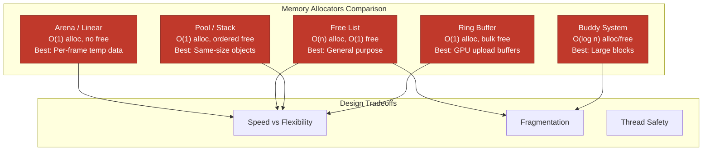

---

## 7. Multi-threading & Synchronization

### 7.1 Job System

```c++
// Thread pool job system
class JobSystem {
public:
    using Job = std::function<void()>;

    JobSystem(size_t numThreads = std::thread::hardware_concurrency()) {
        for (size_t i = 0; i < numThreads; ++i) {
            m_workers.emplace_back([this] { workerLoop(); });
        }
    }

    ~JobSystem() {
        {
            std::unique_lock lock(m_mutex);
            m_shutdown = true;
            m_cv.notify_all();
        }
        for (auto& worker : m_workers) {
            worker.join();
        }
    }

    void submit(Job job) {
        {
            std::unique_lock lock(m_mutex);
            m_jobs.push(std::move(job));
        }
        m_cv.notify_one();
    }

    void waitForCompletion() {
        std::unique_lock lock(m_mutex);
        m_cv.wait(lock, [this] {
            return m_jobs.empty() && m_activeJobs == 0;
        });
    }

private:
    void workerLoop() {
        while (true) {
            std::unique_lock lock(m_mutex);
            m_cv.wait(lock, [this] {
                return m_shutdown || !m_jobs.empty();
            });

            if (m_shutdown && m_jobs.empty()) {
                return;
            }

            if (!m_jobs.empty()) {
                auto job = std::move(m_jobs.front());
                m_jobs.pop();
                ++m_activeJobs;
                lock.unlock();

                job();

                lock.lock();
                --m_activeJobs;
                m_cv.notify_all();
            }
        }
    }

    std::vector<std::thread> m_workers;
    std::queue<Job> m_jobs;
    std::mutex m_mutex;
    std::condition_variable m_cv;
    bool m_shutdown = false;
    size_t m_activeJobs = 0;
};
```

### 7.2 Lock-Free Data Structures

```c++
// Lock-free SPSC (Single Producer Single Consumer) queue
template<typename T, size_t Capacity>
class LockFreeSPSCQueue {
public:
    bool push(const T& item) {
        const size_t writeIndex = m_writeIndex.load(std::memory_order_relaxed);
        const size_t nextWriteIndex = (writeIndex + 1) % Capacity;

        if (nextWriteIndex == m_readIndex.load(std::memory_order_acquire)) {
            return false;  // Queue full
        }

        m_data[writeIndex] = item;
        m_writeIndex.store(nextWriteIndex, std::memory_order_release);
        return true;
    }

    bool pop(T& item) {
        const size_t readIndex = m_readIndex.load(std::memory_order_relaxed);

        if (readIndex == m_writeIndex.load(std::memory_order_acquire)) {
            return false;  // Queue empty
        }

        item = m_data[readIndex];
        m_readIndex.store((readIndex + 1) % Capacity, std::memory_order_release);
        return true;
    }

private:
    std::array<T, Capacity> m_data;
    std::atomic<size_t> m_writeIndex{0};
    std::atomic<size_t> m_readIndex{0};
};

// Lock-free MPMC (Multiple Producer Multiple Consumer) queue
template<typename T>
class LockFreeMPMCQueue {
public:
    LockFreeMPMCQueue(size_t capacity)
        : m_capacity(capacity), m_mask(capacity - 1), m_buffer(new Node[capacity]) {

        if (capacity & m_mask) {
            throw std::invalid_argument("Capacity must be power of 2");
        }

        for (size_t i = 0; i < capacity; ++i) {
            m_buffer[i].sequence.store(i, std::memory_order_relaxed);
        }

        m_enqueuePos.store(0, std::memory_order_relaxed);
        m_dequeuePos.store(0, std::memory_order_relaxed);
    }

    ~LockFreeMPMCQueue() {
        delete[] m_buffer;
    }

    bool push(const T& item) {
        Node* node;
        size_t pos = m_enqueuePos.load(std::memory_order_relaxed);

        while (true) {
            node = &m_buffer[pos & m_mask];
            size_t seq = node->sequence.load(std::memory_order_acquire);

            intptr_t diff = static_cast<intptr_t>(seq) - static_cast<intptr_t>(pos);
            if (diff == 0) {
                if (m_enqueuePos.compare_exchange_weak(pos, pos + 1, std::memory_order_relaxed)) {
                    break;
                }
            } else if (diff < 0) {
                return false;  // Queue full
            } else {
                pos = m_enqueuePos.load(std::memory_order_relaxed);
            }
        }

        node->data = item;
        node->sequence.store(pos + 1, std::memory_order_release);
        return true;
    }

    bool pop(T& item) {
        Node* node;
        size_t pos = m_dequeuePos.load(std::memory_order_relaxed);

        while (true) {
            node = &m_buffer[pos & m_mask];
            size_t seq = node->sequence.load(std::memory_order_acquire);

            intptr_t diff = static_cast<intptr_t>(seq) - static_cast<intptr_t>(pos + 1);
            if (diff == 0) {
                if (m_dequeuePos.compare_exchange_weak(pos, pos + 1, std::memory_order_relaxed)) {
                    break;
                }
            } else if (diff < 0) {
                return false;  // Queue empty
            } else {
                pos = m_dequeuePos.load(std::memory_order_relaxed);
            }
        }

        item = node->data;
        node->sequence.store(pos + m_mask + 1, std::memory_order_release);
        return true;
    }

private:
    struct Node {
        T data;
        std::atomic<size_t> sequence;
    };

    size_t m_capacity;
    size_t m_mask;
    Node* m_buffer;
    std::atomic<size_t> m_enqueuePos;
    std::atomic<size_t> m_dequeuePos;
};
```

### 7.3 Vulkan Synchronization Primitives

```c++
// Vulkan timeline semaphores for cross-queue synchronization
class TimelineSemaphore {
public:
    TimelineSemaphore(VkDevice device, uint64_t initialValue = 0)
        : m_device(device), m_value(initialValue) {

        VkSemaphoreTypeCreateInfo typeInfo{};
        typeInfo.sType = VK_STRUCTURE_TYPE_SEMAPHORE_TYPE_CREATE_INFO;
        typeInfo.semaphoreType = VK_SEMAPHORE_TYPE_TIMELINE;
        typeInfo.initialValue = initialValue;

        VkSemaphoreCreateInfo createInfo{};
        createInfo.sType = VK_STRUCTURE_TYPE_SEMAPHORE_CREATE_INFO;
        createInfo.pNext = &typeInfo;

        vkCreateSemaphore(device, &createInfo, nullptr, &m_semaphore);
    }

    ~TimelineSemaphore() {
        vkDestroySemaphore(m_device, m_semaphore, nullptr);
    }

    void signal(uint64_t value) {
        VkSemaphoreSignalInfo signalInfo{};
        signalInfo.sType = VK_STRUCTURE_TYPE_SEMAPHORE_SIGNAL_INFO;
        signalInfo.semaphore = m_semaphore;
        signalInfo.value = value;
        vkSignalSemaphore(m_device, &signalInfo);
        m_value = value;
    }

    void wait(uint64_t value, uint64_t timeout = UINT64_MAX) {
        VkSemaphoreWaitInfo waitInfo{};
        waitInfo.sType = VK_STRUCTURE_TYPE_SEMAPHORE_WAIT_INFO;
        waitInfo.semaphoreCount = 1;
        waitInfo.pSemaphores = &m_semaphore;
        waitInfo.pValues = &value;
        waitInfo.flags = VK_SEMAPHORE_WAIT_ANY_BIT;

        vkWaitSemaphores(m_device, &waitInfo, timeout);
    }

    uint64_t getCurrentValue() const {
        uint64_t value;
        vkGetSemaphoreCounterValue(m_device, m_semaphore, &value);
        return value;
    }

    VkSemaphore getHandle() const { return m_semaphore; }

private:
    VkDevice m_device;
    VkSemaphore m_semaphore{VK_NULL_HANDLE};
    uint64_t m_value;
};

// Vulkan buffer with host-coherent memory for lock-free CPU-GPU communication
template<typename T>
class AtomicBuffer {
public:
    AtomicBuffer(VkDevice device, VmaAllocator allocator, size_t count)
        : m_device(device), m_count(count) {

        VkBufferCreateInfo bufferInfo{};
        bufferInfo.sType = VK_STRUCTURE_TYPE_BUFFER_CREATE_INFO;
        bufferInfo.size = sizeof(T) * count;
        bufferInfo.usage = VK_BUFFER_USAGE_STORAGE_BUFFER_BIT | VK_BUFFER_USAGE_TRANSFER_DST_BIT;

        VmaAllocationCreateInfo allocInfo{};
        allocInfo.usage = VMA_MEMORY_USAGE_CPU_ONLY;
        allocInfo.flags = VMA_ALLOCATION_CREATE_MAPPED_BIT;
        allocInfo.requiredFlags = VK_MEMORY_PROPERTY_HOST_COHERENT_BIT;

        vmaCreateBuffer(allocator, &bufferInfo, &allocInfo, &m_buffer, &m_allocation, &m_allocInfo);
        m_data = static_cast<T*>(m_allocInfo.pMappedData);
    }

    void set(size_t index, const T& value) {
        // Atomic write (for single-producer)
        std::atomic_ref<T> ref(m_data[index]);
        ref.store(value, std::memory_order_release);
    }

    T get(size_t index) const {
        // Atomic read
        std::atomic_ref<T> ref(m_data[index]);
        return ref.load(std::memory_order_acquire);
    }

    T* data() { return m_data; }
    VkBuffer getBuffer() const { return m_buffer; }

private:
    VkDevice m_device;
    VkBuffer m_buffer{VK_NULL_HANDLE};
    VmaAllocation m_allocation{VK_NULL_HANDLE};
    VmaAllocationInfo m_allocInfo{};
    T* m_data;
    size_t m_count;
};
```

```mermaid
graph TB
    subgraph SyncPatterns["Synchronization Patterns"]
        SP1["Mutex / Lock<br/>Simple, exclusive access"]
        SP2["RWLock<br/>Multiple readers, one writer"]
        SP3["Atomic Operations<br/>Lock-free, single values"]
        SP4["SPSC Queue<br/>Lock-free, single producer/consumer"]
        SP5["MPMC Queue<br/>Lock-free, multiple producer/consumer"]
        SP6["RCU<br/>Read-Copy-Update for readers"]
        SP7["Semaphore<br/>Resource counting"]
        SP8["Barrier<br/>Phased execution"]
    end

    subgraph UseCases["Common Use Cases"]
        UC1["Command buffer recording"]
        UC2["Resource streaming"]
        UC3["Frame parallelism"]
        UC4="Job dependency graph"
    end

    SP1 --> UC1
    SP3 --> UC2
    SP5 --> UC2
    SP4 --> UC3
    SP8 --> UC4

    style SP1 fill:#e74c3c,stroke:#922b21,color:#fff
    style SP2 fill:#e74c3c,stroke:#922b21,color:#fff
    style SP3 fill:#e74c3c,stroke:#922b21,color:#fff
    style SP4 fill:#e74c3c,stroke:#922b21,color:#fff
    style SP5 fill:#e74c3c,stroke:#922b21,color:#fff
    style SP6 fill:#e74c3c,stroke:#922b21,color:#fff
    style SP7 fill:#e74c3c,stroke:#922b21,color:#fff
    style SP8 fill:#e74c3c,stroke:#922b21,color:#fff
```

---

## 8. Performance Optimization

### 8.1 SIMD (Single Instruction Multiple Data)

```c++
// SIMD-optimized vector operations
#ifdef USE_SSE
#include <xmmintrin.h>
#include <emmintrin.h>
#include <immintrin.h>

namespace simd {

// SSE float4 addition
inline __m128 add_ps(__m128 a, __m128 b) {
    return _mm_add_ps(a, b);
}

// SSE float4 dot product
inline float dot_ps(__m128 a, __m128 b) {
    __m128 mul = _mm_mul_ps(a, b);
    __m128 shuf = _mm_shuffle_ps(mul, mul, _MM_SHUFFLE(2, 3, 0, 1));
    __m128 sums = _mm_add_ps(mul, shuf);
    shuf = _mm_movehl_ps(shuf, sums);
    sums = _mm_add_ss(sums, shuf);
    return _mm_cvtss_f32(sums);
}

// AVX2 float8 transformation
inline void transform8_avx2(const float* __restrict positions,
                           const float* __restrict matrices,
                           float* __restrict results,
                           size_t count) {
    for (size_t i = 0; i < count; i += 8) {
        // Load 8 positions (x, y, z, 0, x, y, z, 0)
        __m256 px = _mm256_set_ps(0, positions[i+6], positions[i+4], 0,
                                   0, positions[i+2], positions[i], 0);
        __m256 py = _mm256_set_ps(0, positions[i+7], positions[i+5], 0,
                                   0, positions[i+3], positions[i+1], 0);

        // Load matrix rows
        __m256 m0 = _mm256_load_ps(matrices);
        __m256 m1 = _mm256_load_ps(matrices + 8);
        __m256 m2 = _mm256_load_ps(matrices + 16);

        // Transform
        __m256 rx = _mm256_add_ps(_mm256_mul_ps(px, m0), _mm256_mul_ps(px, m1));
        rx = _mm256_add_ps(rx, _mm256_mul_ps(px, m2));

        // Store results
        _mm256_store_ps(results + i, rx);
    }
}

}

// NEON for ARM
#elif USE_NEON
#include <arm_neon.h>

namespace simd {

inline float32x4_t add_ps(float32x4_t a, float32x4_t b) {
    return vaddq_f32(a, b);
}

inline float dot_ps(float32x4_t a, float32x4_t b) {
    float32x4_t mul = vmulq_f32(a, b);
    float32x2_t sum = vadd_f32(vget_high_f32(mul), vget_low_f32(mul));
    sum = vpadd_f32(sum, sum);
    return vget_lane_f32(sum, 0);
}

}

#endif
```

### 8.2 Cache-Friendly Data Layout

```c++
// Structure of Arrays (SoA) vs Array of Structures (AoS)

// AoS - cache inefficient for random access
struct ParticleAoS {
    glm::vec3 position;
    glm::vec3 velocity;
    float mass;
    float lifetime;
};

// SoA - cache efficient for SIMD
struct ParticleSoA {
    std::vector<float> posX, posY, posZ;
    std::vector<float> velX, velY, velZ;
    std::vector<float> mass;
    std::vector<float> lifetime;

    void update(float dt) {
        for (size_t i = 0; i < posX.size(); ++i) {
            posX[i] += velX[i] * dt;
            posY[i] += velY[i] * dt;
            posZ[i] += velZ[i] * dt;
        }
    }

    // SIMD-friendly version
    void updateSIMD(float dt) {
        size_t i = 0;
        const size_t simdWidth = 8;  // AVX2 processes 8 floats

        for (; i + simdWidth <= posX.size(); i += simdWidth) {
            // Load 8 positions and velocities
            __m256 px = _mm256_load_ps(posX.data() + i);
            __m256 vx = _mm256_load_ps(velX.data() + i);
            __m256 dt_v = _mm256_set1_ps(dt);

            // Compute new positions
            __m256 new_px = _mm256_add_ps(px, _mm256_mul_ps(vx, dt_v));

            // Store
            _mm256_store_ps(posX.data() + i, new_px);
        }

        // Handle remainder
        for (; i < posX.size(); ++i) {
            posX[i] += velX[i] * dt;
        }
    }
};
```

### 8.3 Profiling and Instrumentation

```c++
// Scoped profiler timer
class Profiler {
public:
    struct Scope {
        const char* name;
        std::chrono::high_resolution_clock::time_point start;

        ~Scope() {
            auto end = std::chrono::high_resolution_clock::now();
            auto duration = std::chrono::duration_cast<std::chrono::microseconds>(end - start).count();
            Profiler::record(name, duration);
        }
    };

    static Profiler& get() {
        static Profiler instance;
        return instance;
    }

    static Scope scope(const char* name) {
        return {name, std::chrono::high_resolution_clock::now()};
    }

    static void record(const char* name, int64_t microseconds) {
        auto& stats = get().m_stats[name];
        stats.totalTime += microseconds;
        stats.callCount++;
        stats.minTime = std::min(stats.minTime, microseconds);
        stats.maxTime = std::max(stats.maxTime, microseconds);
    }

    void printReport() const {
        for (const auto& [name, stats] : m_stats) {
            float avg = static_cast<float>(stats.totalTime) / stats.callCount;
            std::cout << name << ": "
                      << "avg=" << avg << "μs, "
                      << "min=" << stats.minTime << "μs, "
                      << "max=" << stats.maxTime << "μs, "
                      << "calls=" << stats.callCount << "\n";
        }
    }

private:
    struct Stats {
        int64_t totalTime = 0;
        int64_t callCount = 0;
        int64_t minTime = INT64_MAX;
        int64_t maxTime = 0;
    };

    std::unordered_map<const char*, Stats> m_stats;
};

#define PROFILE_SCOPE(name) auto _profiler_##__LINE__ = Profiler::scope(name)
#define PROFILE_FUNCTION() PROFILE_SCOPE(__FUNCTION__)
```

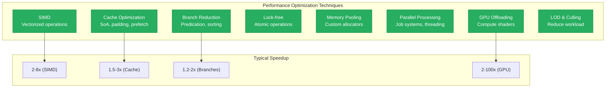

---

## 9. Entity Component System (ECS)

### 9.1 Data-Oriented Design (DOD) Principles

```c++
// ECS Architecture - Data-Oriented Design
namespace ecs {

// Entity: Just an ID, no data
using Entity = uint32_t;
constexpr Entity INVALID_ENTITY = UINT32_MAX;

// Component: Pure data, no logic
struct TransformComponent {
    glm::vec3 position{0.0f};
    glm::quat rotation{1.0f, 0.0f, 0.0f, 0.0f};
    glm::vec3 scale{1.0f};
};

struct RenderComponent {
    uint32_t meshID;
    uint32_t materialID;
    bool visible{true};
};

struct PhysicsComponent {
    glm::vec3 velocity{0.0f};
    glm::vec3 acceleration{0.0f};
    float mass{1.0f};
};

// System: Pure logic, operates on components
class System {
public:
    virtual void update(float deltaTime) = 0;
    virtual ~System() = default;
};

} // namespace ecs
```

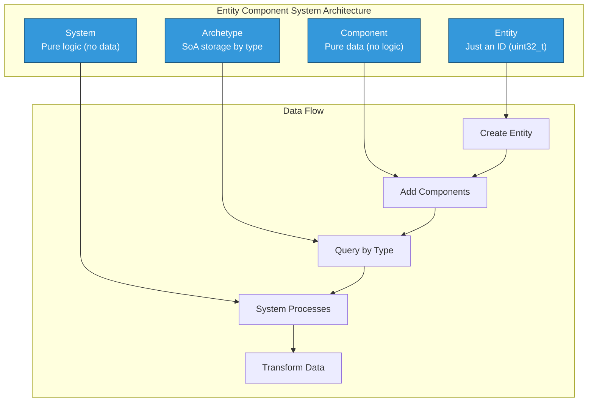

---

## 10. Advanced Vulkan Patterns

### 10.1 Bindless Descriptors

```c++
// Bindless descriptor architecture for GPU-driven rendering
class BindlessResourceManager {
public:
    static constexpr uint32_t MAX_TEXTURES = 100000;
    static constexpr uint32_t MAX_SAMPLERS = 256;
    static constexpr uint32_t MAX_BUFFERS = 10000;

    struct TextureHandle {
        uint32_t index;
        uint32_t generation;
    };

    void initialize(VkDevice device, VmaAllocator allocator) {
        m_device = device;

        // Create descriptor set layout with bindless resources
        std::vector<VkDescriptorSetLayoutBinding> bindings;

        // Textures
        VkDescriptorSetLayoutBinding textureBinding{};
        textureBinding.binding = 0;
        textureBinding.descriptorType = VK_DESCRIPTOR_TYPE_SAMPLED_IMAGE;
        textureBinding.descriptorCount = MAX_TEXTURES;
        textureBinding.stageFlags = VK_SHADER_STAGE_ALL;
        bindings.push_back(textureBinding);

        // Create UPDATE_AFTER_BIND descriptor pool...
    }

    TextureHandle registerTexture(VkImageView view, VkImageLayout layout) {
        uint32_t index = allocateTextureIndex();
        // Update descriptor at index...
        return TextureHandle{index, m_textureGenerations[index]};
    }

private:
    VkDevice m_device;
    VkDescriptorSetLayout m_descriptorLayout{VK_NULL_HANDLE};
    VkDescriptorPool m_descriptorPool{VK_NULL_HANDLE};
    VkDescriptorSet m_descriptorSet{VK_NULL_HANDLE};
};
```

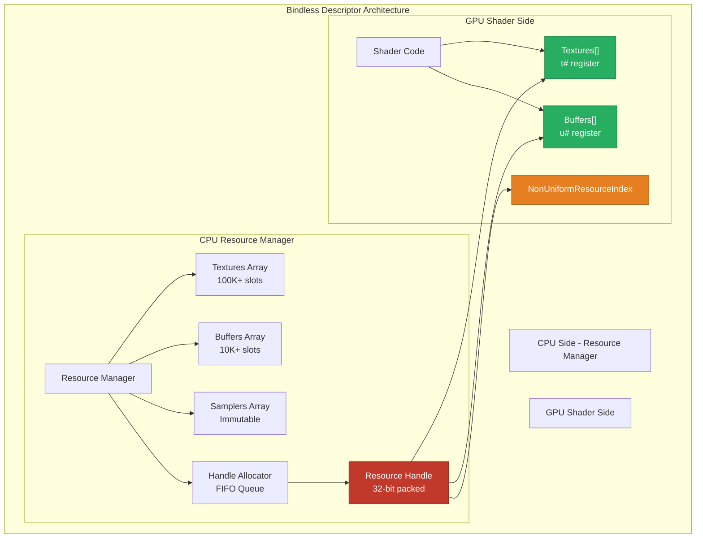

---

## 11. Compute Shader Techniques

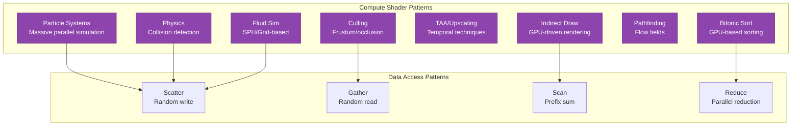

---

## 12. USD Advanced Techniques

### 12.1 Value Resolution with Composition Arcs

USD uses a powerful composition system with multiple arc types:

| Arc Type | Description | Strength |
|----------|-------------|----------|
| **SubLayer** | Weaker to stronger layer stacking | Weakest |
| **Payload** | Lazy-loaded reference | Medium |
| **Reference** | Read-only external composition | Medium |
| **Inherits** | Non-composing property inheritance | Strong |
| **Specializes** | Class-like composition | Strong |
| **Variant** | Mutually exclusive selection | Strongest |

### 12.2 USD Instancing

```c++
// Point instancing for efficient large-scale rendering
class PointInstancer {
public:
    void generateInstances(const std::vector<Transform>& transforms,
                          const std::vector<SdfPath>& prototypes) {
        UsdStageRefPtr stage = UsdStage::CreateNew("instanced.usda");

        // Create point instancer prim
        UsdGeomPointInstancer instancer = UsdGeomPointInstancer::Define(
            stage, SdfPath("/PointInstancer")
        );

        // Configure prototypes, positions, orientations, scales...
    }
};
```

---

## 13. Real-Time Rendering Techniques

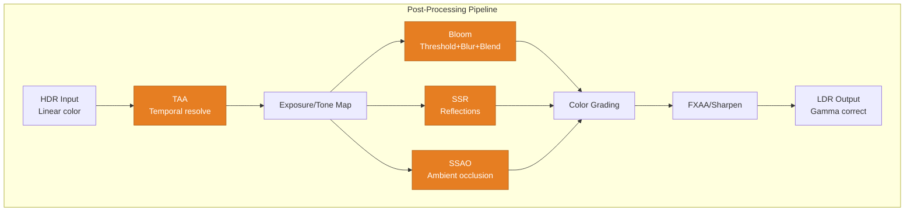

### 13.1 Temporal Anti-Aliasing (TAA)

TAA uses temporal history to reduce aliasing:
- **Jitter**: Apply sub-pixel offset using Halton sequence
- **Reproject**: Map previous frame pixels using motion vectors
- **Blend**: Combine current frame with reprojected history
- **Clamp**: Prevent ghosting with neighborhood clamping

### 13.2 Screen Space Reflections (SSR)

1. **Ray Marching**: March reflected ray through screen space
2. **Hierarchical Z**: Use Hi-Z pyramid for acceleration
3. **Temporal Accumulation**: Smooth reflections over time
4. **Composite**: Blend with scene color based on roughness

---

## 14. Advanced Mathematics Summary

| Domain | Key Concepts | Applications |
|--------|-------------|--------------|
| **Linear Algebra** | Vectors, matrices, transformations | Rendering, animation |
| **Quaternions** | SLERP, dual quaternions | Smooth rotations, skinning |
| **Dual Quaternions** | Rotation + translation unified | Skinning without artifacts |
| **Spherical Harmonics** | SH coefficients, projection | Irradiance caching, IBL |
| **Monte Carlo** | Importance sampling, quasi-random | Path tracing, GI |
| **Calculus** | Derivatives, integrals | Physics simulation |
| **Probability** | PDFs, CDFs, sampling | Anti-aliasing, distribution |

---

## Summary

This document covers the essential C++ techniques, design patterns, algorithms, and mathematics used in:

1. **Modern C++ Techniques** - Move semantics, templates, concepts, coroutines
2. **Design Patterns** - GoF patterns applied to graphics programming
3. **Graphics-Specific Patterns** - Vulkan RAII, USD composition, Unreal reflection
4. **Algorithms** - BVH, spatial structures, culling techniques
5. **Mathematics** - Linear algebra, quaternions, PBR lighting
6. **Memory Management** - Allocators, pools, ring buffers
7. **Multi-threading** - Job systems, lock-free structures, Vulkan sync
8. **Performance** - SIMD, cache optimization, profiling
9. **Entity Component System** - DOD principles, archetype-based ECS
10. **Advanced Vulkan** - Bindless descriptors, GPU-driven rendering
11. **Compute Shaders** - Particle systems, sorting algorithms
12. **USD Techniques** - Value resolution, instancing
13. **Rendering Techniques** - TAA, SSR, post-processing
14. **Advanced Mathematics** - Dual quaternions, spherical harmonics

For implementation details, see the project source code under `src/`.
