# USD Vulkan Engine - Comprehensive Research Document

This document compiles comprehensive research on OpenUSD, Vulkan, and their implementations in Unreal Engine for reference during development.

---

## Table of Contents

1. [Senior Principal Graphics Engineer - Required Expertise](#principal-engineer-expertise)
2. [Architecture Visualizations](#architecture-visualizations)
3. [OpenUSD (Universal Scene Description)](#openusd-research)
4. [Vulkan Graphics API](#vulkan-research)
5. [Unreal Engine Implementations](#unreal-engine-research)
6. [Best Practices and Patterns](#best-practices)
7. [References](#references)

---

# Senior Principal Graphics Engineer - Required Expertise

## Industry Requirements (2024-2025)

Based on analysis of Principal Graphics Engineer positions at industry-leading companies (Skydance, EA/Frostbite, Unity, Sony PlayStation, NVIDIA, Adobe):

### Core Technical Competencies

| Area | Required Skills |
|------|-----------------|
| **Graphics APIs** | Vulkan (expert), DirectX 12, Metal, OpenGL ES (legacy) |
| **Ray Tracing** | VK_KHR_ray_tracing_pipeline, VK_KHR_ray_query, DXR, NRD, DLSS Ray Reconstruction |
| **Engine Architecture** | Render graphs, frame graphs, task/job systems, GPU-driven rendering |
| **Shading Languages** | HLSL, GLSL, Slang, SPIR-V, WGSL |
| **Math & Physics** | Linear algebra, computational geometry, physics simulation |
| **Performance** | Profiling, optimization, GPU/CPU parallelism, memory management |
| **Build Systems** | CMake, Bazel, shader compilation pipelines |
| **Leadership** | Technical direction, mentoring, architecture decisions |

### Salary Ranges (2024-2025)
- **Senior Graphics Engineer**: $150,000 - $200,000
- **Principal Graphics Engineer**: $200,000 - $280,000
- **Technical Director/Architect**: $250,000 - $350,000+

### Key Responsibilities

1. **Graphics Systems Architecture**
   - Design and implement rendering architectures
   - Define abstractions for multi-platform support
   - Balance performance vs. maintainability
   - Guide technical vision for 3-5 year horizons

2. **Performance Optimization**
   - Profile and optimize GPU/CPU bottlenecks
   - Implement GPU-driven rendering pipelines
   - Optimize memory allocation strategies
   - Reduce draw calls and state changes

3. **Team Leadership**
   - Mentor junior and senior engineers
   - Conduct code reviews and architecture reviews
   - Drive technical standards and best practices
   - Collaborate across disciplines (art, design, production)

---

# Architecture Visualizations

This section provides comprehensive Mermaid diagram visualizations for the technical concepts covered in this document.

## 1. Principal Graphics Engineer Skill Tree

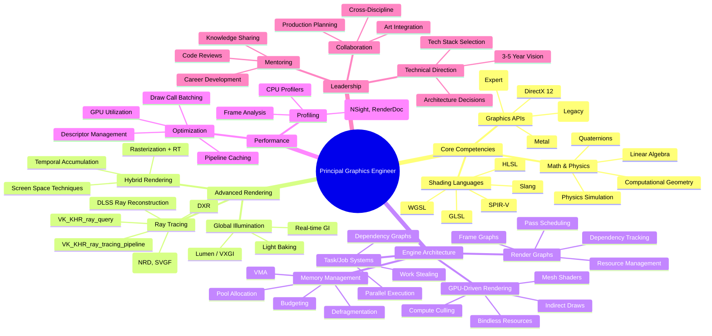

## 2. USD Composition Arcs Strength Ordering

```mermaid
graph TD
    subgraph Composition_Strength_Order["USD Composition Arcs: Strongest to Weakest"]
        A[Session Layer<br/>Current edit session]:::strongest
        B[Stage Root Layer<br/>Primary layer]:::strong
        C[SubLayers<br/>Layer stack - last is strongest]:::mediumStrong
        D[Payloads<br/>Deferred references]:::medium
        E[References<br/>Asset inclusion]:::mediumWeak
        F[Variant Selections<br/>Chosen variant]:::weak
        G[Inherits<br/>Persistent relationships]:::weaker
        H[Specializes<br/>Specialized refinements]:::weakest
        I[Fallback Values<br/>Authored defaults]:::fallback

        A --> B
        B --> C
        C --> D
        D --> E
        E --> F
        F --> G
        G --> H
        H --> I
    end

    classDef strongest fill:#ff6b6b,stroke:#c92a2a,stroke-width:3px,color:#fff
    classDef strong fill:#fa8c16,stroke:#e67700,stroke-width:2px,color:#fff
    classDef mediumStrong fill:#fab005,stroke:#fd7e14,stroke-width:2px,color:#000
    classDef medium fill:#40c057,stroke:#37b24d,stroke-width:2px,color:#fff
    classDef mediumWeak fill:#228be6,stroke:#1c7ed6,stroke-width:2px,color:#fff
    classDef weak fill:#748ffc,stroke:#5c7cfa,stroke-width:2px,color:#fff
    classDef weaker fill:#845ef7,stroke:#7950f2,stroke-width:2px,color:#fff
    classDef weakest fill:#d6336c,stroke:#a61e4d,stroke-width:2px,color:#fff
    classDef fallback fill:#adb5bd,stroke:#868e96,stroke-width:2px,color:#000
```

## 3. USD Layer Composition Example

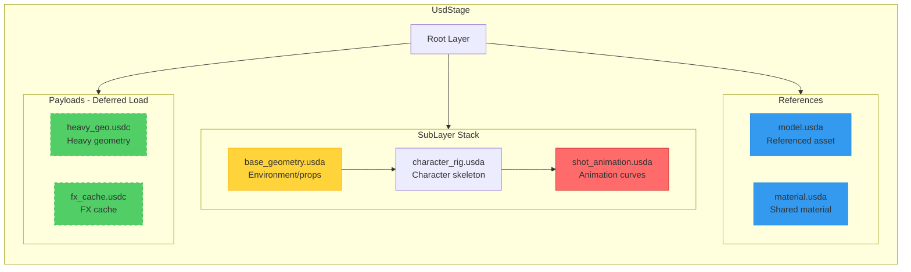

## 4. Vulkan Pipeline Comparison


## 5. GPU-Driven Rendering Pipeline

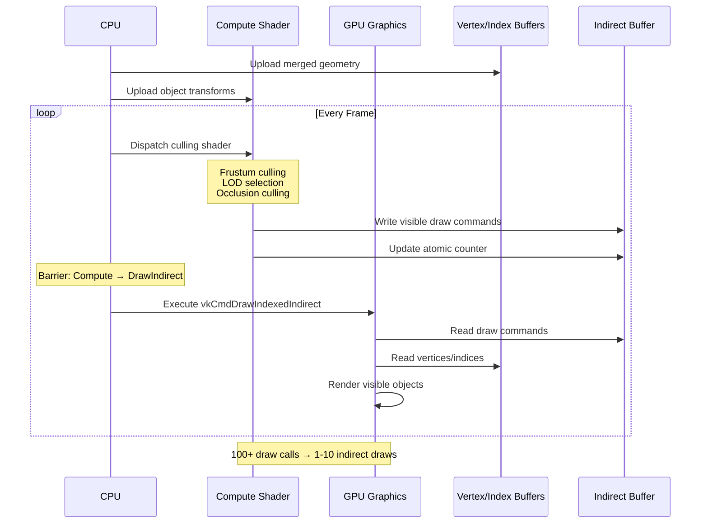

## 6. Bindless Descriptor Architecture

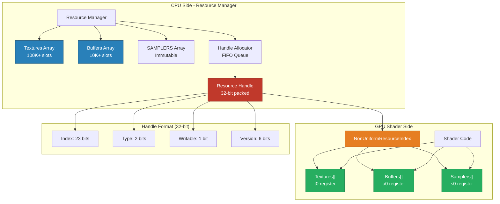

## 7. Ray Tracing Acceleration Structure

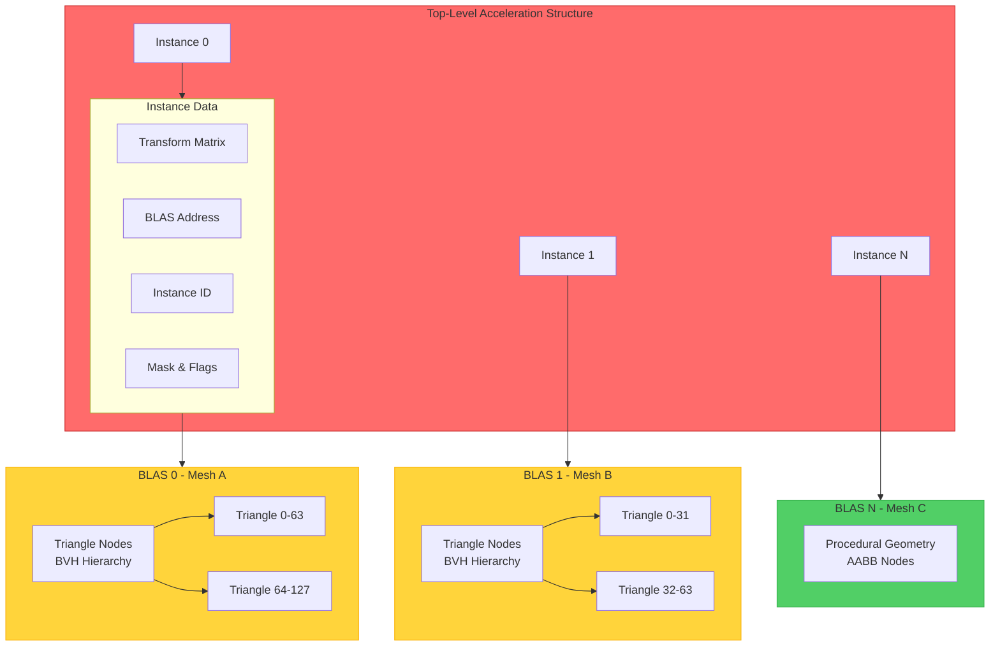

## 8. Ray Tracing Pipeline with SBT

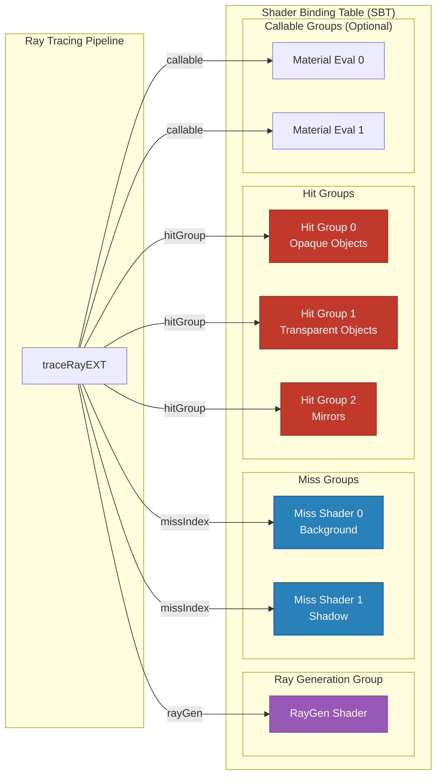

## 9. Asynchronous Compute Timeline

```mermaid
gantt
    title Async Compute Frame Pipeline (3 frames in flight)
    dateFormat X
    axisFormat %L

    section Graphics Queue
    Frame N Graphics    :active, g1, 0, 3
    Frame N+1 Graphics  :g2, 3, 6
    Frame N+2 Graphics  :g3, 6, 9

    section Compute Queue
    Frame N+1 Prep      :c1, 1, 4
    Frame N+2 Prep      :c2, 4, 7
    Frame N+3 Prep      :c3, 7, 10

    section Sync Points
    Graphics N Complete :milestone, m1, 3, 0d
    Compute N+1 Ready   :milestone, m2, 4, 0d
    Graphics N+1 Start  :milestone, m3, 4, 0d
```

## 10. Memory Allocator Hierarchy (VMA)

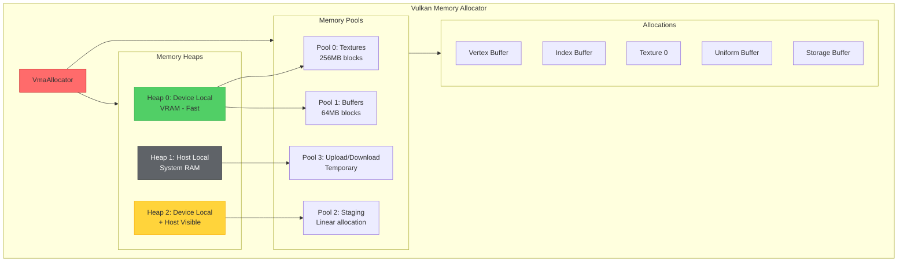

## 11. Render Graph Architecture

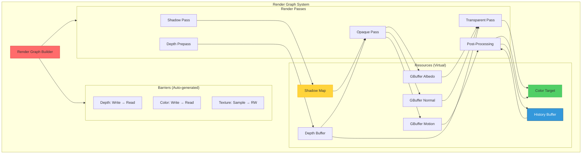

## 12. Mesh Shader Culling Flow

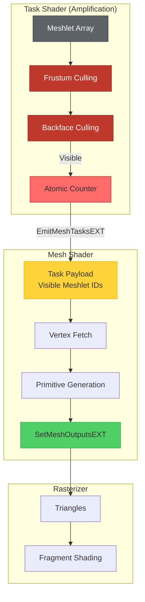

## 13. USD Stage Loading Lifecycle

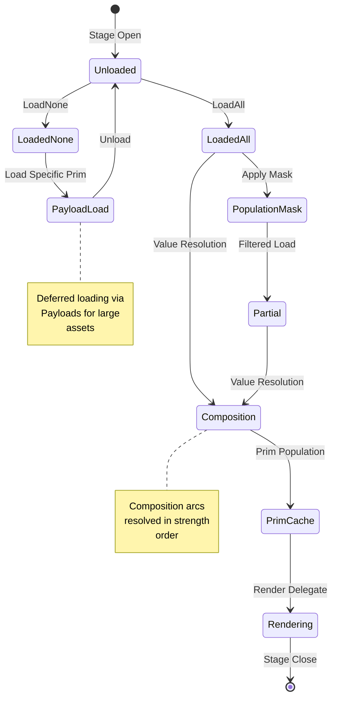

## 14. Vulkan Frame Rendering Flow

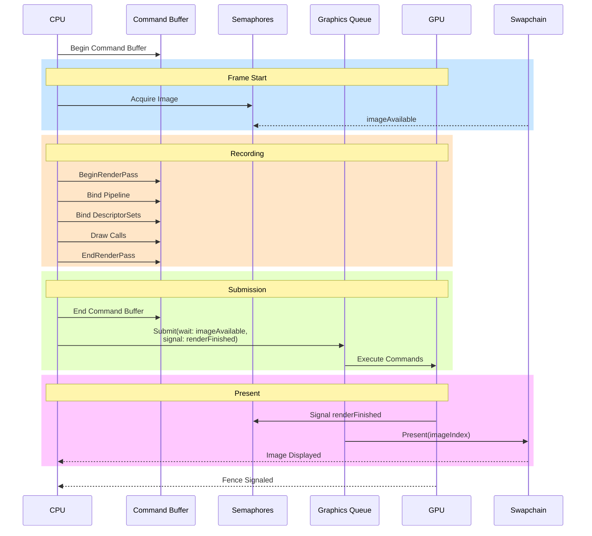

## 15. Hybrid Rendering Strategy

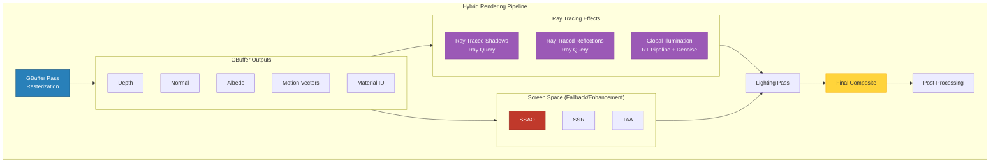

## 16. Complete Engine Architecture Overview

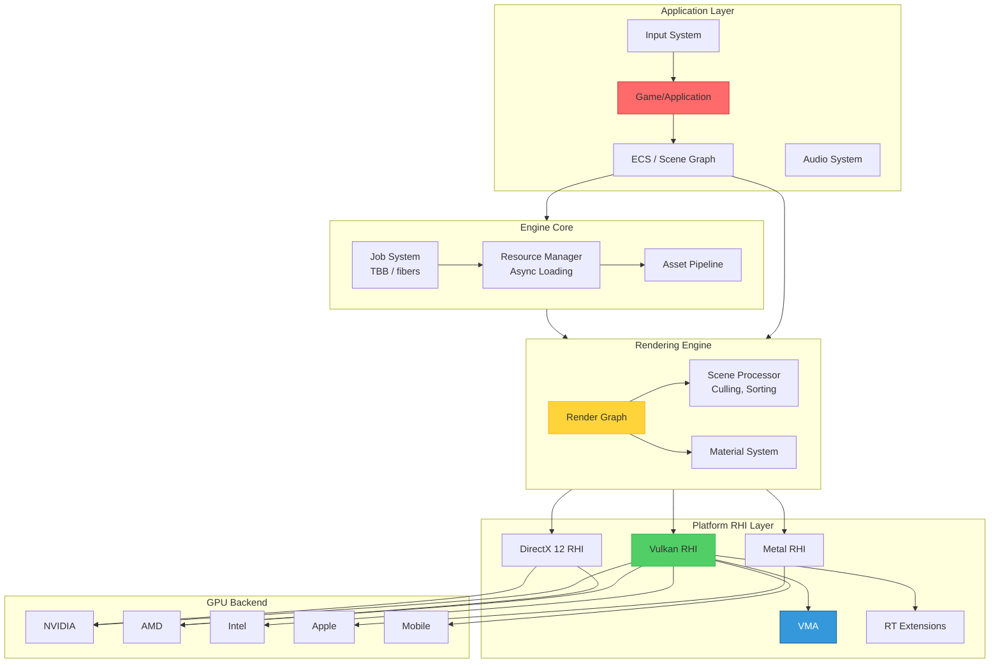

## 17. Shader Execution Reordering (SER)

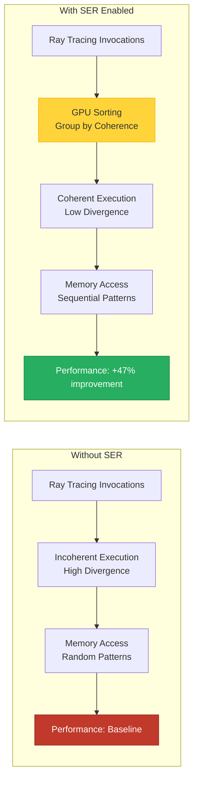

## 18. USD Value Clips Architecture

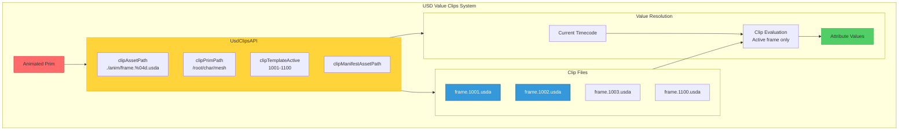

## 19. Descriptor Management Strategies

```mermaid
graph TB
    subgraph Traditional["Traditional Descriptor Management"]
        TD1[Create Descriptor Set<br/>Per Material]
        TD2[Bind Descriptor Set<br/>Per Draw Call]
        TD3[CPU Overhead<br/>High]

        TD1 --> TD2
        TD2 --> TD3
    end

    subgraph Bindless["Bindless Descriptors"]
        BD1[Create Single Descriptor Set<br/>At Startup]
        BD2[GPU Indexing<br/>Per Material]
        BD3[CPU Overhead<br/>Minimal]

        BD1 --> BD2
        BD2 --> BD3
    end

    subgraph Hybrid["Hybrid Approach"]
        HD1[Descriptor Set per<br/>Material Type]
        HD2[Dynamic Offset<br/>Per Object]
        HD3[Balanced Approach]

        HD1 --> HD2
        HD2 --> HD3
    end

    style TD3 fill:#c0392b,stroke:#922b21,color:#fff
    style BD3 fill:#27ae60,stroke:#1e8449,color:#fff
    style HD3 fill:#ffd43b,stroke:#fab005
```

## 20. Vulkan Synchronization Hierarchy

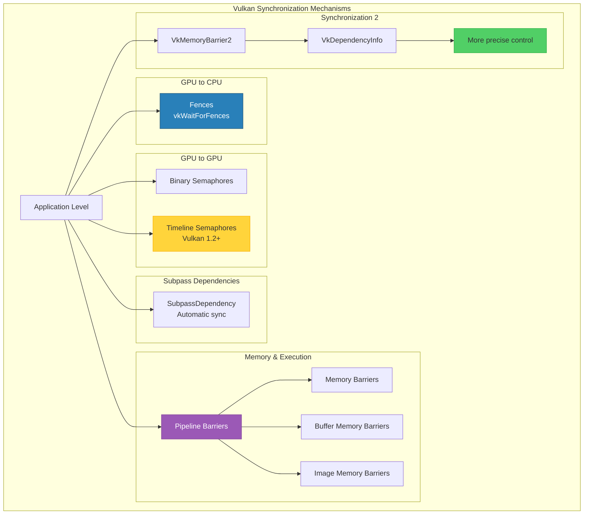

---

# OpenUSD Research

## 1. Official Documentation Structure

### Primary Sources
- **Official Repository**: [PixarAnimationStudios/OpenUSD](https://github.com/PixarAnimationStudios/OpenUSD)
- **Documentation**: https://openusd.org/docs/
- **API Reference**: https://openusd.org/docs/api/index.html
- **Quick Start**: [USD Basics in an Hour(ish)](https://openusd.org/files/USD_Quickstart_Guide.pdf)

### What is USD?
OpenUSD is an efficient, scalable system for authoring, reading, and streaming time-sampled scene description for interchange between graphics applications. It provides:

- A rich, common language for defining, packaging, assembling, and editing 3D data
- Support for multiple artists collaborating on the same assets and scenes
- Maximized artistic iteration through minimized latency
- Robust interchange between digital content creation tools

---

## 2. Core USD Concepts

### Layers (SdfLayer)

Layers are the fundamental file abstraction in USD that contain scene description.

**File Formats:**
- **`.usda`** - Text-based ASCII format (human-readable, version control friendly)
- **`.usdc`** - Binary Crate format (faster loading, smaller size)
- **`.usdz`** - Package format (uncompressed zip archive)

```c++
// C++ API for creating layers
#include "pxr/usd/usd/stage.h"
#include "pxr/usd/sdf/layer.h"

using namespace pxr;

// Create a new layer
SdfLayerRefPtr layer = SdfLayer::CreateNew("scene.usda");
layer->Save();

// Open an existing layer
SdfLayerRefPtr layer = SdfLayer::Open("scene.usda");

// Create a stage from a layer
UsdStageRefPtr stage = UsdStage::Open(layer);
```

### Prims (Primitives)

Prims are the sole persistent scenegraph objects on a UsdStage. They form the hierarchical namespace.

```c++
// Get a prim by path
UsdPrim prim = stage->GetPrimAtPath(SdfPath("/root/geometry/sphere"));

// Check if prim is valid
if (prim.IsValid()) {
    std::cout << "Prim type: " << prim.GetTypeName() << std::endl;
}

// Create a new Xform prim
UsdGeomXform xform = UsdGeomXform::Define(stage, SdfPath("/root/geometry"));

// Create a Sphere prim
UsdGeomSphere sphere = UsdGeomSphere::Define(stage, SdfPath("/root/geometry/sphere"));
```

### Properties

Properties are named attributes and relationships on prims:

**Attributes:** Typed values that can vary over time
**Relationships:** Multi-target "pointers" to other objects

```c++
// Working with attributes
UsdAttribute radiusAttr = sphere.GetRadiusAttr();
radiusAttr.Set(2.0);  // Set value at default time

// Get attribute at specific time
UsdTimeCode time(1.0);
double radius = radiusAttr.Get(time).Get<double>();

// Working with relationships
UsdRelationship rel = prim.GetRelationship("inputPrims");
SdfPathVector targets;
rel.GetTargets(&targets);
```

### Composition Arcs

USD's composition engine uses several operators:

1. **SubLayers** - Stack layers together (like Photoshop layers)
2. **References** - Pull in entire scenegraphs from other files
3. **Payloads** - Deferred references for selective loading
4. **VariantSets** - Bundle multiple variations with selectable variants
5. **Inherits** - Establish persistent relationships for mass editing
6. **Specializes** - Create persistent specialized refinements

```c++
// Add a sublayer
stage->GetRootLayer()->GetSubLayerPaths().append("./layer.usda");

// Add a reference
UsdReferences refs = prim.GetReferences();
refs.AddReference(SdfReference("./model.usda", SdfPath("/Model")));

// Work with variants
UsdVariantSet varSet = prim.GetVariantSet("geometry");
varSet.SetVariantSelection("highPoly");

// Add payload
UsdPayloads payloads = prim.GetPayloads();
payloads.AddPayload(SdfPayload("./geometry.usdc", SdfPath("/Geometry")));
```

---

## 3. Core Schemas

### UsdGeom (Geometry Schema)

Provides OpenSubdiv-compliant meshes and geometric concepts:

```c++
// Create a mesh
UsdGeomMesh mesh = UsdGeomMesh::Define(stage, SdfPath("/geometry/mesh"));

// Set points
VtVec3fArray points;
points.push_back(GfVec3f(-1, -1, 0));
points.push_back(GfVec3f(1, -1, 0));
points.push_back(GfVec3f(0, 1, 0));
mesh.CreatePointsAttr(points);

// Set face vertex counts
VtIntArray faceVertexCounts;
faceVertexCounts.push_back(3);
mesh.CreateFaceVertexCountsAttr(faceVertexCounts);

// Set face vertex indices
VtIntArray faceVertexIndices;
faceVertexIndices.push_back(0);
faceVertexIndices.push_back(1);
faceVertexIndices.push_back(2);
mesh.CreateFaceVertexIndicesAttr(faceVertexIndices);

// Set extent
VtVec3fArray extent;
extent.push_back(GfVec3f(-1, -1, -1));
extent.push_back(GfVec3f(1, 1, 1));
mesh.CreateExtentAttr(extent);

// Working with transforms
UsdGeomXform xform = UsdGeomXform::Define(stage, SdfPath("/transform"));
UsdGeomXformCommonAPI(xform).SetTranslate(GfVec3d(10, 20, 30));
UsdGeomXformCommonAPI(xform).SetRotate(GfVec3f(0, 0, 45));
```

### UsdSkel (Skeletal Schema)

For character rigging and skinning:

```c++
// Create a skeleton
UsdSkelSkeleton skel = UsdSkelSkeleton::Define(stage, SdfPath("/character/skeleton"));

// Set joints
VtTokenArray joints;
joints.push_back("root");
joints.push_back("spine");
joints.push_back("head");
skel.CreateJointsAttr(joints);

// Set joint transforms
VtMatrix4dArray transforms;  // Joint transform matrices
skel.CreateTransformsAttr(transforms);

// Create skin binding
UsdSkelSkin skin = UsdSkelSkin::Define(stage, SdfPath("/character/skin"));
skin.CreateBinding(skel, meshPrim);

// Set influences
VtIntArray jointIndices;  // Joint indices per vertex
VtFloatArray jointWeights;  // Joint weights per vertex
skin.CreateInfluencesAttr(jointIndices);
skin.CreateJointWeightsAttr(jointWeights);
```

### UsdShade (Shading Schema)

For materials and shading networks:

```c++
// Create a material
UsdShadeMaterial material = UsdShadeMaterial::Define(stage, SdfPath("/materials/pbr"));

// Create a shader
UsdShadeShader shader = UsdShadeShader::Define(stage, SdfPath("/materials/pbr/preview"));
shader.CreateIdAttr(VtValue("UsdPreviewSurface"));

// Set shader inputs
shader.CreateInput("roughness", SdfValueTypeNames->Float).Set(0.4f);
shader.CreateInput("metallic", SdfValueTypeNames->Float).Set(0.0f);
shader.CreateInput("diffuseColor", SdfValueTypeNames->Color3f).Set(GfVec3f(1.0, 0.0, 0.0));

// Connect to material output
UsdShadeOutput surfaceOutput = material.CreateSurfaceOutput();
surfaceOutput.ConnectToSource(shader.ConnectableAPI(), TfToken("surface"));

// Bind material to geometry
UsdShadeMaterialBindingAPI(prim).Bind(material);
```

### UsdLux (Lighting Schema)

For lights and light filtering:

```c++
// Create different light types
UsdLuxDomeLight domeLight = UsdLuxDomeLight::Define(stage, SdfPath("/lights/env"));
UsdLuxRectLight rectLight = UsdLuxRectLight::Define(stage, SdfPath("/lights/key"));

// Set light properties
rectLight.CreateColorAttr(GfVec3f(1.0, 1.0, 0.0));
rectLight.CreateIntensityAttr(1000.0f);
rectLight.CreateWidthAttr(100.0);
rectLight.CreateHeightAttr(100.0);

// Add light filters
UsdLuxLightFilter filter = UsdLuxLightFilter::Define(stage, SdfPath("/lights/filter"));
rectLight.GetFilters().AddFilter(filter.GetPath());
```

---

## 4. Stage and Layer Composition

### UsdStage Management

```c++
// Create a new stage
UsdStageRefPtr stage = UsdStage::CreateNew("output.usda");

// Set default prim
UsdPrim rootPrim = stage->DefinePrim(SdfPath("/root"));
stage->SetDefaultPrim(rootPrim);

// Save changes
stage->GetRootLayer()->Save();

// Open existing stage
UsdStageRefPtr stage = UsdStage::Open("scene.usda");

// Get all layers used in composition
SdfLayerVector usedLayers = stage->GetUsedLayers();
for (const auto& layer : usedLayers) {
    std::cout << "Layer: " << layer->GetIdentifier() << std::endl;
}

// Flatten composition
UsdStageRefPtr flattened = stage->Flatten();
std::cout << flattened->ExportToString() << std::endl;
```

### Composition Strength

Data is resolved based on strength ordering (strongest to weakest):
1. **Strongest** - Session layer (current edit session)
2. Stage root layer
3. Sublayers (in order, strongest last)
4. Payloads
5. References
6. Variant selections
7. **Weakest** - Fallback values (authored opinion defaults)

---

## 5. Time Sampling and Animation

```c++
// Set time-sampled values
VtVec3fArray positions;
positions.push_back(GfVec3f(0, 0, 0));  // At time 0
positions.push_back(GfVec3f(0, 1, 0));  // At time 1
positions.push_back(GfVec3f(0, 2, 0));  // At time 2

UsdAttribute pointsAttr = mesh.GetPointsAttr();
pointsAttr.Set(positions);

// Get value at specific time
UsdTimeCode time1(1.0);
UsdTimeCode time2(2.0);
VtVec3fArray valueAt1 = pointsAttr.Get(time1).Get<VtVec3fArray>();
VtVec3fArray valueAt2 = pointsAttr.Get(time2).Get<VtVec3fArray>();

// Time range queries
std::vector<double> timeSamples;
pointsAttr.GetTimeSamples(&timeSamples);

// Stage time management
stage->SetStartTimeCode(0.0);
stage->SetEndTimeCode(100.0);
stage->SetTimeCodesPerSecond(24.0);  // 24 FPS
double currentTime = stage->GetTimeCodesPerSecond();
```

---

## 6. Best Practices for USD Usage

### File Organization

**DO:**
- Use `.usdc` for geometry and shading (better performance)
- Use `.usda` for small interface files (version control friendly)
- Structure assets with payloads for deferred loading
- Use variant sets for LODs and configurations

**DON'T:**
- Flatten everything during authoring
- Create too many layers (impacts performance)
- Use `.usda` for large geometry files

### Asset Structure Pattern

```usda
#usda 1.0
(
    defaultPrim = "Asset"
)

def Xform "Asset"
{
    # Metadata
    asset info = {
        string asset name = "model_name"
        string version = "1.0"
    }
    uniform token kind = "component"

    # Interface properties
    double3 xformOp:translate = (0, 0, 0)
    uniform token[] xformOpOrder = ["xformOp:translate"]

    # Variations for different needs
    variantSet "levelOfDetail" = {
        "low"
        "medium"
        "high"
    }

    # Deferred geometry
    payload = @./geometry.usdc@
}
```

### Performance Optimization

1. **Use binary formats** (.usdc) for geometry and shading
2. **Monitor layer count** - each layer consumes memory
3. **Minimize prim count** - use instancing where possible
4. **Use value clips** for distributing animation data
5. **Leverage payloads** for large asset references

### Common Patterns

**1. Model Asset Pattern:**
- Interface file with metadata
- Payload to geometry/shading
- Variant sets for configurations

**2. Set Shading Pattern:**
- Collections define groups
- Material bindings via collections
- Override colors at set level

**3. Animation Workflow:**
- Rig in DCC tool
- Export animation as USD
- Use value clips for sequencing

---

## 7. Advanced USD Techniques (2024-2025)

### Value Clips

Value clips are the go-to mechanism for loading heavy data, especially for animation and FX. They allow splitting layers across multiple files and are the only USD mechanism for looping data.

```c++
// Define value clips for animation
UsdStageRefPtr stage = UsdStage::Open("character.usda");

// Get the prim that will use value clips
UsdPrim animatedPrim = stage->GetPrimAtPath("/root/character");

// Create clip sets
UsdClipsAPI clipsApi = UsdClipsAPI::Apply(animatedPrim);
clipsApi.SetClipPrimPath("/root/character/mesh");  // Path to clip prim
clipsApi.SetClipAssetPath("./animation/frame.%04d.usda");  // Asset pattern
clipsApi.SetClipTemplateStride(1);  // Frame stride
clipsApi.SetClipTemplateStartTimeCode(1001);  // First frame
clipsApi.SetClipTemplateEndTimeCode(1100);  // Last frame
clipsApi.SetClipActiveState(true);  // Enable clips

// For looping animation
clipsApi.SetClipManifestAssetPath("./animation/manifest.usda");
```

**Best Practices for Value Clips:**
- Use for heavy animation data that doesn't need to be fully loaded
- Perfect for frame-based animation sequences
- Supports looping through clip manifests
- Reduces memory footprint by loading only active frames

### Native Instancing

USD provides native scene graph instancing (not UsdGeomPointInstancer) for efficient reuse of geometry:

```c++
// Create a prototype mesh
UsdGeomMesh prototypeMesh = UsdGeomMesh::Define(stage, SdfPath("/_prototypes/rock"));

// Create instances
for (int i = 0; i < 1000; ++i) {
    SdfPath instancePath = SdfPath("/root/instances/rock_" + std::to_string(i));
    UsdPrim instance = stage->DefinePrim(instancePath);

    // Create an instance reference to the prototype
    UsdReferences refs = instance.GetReferences();
    refs.AddReference(SdfReference("./_prototypes/rock.usda", SdfPath("/_prototypes/rock")));

    // Add instance transform
    UsdGeomXformable xformable(instance);
    GfMatrix4d transform = createRandomTransform();
    xformable.MakeMatrixXform().Set(transform);
}
```

**Instancing Performance:**
- Prototype data is loaded once
- Instances share the same prim definition
- Transforms are stored per-instance
- Ideal for vegetation, rocks, debris

### Payloads for Deferred Loading

Payloads are "deferred references" that allow structuring scenes for efficient stage opening:

```c++
// Create a payload reference
UsdPrim payloadPrim = stage->DefinePrim(SdfPath("/root/large_scene"));
UsdPayloads payloads = payloadPrim.GetPayloads();

// Payload is only loaded when explicitly accessed
payloads.AddPayload(SdfPayload("./heavy_geometry.usdc", SdfPath("/heavy_geometry")));

// When loading stage
UsdStageRefPtr stage = UsdStage::Open("scene.usda");
// Payloads are NOT loaded yet - stage opens quickly

// Load payload on demand
stage->Load(payloadPrim);  // Now the payload is loaded
```

**Payload vs Reference:**
- **Reference**: Loaded immediately when stage opens
- **Payload**: Loaded only when explicitly requested
- Use payloads for: large assets, rare variants, LODs

### Composition Arcs Best Practices

```c++
// 1. SubLayers for layered editing
// Order matters - later layers override earlier ones
stage->GetRootLayer()->GetSubLayerPaths() = {
    "./base_geometry.usda",     // Layer 1: Base
    "./character_rig.usda",     // Layer 2: Character
    "./shot_animation.usda"     // Layer 3: Animation (strongest)
};

// 2. References for asset inclusion
UsdReferences refs = prim.GetReferences();
refs.AddReference(SdfReference("./car.usda", SdfPath("/Car")));  // Reference entire asset

// 3. Inherits for shared properties
UsdInherits inherits = prim.GetInherits();
inherits.AddInherit(SdfPath("/_class/Tree"));  // Inherit tree properties

// 4. Specializes for specialized refinements
UsdSpecializes specials = prim.GetSpecializes();
specials.AddSpecialize(SdfPath("/_class/ParticleEffect_v2"));  // Specialized version

// 5. VariantSets for variations
UsdVariantSet varSet = prim.GetVariantSet("lod");
varSet.SetVariantSelection("high");  // Switch to high LOD
```

**Composition Strength Order (strongest to weakest):**
1. Session layer (current edit session)
2. Stage root layer
3. Sublayers (strongest last)
4. **Payloads** (deferred references)
5. **References** (asset inclusion)
6. Variant selections
7. **Inherits** (persistent relationships)
8. **Specializes** (specialized refinements)
9. Fallback values (authored opinion defaults)

### Performance Optimization Techniques

```c++
// 1. Use binary crate (.usdc) for production
SdfLayerRefPtr layer = SdfLayer::Convert("source.usda", "output.usdc");

// 2. Flatten for optimized distribution (when composition no longer needed)
UsdStageRefPtr flattened = stage->Flatten();
flattened->Export("optimized.usdc");

// 3. Explicit population masks
UsdStagePopulationMask mask;
mask.Add("/root/characters/*");  // Only load characters
mask.Add("/root/camera");        // And camera
UsdStageRefPtr stage = UsdStage::OpenMasked("scene.usda", mask);

// 4. Prefetch for async loading
stage->LoadAndUnload(UsdStage::InitialLoadSet::LoadAll, UsdStage::InitialLoadSet::LoadNone);

// 5. Use UsdImagingGLEngine for efficient rendering
UsdImagingGLEngine renderer;
renderer.SetUsdDrawMode(UsdImagingGLEngine::DRAW_GEOM_ONLY);
renderer.SetRendererPath(UsdImagingGLEngine::PATH_RENDERING_PURPOSE);
renderer.SetShowGuides(true);
```

### Advanced Material Networks

```c++
// Complex material shader networks
UsdShadeMaterial material = UsdShadeMaterial::Define(stage, SdfPath("/materials/advanced_pbr"));

// Create multiple shaders
UsdShadeShader albedoShader = UsdShadeShader::Define(stage, SdfPath("/materials/advanced_pbr/albedo"));
albedoShader.CreateIdAttr(VtValue("UsdPrimvarReader_float4"));
albedoShader.CreateInput("varname", SdfValueTypeNames->Token).Set(TfToken("cd"));

UsdShadeShader roughnessShader = UsdShadeShader::Define(stage, SdfPath("/materials/advanced_pbr/roughness"));
roughnessShader.CreateIdAttr(VtValue("UsdPrimvarReader_float"));
roughnessShader.CreateInput("varname", SdfValueTypeNames->Token).Set(TfToken("roughness"));

UsdShadeShader pbrShader = UsdShadeShader::Define(stage, SdfPath("/materials/advanced_pbr/PBR"));
pbrShader.CreateIdAttr(VtValue("UsdPreviewSurface"));

// Connect shader network
UsdShadeInput albedoInput = pbrShader.CreateInput("diffuseColor", SdfValueTypeNames->Color3f);
UsdShadeOutput albedoOutput = albedoShader.CreateOutput("result", SdfValueTypeNames->Color3f);
albedoOutput.ConnectToSource(albedoInput);

// Material binding via collections
UsdCollectionAPI collection = UsdCollectionAPI::ApplyCollection(stage, GetPrimAtPath("/root/geo/rocks"));
collection.CreateIncludesRel().AddTarget(SdfPath("/root/geo/rock_.*"));

UsdMaterialBindingAPI::Apply(prim).Bind(collection, material);
```

### USD and glTF Interoperability

```c++
// glTF 2.0 PBR material mapping
// USD supports glTF's PBR model through UsdPreviewSurface

// glTF material -> USD mapping:
// baseColorFactor -> inputs:diffuseColor
// metallicFactor -> inputs:metallic
// roughnessFactor -> inputs:roughness
// normalTexture -> inputs:normal
// occlusionTexture -> inputs:occlusion
// emissiveTexture -> inputs:emissiveColor

// Load glTF in USD
UsdStageRefPtr stage = UsdStage::Open("model.gltf");

// Export USD to glTF
UsdStageRefPtr stage = UsdStage::Open("model.usda");
UsdGeomBBoxCache bboxCache(stage, UsdGeomImageable::GetOrderedPrimPaths(),
                           UsdGeomTokens->default_, TfToken(), false);
```

### Hydra Render Delegate Integration

```c++
// Hydra is USD's rendering architecture
// Multiple render delegates available: Storm (OpenGL), HdRpr (RadeonPro), HdNDC (NVIDIA)

// Initialize Hydra engine
HdRenderDelegate* renderDelegate = new HdNdcRenderDelegate();
HdRenderIndex* renderIndex = HdRenderIndex::New(renderDelegate);
HdSceneDelegate* sceneDelegate = new UsdImagingDelegate(sceneDelegate, stage);

// Set rendering parameters
HdRprimCollectionVector collections;
collections.push_back(HdRprimCollection(
    HdTokens->geometry,
    HdReprSelector(HdReprTokens->hull, HdReprTokens->hull, HdReprTokens->hull)
));

// Render
renderDelegate->Render(&renderIndex, &sceneDelegate);
```

---

# Vulkan Research

## 1. Vulkan Architecture and Core Concepts

### What is Vulkan?

Vulkan is a next-generation graphics and compute API that provides:
- Low-level control over GPU hardware
- Reduced driver overhead compared to OpenGL/Direct3D
- Explicit parallelism and synchronization
- Deterministic execution model
- Support for both graphics and compute workloads

### Key Architectural Principles

1. **Explicit Control** - Applications must explicitly specify all GPU operations
2. **No Implicit Assumptions** - Driver makes minimal assumptions
3. **Parallelism** - Multiple operations can execute concurrently with proper synchronization
4. **Determinism** - Frame-to-frame consistency is guaranteed

### Core Components

| Component | Description |
|-----------|-------------|
| **Instance** | Connection to Vulkan API (represents the application) |
| **Physical Device** | Actual GPU hardware (discrete GPU, integrated GPU) |
| **Logical Device** | Connection to specific features of a physical device |
| **Queue** | Command execution pipeline on the GPU |
| **Command Buffer** | Recorded commands to be executed by the queue |
| **Pipeline** | State object defining how shaders and fixed-function stages operate |
| **Swap Chain** | Mechanism for presenting rendered images to the display |

---

## 2. Vulkan Pipeline Stages

### Graphics Pipeline Stages (in order)

```
┌─────────────────────────────────────────────────────────────────┐
│                      Vulkan Graphics Pipeline                   │
├─────────────────────────────────────────────────────────────────┤
│ 1. Top of Pipe          (Command parsing, no actual work)       │
│ 2. Draw Indirect        (Parsing indirect draw commands)        │
│ 3. Vertex Input         (Vertex attribute fetching)             | 
│ 4. Vertex Shader        (Vertex processing)                     │
│ 5. Tessellation Control (Tessellation processing - stage 1)     │
│ 6. Tessellation Eval    (Tessellation processing - stage 2)     │
│ 7. Geometry Shader      (Primitive generation)                  │
│ 8. Early Fragment Tests (Depth/stencil before shading)          │
│ 9. Fragment Shader      (Pixel processing)                      |
│ 10. Late Fragment Tests (Depth/stencil after shading)           │
│ 11. Color Attachment     (Color blending, framebuffer writes)   │
│ 12. Bottom of Pipe       (Command completion)                   │
└─────────────────────────────────────────────────────────────────┘
```

### Compute Pipeline Stages

```
┌─────────────────────────────────────────────────────────────────┐
│                       Vulkan Compute Pipeline                   │
├─────────────────────────────────────────────────────────────────┤
│ 1. Top of Pipe          (Command parsing)                       │
│ 2. Draw Indirect        (For indirect dispatches)               │
│ 3. Compute              (Compute shader execution)              │
│ 4. Bottom of Pipe       (Command completion)                    │
└─────────────────────────────────────────────────────────────────┘
```

### Access Masks (VkAccessFlags)

Each stage can perform specific memory accesses:

| Flag | Description |
|------|-------------|
| `VK_ACCESS_SHADER_READ_BIT` | Read by a shader |
| `VK_ACCESS_SHADER_WRITE_BIT` | Write by a shader |
| `VK_ACCESS_COLOR_ATTACHMENT_READ_BIT` | Read by color attachment |
| `VK_ACCESS_COLOR_ATTACHMENT_WRITE_BIT` | Write by color attachment |
| `VK_ACCESS_DEPTH_STENCIL_ATTACHMENT_READ_BIT` | Read by depth/stencil |
| `VK_ACCESS_DEPTH_STENCIL_ATTACHMENT_WRITE_BIT` | Write by depth/stencil |
| `VK_ACCESS_TRANSFER_READ_BIT` | Read by transfer operation |
| `VK_ACCESS_TRANSFER_WRITE_BIT` | Write by transfer operation |
| `VK_ACCESS_HOST_READ_BIT` | Read by host |
| `VK_ACCESS_HOST_WRITE_BIT` | Write by host |

---

## 3. Vulkan-Hpp (C++ Bindings) Usage

### Key Features

- Header-only C++ bindings for Vulkan C API
- Type safety for enums and bitfields
- STL container support
- RAII wrapper classes available
- Optional exception support

### Basic Usage

```c++
#include <vulkan/vulkan.hpp>

namespace vk {

// Create instance
ApplicationInfo appInfo("My App", 1, "My Engine", 1, VK_API_VERSION_1_3);
InstanceCreateInfo createInfo({}, &appInfo);
Instance instance = createInstance(createInfo);

// Select physical device
PhysicalDevice physicalDevice = instance.enumeratePhysicalDevices()[0];

// Create device
DeviceQueueCreateInfo queueCreateInfo({}, graphicsQueueFamilyIndex, 1, &queuePriority);
DeviceCreateInfo deviceCreateInfo({}, 1, &queueCreateInfo);
Device device = physicalDevice.createDevice(deviceCreateInfo);

// Get queue
Queue queue = device.getQueue(graphicsQueueFamilyIndex, 0);

// Create command buffer
CommandBufferAllocateInfo allocInfo(commandPool, CommandBufferLevel::ePrimary, 1);
CommandBuffer commandBuffer = device.allocateCommandBuffers(allocInfo)[0];

} // namespace vk
```

### Enhanced Features

**Scoped Enums:**
```c++
// Type-safe enum values
Format format = Format::eR8G8B8A8Unorm;
ImageLayout layout = ImageLayout::eColorAttachmentOptimal;
```

**Flags Class:**
```c++
// Type-safe bitmask operations
ImageUsageFlags flags = ImageUsageFlagBits::eColorAttachment |
                       ImageUsageFlagBits::eTransferDst;

PipelineStageFlags stages = PipelineStageFlagBits::eVertexShader |
                            PipelineStageFlagBits::eFragmentShader;
```

**ArrayProxy:**
```c++
// STL container support
std::vector<Rect2D> scissors = {...};
commandBuffer.setScissor(0, scissors);
```

**StructureChain:**
```c++
// Compile-time checked pNext chains
StructureChain<MemoryAllocateInfo, MemoryDedicatedAllocateInfo> chain =
    getMemoryAllocateInfo();
}
```

---

## 4. Memory Management and Synchronization

### Memory Types and Heaps

```c++
// Query memory properties
PhysicalDeviceMemoryProperties memProps = physicalDevice.getMemoryProperties();

struct MemoryType {
    uint32_t heapIndex;
    MemoryPropertyFlags propertyFlags;
};

struct MemoryHeap {
    uint64_t size;
    MemoryHeapFlags flags;
};

// Find suitable memory type
uint32_t findMemoryType(uint32_t typeFilter, MemoryPropertyFlags properties) {
    for (uint32_t i = 0; i < memProps.memoryTypeCount; i++) {
        if ((typeFilter & (1 << i)) &&
            (memProps.memoryTypes[i].propertyFlags & properties) == properties) {
            return i;
        }
    }
    throw std::runtime_error("Failed to find suitable memory type");
}

// Allocate buffer memory
BufferCreateInfo bufferInfo({}, bufferSize, BufferUsageFlagBits::eVertexBuffer);
Buffer buffer = device.createBuffer(bufferInfo);

MemoryRequirements memRequirements = device.getBufferMemoryRequirements(buffer);
MemoryAllocateInfo allocInfo(memRequirements.size,
                           findMemoryType(memRequirements.memoryTypeBits,
                                       MemoryPropertyFlagBits::eDeviceLocal));
DeviceMemory memory = device.allocateMemory(allocInfo);
device.bindBufferMemory(buffer, memory, 0);
```

### Synchronization Mechanisms

#### 1. Fences (GPU → CPU)

```c++
// Create fence
Fence fence = device.createFence({});

// Submit work
SubmitInfo submitInfo({}, {}, {}, {}, {}, {}, 1, &commandBuffer);
queue.submit(submitInfo, fence);

// Wait on CPU
device.waitForFences(fence, true, UINT64_MAX);
device.resetFences(fence);
```

#### 2. Semaphores (GPU → GPU)

```c++
// Create semaphores
Semaphore imageAvailableSemaphore = device.createSemaphore({});
Semaphore renderFinishedSemaphore = device.createSemaphore({});

// Acquire swapchain image
uint32_t imageIndex;
device.acquireNextImageKHR(swapchain, UINT64_MAX,
                           imageAvailableSemaphore, {}, &imageIndex);

// Submit with wait/stage masks
PipelineStageFlags waitStage = PipelineStageFlagBits::eColorAttachmentOutput;
SubmitInfo submitInfo(
    1, &imageAvailableSemaphore,  // Wait semaphores
    &waitStage,                    // Pipeline stages
    1, &commandBuffer,             // Command buffers
    1, &renderFinishedSemaphore    // Signal semaphores
);
queue.submit(submitInfo);

// Present
PresentInfoKHR presentInfo(
    1, &renderFinishedSemaphore,
    1, &swapchain, &imageIndex
);
queue.presentKHR(presentInfo);
```

#### 3. Barriers (Memory and Execution Synchronization)

```c++
// Image layout transition barrier
ImageMemoryBarrier barrier(
    {},  // srcAccessMask
    {},  // dstAccessMask
    ImageLayout::eUndefined,      // oldLayout
    ImageLayout::eColorAttachmentOptimal,  // newLayout
    VK_QUEUE_FAMILY_IGNORED, VK_QUEUE_FAMILY_IGNORED,
    image,
    ImageSubresourceRange(
        ImageAspectFlagBits::eColor, 0, 1, 0, 1
    )
);

commandBuffer.pipelineBarrier(
    PipelineStageFlagBits::eTopOfPipe,
    PipelineStageFlagBits::eColorAttachmentOutput,
    {},  // dependency flags
    0, nullptr,  // memory barriers
    0, nullptr,  // buffer memory barriers
    1, &barrier  // image memory barriers
);
```

---

## 5. Descriptor Sets and Layouts

### Descriptor Set Layout

Defines the interface between shader and application:

```c++
// Define bindings
DescriptorSetLayoutBinding bindings[3];

// Uniform buffer (vertex shader)
bindings[0] = DescriptorSetLayoutBinding(
    0,                                        // binding
    DescriptorType::eUniformBuffer,           // descriptorType
    1,                                        // descriptorCount
    ShaderStageFlagBits::eVertex | ShaderStageFlagBits::eFragment,  // stageFlags
    nullptr                                   // pImmutableSamplers
);

// Combined image sampler (fragment shader)
bindings[1] = DescriptorSetLayoutBinding(
    1,
    DescriptorType::eCombinedImageSampler,
    1,
    ShaderStageFlagBits::eFragment,
    nullptr
);

// Storage buffer (compute shader)
bindings[2] = DescriptorSetLayoutBinding(
    2,
    DescriptorType::eStorageBuffer,
    1,
    ShaderStageFlagBits::eCompute,
    nullptr
);

// Create layout
DescriptorSetLayoutCreateInfo layoutInfo({}, 3, bindings);
DescriptorSetLayout layout = device.createDescriptorSetLayout(layoutInfo);
```

### Descriptor Pool

Pre-allocates descriptor sets:

```c++
// Pool sizes
DescriptorPoolSize poolSizes[2];
poolSizes[0] = {DescriptorType::eUniformBuffer, 10};
poolSizes[1] = {DescriptorType::eCombinedImageSampler, 10};

// Create pool
DescriptorPoolCreateInfo poolInfo(
    10,     // maxSets
    2,      // poolSizeCount
    poolSizes
);
DescriptorPool pool = device.createDescriptorPool(poolInfo);
```

### Descriptor Set Allocation and Updates

```c++
// Allocate descriptor set
DescriptorSetAllocateInfo allocInfo(pool, 1, &layout);
DescriptorSet descriptorSet = device.allocateDescriptorSets(allocInfo)[0];

// Update descriptor set
DescriptorBufferInfo bufferInfo(buffer, 0, bufferSize);
DescriptorImageInfo imageInfo(sampler, imageView, ImageLayout::eShaderReadOnlyOptimal);

WriteDescriptorSet writes[2];
writes[0] = WriteDescriptorSet(
    descriptorSet, 0, 0,
    DescriptorType::eUniformBuffer,
    nullptr, &bufferInfo
);
writes[1] = WriteDescriptorSet(
    descriptorSet, 1, 0,
    DescriptorType::eCombinedImageSampler,
    &imageInfo
);
device.updateDescriptorSets(2, writes, 0, nullptr);

// Bind during rendering
commandBuffer.bindDescriptorSets(
    PipelineBindPoint::eGraphics,
    pipelineLayout,
    0,  // firstSet
    1,  // descriptorSetCount
    &descriptorSet,
    0, nullptr  // dynamicOffsets
);
```

---

## 6. Render Passes and Framebuffers

### Render Pass Creation

```c++
// Color attachment description
AttachmentDescription colorAttachment;
colorAttachment.format = swapchainImageFormat;
colorAttachment.samples = SampleCountFlagBits::e1;
colorAttachment.loadOp = AttachmentLoadOp::eClear;
colorAttachment.storeOp = AttachmentStoreOp::eStore;
colorAttachment.stencilLoadOp = AttachmentLoadOp::eDontCare;
colorAttachment.stencilStoreOp = AttachmentStoreOp::eDontCare;
colorAttachment.initialLayout = ImageLayout::eUndefined;
colorAttachment.finalLayout = ImageLayout::ePresentSrcKHR;

// Attachment reference
AttachmentReference colorAttachmentRef;
colorAttachmentRef.attachment = 0;
colorAttachmentRef.layout = ImageLayout::eColorAttachmentOptimal;

// Subpass
SubpassDescription subpass;
subpass.pipelineBindPoint = PipelineBindPoint::eGraphics;
subpass.colorAttachmentCount = 1;
subpass.pColorAttachments = &colorAttachmentRef;

// Subpass dependency
SubpassDependency dependency;
dependency.srcSubpass = VK_SUBPASS_EXTERNAL;
dependency.dstSubpass = 0;
dependency.srcStageMask = PipelineStageFlagBits::eColorAttachmentOutput;
dependency.srcAccessMask = {};
dependency.dstStageMask = PipelineStageFlagBits::eColorAttachmentOutput;
dependency.dstAccessMask = AccessFlagBits::eColorAttachmentWrite;

// Create render pass
RenderPassCreateInfo renderPassInfo(
    {}, 1, &colorAttachment, 1, &subpass, 1, &dependency
);
RenderPass renderPass = device.createRenderPass(renderPassInfo);
```

### Framebuffer Creation

```c++
// Create framebuffer
std::vector<ImageView> attachments = { swapchainImageViews[i] };

FramebufferCreateInfo framebufferInfo;
framebufferInfo.renderPass = renderPass;
framebufferInfo.attachmentCount = 1;
framebufferInfo.pAttachments = attachments.data();
framebufferInfo.width = swapchainExtent.width;
framebufferInfo.height = swapchainExtent.height;
framebufferInfo.layers = 1;

Framebuffer framebuffer = device.createFramebuffer(framebufferInfo);
```

---

## 7. Command Buffers and Queues

### Command Buffer Recording

```c++
// Begin command buffer
CommandBufferBeginInfo beginInfo;
beginInfo.flags = CommandBufferUsageFlagBits::eOneTimeSubmit;
commandBuffer.begin(beginInfo);

// Begin render pass
RenderPassBeginInfo renderPassInfo;
renderPassInfo.renderPass = renderPass;
renderPassInfo.framebuffer = framebuffer;
renderPassInfo.renderArea = {{0, 0}, swapchainExtent};

ClearValue clearValue;
clearValue.color = std::array<float, 4>{0.0f, 0.0f, 0.0f, 1.0f};
renderPassInfo.clearValueCount = 1;
renderPassInfo.pClearValues = &clearValue;

commandBuffer.beginRenderPass(renderPassInfo, SubpassContents::eInline);

// Bind pipeline and descriptors
commandBuffer.bindPipeline(PipelineBindPoint::eGraphics, graphicsPipeline);
commandBuffer.bindDescriptorSets(
    PipelineBindPoint::eGraphics,
    pipelineLayout,
    0, 1, &descriptorSet, 0, nullptr
);

// Set viewport and scissor
Viewport viewport(0, 0, swapchainExtent.width, swapchainExtent.height, 0, 1);
commandBuffer.setViewport(0, viewport);

Rect2D scissor({0, 0}, swapchainExtent);
commandBuffer.setScissor(0, scissor);

// Draw
commandBuffer.draw(vertexCount, instanceCount, firstVertex, firstInstance);

// End render pass
commandBuffer.endRenderPass();

// End recording
commandBuffer.end();
```

### Queue Submission

```c++
// Submit command buffer
SubmitInfo submitInfo;
submitInfo.waitSemaphoreCount = 1;
submitInfo.pWaitSemaphores = &imageAvailableSemaphore;
submitInfo.pWaitDstStageMask = &waitStage;
submitInfo.commandBufferCount = 1;
submitInfo.pCommandBuffers = &commandBuffer;
submitInfo.signalSemaphoreCount = 1;
submitInfo.pSignalSemaphores = &renderFinishedSemaphore;

queue.submit(submitInfo);
```

---

## 8. SPIR-V Shaders

### GLSL to SPIR-V Compilation

```bash
# Compile vertex shader
glslc -o vert.spv vertex_shader.glsl

# Compile fragment shader
glslc -o frag.spv fragment_shader.glsl

# With optimization
glslc -O -o vert.spv vertex_shader.glsl
```

### Shader Module Creation

```c++
// Read SPIR-V file
std::vector<char> spirvCode = readFile("shader.spv");

// Create shader module
ShaderModuleCreateInfo createInfo;
createInfo.codeSize = spirvCode.size();
createInfo.pCode = reinterpret_cast<const uint32_t*>(spirvCode.data());
ShaderModule shaderModule = device.createShaderModule(createInfo);

// Pipeline shader stage create info
PipelineShaderStageCreateInfo vertShaderStageInfo;
vertShaderStageInfo.stage = ShaderStageFlagBits::eVertex;
vertShaderStageInfo.module = shaderModule;
vertShaderStageInfo.pName = "main";
```

### Vertex Shader Example

```glsl
#version 450

// Input locations match vertex attribute bindings
layout(location = 0) in vec3 inPosition;
layout(location = 1) in vec3 inColor;
layout(location = 2) in vec2 inTexCoord;

// Output to fragment shader
layout(location = 0) out vec3 fragColor;
layout(location = 1) out vec2 fragTexCoord;

// Uniform buffer descriptor (set = 0, binding = 0)
layout(set = 0, binding = 0) uniform UniformBufferObject {
    mat4 model;
    mat4 view;
    mat4 proj;
} ubo;

// Push constants
layout(push_constant) uniform PushConstants {
    float time;
} pcs;

void main() {
    gl_Position = ubo.proj * ubo.view * ubo.model * vec4(inPosition, 1.0);
    fragColor = inColor;
    fragTexCoord = inTexCoord;
}
```

### Fragment Shader Example

```glsl
#version 450

// Input from vertex shader
layout(location = 0) in vec3 fragColor;
layout(location = 1) in vec2 fragTexCoord;

// Output
layout(location = 0) out vec4 outColor;

// Combined image sampler (set = 0, binding = 1)
layout(set = 0, binding = 1) uniform sampler2D textureSampler;

void main() {
    vec3 texColor = texture(textureSampler, fragTexCoord).rgb;
    outColor = vec4(fragColor * texColor, 1.0);
}
```

---

## 9. Best Practices for Vulkan Development

### Initialization

1. **Enable Validation Layers** during development:
   ```cpp
   std::vector<const char*> validationLayers = {
       "VK_LAYER_KHRONOS_validation"
   };
   ```

2. **Check Extension Support** before using:
   ```cpp
   std::vector<const char*> requiredExtensions = {
       VK_KHR_SWAPCHAIN_EXTENSION_NAME
   };
   ```

3. **Use Modern Features** (Vulkan 1.3+):
   - Dynamic Rendering
   - Synchronization 2
   - Push Descriptors
   - Timeline Semaphores

### Performance Optimization

1. **Command Buffer Reuse**: Recreate only when state changes
2. **Descriptor Set Updates**: Use push descriptors for frequently updated data
3. **Memory Aliasing**: Share memory between transient resources
4. **Pipeline Barriers**: Minimize and combine when possible
5. **Batching**: Group similar operations to reduce draw calls

### Resource Management

1. **RAII Wrappers**: Use for automatic cleanup
2. **Memory Pools**: Use VMA or custom allocators
3. **Object Reuse**: Cache pipelines and descriptor sets
4. **Staging Buffers**: Use for efficient data transfer

---

## 10. Common Pitfalls and Solutions

### Common Mistakes

| Mistake | Solution |
|---------|----------|
| Assuming commands execute in order without barriers | Use pipeline barriers and semaphores |
| Not handling GPU memory cache coherence | Use appropriate memory barriers |
| Not managing object lifetimes properly | Use RAII and explicit destruction order |
| Using excessive barriers | Minimize and batch barrier operations |
| Not properly handling queue family transfers | Use release/acquire semantics |

### Performance Considerations

1. **CPU Overhead**: Minimize synchronization points
2. **Memory Bandwidth**: Optimize access patterns (coalesced reads)
3. **Parallelism**: Use multiple queue families when available
4. **GPU Utilization**: Keep GPU busy with sufficient work
5. **Memory Fragmentation**: Use appropriate allocation strategies

---

## 11. Vulkan 1.4 (Latest - December 2024)

### Vulkan 1.4 Overview

Vulkan 1.4 was released in December 2024 and promotes several previously optional extensions to core:

| Previously Optional Extension | Vulkan 1.4 Status |
|------------------------------|-------------------|
| `VK_KHR_dynamic_rendering` | **Core** - Replaces traditional render passes |
| `VK_KHR_synchronization2` | **Core** - Enhanced synchronization |
| `VK_EXT_shader_object` | **Promoted** - Shader-based pipeline alternative |
| `VK_KHR_ray_tracing_position_fetch` | **Promoted** - Optimized ray tracing hit attributes |
| `VK_KHR_ray_tracing_maintenance1` | **Promoted** - RT maintenance features |
| `VK_EXT_shader_tile_image` | **Promoted** - Tile-based shading |
| `VK_KHR_dynamic_rendering_local_read` | **Promoted** - Local reads in dynamic rendering |

### Dynamic Rendering (VK_KHR_dynamic_rendering)

**Core in Vulkan 1.4** - Eliminates the need to pre-specify render pass structure:

```c++
// Old way (Vulkan 1.0-1.3) - Render Pass must be declared upfront
RenderPassCreateInfo renderPassInfo;
renderPassInfo.attachmentCount = 1;
renderPassInfo.pAttachments = &colorAttachment;
RenderPass renderPass = device.createRenderPass(renderPassInfo);

// New way (Vulkan 1.4) - Dynamic Rendering
VkRenderingInfo renderingInfo{
    .sType = VK_STRUCTURE_TYPE_RENDERING_INFO,
    .renderArea = {{0, 0}, {width, height}},
    .layerCount = 1,
    .colorAttachmentCount = 1,
    .pColorAttachments = &colorAttachment
};

vkCmdBeginRendering(cmdBuffer, &renderingInfo);
// ... draw calls ...
vkCmdEndRendering(cmdBuffer);
```

**Benefits:**
- No need to pre-declare render pass structures
- More flexible framebuffer attachments
- Better for applications with variable rendering patterns
- Reduced CPU overhead for render pass management

### Synchronization 2 (VK_KHR_synchronization2)

**Core in Vulkan 1.4** - Enhanced synchronization with improved specificity:

```c++
// Old way (Vulkan 1.0-1.3)
ImageMemoryBarrier barrier{
    .srcAccessMask = VK_ACCESS_TRANSFER_WRITE_BIT,
    .dstAccessMask = VK_ACCESS_SHADER_READ_BIT,
    .oldLayout = VK_IMAGE_LAYOUT_TRANSFER_DST_OPTIMAL,
    .newLayout = VK_IMAGE_LAYOUT_SHADER_READ_ONLY_OPTIMAL,
    // ...
};

// New way (Vulkan 1.4) - More precise control
VkMemoryBarrier2 barrier{
    .sType = VK_STRUCTURE_TYPE_MEMORY_BARRIER_2,
    .srcStageMask = VK_PIPELINE_STAGE_2_COPY_BIT,
    .srcAccessMask = VK_ACCESS_2_TRANSFER_WRITE_BIT,
    .dstStageMask = VK_PIPELINE_STAGE_2_FRAGMENT_SHADER_BIT,
    .dstAccessMask = VK_ACCESS_2_SHADER_SAMPLED_READ_BIT,
};

VkDependencyInfo dependencyInfo{
    .sType = VK_STRUCTURE_TYPE_DEPENDENCY_INFO,
    .memoryBarrierCount = 1,
    .pMemoryBarriers = &barrier
};

vkCmdPipelineBarrier2(cmdBuffer, &dependencyInfo);
```

### Shader Objects (VK_EXT_shader_object)

**Promoted in Vulkan 1.4** - Alternative to traditional pipeline compilation:

```c++
// Create individual shader objects
VkShaderCreateInfoEXT shaderCreateInfos[2] = {
    {
        .sType = VK_STRUCTURE_TYPE_SHADER_CREATE_INFO_EXT,
        .stage = VK_SHADER_STAGE_VERTEX_BIT,
        .codeSize = vertShaderCode.size(),
        .pCode = vertShaderCode.data(),
    },
    {
        .sType = VK_STRUCTURE_TYPE_SHADER_CREATE_INFO_EXT,
        .stage = VK_SHADER_STAGE_FRAGMENT_BIT,
        .codeSize = fragShaderCode.size(),
        .pCode = fragShaderCode.data(),
    }
};

VkShaderEXT shaders[2];
vkCreateShadersEXT(device, 2, shaderCreateInfos, nullptr, shaders);

// Bind shaders directly (no pipeline object)
vkCmdBindShadersEXT(cmdBuffer,
    VK_PIPELINE_BIND_POINT_GRAPHICS,
    2,
    (VkShaderStageFlagBits[]){VK_SHADER_STAGE_VERTEX_BIT, VK_SHADER_STAGE_FRAGMENT_BIT},
    shaders
);

// Set dynamic state
vkCmdSetViewportWithCountEXT(cmdBuffer, 1, &viewport);
vkCmdSetScissorWithCountEXT(cmdBuffer, 1, &scissor);
vkCmdSetDepthTestEnableEXT(cmdBuffer, VK_TRUE);
```

**Benefits:**
- No need for monolithic pipeline compilation
- Faster shader iteration during development
- Reduced pipeline cache management
- More modular shader architecture

### Dynamic Rendering Local Reads (VK_KHR_dynamic_rendering_local_read)

**Promoted in Vulkan 1.4** - Enables reading from input attachments during dynamic rendering:

```c++
// Enables techniques like:
// - Screen-space reflections
// - Temporal anti-aliasing
// - Deferred shading
// All without traditional render passes

VkRenderingAttachmentInfo colorAttachment{
    .sType = VK_STRUCTURE_TYPE_RENDERING_ATTACHMENT_INFO,
    .imageView = colorImageView,
    .imageLayout = VK_IMAGE_LAYOUT_ATTACHMENT_OPTIMAL,
    .loadOp = VK_ATTACHMENT_LOAD_OP_CLEAR,
};

VkRenderingAttachmentInfo inputAttachment{
    .sType = VK_STRUCTURE_TYPE_RENDERING_ATTACHMENT_INFO,
    .imageView = depthReadOnlyImageView,
    .imageLayout = VK_IMAGE_LAYOUT_DEPTH_READ_ONLY_OPTIMAL,
};

VkRenderingInfo renderingInfo{
    .sType = VK_STRUCTURE_TYPE_RENDERING_INFO,
    .flags = VK_RENDERING_INPUT_ATTACHMENT_BIT_BIT_KHR, // Enable input attachment reads
    .colorAttachmentCount = 1,
    .pColorAttachments = &colorAttachment,
};
```

---

## 12. Vulkan Ray Tracing (Latest Techniques)

### Ray Tracing Extensions Overview

Vulkan ray tracing is built on several key extensions:

| Extension | Purpose |
|-----------|---------|
| `VK_KHR_acceleration_structure` | Build and manage acceleration structures |
| `VK_KHR_ray_tracing_pipeline` | Execute ray tracing with dedicated pipelines |
| `VK_KHR_ray_query` | Inline ray tracing in any shader |
| `VK_KHR_ray_tracing_position_fetch` | Optimized hit attribute retrieval |
| `VK_KHR_ray_tracing_maintenance1` | RT maintenance and optimizations |
| `VK_EXT_ray_tracing_invocation_reorder` | GPU-driven shader execution reordering |

### Ray Tracing Pipeline vs Ray Query

**Ray Tracing Pipeline (VK_KHR_ray_tracing_pipeline):**
- Dedicated ray tracing dispatch
- Separate raygen, miss, hit, and callable shaders
- Best for primary rendering (full ray tracing)

**Ray Query (VK_KHR_ray_query):**
- Inline ray tracing in compute/fragment/vertex shaders
- Can mix with rasterization
- Best for hybrid rendering, reflections, shadows

### Acceleration Structures (BLAS and TLAS)

```c++
// BLAS (Bottom-Level Acceleration Structure) - Geometry level
// TLAS (Top-Level Acceleration Structure) - Instance level

// Step 1: Build BLAS for each mesh
VkAccelerationStructureGeometryTrianglesDataKHR triangles{
    .sType = VK_STRUCTURE_TYPE_ACCELERATION_STRUCTURE_GEOMETRY_TRIANGLES_DATA_KHR,
    .vertexFormat = VK_FORMAT_R32G32B32_SFLOAT,
    .vertexData.deviceAddress = vertexBufferAddress,
    .vertexStride = sizeof(Vertex),
    .maxVertex = vertexCount - 1,
    .indexType = VK_INDEX_TYPE_UINT32,
    .indexData.deviceAddress = indexBufferAddress,
};

VkAccelerationStructureGeometryKHR geometry{
    .sType = VK_STRUCTURE_TYPE_ACCELERATION_STRUCTURE_GEOMETRY_KHR,
    .geometryType = VK_GEOMETRY_TYPE_TRIANGLES_KHR,
    .geometry.triangles = triangles,
    .flags = VK_GEOMETRY_OPAQUE_BIT_KHR,
};

// Step 2: Build TLAS referencing BLAS instances
VkAccelerationStructureInstanceKHR instance{};
instance.accelerationStructureReference = blasDeviceAddress;
instance.transform = transformMatrix;
instance.instanceCustomIndex = meshId;
instance.mask = 0xFF;
instance.flags = VK_GEOMETRY_INSTANCE_TRIANGLE_FACING_CULL_DISABLE_BIT_KHR;
```

### Shader Binding Table (SBT)

The SBT maps shader groups to ray tracing operations:

```c++
// SBT Structure
struct SBTEntry {
    VkDeviceAddress shaderHandle;  // Shader group handle
    void* userData;                 // Optional per-entry data
};

// Alignment requirements (from physical device properties)
VkPhysicalDeviceRayTracingPipelinePropertiesKHR rtProps{
    .sType = VK_STRUCTURE_TYPE_PHYSICAL_DEVICE_RAY_TRACING_PIPELINE_PROPERTIES_KHR
};

VkPhysicalDeviceProperties2 props2{
    .sType = VK_STRUCTURE_TYPE_PHYSICAL_DEVICE_PROPERTIES_2,
    .pNext = &rtProps
};
vkGetPhysicalDeviceProperties2(physicalDevice, &props2);

// Key properties
// - shaderGroupHandleSize: Size of each shader handle
// - shaderGroupBaseAlignment: Alignment for SBT regions
// - shaderGroupHandleAlignment: Alignment within regions
```

### Ray Tracing Shaders

**Ray Generation Shader:**
```glsl
#version 460
#extension GL_EXT_ray_tracing : enable

layout(location = 0) rayPayloadEXT vec4 hitValue;
layout(binding = 0) uniform accelerationStructureEXT topLevelAS;

layout(binding = 1, set = 0) uniform CameraData {
    mat4 viewInverse;
    mat4 projInverse;
} camera;

void main() {
    vec2 uv = gl_LaunchIDEXT.xy / gl_LaunchSizeEXT.xy;

    // Generate ray from camera
    vec3 origin = (camera.viewInverse * vec4(0, 0, 0, 1)).xyz;
    vec3 target = (camera.projInverse * vec4(uv * 2.0 - 1.0, 0, 1)).xyz;
    vec3 direction = normalize((camera.viewInverse * vec4(target, 0)).xyz);

    // Trace ray
    traceRayEXT(topLevelAS,
               gl_RayFlagsNoneEXT,           // rayFlags
               0xFF,                         // cullMask
               0,                            // sbtRecordOffset
               0,                            // sbtRecordStride
               0,                            // missIndex
               origin, 0.0,                  // origin, Tmin
               direction, 1000.0,            // direction, Tmax
               0);                           // payload location
}
```

**Closest Hit Shader:**
```glsl
#version 460
#extension GL_EXT_ray_tracing : require

layout(location = 0) rayPayloadInEXT vec4 hitValue;
hitAttributeEXT vec2 barycentrics;

layout(binding = 2) buffer Vertices { vec4 v[]; } vertices;
layout(binding = 3) buffer Indices { uint i[]; } indices;

void main() {
    // Get triangle indices
    uint3 idx = uint3(indices.i[gl_PrimitiveID * 3 + 0],
                       indices.i[gl_PrimitiveID * 3 + 1],
                       indices.i[gl_PrimitiveID * 3 + 2]);

    // Interpolate vertex attributes using barycentrics
    vec3 p0 = vertices.v[idx.x].xyz;
    vec3 p1 = vertices.v[idx.y].xyz;
    vec3 p2 = vertices.v[idx.z].xyz;

    vec3 position = (1.0 - barycentrics.x - barycentrics.y) * p0 +
                    barycentrics.x * p1 +
                    barycentrics.y * p2;

    hitValue = vec4(position, 1.0);
}
```

**Miss Shader:**
```glsl
#version 460
#extension GL_EXT_ray_tracing : require

layout(location = 0) rayPayloadInEXT vec4 hitValue;

void main() {
    // Ray missed everything - return background color
    hitValue = vec4(0.5, 0.7, 1.0, 1.0);
}
```

### Ray Query (Inline Ray Tracing)

```glsl
#version 460
#extension GL_EXT_ray_query : enable

layout(binding = 0) uniform accelerationStructureEXT as;
layout(binding = 1, r32ui) uniform uimage2D result;

void main() {
    vec2 pixelPos = gl_GlobalInvocationID.xy;
    vec2 uv = pixelPos / imageSize(result);

    // Camera ray generation
    vec3 origin = vec3(0, 0, -5);
    vec3 direction = normalize(vec3(uv * 2.0 - 1.0, 1.0));

    // Initialize ray query
    rayQueryEXT rq;
    rayQueryInitializeEXT(rq, as,
        gl_RayFlagsNoneEXT, 0xFF,
        origin, 0.001, direction, 1000.0);

    // Proceed with traversal
    while(rayQueryProceedEXT(rq)) {
        // Intersection shader or intersection callback
    }

    // Check if ray hit anything
    if(rayQueryGetIntersectionTypeEXT(rq, true) ==
       gl_RayQueryCommittedIntersectionNoneEXT) {
        imageStore(result, ivec2(pixelPos), uvec4(0)); // Miss
    } else {
        // Get hit information
        vec3 hitPosition = rayQueryGetIntersectionObjectRayOriginEXT(rq, true) +
                           rayQueryGetIntersectionObjectRayDirectionEXT(rq, true) *
                           rayQueryGetIntersectionTEXT(rq, true);
        imageStore(result, ivec2(pixelPos), uvec4(1)); // Hit
    }
}
```

### Shader Execution Reordering (SER)

**VK_EXT_ray_tracing_invocation_reorder** - GPU-driven optimization for coherent ray tracing:

```c++
// SER automatically reorders shader invocations for:
// - Better memory coherence
// - Reduced divergence
// - Improved hit group performance

// Enable during pipeline creation
VkRayTracingPipelineCreateInfoKHR rtPipelineInfo{
    .sType = VK_STRUCTURE_TYPE_RAY_TRACING_PIPELINE_CREATE_INFO_KHR,
    // ...
    .flags = VK_PIPELINE_RAY_TRACING_SHADER_INVOCATION_REORDER_BIT_EXT,
    // OR
    .flags = VK_PIPELINE_RAY_TRACING_SHADER_GROUP_HANDLE_CAPTURE_REPLAY_BIT_EXT,
};

// Performance benefit: up to 47% improvement in complex scenes
// Best for: Scenes with many small triangles, complex materials
```

### Hybrid Rendering (Rasterization + Ray Tracing)

```glsl
// Fragment shader combining rasterization with ray traced effects
#version 460
#extension GL_EXT_ray_query : enable

layout(location = 0) in vec2 uv;
layout(location = 0) out vec4 fragColor;

layout(binding = 0) uniform sampler2D albedoTexture;
layout(binding = 1) uniform accelerationStructureEXT tl;

void main() {
    // Sample from rasterized G-buffer
    vec3 albedo = texture(albedoTexture, uv).rgb;

    // Add ray traced reflection
    vec3 reflectDir = reflect(normalize(viewDir), normal);

    rayQueryEXT rq;
    rayQueryInitializeEXT(rq, tl, gl_RayFlagsNoneEXT, 0xFF,
        worldPos, 0.01, reflectDir, 100.0);

    while(rayQueryProceedEXT(rq));

    if(rayQueryGetIntersectionTypeEXT(rq, true) != gl_RayQueryCommittedIntersectionNoneEXT) {
        vec3 reflectColor = rayQueryGetIntersectionObjectWorldToObjectEXT(rq, true);
        albedo = mix(albedo, reflectColor, 0.3);
    }

    fragColor = vec4(albedo, 1.0);
}
```

### GPU Work Graphs (VK_AMDX_shader_enqueue)

**AMD Extension for GPU-driven task graphs**:

```c++
// Enables:
// - GPU-driven dispatch
// - Dynamic workload distribution
// - Task graph execution on GPU

// Use cases:
// - Procedural geometry generation
// - Dynamic LOD selection
// - GPU-driven culling
// - Indirect ray tracing
```

---

## 13. Ray Tracing Best Practices (2024-2026)

### Memory Management

```c++
// Use memory budgeting for large scenes
VkDeviceSize maxBudget = 256 * 1024 * 1024; // 256 MB

// Build BLAS in batches to stay within budget
VkResult buildResult = VK_INCOMPLETE;
while (buildResult == VK_INCOMPLETE) {
    buildResult = buildBLASBatch(cmdBuffer, maxBudget);
    if (buildResult == VK_INCOMPLETE) {
        // Submit current batch and continue
        vkEndCommandBuffer(cmdBuffer);
        queueSubmit(cmdBuffer);
        vkResetCommandBuffer(cmdBuffer, ...);
    }
}
```

### BLAS Compaction

```c++
// Step 1: Build with compaction flag
VkAccelerationStructureBuildGeometryInfoKHR buildInfo{
    .flags = VK_BUILD_ACCELERATION_STRUCTURE_ALLOW_COMPACTION_BIT_KHR,
};

// Step 2: Query compacted size
VkQueryPoolCreateInfo queryInfo{
    .queryType = VK_QUERY_TYPE_ACCELERATION_STRUCTURE_COMPACTED_SIZE_KHR,
};
vkCreateQueryPool(device, &queryInfo, nullptr, &queryPool);

vkCmdWriteAccelerationStructuresPropertiesKHR(cmdBuffer,
    1, &as, VK_QUERY_TYPE_ACCELERATION_STRUCTURE_COMPACTED_SIZE_KHR,
    queryPool, 0);

VkDeviceSize compactedSize;
vkGetQueryPoolResults(device, queryPool, 0, 1, &compactedSize, sizeof(VkDeviceSize),
    VK_QUERY_RESULT_WAIT_BIT);

// Step 3: Create compacted AS and copy
VkAccelerationStructureCreateInfoKHR compactInfo{
    .size = compactedSize,
    // ...
};

vkCmdCopyAccelerationStructureKHR(cmdBuffer,
    &(VkCopyAccelerationStructureInfoKHR){
        .src = originalAS,
        .dst = compactedAS,
        .mode = VK_COPY_ACCELERATION_STRUCTURE_MODE_COMPACT_KHR,
    });
```

### SBT Optimization

```c++
// Best practices for SBT:
// 1. Group shaders by material to minimize entries
// 2. Use user data for per-material parameters
// 3. Keep SBT small for better cache performance

// Calculate proper stride
uint32_t stride = alignUp(handleSize + userDataSize, handleAlignment);
```

### Performance Optimization

1. **Use Fast Trace Flag:**
   ```cpp
   VK_BUILD_ACCELERATION_STRUCTURE_PREFER_FAST_TRACE_BIT_KHR
   ```

2. **Update vs Rebuild:**
   - Use TLAS updates for moving objects
   - Rebuild BLAS only for geometry changes

3. **Ray Flags for Optimization:**
   ```glsl
   // Skip closest hit for shadow rays
   traceRayEXT(as, gl_RayFlagsSkipClosestHitShaderEXT, ...);

   // Opaque geometry optimization
   traceRayEXT(as, gl_RayFlagsOpaqueEXT, ...);

   // Terminate on first hit for shadows
   traceRayEXT(as, gl_RayFlagsTerminateOnFirstHitEXT, ...);
   ```

### Hybrid Rendering Strategy

```c++
// Recommended hybrid approach:
// 1. Primary visibility: Rasterization
// 2. Shadows: Ray Query (single ray per pixel)
// 3. Reflections: Ray Query (optional, higher quality)
// 4. Global Illumination: Ray Tracing Pipeline (denoised)

// Screen-space techniques for:
// - Ambient occlusion
// - Reflections (fallback)
// - Indirect lighting approximation
```

---

## 14. Bindless Descriptors (VK_EXT_descriptor_indexing)

### Overview

Bindless descriptors eliminate the need for frequent descriptor set binding by allowing shaders to index into large descriptor arrays. This is core to Vulkan 1.2 and is the foundation for GPU-driven rendering.

**Key Benefits:**
- Reduce CPU overhead from binding calls
- Enable GPU-driven rendering
- Simplify material management
- Support dynamic resource counts

### Descriptor Indexing Setup

```c++
// Enable descriptor indexing feature
VkPhysicalDeviceDescriptorIndexingFeatures indexingFeatures{
    .sType = VK_STRUCTURE_TYPE_PHYSICAL_DEVICE_DESCRIPTOR_INDEXING_FEATURES,
    .shaderSampledImageArrayNonUniformIndexing = VK_TRUE,
    .shaderStorageImageArrayNonUniformIndexing = VK_TRUE,
    .shaderStorageBufferArrayNonUniformIndexing = VK_TRUE,
    .runtimeDescriptorArray = VK_TRUE,
};

// Create descriptor set layout with binding flags
VkDescriptorSetLayoutBindingFlagsCreateInfo flagsCreateInfo{
    .sType = VK_STRUCTURE_TYPE_DESCRIPTOR_SET_LAYOUT_BINDING_FLAGS_CREATE_INFO,
    .bindingCount = 1,
    .pBindingFlags = &(VkDescriptorBindingFlags){
        VK_DESCRIPTOR_BINDING_PARTIALLY_BOUND_BIT,   // Allow sparse updates
        VK_DESCRIPTOR_BINDING_UPDATE_AFTER_BIND_BIT,  // Update without unbinding
        VK_DESCRIPTOR_BINDING_SAMPLED_IMAGE_BIT,      // Image array
    }
};

VkDescriptorSetLayoutBinding binding{
    .binding = 0,
    .descriptorType = VK_DESCRIPTOR_TYPE_COMBINED_IMAGE_SAMPLER,
    .descriptorCount = 100000,  // Large array size
    .stageFlags = VK_SHADER_STAGE_ALL_GRAPHICS | VK_SHADER_STAGE_COMPUTE,
};

// Create layout with flags
VkDescriptorSetLayoutCreateInfo layoutInfo{
    .sType = VK_STRUCTURE_TYPE_DESCRIPTOR_SET_LAYOUT_CREATE_INFO,
    .pNext = &flagsCreateInfo,
    .bindingCount = 1,
    .pBindings = &binding,
};
```

### Resource Handle System

From Traverse Research's bindless pipeline (Vulkanised 2023):

```c++
// Packed resource handle (32 bits)
struct RenderResourceHandle {
    uint32_t index : 23;      // Resource index in descriptor array
    uint32_t type : 2;        // Resource type (buffer, texture, etc)
    uint32_t writable : 1;    // Write access flag
    uint32_t version : 6;     // Generation for validation
};

// Descriptor allocation FIFO queue
class DescriptorAllocator {
public:
    RenderResourceHandle AllocateBuffer(VkBuffer buffer, VkDeviceSize size) {
        uint32_t index = getNextFreeIndex();

        // Write descriptor at index
        VkDescriptorBufferInfo bufferInfo{buffer, 0, size};
        VkWriteDescriptorSet write{
            .sType = VK_STRUCTURE_TYPE_WRITE_DESCRIPTOR_SET,
            .dstSet = m_descriptorSet,
            .dstBinding = 0,
            .dstArrayElement = index,
            .descriptorCount = 1,
            .descriptorType = VK_DESCRIPTOR_TYPE_STORAGE_BUFFER,
            .pBufferInfo = &bufferInfo,
        };
        vkUpdateDescriptorSets(device, 1, &write, 0, nullptr);

        return RenderResourceHandle{index, TYPE_BUFFER, false, 0};
    }

    void RecycleHandle(RenderResourceHandle handle) {
        m_freeIndices.push(handle.index);
    }
};
```

### HLSL Bindless Implementation

```hlsl
// Resource descriptor heap (bindless textures)
#ifndef DESCRIPTOR_HEAP
#define DESCRIPTOR_HEAP

// Declare all possible resource types with register overlapping
Texture2D    Textures[]   : register(t0, space0);
SamplerState Samplers[]  : register(s0, space0);
ByteAddressBuffer Buffers[] : register(u0, space0);

// Emulation struct for bindless access
struct DESCRIPTOR_HEAP {
    // Template overload for texture fetch
    Texture2D<uint4> Tex(uint handle) {
        uint index = (handle >> 0) & 0x7FFFFF;  // Extract index
        return Textures[NonUniformResourceIndex(index)];
    }

    // Buffer access
    uint4 Load(uint handle, uint offset) {
        uint index = (handle >> 0) & 0x7FFFFF;
        return Buffers[NonUniformResourceIndex(index)].Load(offset);
    }
};

// Validation (optional, can be disabled in release)
bool ValidateHandle(uint handle, uint expectedType) {
    uint type = (handle >> 23) & 0x3;
    uint version = (handle >> 29) & 0x3F;

    if (type != expectedType) {
        // Type mismatch - return black
        return false;
    }

    // Check version (for recycled handles)
    if (version != g_VersionHeap[index]) {
        return false;
    }

    return true;
}

#endif

// Shader usage
DESCRIPTOR_HEAP g_DescriptorHeap;

float4 SampleTexture(uint textureHandle, float2 uv) {
    if (!ValidateHandle(textureHandle, TYPE_TEXTURE)) {
        return float4(1, 0, 1, 1);  // Error color (magenta)
    }

    return g_DescriptorHeap.Tex(textureHandle).Sample(g_Sampler, uv);
}
```

### Bindless Performance Best Practices

| Practice | Benefit |
|----------|---------|
| Use immutable samplers | Reduces descriptor array size |
| Partially bound flag | Sparse updates without re-creating sets |
| Update-after-bind | Update descriptors while bound |
| NonUniformIndex intrinsic | Prevents compiler from assuming uniform access |
| FIFO handle recycling | Simple allocation patterns |
| Versioned handles | Prevents stale resource access |

---

## 15. Mesh Shaders (VK_EXT_mesh_shader)

### Overview

Mesh shaders replace the traditional vertex → tessellation → geometry pipeline with a more flexible compute-like model. They enable GPU-driven culling, procedural geometry, and simplified pipeline management.

### Pipeline Comparison

```
Traditional Pipeline:
Input Assembler → Vertex Shader → Tessellation → Geometry Shader → Rasterization

Mesh Shader Pipeline:
Task Shader (optional) → Mesh Shader → Rasterization
```

### Mesh Shader Implementation

```glsl
#version 460
#extension GL_EXT_mesh_shader : require

// Maximum outputs must be compile-time constants
layout(max_vertices = 64) out;
layout(max_primitives = 126) out;
layout(triangles) out;

// Task shader payload (shared memory)
taskPayloadSharedEXT TaskPayload {
    uint meshletIndices[];
};
in taskPayloadSharedEXT TaskPayload payload;

// Output
layout(location = 0) out vec3 outPosition[];
layout(location = 1) out vec3 outNormal[];
layout(location = 2) out vec2 outUV[];

// Meshlet data (from SSBO)
struct Meshlet {
    uint vertexOffset;
    uint triangleOffset;
    uint triangleCount;
    uint8_t boundingSphere[8];  // For culling
};

layout(std430) buffer Meshlets {
    Meshlet meshlets[];
};

// Vertex data
layout(std430) buffer Vertices {
    vec3 positions[];
    vec3 normals[];
    vec2 uvs[];
};

// Indices
layout(std430) buffer Indices {
    uint indices[];
};

void main() {
    // Get current meshlet from task payload
    uint meshletIndex = payload.meshletIndices[gl_WorkGroupID.x];
    Meshlet meshlet = meshlets[meshletIndex];

    uint vertexCount = 0;
    uint primitiveCount = 0;

    // Process triangles
    for (uint i = 0; i < meshlet.triangleCount; ++i) {
        if (primitiveCount >= 126) break;

        // Get triangle indices
        uint i0 = indices[meshlet.triangleOffset + i * 3 + 0];
        uint i1 = indices[meshlet.triangleOffset + i * 3 + 1];
        uint i2 = indices[meshlet.triangleOffset + i * 3 + 2];

        // Fetch vertices
        vec3 p0 = positions[meshlet.vertexOffset + i0];
        vec3 p1 = positions[meshlet.vertexOffset + i1];
        vec3 p2 = positions[meshlet.vertexOffset + i2];

        // Frustum culling per triangle
        if (triangleInFrustum(p0, p1, p2)) {
            uint vIdx = vertexCount;

            outPosition[vIdx] = p0;
            outNormal[vIdx] = normals[meshlet.vertexOffset + i0];
            outUV[vIdx] = uvs[meshlet.vertexOffset + i0];
            vertexCount++;

            outPosition[vIdx + 1] = p1;
            outNormal[vIdx + 1] = normals[meshlet.vertexOffset + i1];
            outUV[vIdx + 1] = uvs[meshlet.vertexOffset + i1];
            vertexCount++;

            outPosition[vIdx + 2] = p2;
            outNormal[vIdx + 2] = normals[meshlet.vertexOffset + i2];
            outUV[vIdx + 2] = uvs[meshlet.vertexOffset + i2];
            vertexCount++;

            gl_PrimitiveTriangleIndicesEXT[primitiveCount] = uvec3(vIdx, vIdx + 1, vIdx + 2);
            primitiveCount++;
        }
    }

    SetMeshOutputsEXT(vertexCount, primitiveCount);
}
```

### Task Shader (Amplification)

```glsl
#version 460
#extension GL_EXT_mesh_shader : require

// Task shader culls meshlets before dispatching mesh shaders
#define MAX_MESHLETS 64

taskPayloadSharedEXT TaskPayload {
    uint visibleMeshletIndices[];
};

layout(local_size_x = 32) in;

void main() {
    uint globalMeshletID = gl_WorkGroupID.x * 32 + gl_LocalInvocationID.x;

    // Load meshlet bounding sphere
    Meshlet meshlet = meshlets[globalMeshletID];
    vec4 sphere = unpackBoundingSphere(meshlet.boundingSphere);

    // Frustum cull
    bool visible = cullMeshlet(sphere);

    // Atomic counter for visible count
    uint visibleIdx = 0;
    if (visible) {
        visibleIdx = atomicAdd(visibleCount, 1);
        visibleMeshletIndices[visibleIdx] = globalMeshletID;
    }

    // Emit mesh shader workgroups
    barrier();
    if (gl_LocalInvocationID.x == 0) {
        uint meshletCount = (visibleCount + 31) / 32;
        EmitMeshTasksEXT(meshletCount, 1, 1);
    }
}
```

### Mesh Shader Best Practices

From Khronos and Valve's Vulkanised 2023 presentation:

| Practice | Details |
|----------|---------|
| **Use task shaders sparingly** | Only when meaningful culling or amplification is needed |
| **Prefer small meshlets** | 32-64 triangles for better cache utilization |
| **Vendor preferences** | Query `VkPhysicalDeviceMeshShaderPropertiesEXT` |
| **Compaction** | Use `prefersCompactVertexOutput` when available |
| **Local invocation indexing** | Use when `prefersLocalInvocationVertexOutput` is true |
| **Avoid reimplementing fixed function** | Use simpler algorithms over complex emulation |

```c++
// Query vendor preferences
VkPhysicalDeviceMeshShaderPropertiesEXT meshShaderProps{
    .sType = VK_STRUCTURE_TYPE_PHYSICAL_DEVICE_MESH_SHADER_PROPERTIES_EXT
};

VkPhysicalDeviceProperties2 props2{
    .sType = VK_STRUCTURE_TYPE_PHYSICAL_DEVICE_PROPERTIES_2,
    .pNext = &meshShaderProps
};
vkGetPhysicalDeviceProperties2(physicalDevice, &props2);

// Use preferences in shader compilation
uint maxWorkGroupInvocations = meshShaderProps.maxPreferredMeshWorkGroupInvocations;
bool useLocalIndex = meshShaderProps.prefersLocalInvocationVertexOutput;
```

### Drawing with Mesh Shaders

```c++
// Replace traditional draw calls with mesh shader draws
vkCmdDrawMeshTasksEXT(
    commandBuffer,
    taskCount,    // Number of task shader workgroups
    firstTask,     // First task shader workgroup ID
    1              // Number of drawing dimensions (always 1)
);

// For task-less mesh shaders
vkCmdDrawMeshTasksIndirectEXT(commandBuffer, indirectBuffer, offset, drawCount, stride);
```

---

## 16. GPU-Driven Rendering

### Overview

GPU-driven rendering moves scene processing from CPU to GPU, enabling:
- Orders of magnitude more draw calls
- Lower CPU overhead
- Reduced latency
- Better GPU utilization

### Architecture

```
CPU Side:
┌─────────────────────────────────────────────────────────────┐
│ 1. Upload scene data (vertices, materials, transforms)     │
│ 2. Build indirect draw buffers                             │
│ 3. Execute culling compute shader                           │
│ 4. Execute vkCmdDrawIndexedIndirect for each batch          │
└─────────────────────────────────────────────────────────────┘

GPU Side:
┌─────────────────────────────────────────────────────────────┐
│ Compute Shader:                                             │
│ 1. Frustum culling per-object                               │
│ 2. LOD selection                                            │
│ 3. Write visible objects to indirect buffer                 │
│ 4. Update instance counts                                   │
└─────────────────────────────────────────────────────────────┘
```

### Indirect Draw Setup

```c++
// Indirect draw command structure
struct DrawCommand {
    uint32_t indexCount;
    uint32_t instanceCount;
    uint32_t firstIndex;
    int32_t  vertexOffset;
    uint32_t firstInstance;
};

// Scene data buffers
struct ObjectData {
    glm::mat4 modelMatrix;
    glm::vec4 boundingSphere;  // center.xyz, radius.w
    uint32_t meshIndex;
    uint32_t materialIndex;
    uint32_t objectID;
    uint32_t _padding;
};

// Create buffers
VulkanBuffer objectBuffer;      // All object transforms
VulkanBuffer indirectBuffer;   // Indirect draw commands
VulkanBuffer visibleBuffer;    // Visible objects after culling

// Merge all meshes into single vertex/index buffer
struct MeshDraw {
    uint32_t vertexOffset;
    uint32_t indexOffset;
    uint32_t indexCount;
};

std::vector<MeshDraw> meshes;
std::vector<Vertex> allVertices;
std::vector<uint32_t> allIndices;

// Upload merged geometry
uploadBuffer(vertexBuffer, allVertices);
uploadBuffer(indexBuffer, allIndices);
```

### Compute Shader Culling

```glsl
#version 460
layout(local_size_x = 64) in;

// Object data buffer
layout(std430) buffer ObjectBuffer {
    ObjectData objects[];
};

// Output indirect commands
struct DrawCommand {
    uint indexCount;
    uint instanceCount;
    uint firstIndex;
    uint vertexOffset;
    uint firstInstance;
};

layout(std430) buffer IndirectBuffer {
    DrawCommand commands[];
};

// Visibility counter
layout(std430) buffer CounterBuffer {
    uint visibleCount;
};

// Frustum planes (from camera)
struct Frustum {
    vec4 planes[6];  // left, right, top, bottom, near, far
};

layout(push_constant) uniform PushConstants {
    Frustum frustum;
    uint maxObjects;
};

void main() {
    uint objectID = gl_GlobalInvocationID.x;
    if (objectID >= maxObjects) return;

    ObjectData obj = objects[objectID];

    // Frustum culling
    bool visible = true;
    vec3 center = obj.boundingSphere.xyz;
    float radius = obj.boundingSphere.w;

    for (int i = 0; i < 6; ++i) {
        float distance = dot(frustum.planes[i], vec4(center, 1.0));
        if (distance < -radius) {
            visible = false;
            break;
        }
    }

    if (visible) {
        // Reserve slot in indirect buffer
        uint drawID = atomicAdd(visibleCount, 1);

        // Write draw command
        MeshInfo mesh = meshes[obj.meshIndex];
        commands[drawID].indexCount = mesh.indexCount;
        commands[drawID].instanceCount = 1;
        commands[drawID].firstIndex = mesh.indexOffset;
        commands[drawID].vertexOffset = mesh.vertexOffset;
        commands[drawID].firstInstance = objectID;
    }
}
```

### Execution on CPU

```c++
void renderScene(VkCommandBuffer cmd) {
    // 1. Execute culling compute shader
    vkCmdBindPipeline(cmd, VK_PIPELINE_BIND_POINT_COMPUTE, cullingPipeline);
    vkCmdBindDescriptorSets(cmd, VK_PIPELINE_BIND_POINT_COMPUTE,
                           cullingPipelineLayout, 0, 1, &cullingDescriptorSet, 0, nullptr);
    vkCmdPushConstants(cmd, cullingPipelineLayout,
                      VK_SHADER_STAGE_COMPUTE_BIT, 0, sizeof(pushConstants), &pushConstants);
    vkCmdDispatch(cmd, (objectCount + 63) / 64, 1, 1);

    // Memory barrier
    VkMemoryBarrier2 barrier{
        .sType = VK_STRUCTURE_TYPE_MEMORY_BARRIER_2,
        .srcStageMask = VK_PIPELINE_STAGE_2_COMPUTE_SHADER_BIT,
        .srcAccessMask = VK_ACCESS_2_SHADER_WRITE_BIT,
        .dstStageMask = VK_PIPELINE_STAGE_2_DRAW_INDIRECT_BIT,
        .dstAccessMask = VK_ACCESS_2_INDIRECT_COMMAND_READ_BIT,
    };
    VkDependencyInfo depInfo{
        .sType = VK_STRUCTURE_TYPE_DEPENDENCY_INFO,
        .memoryBarrierCount = 1,
        .pMemoryBarriers = &barrier,
    };
    vkCmdPipelineBarrier2(cmd, &depInfo);

    // 2. Execute indirect draws (one per material batch)
    for (const auto& batch : materialBatches) {
        vkCmdBindPipeline(cmd, VK_PIPELINE_BIND_POINT_GRAPHICS, batch.pipeline);
        vkCmdBindDescriptorSets(cmd, VK_PIPELINE_BIND_POINT_GRAPHICS,
                               batch.pipelineLayout, 0, 1, &batch.descriptorSet, 0, nullptr);

        vkCmdDrawIndexedIndirect(cmd,
                                indirectBuffer.buffer,
                                batch.offset,
                                batch.drawCount,
                                sizeof(DrawCommand));
    }
}
```

### Performance Results

| Metric | Traditional | GPU-Driven | Improvement |
|--------|------------|------------|-------------|
| Draw calls (250K objects) | 250,000 | ~100 | 2500x |
| CPU time (culling) | ~8ms | <0.5ms | 16x |
| FPS (250K objects) | ~30 | 60+ | 2x+ |

---

## 17. Asynchronous Compute

### Overview

Asynchronous compute allows compute and graphics work to execute concurrently on the GPU, maximizing utilization.

### Queue Setup

```c++
// Request multiple queues
VkDeviceQueueCreateInfo queueCreateInfos[2] = {};

// Graphics queue
queueCreateInfos[0].queueFamilyIndex = graphicsFamilyIndex;
queueCreateInfos[0].queueCount = 1;
queueCreateInfos[0].pQueuePriorities = &queuePriority;

// Compute queue (separate family)
queueCreateInfos[1].queueFamilyIndex = computeFamilyIndex;
queueCreateInfos[1].queueCount = 1;
queueCreateInfos[1].pQueuePriorities = &queuePriority;

VkDeviceCreateInfo deviceInfo{
    .sType = VK_STRUCTURE_TYPE_DEVICE_CREATE_INFO,
    .queueCreateInfoCount = 2,
    .pQueueCreateInfos = queueCreateInfos,
};
```

### Timeline Semaphores for Synchronization

```c++
// Timeline semaphores (Vulkan 1.2+) for fine-grained sync
VkSemaphoreTypeCreateInfo timelineCreateInfo{
    .sType = VK_STRUCTURE_TYPE_SEMAPHORE_TYPE_CREATE_INFO,
    .semaphoreType = VK_SEMAPHORE_TYPE_TIMELINE,
};

VkSemaphoreCreateInfo semaphoreInfo{
    .sType = VK_STRUCTURE_TYPE_SEMAPHORE_CREATE_INFO,
    .pNext = &timelineCreateInfo,
};

VkSemaphore graphicsTimeline, computeTimeline;
vkCreateSemaphore(device, &semaphoreInfo, nullptr, &graphicsTimeline);
vkCreateSemaphore(device, &semaphoreInfo, nullptr, &computeTimeline);

// Submit compute work with timeline wait/signal
VkTimelineSemaphoreSubmitInfoKHR timelineSubmitInfo{
    .sType = VK_STRUCTURE_TYPE_TIMELINE_SEMAPHORE_SUBMIT_INFO_KHR,
    .waitSemaphoreValueCount = 1,
    .pWaitSemaphoreValues = &graphicsTimelineValue,
    .signalSemaphoreValueCount = 1,
    .pSignalSemaphoreValues = &computeTimelineValue,
};

VkSubmitInfo submitInfo{
    .sType = VK_STRUCTURE_TYPE_SUBMIT_INFO,
    .pNext = &timelineSubmitInfo,
    .waitSemaphoreCount = 1,
    .pWaitSemaphores = &graphicsTimeline,
    .pWaitDstStageMask = &stageMask,
    .signalSemaphoreCount = 1,
    .pSignalSemaphores = &computeTimeline,
    .commandBufferCount = 1,
    .pCommandBuffers = &computeCmd,
};

vkQueueSubmit(computeQueue, 1, &submitInfo, VK_NULL_HANDLE);
```

### Async Compute Pattern

```c++
// Frame timeline:
// T0: Graphics frame N starts, signals compute to start processing frame N+1
// T1: Compute processes frame N+1
// T2: Graphics frame N finishes
// T3: Compute finishes, graphics frame N+1 starts

// Graphics submit (frame N)
uint64_t waitValue = computeFinishedValue;
uint64_t signalValue = graphicsFinishedValue + 1;

VkSemaphoreSubmitInfo signalInfo{
    .sType = VK_STRUCTURE_TYPE_SEMAPHORE_SUBMIT_INFO,
    .pSignalSemaphores = &graphicsTimeline,
    .pSignalValues = &signalValue,
};

// Compute submit (frame N+1 preparation)
uint64_t waitForGraphics = graphicsFinishedValue;
uint64_t signalCompute = computeFinishedValue + 1;

// Compute waits for graphics frame N to complete
// Then processes frame N+1 data
vkQueueSubmit(computeQueue, ...);
```

### Best Practices

| Practice | Details |
|----------|---------|
| **Use timeline semaphores** | More flexible than binary semaphores |
| **Batch compute work** | Minimize submissions |
| **Avoid texture storage** | Read-only images preferred |
| **Profile per vendor** | Behavior varies significantly |
| **Mobile consideration** | Tile-based GPUs have different characteristics |

---

## 18. Vulkan Memory Allocator (VMA)

### Overview

VMA is AMD's open-source memory allocator that simplifies Vulkan memory management with features like:
- Automatic suballocation
- Memory defragmentation
- Memory budgeting
- Statistics and debugging

### Initialization

```c++
#include "vk_mem_alloc.h"

VmaAllocator allocator;

// Initialize VMA with common settings
VmaVulkanFunctions vulkanFunctions{
    .vkGetInstanceProcAddr = vkGetInstanceProcAddr,
    .vkGetDeviceProcAddr = vkGetDeviceProcAddr,
};

VmaAllocatorCreateInfo allocatorInfo{
    .vulkanApiVersion = VK_API_VERSION_1_4,
    .physicalDevice = physicalDevice,
    .device = device,
    .instance = instance,
    .pVulkanFunctions = &vulkanFunctions,

    // Enable preferred features
    .flags = VMA_ALLOCATOR_CREATE_EXT_MEMORY_PRIORITY_BIT,

    // Device memory priorities
    .priorityLevels[0] = 1.0f,  // Critical (color attachments)
    .priorityLevels[1] = 0.5f,  // Medium (depth, textures)
    .priorityLevels[2] = 0.0f,  // Low (staging, buffers)
};

vmaCreateAllocator(&allocatorInfo, &allocator);
```

### Buffer Allocation

```c++
VmaBuffer vertexBuffer;
VmaAllocation allocation;

// Create buffer with VMA
VmaBufferCreateInfo bufferInfo{
    .size = vertexDataSize,
    .usage = VK_BUFFER_USAGE_VERTEX_BUFFER_BIT,
};

VmaAllocationCreateInfo allocInfo{
    .flags = VMA_ALLOCATION_CREATE_MAPPED_BIT,  // For persistent mapping
    .usage = VMA_MEMORY_USAGE_AUTO_PREFER_DEVICE,  // Device local
    .requiredFlags = VK_MEMORY_PROPERTY_HOST_VISIBLE_BIT,  // For mapped
    .priority = 0.5f,  // Medium priority
};

vmaCreateBuffer(allocator, &bufferInfo, &allocInfo,
                &vertexBuffer.buffer, &allocation, nullptr);

// Map and fill
void* data;
vmaMapMemory(allocator, allocation, &data);
memcpy(data, vertexData.data(), vertexDataSize);
vmaUnmapMemory(allocator, allocation);
```

### Memory Pools

```c++
// Create custom pool for specific usage
VmaPoolCreateInfo poolInfo{
    .memoryTypeIndex = deviceLocalMemoryIndex,
    .flags = VMA_POOL_CREATE_LINEAR_ALGORITHM_BIT,  // Linear allocation
    .blockSize = 256 * 1024 * 1024,  // 256 MB blocks
    .minBlockCount = 1,
    .maxBlockCount = 4,
    .priority = 0.0f,  // Low priority (streaming textures)
};

VmaPool pool;
vmaCreatePool(allocator, &poolInfo, &pool);

// Allocate from pool
VmaAllocationCreateInfo allocInfo{
    .pool = pool,
    .usage = VMA_MEMORY_USAGE_GPU_ONLY,
};
```

### Defragmentation

```c++
// Defragmentation to reduce memory fragmentation
VmaDefragmentationContext ctx;
VmaDefragmentationInfo defragInfo{
    .flags = VMA_DEFRAGMENTATION_FLAG_ALGORITHM_FAST_BIT,
    .poolCount = 1,
    .pPools = &pool,
};

vmaBeginDefragmentation(allocator, &defragInfo, &ctx);

while (vmaDefragmentation(allocator, ctx, VK_NULL_HANDLE) == VK_INCOMPLETE) {
    // Process other work
}

vmaEndDefragmentation(allocator, ctx, &stats);
```

### Statistics and Debugging

```c++
// Get current statistics
VmaStatistics stats;
VmaTotalStatistics totalStats;

vmaCalculateStatistics(allocator, &stats);
vmaCalculateHeapStatistics(allocator, heapIndex, &stats);

// Print stats
printf("Memory statistics:\n");
printf("  Blocks: %u\n", stats.memoryHeap->blockCount);
printf("  Allocations: %u\n", stats.memoryHeap->allocationCount);
printf("  Used: %zu MB\n", stats.memoryHeap->usedBytes / (1024 * 1024));
printf("  Unused: %zu MB\n", stats.memoryHeap->unusedBytes / (1024 * 1024));

// Enable detailed statistics
VmaAllocatorInfo info{
    .pRecordingFlags = VMA_RECORDING_ENABLED,
    .pHeapSizeLimit = 0,
};
vmaSetCurrentFrameIndex(allocator, frameIndex);

// Find lost allocations
uint32_t lostAllocationCount = 0;
VkDeviceSize allocationSize = 0;
vmaGetAllocationInfo(allocator, allocation, &info, nullptr, nullptr);

// Check if allocation was lost
if (lostAllocationCount > 0) {
    // Handle memory fragmentation
}
```

---

## 19. Shader Objects (VK_EXT_shader_object)

### Overview

**VK_EXT_shader_object** (promoted to Vulkan 1.4) is a revolutionary extension that allows using Vulkan without traditional pipeline objects. Shader objects provide a simpler, more flexible interface for shader management, enabling dynamism-heavy applications to avoid pipeline permutation explosion.

**Key Benefits:**
- No pipeline compilation for every shader combination
- Shaders can be compiled individually
- No attachment format specification at creation time
- Simplified state management (all state is dynamic)
- Binary shader code can be retrieved and reused

### Shader Object Creation

```c++
// Enable shader objects feature
VkPhysicalDeviceShaderObjectFeaturesEXT shaderObjectFeatures{
    .sType = VK_STRUCTURE_TYPE_PHYSICAL_DEVICE_SHADER_OBJECT_OBJECT_FEATURES_EXT,
    .shaderObject = VK_TRUE,
};

// Create shader objects (one or more at a time)
VkShaderCreateInfoEXT shaderCreateInfos[2] = {
    {
        .sType = VK_STRUCTURE_TYPE_SHADER_CREATE_INFO_EXT,
        .flags = 0,
        .stage = VK_SHADER_STAGE_VERTEX_BIT,
        .nextStage = VK_SHADER_STAGE_FRAGMENT_BIT,
        .codeType = VK_SHADER_CODE_TYPE_SPIRV_EXT,
        .codeSize = vertShaderCode.size(),
        .pCode = vertShaderCode.data(),
        .pName = "main",
        .setLayoutCount = 1,
        .pSetLayouts = &descriptorSetLayout,
    },
    {
        .sType = VK_STRUCTURE_TYPE_SHADER_CREATE_INFO_EXT,
        .flags = 0,
        .stage = VK_SHADER_STAGE_FRAGMENT_BIT,
        .nextStage = 0,
        .codeType = VK_SHADER_CODE_TYPE_SPIRV_EXT,
        .codeSize = fragShaderCode.size(),
        .pCode = fragShaderCode.data(),
        .pName = "main",
        .setLayoutCount = 1,
        .pSetLayouts = &descriptorSetLayout,
    }
};

VkShaderEXT shaders[2];
vkCreateShadersEXT(device, 2, shaderCreateInfos, nullptr, shaders);
```

### Binding Shaders

```c++
// Instead of binding a pipeline, bind shaders directly
VkShaderStageFlagBits stages[2] = {
    VK_SHADER_STAGE_VERTEX_BIT,
    VK_SHADER_STAGE_FRAGMENT_BIT
};

vkCmdBindShadersEXT(commandBuffer, 2, stages, shaders);

// Set dynamic state (all state is dynamic with shader objects)
vkCmdSetViewportWithCountEXT(commandBuffer, 1, &viewport);
vkCmdSetScissorWithCountEXT(commandBuffer, 1, &scissor);
vkCmdSetRasterizationStateEXT(commandBuffer, &(VkRasterizationStateInfoEXT){
    .sType = VK_STRUCTURE_TYPE_RASTERIZATION_STATE_INFO_EXT,
    .depthClampEnable = VK_FALSE,
    .rasterizerDiscardEnable = VK_FALSE,
    .polygonMode = VK_POLYGON_MODE_FILL,
    .cullMode = VK_CULL_MODE_BACK_BIT,
    .frontFace = VK_FRONT_FACE_COUNTER_CLOCKWISE,
    .lineWidth = 1.0f,
});
vkCmdSetDepthTestEnableEXT(commandBuffer, VK_TRUE);
vkCmdSetDepthWriteEnableEXT(commandBuffer, VK_TRUE);
vkCmdSetDepthCompareOpEXT(commandBuffer, VK_COMPARE_OP_LESS);

// Draw
vkCmdDraw(commandBuffer, vertexCount, instanceCount, firstVertex, firstInstance);
```

### Binary Retrieval and Caching

```c++
// Get binary representation for caching
VkShaderCreateInfoEXT binaryInfo{};
vkGetShaderBinaryDataEXT(device, shader, &binaryInfo);

// Create shader from binary (no SPIR-V needed!)
VkShaderCreateInfoEXT createInfo{
    .sType = VK_STRUCTURE_TYPE_SHADER_CREATE_INFO_EXT,
    .codeType = VK_SHADER_CODE_TYPE_BINARY_EXT,
    .codeSize = binaryData.size(),
    .pCode = binaryData.data(),
};
vkCreateShadersEXT(device, 1, &createInfo, nullptr, &cachedShader);
```

### Performance Guarantees

VK_EXT_shader_object implementations must meet:
- Shader object draws: ≤150% CPU time of static pipeline draws
- Shader object draws: ≤120% CPU time of fully dynamic pipeline draws
- Compute shader objects: No measurable slowdown vs compute pipelines
- Binary shader creation: ≤150% CPU time of copying data to device-local memory

---

## 20. Synchronization 2 (VK_KHR_synchronization2)

### Overview

**VK_KHR_synchronization2** (core in Vulkan 1.2) significantly improves Vulkan's synchronization API by making barriers more precise and easier to use.

**Key Improvements:**
- Pipeline stage masks stored in barrier structures (not function parameters)
- More precise stage and access masks
- Simplified resource tracking
- Enhanced image layout transition support
- Unified queue submission structure

### New Barrier Structures

```c++
// Old way (Synchronization 1)
VkImageMemoryBarrier barrier{
    .srcAccessMask = VK_ACCESS_TRANSFER_WRITE_BIT,
    .dstAccessMask = VK_ACCESS_SHADER_READ_BIT,
    .oldLayout = VK_IMAGE_LAYOUT_TRANSFER_DST_OPTIMAL,
    .newLayout = VK_IMAGE_LAYOUT_SHADER_READ_ONLY_OPTIMAL,
    // ...
};
vkCmdPipelineBarrier(cmdBuffer,
    VK_PIPELINE_STAGE_TRANSFER_BIT,
    VK_PIPELINE_STAGE_FRAGMENT_SHADER_BIT,
    0, 0, nullptr, 0, nullptr,
    1, &barrier);

// New way (Synchronization 2)
VkMemoryBarrier2 barrier2{
    .sType = VK_STRUCTURE_TYPE_MEMORY_BARRIER_2,
    .srcStageMask = VK_PIPELINE_STAGE_2_COPY_BIT,
    .srcAccessMask = VK_ACCESS_2_TRANSFER_WRITE_BIT,
    .dstStageMask = VK_PIPELINE_STAGE_2_FRAGMENT_SHADER_BIT,
    .dstAccessMask = VK_ACCESS_2_SHADER_SAMPLED_READ_BIT,
};

VkDependencyInfo dependencyInfo{
    .sType = VK_STRUCTURE_TYPE_DEPENDENCY_INFO,
    .memoryBarrierCount = 1,
    .pMemoryBarriers = &barrier2,
};

vkCmdPipelineBarrier2(cmdBuffer, &dependencyInfo);
```

### New Stage and Access Masks

```c++
// More precise control with *_2 versions
typedef enum VkPipelineStageFlagBits2 {
    VK_PIPELINE_STAGE_2_NONE = 0,
    VK_PIPELINE_STAGE_2_TOP_OF_PIPE_BIT = 0x00000001,
    VK_PIPELINE_STAGE_2_DRAW_INDIRECT_BIT = 0x00000004,
    VK_PIPELINE_STAGE_2_VERTEX_INPUT_BIT = 0x00000008,
    VK_PIPELINE_STAGE_2_VERTEX_SHADER_BIT = 0x00000010,
    VK_PIPELINE_STAGE_2_FRAGMENT_SHADER_BIT = 0x00000020,
    VK_PIPELINE_STAGE_2_EARLY_FRAGMENT_TESTS_BIT = 0x00000040,
    VK_PIPELINE_STAGE_2_LATE_FRAGMENT_TESTS_BIT = 0x00000080,
    VK_PIPELINE_STAGE_2_COLOR_ATTACHMENT_OUTPUT_BIT = 0x00000400,
    VK_PIPELINE_STAGE_2_COMPUTE_SHADER_BIT = 0x00000800,
    VK_PIPELINE_STAGE_2_COPY_BIT = 0x00001000,
    VK_PIPELINE_STAGE_2_FRAGMENT_SHADING_RATE_ATTACHMENT_BIT = 0x00400000,
    // ...
} VkPipelineStageFlagBits2;

typedef enum VkAccessFlagBits2 {
    VK_ACCESS_2_NONE = 0,
    VK_ACCESS_2_SHADER_READ_BIT = 0x00000001,
    VK_ACCESS_2_SHADER_WRITE_BIT = 0x00000002,
    VK_ACCESS_2_SHADER_SAMPLED_READ_BIT = 0x00000004,
    VK_ACCESS_2_SHADER_STORAGE_READ_BIT = 0x00000008,
    VK_ACCESS_2_SHADER_STORAGE_WRITE_BIT = 0x00000010,
    VK_ACCESS_2_TRANSFER_READ_BIT = 0x00002000,
    VK_ACCESS_2_TRANSFER_WRITE_BIT = 0x00004000,
    // ...
} VkAccessFlagBits2;
```

### Queue Submission with Synchronization2

```c++
// Timeline semaphores with Synchronization2
VkSemaphoreSubmitInfo waitSemaphoreInfo{
    .sType = VK_STRUCTURE_TYPE_SEMAPHORE_SUBMIT_INFO,
    .semaphore = waitSemaphore,
    .value = waitValue,
    .stageMask = VK_PIPELINE_STAGE_2_COLOR_ATTACHMENT_OUTPUT_BIT,
};

VkSemaphoreSubmitInfo signalSemaphoreInfo{
    .sType = VK_STRUCTURE_TYPE_SEMAPHORE_SUBMIT_INFO,
    .semaphore = signalSemaphore,
    .value = signalValue,
    .stageMask = VK_PIPELINE_STAGE_2_COMPUTE_SHADER_BIT,
};

VkCommandBufferSubmitInfo commandBufferSubmitInfo{
    .sType = VK_STRUCTURE_TYPE_COMMAND_BUFFER_SUBMIT_INFO,
    .commandBuffer = commandBuffer,
};

VkSubmitInfo2 submitInfo{
    .sType = VK_STRUCTURE_TYPE_SUBMIT_INFO_2,
    .waitSemaphoreInfoCount = 1,
    .pWaitSemaphoreInfos = &waitSemaphoreInfo,
    .signalSemaphoreInfoCount = 1,
    .pSignalSemaphoreInfos = &signalSemaphoreInfo,
    .commandBufferInfoCount = 1,
    .pCommandBufferInfos = &commandBufferSubmitInfo,
};

vkQueueSubmit2(queue, &submitInfo, VK_NULL_HANDLE);
```

### Event Improvements

```c++
// vkCmdSetEvent2KHR requires barriers at set time (not wait time)
VkEvent event;
vkCreateEvent(device, nullptr, &event);

VkMemoryBarrier2 barrier{
    .sType = VK_STRUCTURE_TYPE_MEMORY_BARRIER_2,
    .srcStageMask = VK_PIPELINE_STAGE_2_COMPUTE_SHADER_BIT,
    .srcAccessMask = VK_ACCESS_2_SHADER_WRITE_BIT,
    .dstStageMask = VK_PIPELINE_STAGE_2_FRAGMENT_SHADER_BIT,
    .dstAccessMask = VK_ACCESS_2_SHADER_READ_BIT,
};

// Set event with barrier
vkCmdSetEvent2KHR(commandBuffer, event,
    VK_PIPELINE_STAGE_2_COMPUTE_SHADER_BIT, &barrier);

// Wait for event
vkCmdWaitEvents2KHR(commandBuffer, 1, &event,
    VK_PIPELINE_STAGE_2_FRAGMENT_SHADER_BIT);
```

---

## 21. Descriptor Buffers (VK_EXT_descriptor_buffer)

### Overview

**VK_EXT_descriptor_buffer** is an alternative to traditional descriptor sets that puts descriptors in buffer memory that the GPU can read directly. This gives applications explicit control over descriptor memory layout.

**Key Benefits:**
- Descriptors stored in GPU-visible buffers
- No descriptor pool management
- Direct GPU access to descriptor data
- Supports bindless patterns more naturally
- Better for dynamic descriptor updates

### Descriptor Buffer Creation

```c++
// Enable descriptor buffers feature
VkPhysicalDeviceDescriptorBufferFeaturesEXT descriptorBufferFeatures{
    .sType = VK_STRUCTURE_TYPE_PHYSICAL_DEVICE_DESCRIPTOR_BUFFER_FEATURES_EXT,
    .descriptorBuffer = VK_TRUE,
    .descriptorBufferPushDescriptors = VK_TRUE,
    .descriptorBufferCaptureReplay = VK_TRUE,
};

// Create descriptor buffer
VkBufferCreateInfo bufferInfo{
    .sType = VK_STRUCTURE_TYPE_BUFFER_CREATE_INFO,
    .size = descriptorBufferSize,
    .usage = VK_BUFFER_USAGE_RESOURCE_DESCRIPTOR_BUFFER_BIT_EXT |
              VK_BUFFER_USAGE_SAMPLER_DESCRIPTOR_BUFFER_BIT_EXT |
              VK_BUFFER_USAGE_SHADER_DEVICE_ADDRESS_BIT,
};

VmaAllocationCreateInfo allocInfo{
    .usage = VMA_MEMORY_USAGE_CPU_TO_GPU,
    .requiredFlags = VK_MEMORY_PROPERTY_HOST_VISIBLE_BIT |
                      VK_MEMORY_PROPERTY_DEVICE_COHERENT_BIT,
};

VkBuffer descriptorBuffer;
VmaAllocation allocation;
vmaCreateBuffer(allocator, &bufferInfo, &allocInfo,
                &descriptorBuffer, &allocation, nullptr);

// Get buffer device address
VkBufferDeviceAddressInfo addressInfo{
    .sType = VK_STRUCTURE_TYPE_BUFFER_DEVICE_ADDRESS_INFO,
    .buffer = descriptorBuffer,
};
VkDeviceAddress bufferAddress = vkGetBufferDeviceAddress(device, &addressInfo);
```

### Writing Descriptor Data

```c++
// Descriptor layout (matches std430 in shader)
struct ResourceDescriptor {
    VkDeviceAddress bufferAddress;
    uint64_t textureHandle;  // Use VK_EXT_image_robustness for safety
    uint64_t samplerHandle;
};

// Write descriptors to buffer
ResourceDescriptor* descriptors = mapDescriptorBuffer();

descriptors[0].bufferAddress = vertexBufferAddress;
descriptors[0].textureHandle = combinedImageSamplerHandle;
descriptors[0].samplerHandle = samplerHandle;

unmapDescriptorBuffer();
```

### Shader Usage

```glsl
#version 460
#extension GL_EXT_descriptor_indexing : enable
#extension GL_EXT_scalar_block_layout : enable
#extension GL_EXT_shader_explicit_arithmetic_types : enable

// Descriptor buffer binding
layout(buffer, set = 0, binding = 0) readonly buffer DescriptorBuffer {
    ResourceDescriptor descriptors[];
} descriptorBuffer;

// Sample using descriptor from buffer
vec4 sampleTexture(uint descriptorIndex, vec2 uv) {
    ResourceDescriptor desc = descriptors[descriptorIndex];
    sampler2D tex = sampler2D(desc.textureHandle);
    return texture(tex, uv);
}

void main() {
    vec4 color = sampleTexture(materialIndex, uv);
    fragColor = color;
}
```

### Push Descriptor Updates

```c++
// Embedded descriptors in push constants
typedef struct VkDescriptorDataEXT {
    VkBufferDeviceAddressInfo buffer;
    VkDescriptorImageInfo image;
    VkDescriptorBufferInfo bufferView;
} VkDescriptorDataEXT;

// Push descriptor at command time
vkCmdPushDescriptorSetWithTemplate2EXT(
    commandBuffer,
    descriptorUpdateTemplate,
    VK_PIPELINE_BIND_POINT_GRAPHICS,
    layout,
    0,
    sizeof(VkDescriptorDataEXT),
    &descriptorData
);
```

---

## 22. Variable Rate Shading (VK_KHR_fragment_shading_rate)

### Overview

**VK_KHR_fragment_shading_rate** (Variable Rate Shading - VRS) allows control over fragment shader invocation frequency, reducing shader work for less important regions of the screen.

**Use Cases:**
- Per-object shading rate control
- VR foveated rendering
- Motion blur regions
- Low-frequency effects (depth of field)
- Mobile/low-power optimization

### Pipeline Setup

```c++
// Enable fragment shading rate
VkPhysicalDeviceFragmentShadingRateFeaturesKHR shadingRateFeatures{
    .sType = VK_STRUCTURE_TYPE_PHYSICAL_DEVICE_FRAGMENT_SHADING_RATE_FEATURES_KHR,
    .pipelineFragmentShadingRate = VK_TRUE,
    .primitiveFragmentShadingRate = VK_TRUE,
    .attachmentFragmentShadingRate = VK_TRUE,
};

// Pipeline creation flag
VkGraphicsPipelineCreateInfo pipelineInfo{
    // ...
    .flags = VK_PIPELINE_CREATE_RENDERING_FRAGMENT_SHADING_RATE_ATTACHMENT_BIT_KHR,
};
```

### Setting Shading Rate

```c++
// Method 1: Per-draw shading rate
vkCmdSetFragmentShadingRateKHR(commandBuffer,
    VK_FRAGMENT_SHADING_RATE_2X4_BIT_KHR,  // 2 pixels x 4 pixels per fragment
    {0, 0}  // combiner operations
);

// Method 2: Shading rate image
VkImage shadingRateImage;
VkImageView shadingRateImageView;
VkDeviceMemory shadingRateMemory;

// Create image with VK_IMAGE_USAGE_FRAGMENT_SHADING_RATE_ATTACHMENT_BIT_KHR
// Format must be VK_FORMAT_R8_UINT
// Each texel represents 8x8 pixel block shading rate

vkCmdBindFragmentShadingRateImageKHR(commandBuffer,
    shadingRateImageView,
    VK_IMAGE_LAYOUT_READ_ONLY_OPTIMAL_KHR);
```

### Shading Rate Combiners

```c++
typedef enum VkFragmentShadingRateCombinerOpKHR {
    VK_FRAGMENT_SHADING_RATE_COMBINER_OP_KEEP_KHR = 0,
    VK_FRAGMENT_SHADING_RATE_COMBINER_OP_REPLACE_KHR = 1,
    VK_FRAGMENT_SHADING_RATE_COMBINER_OP_MIN_KHR = 2,
    VK_FRAGMENT_SHADING_RATE_COMBINER_OP_MAX_KHR = 3,
    VK_FRAGMENT_SHADING_RATE_COMBINER_OP_MUL_KHR = 4,
} VkFragmentShadingRateCombinerOpKHR;

// Combine primitive, attachment, and pipeline rates
VkFragmentShadingRateCombinerOpKHR combiners[2] = {
    VK_FRAGMENT_SHADING_RATE_COMBINER_OP_MIN_KHR,  // Primitive AND Attachment
    VK_FRAGMENT_SHADING_RATE_COMBINER_OP_MIN_KHR,  // Result AND Pipeline
};

vkCmdSetFragmentShadingRateKHR(commandBuffer,
    VK_FRAGMENT_SHADING_RATE_1X1_BIT_KHR,  // Base rate
    combiners);
```

### Shading Rate Values

```c++
typedef enum VkFragmentShadingRateFlagBitsKHR {
    VK_FRAGMENT_SHADING_RATE_1X1_BIT_KHR = 0x01,    // Full quality
    VK_FRAGMENT_SHADING_RATE_1X2_BIT_KHR = 0x02,
    VK_FRAGMENT_SHADING_RATE_2X1_BIT_KHR = 0x04,
    VK_FRAGMENT_SHADING_RATE_2X2_BIT_KHR = 0x08,    // 1 fragment per 2x2 pixels
    VK_FRAGMENT_SHADING_RATE_2X4_BIT_KHR = 0x10,
    VK_FRAGMENT_SHADING_RATE_4X2_BIT_KHR = 0x20,
    VK_FRAGMENT_SHADING_RATE_4X4_BIT_KHR = 0x40,    // 1 fragment per 4x4 pixels
} VkFragmentShadingRateFlagBitsKHR;

// Example: Adaptive quality based on distance
float distanceToCamera = length(worldPos - cameraPos);
VkFragmentShadingRateFlagBitsKHR shadingRate;
if (distanceToCamera < 10.0) {
    shadingRate = VK_FRAGMENT_SHADING_RATE_1X1_BIT_KHR;
} else if (distanceToCamera < 50.0) {
    shadingRate = VK_FRAGMENT_SHADING_RATE_2X2_BIT_KHR;
} else {
    shadingRate = VK_FRAGMENT_SHADING_RATE_4X4_BIT_KHR;
}
```

---

## 23. GPU Work Graphs (VK_AMDX_shader_enqueue)

### Overview

**VK_AMDX_shader_enqueue** (AMD experimental) enables GPU Work Graphs - a paradigm where the GPU can generate work for itself dynamically. This represents the future of GPU-driven rendering.

**Key Benefits:**
- GPU generates work dynamically without CPU intervention
- No pre-allocated indirect buffers
- No synchronization points between culling and drawing
- Natural expression of complex task dependencies
- Mesh shader integration (mesh nodes)

### Work Graph Node Types

```hlsl
// Compute node - traditional compute shader
[Shader("node_compute")]
void NodeCompute(uint3 dispatchID : SV_DispatchThreadID,
                   NodePayload payload,
                   NodeOutput output)
{
    // Process data and potentially spawn child nodes
    output.Dispatch(1, 1, 1);  // Spawn child node
}

// Mesh node - dispatches mesh shaders (new!)
[Shader("node_mesh")]
[NodeOutput("mesh_payload")]
void NodeMesh(NodePayload payload,
               uint meshletID : SV_DispatchThreadID,
               NodeMeshOutput output)
{
    // Emit mesh shader workgroups
    output.DispatchMesh(1, 1, 1, payload);
}

// Amplification node - coordinates work
[Shader("node_amplification")]
void NodeAmplification(NodePayload payload,
                        NodeOutput output)
{
    // Determine what work to spawn
    if (needsProcessing) {
        output.Dispatch(computeNodeIndex, 1, 1, 1);
    }
}
```

### Graph Initialization

```c++
// Create work graph pipeline
VkComputePipelineCreateInfo pipelineInfo{
    .sType = VK_STRUCTURE_TYPE_COMPUTE_PIPELINE_CREATE_INFO,
    .stage = VkPipelineShaderStageCreateInfo{
        .sType = VK_STRUCTURE_TYPE_PIPELINE_SHADER_STAGE_CREATE_INFO,
        .stage = VK_SHADER_STAGE_COMPUTE_BIT,
        .module = shaderModule,
        .pName = "NodeAmplification",
    },
};

VkPipeline pipeline;
vkCreateComputePipelines(device, VK_NULL_HANDLE, 1, &pipelineInfo,
                          nullptr, &pipeline);

// Allocate payload memory
VkDeviceAddress payloadAddress;
VkDeviceSize payloadSize = sizeof(NodePayload);

// Dispatch work graph
VkCmdDispatchGraphAMDX(cmdBuffer, pipeline,
    initialPayloadAddress, payloadSize,
    initialPayloadCount);
```

### Mesh Node Example

```glsl
#version 460
#extension GL_AMDX_shader_enqueue : require

// Mesh node payload
struct MeshNodePayload {
    uint meshletIndex;
    uint instanceCount;
    float4x4 transform;
};

// Mesh node - spawns mesh shaders
layout(local_size_x = 32) in;
void meshNodeMain(uint meshletID : SV_DispatchThreadID,
                   MeshNodePayload payload,
                   MeshNodeOutput output)
{
    // Cull meshlet
    if (isMeshletVisible(meshletID, payload.transform)) {
        // Spawn mesh shader workgroup
        output.DispatchMesh(
            1,      // x count
            1,      // y count
            1,      // z count
            payload
        );
    }
}

// Child mesh shader processes the geometry
```

### Performance Benefits

| Approach | CPU Overhead | GPU Utilization | Memory Usage |
|----------|--------------|-----------------|---------------|
| Indirect Draw | Medium | Medium | High (pre-allocated) |
| Mesh Shaders | Low | High | Medium |
| Work Graphs | Very Low | Very High | Low (on-demand) |

---

## 24. Hybrid Rendering with Ray Query

### VK_KHR_ray_query Overview

**VK_KHR_ray_query** enables inline ray tracing from any shader stage without dedicated ray tracing pipelines. This is ideal for hybrid rendering where ray tracing enhances rasterization.

**Key Benefits:**
- Ray trace from compute, fragment, or vertex shaders
- No separate pipeline needed
- Easier integration with existing renderers
- Per-pixel selective ray tracing

### Hybrid Shadows

```glsl
#version 460
#extension GL_EXT_ray_query : enable

layout(binding = 0) uniform accelerationStructureEXT topLevelAS;
layout(location = 0) in vec2 fragCoord;
layout(location = 0) out vec4 outColor;

void main() {
    vec2 uv = fragCoord / resolution;

    // Sample G-buffer (from rasterization pass)
    vec3 worldPos = texture(gBufferPosition, uv).rgb;
    vec3 normal = normalize(texture(gBufferNormal, uv).rgb);

    // Ray to light
    vec3 lightDir = normalize(lightPosition - worldPos);
    float lightDist = length(lightPosition - worldPos);

    // Initialize ray query for shadow
    rayQueryEXT rq;
    rayQueryInitializeEXT(rq, topLevelAS,
        gl_RayFlagsTerminateOnFirstHitEXT | gl_RayFlagsSkipClosestHitShaderEXT,
        0xFF,  // cullMask
        worldPos, 0.01, lightDir, lightDist);

    // Proceed with traversal
    while (rayQueryProceedEXT(rq));

    // Check visibility
    bool visible = rayQueryGetIntersectionTypeEXT(rq, true) ==
                   gl_RayQueryCommittedIntersectionNoneEXT;

    float shadow = visible ? 1.0 : 0.0;
    outColor = vec4(albedo * lightIntensity * shadow, 1.0);
}
```

### Hybrid Reflections

```glsl
#version 460
#extension GL_EXT_ray_query : enable

// SSR + RT hybrid approach
vec3 computeReflection(vec2 uv, vec3 viewDir, vec3 normal) {
    // Try SSR first (cheaper)
    vec3 ssrColor = computeScreenSpaceReflection(uv, normal);

    // Fall back to ray tracing for missing data
    if (all(equal(ssrColor, vec3(0.0)))) {
        vec3 reflectDir = reflect(-viewDir, normal);

        rayQueryEXT rq;
        rayQueryInitializeEXT(rq, topLevelAS,
            gl_RayFlagsOpaqueEXT, 0xFF,
            worldPos, 0.01, reflectDir, 100.0);

        while (rayQueryProceedEXT(rq));

        if (rayQueryGetIntersectionTypeEXT(rq, true) !=
            gl_RayQueryCommittedIntersectionNoneEXT) {
            // Hit! Get texture coordinates from intersection
            vec2 hitUV = rayQueryGetIntersectionBarycentricsEXT(rq, true);
            uint instanceID = rayQueryGetIntersectionInstanceCustomIndexEXT(rq, true);
            vec3 rtColor = sampleMaterial(instanceID, hitUV);
            return rtColor;
        }
    }

    return ssrColor;
}
```

### Progressive Ray Tracing

```glsl
// Accumulate samples over multiple frames
layout(binding = 1, rgba32f) uniform image2D accumBuffer;

void accumulateSample(vec2 uv, vec3 sampleColor) {
    uint frameCount = 0;
    vec3 history = imageLoad(accumBuffer, ivec2(uv * resolution)).rgb;

    // Temporal blend
    float alpha = 1.0 / (frameCount + 1.0);
    vec3 accumulated = mix(history, sampleColor, alpha);

    imageStore(accumBuffer, ivec2(uv * resolution), vec4(accumulated, frameCount));
}
```

---

## 25. Screen Space Reflections (SSR)

### SSR Pipeline

```glsl
#version 460
layout(location = 0) out vec4 outColor;

layout(binding = 0) uniform sampler2D depthBuffer;
layout(binding = 1) uniform sampler2D normalBuffer;
layout(binding = 2) uniform sampler2D colorBuffer;

uniform vec2 resolution;
uniform mat4 invViewProj;
uniform int maxSteps;
uniform float stepSize;
uniform float zThickness;

// Convert screen to world position
vec3 screenToWorld(vec2 screen, float depth) {
    vec4 ndc = vec4(screen * 2.0 - 1.0, depth, 1.0);
    vec4 world = invViewProj * ndc;
    return world.xyz / world.w;
}

// SSR main function
vec3 traceSSR(vec2 uv, vec3 viewDir, vec3 normal) {
    vec3 reflectDir = reflect(-viewDir, normal);

    // Initialize ray in screen space
    vec3 rayStart = vec3(uv, texture(depthBuffer, uv).r);
    vec3 rayDirSS = reflectDir;

    // March through depth buffer
    vec3 color = vec3(0.0);
    float bestDepth = 1.0;

    for (int i = 0; i < maxSteps; i++) {
        vec3 rayPos = rayStart + rayDirSS * (i * stepSize);

        if (rayPos.x < 0 || rayPos.x > 1 ||
            rayPos.y < 0 || rayPos.y > 1 ||
            rayPos.z > 1) break;

        float sceneDepth = texture(depthBuffer, rayPos.xy).r;
        float delta = rayPos.z - sceneDepth;

        if (delta > 0 && delta < zThickness) {
            // Hit! Sample color
            color = texture(colorBuffer, rayPos.xy).rgb;
            break;
        }
    }

    return color;
}

void main() {
    vec2 uv = gl_FragCoord.xy / resolution;
    float depth = texture(depthBuffer, uv).r;
    vec3 normal = normalize(texture(normalBuffer, uv).rgb * 2.0 - 1.0);

    vec3 worldPos = screenToWorld(uv, depth);
    vec3 viewDir = normalize(cameraPos - worldPos);

    vec3 reflection = traceSSR(uv, viewDir, normal);
    vec3 baseColor = texture(colorBuffer, uv).rgb;

    float reflectivity = 0.5;
    outColor = vec4(mix(baseColor, reflection, reflectivity), 1.0);
}
```

### Stochastic SSR

```glsl
// Random ray direction for stochastic sampling
uint rngState;
float rand() {
    rngState = rngState * 747796405u + 2891336453u;
    uint result = ((rngState >> ((rngState >> 28u) + 4u)) ^ rngState) * 277803737u;
    return result / 4294967296.0;
}

vec2 getRandomDirection(vec2 uv, uint sample) {
    // Blue noise sampling pattern
    vec2 noise = blueNoise(uv, sample);
    return noise * 2.0 - 1.0;
}

// Accumulate over multiple frames
void accumulateStochasticSSR(vec2 uv) {
    const uint sampleCount = 8;
    vec3 accumulatedColor = vec3(0.0);

    for (uint i = 0; i < sampleCount; i++) {
        vec2 randomOffset = getRandomDirection(uv, i) * 0.01;
        vec3 sampleColor = traceSSR(uv + randomOffset, viewDir, normal);
        accumulatedColor += sampleColor;
    }

    vec3 finalColor = accumulatedColor / float(sampleCount);
}
```

---

## 26. Temporal Anti-Aliasing (TAA)

### TAA Overview

Temporal Anti-Aliasing combines samples from multiple frames to reduce aliasing artifacts while maintaining good performance.

```glsl
#version 460
layout(binding = 0) uniform sampler2D currentColor;
layout(binding = 1) uniform sampler2D historyColor;
layout(binding = 2) uniform sampler2D motionVectors;
layout(binding = 3) uniform sampler2D depthBuffer;

layout(location = 0) in vec2 texCoord;
layout(location = 0) out vec4 outColor;

uniform vec2 resolution;
uniform vec2 prevResolution;
uniform float jitterIndex;
uniform vec2 jitterOffsets[16];

vec2 getClosestFragmentVelocity(vec2 uv) {
    // Neighborhood search for best velocity
    vec2 bestVelocity = vec2(0.0);
    float bestDepth = 1.0;

    for (int x = -1; x <= 1; x++) {
        for (int y = -1; y <= 1; y++) {
            vec2 offset = vec2(x, y) / resolution;
            float depth = texture(depthBuffer, uv + offset).r;

            if (depth < bestDepth) {
                bestDepth = depth;
                bestVelocity = texture(motionVectors, uv + offset).rg;
            }
        }
    }

    return bestVelocity;
}

vec4 clipToAABB(vec4 color, vec3 minColor, vec3 maxColor) {
    vec3 p = color.rgb;
    vec3 r = 0.5 * (maxColor - minColor);
    vec3 c = minColor + r;
    vec3 d = p - c;

    float maxD = max(abs(d.x), max(abs(d.y), abs(d.z)));

    if (maxD > r.x) {
        float scale = (r.x) / maxD;
        color.rgb = c + d * scale;
    }

    return color;
}

void main() {
    vec2 uv = texCoord;

    // Get current and history samples
    vec4 current = texture(currentColor, uv);
    vec2 velocity = texture(motionVectors, uv).rg;

    // Apply subpixel jitter from previous frame
    vec2 prevUV = uv - velocity;
    vec2 closestVelocity = getClosestFragmentVelocity(uv);
    prevUV = uv - closestVelocity;

    // Remove jitter for history sample
    vec2 jitter = jitterOffsets[int(jitterIndex)] / resolution;
    prevUV -= jitter;

    vec4 history = texture(historyColor, prevUV);

    // AABB clipping for ghost reduction
    vec3 minColor = min(current.rgb, history.rgb);
    vec3 maxColor = max(current.rgb, history.rgb);

    // Expand AABB
    vec3 range = maxColor - minColor;
    minColor -= range * 0.05;
    maxColor += range * 0.05;

    history = clipToAABB(history, minColor, maxColor);

    // Temporal blend factor
    float blendFactor = 0.9;

    // Adjust blend based on velocity magnitude
    float velocityMag = length(velocity) * resolution;
    blendFactor = mix(0.75, 0.95, clamp(velocityMag / 0.1, 0.0, 1.0));

    // Check for disocclusion
    float currentDepth = texture(depthBuffer, uv).r;
    vec2 reprojectedDepthUV = prevUV;
    float historyDepth = texture(depthBuffer, reprojectedDepthUV).r;

    if (abs(currentDepth - historyDepth) > 0.01) {
        blendFactor = 0.0;  // Reset on disocclusion
    }

    vec4 taaColor = mix(current, history, blendFactor);
    outColor = taaColor;
}
```

### Motion Vector Generation

```glsl
// Vertex shader - generate motion vectors
layout(location = 0) out vec4 outClipPos;
layout(location = 1) out vec4 outPrevClipPos;

uniform mat4 currentMVP;
uniform mat4 prevMVP;

void main() {
    vec3 worldPos = (model * vec4(inPosition, 1.0)).xyz;

    // Current frame clip position
    outClipPos = currentMVP * vec4(worldPos, 1.0);

    // Previous frame clip position
    vec3 prevWorldPos = (prevModel * vec4(inPosition, 1.0)).xyz;
    outPrevClipPos = prevMVP * vec4(prevWorldPos, 1.0);

    gl_Position = outClipPos;
}

// Fragment shader
layout(location = 0) in vec4 clipPos;
layout(location = 1) in vec4 prevClipPos;
layout(location = 0) out vec2 outMotionVector;

void main() {
    vec2 currentNDC = clipPos.xy / clipPos.w;
    vec2 prevNDC = prevClipPos.xy / prevClipPos.w;

    // Motion vector in screen space
    outMotionVector = (currentNDC - prevNDC) * 0.5;
}
```

---

## 27. Multi-threaded Command Recording

### Secondary Command Buffers

```c++
class RenderThread {
public:
    RenderThread(VkDevice device, VkCommandPool pool)
        : device(device), commandPool(pool) {
        // Allocate command buffer for this thread
        VkCommandBufferAllocateInfo allocInfo{
            .sType = VK_STRUCTURE_TYPE_COMMAND_BUFFER_ALLOCATE_INFO,
            .commandPool = commandPool,
            .level = VK_COMMAND_BUFFER_LEVEL_SECONDARY,
            .commandBufferCount = 1,
        };
        vkAllocateCommandBuffers(device, &allocInfo, &commandBuffer);
    }

    void recordRenderPass(const RenderPassData& data) {
        VkCommandBufferInheritanceInfo inheritInfo{
            .sType = VK_STRUCTURE_TYPE_COMMAND_BUFFER_INHERITANCE_INFO,
            .renderPass = data.renderPass,
            .subpass = data.subpass,
            .framebuffer = data.framebuffer,
        };

        VkCommandBufferBeginInfo beginInfo{
            .sType = VK_STRUCTURE_TYPE_COMMAND_BUFFER_BEGIN_INFO,
            .flags = VK_COMMAND_BUFFER_USAGE_RENDER_PASS_CONTINUE_BIT,
            .pInheritanceInfo = &inheritInfo,
        };

        vkBeginCommandBuffer(commandBuffer, &beginInfo);

        // Record draw commands
        for (const auto& draw : data.drawCalls) {
            vkCmdBindPipeline(commandBuffer, VK_PIPELINE_BIND_POINT_GRAPHICS,
                            draw.pipeline);
            vkCmdBindDescriptorSets(commandBuffer, VK_PIPELINE_BIND_POINT_GRAPHICS,
                                   draw.pipelineLayout, 0, 1, &draw.descriptorSet,
                                   0, nullptr);
            vkCmdDraw(commandBuffer, draw.vertexCount, draw.instanceCount,
                    draw.firstVertex, draw.firstInstance);
        }

        vkEndCommandBuffer(commandBuffer);
    }

    VkCommandBuffer getCommandBuffer() const { return commandBuffer; }

private:
    VkDevice device;
    VkCommandPool commandPool;
    VkCommandBuffer commandBuffer;
};

// Main thread - execute secondary command buffers
void executeMultiThreadedRenderPass(VkCommandBuffer primaryCmd,
                                       const std::vector<RenderThread>& threads) {
    vkCmdBeginRenderPass(primaryCmd, &renderPassBeginInfo,
                        VK_SUBPASS_CONTENTS_SECONDARY_COMMAND_BUFFERS);

    for (const auto& thread : threads) {
        vkCmdExecuteCommands(primaryCmd, 1, &thread.getCommandBuffer());
    }

    vkCmdEndRenderPass(primaryCmd);
}
```

### Thread-Safe Resource Management

```c++
// Thread-safe resource pool
class ThreadSafeRenderResources {
public:
    struct PipelineKey {
        VkShaderModule vert;
        VkShaderModule frag;
        VkRenderPass renderPass;

        bool operator<(const PipelineKey& other) const {
            if (vert != other.vert) return vert < other.vert;
            if (frag != other.frag) return frag < other.frag;
            return renderPass < other.renderPass;
        }
    };

    VkPipeline getOrCreatePipeline(const PipelineKey& key) {
        std::lock_guard<std::mutex> lock(mutex);

        auto it = pipelineCache.find(key);
        if (it != pipelineCache.end()) {
            return it->second;
        }

        // Create new pipeline
        VkPipeline pipeline = createPipeline(key);
        pipelineCache[key] = pipeline;
        return pipeline;
    }

private:
    std::mutex mutex;
    std::map<PipelineKey, VkPipeline> pipelineCache;
};
```

### Job System Integration

```c++
// Job system integration for render commands
struct RenderJob {
    std::function<void(VkCommandBuffer)> commandFunc;
    VkCommandBuffer commandBuffer;
    VkSemaphore signalSemaphore;

    void execute() {
        commandFunc(commandBuffer);
        // Signal completion
    }
};

class RenderJobSystem {
public:
    void submitJob(const RenderJob& job) {
        uint32_t threadIndex = getNextThreadIndex();
        threads[threadIndex].queueJob(job);
    }

    void waitForCompletion() {
        for (auto& thread : threads) {
            thread.waitUntilIdle();
        }
    }

private:
    std::vector<WorkerThread> threads;
};
```

---

## 28. Hydra Render Delegate Architecture (USD)

### Hydra Overview

Hydra is OpenUSD's rendering architecture that bridges scene description (USD) with rendering backends. It provides a high-performance, scalable, and extensible solution for rendering large 3D scenes.

### Architecture Components

```c++
// The three main components of Hydra

// 1. Scene Delegate - Provides scene information to Hydra
class HdSceneDelegate {
public:
    // Synchronize for changes
    virtual void Sync(HdSyncRequestVector* request) = 0;

    // Get prim data
    virtual HdPrimSharedPtr GetPrim(const SdfPath& primPath) = 0;

    // Get topology
    virtual VtValue Get(const HdPrimSharedPtr& prim, const TfToken& key) = 0;
};

// 2. Render Index - Tracks changes and manages scene
class HdRenderIndex {
public:
    // Insert or get a prim
    HdPrimSharedPtr InsertPrim(const HdPrimTypeID& typeId,
                              const SdfPath& primPath,
                              HdSceneDelegate* delegate);

    // Get change tracker
    HdChangeTracker& GetChangeTracker();

    // Sync scene
    void SyncAll(HdSceneDelegate* delegate);
};

// 3. Render Delegate - Generates rendering commands for backend
class HdRenderDelegate {
public:
    // Render the scene
    virtual void Render(HdRenderPassStateSharedPtr const& renderPassState,
                      TfTokenVector const& renderTags) = 0;

    // Commit resources
    virtual void CommitResources(HdChangeTracker::Tracker& tracker) = 0;
};
```

### Render Delegate Implementation

```c++
// Custom render delegate example
class MyVulkanRenderDelegate : public HdRenderDelegate {
public:
    MyVulkanRenderDelegate(HdRenderIndex* index)
        : HdRenderDelegate(index) {
        // Initialize Vulkan resources
        createRenderPass();
        createPipelineCache();
    }

    virtual void Render(HdRenderPassStateSharedPtr const& renderPassState,
                      TfTokenVector const& renderTags) override {
        // Begin Vulkan render pass
        VkCommandBuffer cmd = getCurrentCommandBuffer();
        vkCmdBeginRenderPass(cmd, &renderPassInfo,
                            VK_SUBPASS_CONTENTS_INLINE);

        // Iterate over render tags
        for (const TfToken& tag : renderTags) {
            HdRprimCollection& collection = GetRprimCollection(tag);

            // Draw each rprim
            for (const auto& rprimID : collection.GetPrimIDs()) {
                HdRprim* rprim = _renderIndex->GetRprim(rprimID);
                if (rprim && IsVisible(rprim)) {
                    drawRprim(cmd, rprim);
                }
            }
        }

        vkCmdEndRenderPass(cmd);
    }

    virtual void CommitResources(HdChangeTracker::Tracker& tracker) override {
        // Process resource changes
        for (const auto& id : tracker.VbufCollectionChanged()) {
            updateVertexBuffer(id);
        }
        for (const auto& id : tracker.IbufCollectionChanged()) {
            updateIndexBuffer(id);
        }
        for (const auto& id : tracker.TextureChanged()) {
            updateTexture(id);
        }
    }

private:
    void drawRprim(VkCommandBuffer cmd, HdRprim* rprim) {
        // Get mesh data
        HdMeshTopology* topology = static_cast<HdMeshTopology*>(
            _renderIndex->GetPrim(rprim->GetId())
        );

        // Bind vertex/index buffers
        VkBuffer vertexBuffer = getVertexBuffer(topology);
        VkBuffer indexBuffer = getIndexBuffer(topology);

        vkCmdBindVertexBuffers(cmd, 0, 1, &vertexBuffer, &offsets);
        vkCmdBindIndexBuffer(cmd, indexBuffer, 0, VK_INDEX_TYPE_UINT32);

        // Draw
        vkCmdDrawIndexed(cmd, topology->GetNumIndices(), 1, 0, 0, 0);
    }
};
```

### Using Hydra with USD

```c++
// Create Hydra-enabled stage
#include "pxr/imaging/hd/renderDelegate.h"
#include "pxr/imaging/hdSt/renderDelegate.h"

// Initialize Hydra
HdRenderIndex* renderIndex = HdRenderIndex::New(&renderDelegate);
HdSceneDelegate* sceneDelegate = new UsdImagingDelegate(renderIndex, SdfPath("/"));
HdRenderDelegate* renderDelegate = HdStRenderDelegate::New(&renderIndex);

// Load USD stage
UsdStageRefPtr stage = UsdStage::Open("model.usda");

// Populate render index
UsdImagingDelegate* usdImagingDelegate =
    dynamic_cast<UsdImagingDelegate*>(sceneDelegate);
usdImagingDelegate->Populate(stage);

// Render loop
while (running) {
    // Update scene
    usdImagingDelegate->Populate(stage);
    renderIndex->SyncAll(usdImagingDelegate);

    // Render
    renderDelegate->Render(renderPassState, {HdTokens->geometry});
}
```

---

## 29. Advanced PBR Materials (MaterialX)

### MaterialX Overview

MaterialX is an open standard for representing rich material and look development content in computer graphics. USD supports MaterialX through UsdMtlx schema.

```c++
#include "pxr/usd/usdMtlx/library.h"
#include "pxr/usd/usdShade/materialBindingAPI.h"

// Create MaterialX material
UsdStageRefPtr stage = UsdStage::CreateNew("materialx_scene.usda");

// Define MaterialX node graph
UsdShadeMaterial material = UsdShadeMaterial::Define(stage, SdfPath("/Materials/standard_surface"));

// Create MaterialX shader node
UsdShadeShader standardSurfaceShader = UsdShadeShader::Define(
    stage, SdfPath("/Materials/standard_surface/StandardSurface")
);
standardSurfaceShader.CreateIdAttr(VtValue("ND_standard_surface_surfaceshader"));

// Create texture nodes
UsdShadeShader albedoTexture = UsdShadeShader::Define(
    stage, SdfPath("/Materials/standardSurface/albedo_texture")
);
albedoTexture.CreateIdAttr(VtValue("ND_image_color"));
albedoTexture.CreateInput("file").Set(SdfAssetPath("textures/albedo.png"));

// Connect nodes
UsdShadeConnectionUtils::ConnectSourceToSink(
    material, UsdShadeTokens->surface,
    standardSurfaceShader, TfToken("out")
);
```

### MaterialX Standard Surface Parameters

```c++
// Standard Surface PBR parameters
UsdShadeInput baseColor = standardSurfaceShader.CreateInput("base_color",
                                                          SdfValueTypeNames->Color3f);
baseColor.Set(GfVec3f(0.8, 0.2, 0.1));

UsdShadeInput metallic = standardSurfaceShader.CreateInput("metallic",
                                                        SdfValueTypeNames->Float);
metallicSet(0.5f);

UsdShadeInput roughness = standardSurfaceShader.CreateInput("roughness",
                                                         SdfValueTypeNames->Float);
roughness.Set(0.3f);

UsdShadeInput ior = standardSurfaceShader.CreateInput("ior",
                                                    SdfValueTypeNames->Float);
ior.Set(1.5f);

UsdShadeInput normal = standardSurfaceShader.CreateInput("normal",
                                                        SdfValueTypeNames->Float3);
normal.Set(GfVec3f(0.0, 0.0, 1.0));
```

### OpenPBR Surface

```c++
// OpenPBR is the next-generation PBR specification
// Supported in MaterialX 1.39+ and USD 24.05+

// Create OpenPBR shader
UsdShadeShader openpbrShader = UsdShadeShader::Define(
    stage, SdfPath("/Materials/openpbr/surface")
);
openpbrShader.CreateIdAttr(VtValue("ND_openpbr_surface"));

// OpenPBR inputs
UsdShadeInput bsdf = openpbrShader.CreateInput("bxdf", SdfValueTypeNames->Token);
bsdf.Set(TfToken("diffuse_bsdf"));

UsdShadeInput diffuseColor = openpbrShader.CreateInput("diffuse_color",
                                                             SdfValueTypeNames->Color3f);
UsdShadeInput diffuseRoughness = openpbrShader.CreateInput("diffuse_roughness",
                                                                SdfValueTypeNames->Float);
UsdShadeInput specularColor = openpbrShader.CreateInput("specular_color",
                                                             SdfValueTypeNames->Color3f);
UsdShadeInput specularRoughness = openpbrShader.CreateInput("specular_roughness",
                                                                 SdfValueTypeNames->Float);
UsdShadeInput specularIOR = openpbrShader.CreateInput("specular_ior",
                                                         SdfValueTypeNames->Float);

// Subsurface scattering
UsdShadeInput subsurfaceColor = openpbrShader.CreateInput("subsurface_color",
                                                             SdfValueTypeNames->Color3f);
UsdShadeInput subsurfaceRadius = openpbrShader.CreateInput("subsurface_radius",
                                                             SdfValueTypeNames->Float3);
UsdShadeInput subsurfaceScale = openpbrShader.CreateInput("subsurface_scale",
                                                            SdfValueTypeNames->Float);
```

---

# Advanced Rendering Techniques

## Nanite Virtualized Geometry

### Overview

Nanite is Unreal Engine 5's virtualized geometry system that enables rendering of pixel-level detail geometry with efficient performance. It fundamentally changes how 3D assets are rendered by moving from traditional triangle pipelines to a cluster-based hierarchical LOD system.

### Key Concepts

**Clusters and Meshlets**

Nanite breaks meshes into small clusters of approximately 128 triangles each:

```c++
// Nanite cluster structure (simplified)
struct NaniteCluster {
    uint32_t triangleIndices[128];      // Index buffer for cluster
    Vec3 boundsMin;                     // Cluster bounding box
    Vec3 boundsMax;
    uint32_t parentLOD;                 // Parent LOD index
    uint32_t childrenLOD[2];            // Child LOD indices
    float errorMetric;                  // Screen-space error
};
```

**Hierarchical LOD Structure**

Nanite builds a binary tree hierarchy where each node represents a LOD level:

1. **Leaf nodes** - Highest detail clusters
2. **Parent nodes** - Merged/simplified versions of children
3. **Root node** - Lowest detail representation

```mermaid
graph TD
    A[Root LOD 0<br/>Lowest Detail] --> B[LOD 1]
    A --> C[LOD 1]
    B --> D[LOD 2<br/>Cluster Group]
    B --> E[LOD 2<br/>Cluster Group]
    C --> F[LOD 2<br/>Cluster Group]
    C --> G[LOD 2<br/>Cluster Group]
    D --> H[Leaf Clusters<br/>128 triangles each]
    E --> I[Leaf Clusters<br/>128 triangles each]

    style H fill:#4a90d9,stroke:#1a5276,color:#fff
    style I fill:#4a90d9,stroke:#1a5276,color:#fff
```

### GPU-Driven Pipeline

```mermaid
sequenceDiagram
    participant CPU as CPU
    participant GPU as GPU Compute
    participant Raster as GPU Rasterizer

    CPU->>GPU: Dispatch Instance Data Buffer
    GPU->>GPU: Frustum Culling (Compute)
    GPU->>GPU: Occlusion Culling (Compute)
    GPU->>GPU: LOD Selection (Compute)
    GPU->>GPU: Cluster Binning
    GPU->>Raster: Issue Draw Calls
    Raster->>Raster: Rasterize Visible Clusters
    Raster->>GPU: Depth Pass
    Raster->>GPU: Material Pass
```

**Compute Shader Culling**

```glsl
// Simplified Nanite-style culling compute shader
layout(local_size_x = 64) in;

struct Cluster {
    vec3 boundsMin;
    vec3 boundsMax;
    uint32_t lodIndex;
    float errorMetric;
};

layout(std430, binding = 0) readonly buffer ClusterBuffer {
    Cluster clusters[];
};

layout(std430, binding = 1) buffer VisibleClusters {
    uint32_t visibleCount;
    uint32_t visibleIndices[];
};

uniform mat4 viewProjMatrix;
uniform vec2 viewportSize;

void main() {
    uint clusterID = gl_GlobalInvocationID.x;
    Cluster c = clusters[clusterID];

    // Frustum culling
    vec3 center = (c.boundsMin + c.boundsMax) * 0.5;
    vec3 extent = (c.boundsMax - c.boundsMin) * 0.5;

    bool visible = true;
    for (int i = 0; i < 6; i++) {
        float distance = dot(frustumPlanes[i].xyz, center) + frustumPlanes[i].w;
        if (distance < -dot(abs(frustumPlanes[i].xyz), extent)) {
            visible = false;
            break;
        }
    }

    // Screen-space error calculation for LOD
    float screenSize = length(c.boundsMax - c.boundsMin);
    float screenError = c.errorMetric * screenSize / distanceToCamera;

    // LOD selection based on error threshold
    if (screenError > maxScreenError) {
        // Need higher LOD
    } else if (screenError < minScreenError) {
        // Can use lower LOD
    }

    if (visible) {
        uint idx = atomicAdd(visibleCount, 1);
        visibleIndices[idx] = clusterID;
    }
}
```

### Nanite Rendering Passes

```mermaid
graph LR
    A[Depth Pass<br/>Hi-Z Generation] --> B[Main Pass<br/>Material Shading]
    B --> C[Post Processing]

    A1[Rasterize<br/>Visible Clusters] --> A2[Generate<br/>Hi-Z Buffer]
    A2 --> B1[Deferred<br/>Shading]

    style A fill:#e67e22,stroke:#af601a,color:#fff
    style B fill:#27ae60,stroke:#1e8449,color:#fff
```

**Hi-Z Occlusion Culling**

Nanite uses hierarchical Z-buffer for efficient occlusion culling:

```glsl
// Hi-Z buffer generation
layout(binding = 0) uniform sampler2D depthTexture;
layout(binding = 1, rgba8) writeonly uniform image2D hiZBuffer;

void main() {
    ivec2 coord = ivec2(gl_GlobalInvocationID.xy);
    ivec2 baseCoord = coord * 2;

    // Take minimum depth from 2x2 region
    float d0 = texelFetch(depthTexture, baseCoord, 0).r;
    float d1 = texelFetch(depthTexture, baseCoord + ivec2(1, 0), 0).r;
    float d2 = texelFetch(depthTexture, baseCoord + ivec2(0, 1), 0).r;
    float d3 = texelFetch(depthTexture, baseCoord + ivec2(1, 1), 0).r;

    float minDepth = min(min(d0, d1), min(d2, d3));
    imageStore(hiZBuffer, coord, vec4(minDepth));
}
```

### Nanite Integration Considerations

For implementing Nanite-like systems:

1. **Preprocessing Pipeline**
   - Mesh simplification (quadric decimation)
   - Cluster generation (fixed triangle count)
   - Hierarchy building (binary tree)
   - Per-cluster error metric calculation

2. **Runtime Requirements**
   - Compute shader for culling
   - Indirect drawing support
   - Hierarchical Z-buffer
   - Fast GPU sorting/binning

3. **Memory Layout**
   - Use Structure of Arrays (SoA) for better cache utilization
   - Compressed vertex positions (16-bit or relative encoding)
   - Triangle strip ordering for clusters

---

## Virtual Shadow Maps (VSM)

### Overview

Virtual Shadow Maps (VSM) is Unreal Engine 5's shadow mapping technique that uses virtual texturing concepts to provide extremely high-resolution shadows (16K x 16K virtual resolution) with practical memory usage.

### Key Concepts

**Virtual Resolution vs Physical Memory**

```c++
// Virtual Shadow Map configuration
struct VSMConfig {
    uint32_t virtualResolution = 16384;      // 16K x 16K virtual
    uint32_t physicalPageResolution = 128;   // 128x128 per page
    uint32_t maxPhysicalPages = 4096;        // Max pages in GPU memory

    // Physical memory: 4096 * 128 * 128 * 4 bytes = 256 MB
};
```

**Page Table Structure**

```mermaid
graph TD
    A[Virtual Shadow Map<br/>16K x 16K] --> B[Page Table<br/>128 x 128 entries]
    B --> C[Physical Page 0<br/>128 x 128]
    B --> D[Physical Page 1<br/>128 x 128]
    B --> E[Physical Page N<br/>128 x 128]

    F[Shadow Caster] --> G[Page Coordinate<br/>Calculation]
    G --> B

    style B fill:#e67e22,stroke:#af601a,color:#fff
    style C fill:#4a90d9,stroke:#1a5276,color:#fff
    style D fill:#4a90d9,stroke:#1a5276,color:#fff
    style E fill:#4a90d9,stroke:#1a5276,color:#fff
```

### Clipmap-Based Implementation

VSM uses clipmaps for directional lights similar to virtual texturing:

```c++
// Shadow clipmap configuration
struct ShadowClipmap {
    uint32_t level;           // Clipmap level (0 = finest)
    float coverage;           // World space coverage
    float texelSize;          // World space per texel
    mat4 viewProjMatrix;      // Crop matrix for this level

    // Each level is 2x lower resolution than previous
    // Level 0: Highest detail near camera
    // Level N: Lower detail far from camera
};

// Update clipmap based on camera position
void UpdateShadowClipmaps(ShadowClipmap* clipmaps, vec3 cameraPos) {
    for (uint32_t i = 0; i < numClipmaps; i++) {
        // Snap to texel grid to prevent swimming
        float snap = clipmaps[i].texelSize;
        vec3 snappedPos = floor(cameraPos / snap) * snap;

        clipmaps[i].viewProjMatrix = BuildCropMatrix(snappedPos, clipmaps[i].coverage);
    }
}
```

### VSM Rendering Pipeline

```mermaid
sequenceDiagram
    participant C as CPU
    participant G as GPU Compute
    participant R as GPU Render
    participant M as Memory

    C->>G: Dispatch Page Allocation
    G->>M: Check Page Table
    M-->>G: Return Page Status
    G->>M: Allocate/Update Pages

    loop For Each Shadow Caster
        C->>R: Issue Draw Call
        R->>R: Calculate Page Coordinates
        R->>M: Render to Physical Pages
    end

    R->>R: Filter PCF Shadows
```

**Page Coordinate Calculation**

```glsl
// Calculate virtual shadow map page coordinates
struct VSMPageCoord {
    uint32_t clipmapLevel;
    uint32_t pageX;
    uint32_t pageY;
    uint32_t offsetX;  // Offset within page
    uint32_t offsetY;
};

VSMPageCoord CalculateVSMPages(vec3 worldPos, mat4 lightViewProj) {
    vec4 clipSpace = lightViewProj * vec4(worldPos, 1.0);
    vec3 ndc = clipSpace.xyz / clipSpace.w;

    // Convert to virtual texel coordinates
    vec2 virtualTexel = ndc.xy * 0.5 + 0.5;
    virtualTexel *= virtualResolution;  // 16384

    VSMPageCoord coord;
    coord.pageX = uint32_t(virtualTexel.x) / pageSize;
    coord.pageY = uint32_t(virtualTexel.y) / pageSize;
    coord.offsetX = uint32_t(virtualTexel.x) % pageSize;
    coord.offsetY = uint32_t(virtualTexel.y) % pageSize;

    // Determine clipmap level based on distance
    float dist = length(worldPos - cameraPos);
    coord.clipmapLevel = uint32_t(log2(dist / maxDistance) * numClipmaps);

    return coord;
}
```

### VSM Sampling

```glsl
// Sample virtual shadow map with PCF
float SampleVSM(vec3 worldPos, mat4 lightViewProj) {
    VSMPageCoord coord = CalculateVSMPages(worldPos, lightViewProj);

    // Sample from physical page
    float shadow = 0.0;
    int kernelSize = 2;  // PCF kernel

    for (int x = -kernelSize; x <= kernelSize; x++) {
        for (int y = -kernelSize; y <= kernelSize; y++) {
            uint32_t sampleX = coord.offsetX + x;
            uint32_t sampleY = coord.offsetY + y;

            // Handle page boundary
            uint32_t pageX = coord.pageX;
            uint32_t pageY = coord.pageY;

            if (sampleX >= pageSize) { sampleX -= pageSize; pageX++; }
            if (sampleY >= pageSize) { sampleY -= pageSize; pageY++; }

            // Fetch from physical page atlas
            float depth = FetchPhysicalPage(coord.clipmapLevel, pageX, pageY, sampleX, sampleY);

            // Compare depth
            float receiverDepth = GetReceiverDepth(worldPos, lightViewProj);
            shadow += (receiverDepth <= depth + bias) ? 1.0 : 0.0;
        }
    }

    return shadow / ((kernelSize * 2 + 1) * (kernelSize * 2 + 1));
}
```

### VSM Optimization Techniques

1. **Page Streaming**
   - Load pages on-demand based on visibility
   - Evict least-recently-used pages
   - Prefetch pages based on camera motion

2. **Cascaded Integration**
   - Use different clipmap levels for different distance ranges
   - Cross-fade between levels to prevent artifacts

3. **Nanite Integration**
   - Nanite clusters generate VSM pages directly
   - Cluster-level culling reduces shadow map fill rate

---

## Mesh Shaders: Deep Dive

### Mesh Shader Pipeline

The mesh shader pipeline replaces the traditional vertex-geometry-fragment pipeline:

```mermaid
graph TD
    subgraph Traditional Pipeline
        A1[Vertex Shader] --> A2[Optional: Geometry Shader]
        A2 --> A3[Fragment Shader]
    end

    subgraph Mesh Shader Pipeline
        B1[Task Shader<br/>Optional Amplification] --> B2[Mesh Shader<br/>Geometry Generation]
        B2 --> B3[Fragment Shader]
    end

    style B1 fill:#e67e22,stroke:#af601a,color:#fff
    style B2 fill:#4a90d9,stroke:#1a5276,color:#fff
```

### Task Shader (Amplification Shader)

The task shader allows for culling and LOD selection at the draw call level:

```glsl
#version 460
#extension GL_EXT_mesh_shader : require

layout(local_size_x = 32) in;

// Task shader output - work group count for mesh shaders
layout(max_vertices = 256) out;
layout(max_primitives = 512) out;
taskPayloadSharedEXT TaskData {
    uint visibleMeshletCount;
    uint visibleMeshletIndices[256];
};

struct Meshlet {
    vec3 center;
    float radius;
    uint8_t vertexCount;
    uint8_t triangleCount;
};

layout(std430, binding = 0) readonly buffer MeshletBuffer {
    Meshlet meshlets[];
};

uniform mat4 viewProjMatrix;
uniform vec3 frustumPlanes[6];

void main() {
    uint meshletID = gl_LocalInvocationID.x;
    uint totalMeshlets = meshlets.length();

    uint visibleCount = 0;
    uint visibleIndices[32];

    // Process 32 meshlets per work group
    for (uint i = 0; i < 32; i++) {
        uint idx = gl_WorkGroupID.x * 32 + i;
        if (idx >= totalMeshlets) break;

        Meshlet m = meshlets[idx];

        // Frustum culling
        vec3 center = m.center;
        float radius = m.radius;
        bool visible = true;

        for (int p = 0; p < 6; p++) {
            float distance = dot(frustumPlanes[p], vec4(center, 1.0));
            if (distance < -radius) {
                visible = false;
                break;
            }
        }

        if (visible) {
            visibleIndices[visibleCount++] = idx;
        }
    }

    // Store visible meshlets in shared payload
    uint offset = atomicAdd(taskData.visibleMeshletCount, visibleCount);
    for (uint i = 0; i < visibleCount; i++) {
        taskData.visibleMeshletIndices[offset + i] = visibleIndices[i];
    }

    // Emit one mesh shader work group per visible meshlet
    if (gl_LocalInvocationID.x == 0) {
        EmitMeshTasksEXT(visibleCount, 1, 1);
    }
}
```

### Mesh Shader Implementation

```glsl
#version 460
#extension GL_EXT_mesh_shader : require

layout(local_size_x = 32) in;
layout(triangles) out;
layout(max_vertices = 64) out;
layout(max_primitives = 126) out;

// Access task shader payload
taskPayloadSharedEXT TaskData {
    uint visibleMeshletCount;
    uint visibleMeshletIndices[256];
};

// Mesh shader outputs
layout(location = 0) out vec3 outPosition[];
layout(location = 1) out vec3 outNormal[];
layout(location = 2) out vec2 outUV[];

struct Vertex {
    vec3 position;
    vec3 normal;
    vec2 uv;
};

struct Triangle {
    uint indices[3];
};

layout(std430, binding = 1) readonly buffer VertexBuffer {
    Vertex vertices[];
};

layout(std430, binding = 2) readonly buffer TriangleBuffer {
    Triangle triangles[];
};

void main() {
    uint meshletIndex = taskData.visibleMeshletIndices[gl_WorkGroupID.x];

    // Load meshlet data
    // For simplicity, assume fixed 64 vertices and 126 triangles
    uint vertexOffset = meshletIndex * 64;
    uint triangleOffset = meshletIndex * 126;

    // Set mesh shader primitive count
    gl_PrimitiveCountNV = 126;

    // Emit vertices
    for (uint i = 0; i < 64; i++) {
        uint localIdx = gl_LocalInvocationID.x;
        if (localIdx < 64) {
            Vertex v = vertices[vertexOffset + localIdx];

            gl_MeshVerticesNV[localIdx].gl_Position = viewProjMatrix * vec4(v.position, 1.0);
            outPosition[localIdx] = v.position;
            outNormal[localIdx] = v.normal;
            outUV[localIdx] = v.uv;
        }
    }

    // Emit triangles
    for (uint i = 0; i < 126; i++) {
        uint localIdx = gl_LocalInvocationID.x;
        if (localIdx < 126) {
            Triangle tri = triangles[triangleOffset + localIdx];
            gl_PrimitiveIndicesNV[localIdx * 3 + 0] = tri.indices[0];
            gl_PrimitiveIndicesNV[localIdx * 3 + 1] = tri.indices[1];
            gl_PrimitiveIndicesNV[localIdx * 3 + 2] = tri.indices[2];
        }
    }
}
```

### Mesh Shader Culling Strategies

```mermaid
graph TD
    A[Input Meshlets] --> B{Frustum Test}
    B -->|Outside| C[Discard]
    B -->|Inside| D{Back-face Test}
    D -->|Back-facing| C
    D -->|Front-facing| E{Occlusion Test}
    E -->|Occluded| C
    E -->|Visible| F{LOD Selection}
    F --> G[Emit to Mesh Shader]

    style C fill:#c0392b,stroke:#922b21,color:#fff
    style G fill:#27ae60,stroke:#1e8449,color:#fff
```

**Cone Culling for Back-face Rejection**

```glsl
// Cone-based back-face culling
struct Cone {
    vec3 center;     // Cone tip (meshlet center)
    vec3 axis;       // Cone direction (normal cone axis)
    float cutoff;    // Angle from axis to cone edge
};

bool IsConeVisible(Cone cone, vec3 viewDir) {
    // Calculate angle between view direction and cone axis
    float cosViewAngle = dot(viewDir, cone.axis);

    // If view direction is outside the cone's spread
    // The meshlet is entirely back-facing
    return cosViewAngle > cone.cutoff;
}
```

---

## Vulkan Compute Shaders and GPU Particle Systems

### Compute Shader Fundamentals

Vulkan compute shaders provide general-purpose computation on the GPU:

```c++
// Compute pipeline creation
VkComputePipelineCreateInfo computePipelineInfo = {
    .sType = VK_STRUCTURE_TYPE_COMPUTE_PIPELINE_CREATE_INFO,
    .stage = {
        .sType = VK_STRUCTURE_TYPE_PIPELINE_SHADER_STAGE_CREATE_INFO,
        .stage = VK_SHADER_STAGE_COMPUTE_BIT,
        .module = computeShaderModule,
        .pName = "main"
    },
    .layout = pipelineLayout
};

vkCreateComputePipelines(device, VK_NULL_HANDLE, 1, &computePipelineInfo, nullptr, &computePipeline);
```

**Work Group Dispatch**

```c++
// Dispatch compute work groups
VkCommandBuffer cmdBuffer = ...;
vkCmdBindPipeline(cmdBuffer, VK_PIPELINE_BIND_POINT_COMPUTE, computePipeline);

// Dispatch (x, y, z) work groups
vkCmdDispatch(cmdBuffer,
    numWorkGroupsX,  // e.g., (width + localSizeX - 1) / localSizeX
    numWorkGroupsY,
    numWorkGroupsZ
);

// Indirect dispatch (draw count from GPU buffer)
vkCmdDispatchIndirect(cmdBuffer, indirectBuffer, offset);
```

### GPU Particle System

**Particle Data Structure**

```c++
// Particle structure (Structure of Arrays for better performance)
struct ParticleSystem {
    // GPU buffers
    VkBuffer positionBuffer;        // vec3 positions
    VkBuffer velocityBuffer;        // vec3 velocities
    VkBuffer lifeBuffer;            // float life values (0-1)
    VkBuffer colorBuffer;           // vec4 colors
    VkBuffer sizeBuffer;            // float sizes

    // Indirect draw buffer
    VkBuffer indirectDrawBuffer;

    // Atomic counter for alive particles
    VkBuffer aliveCounterBuffer;
};
```

**Update Compute Shader**

```glsl
#version 460

layout(local_size_x = 256) in;

struct Particle {
    vec3 position;
    float life;
    vec3 velocity;
    uint _pad;
    vec4 color;
    float size;
};

layout(std430, binding = 0) buffer Particles {
    uint count;
    uint aliveCount;
    Particle particles[];
};

uniform float deltaTime;
uniform vec3 gravity;
uniform vec3 emitterPosition;
uniform float emissionRate;

void UpdateParticle(uint idx) {
    Particle p = particles[idx];

    // Apply forces
    p.velocity += gravity * deltaTime;
    p.position += p.velocity * deltaTime;

    // Decay life
    p.life -= deltaTime;

    // Fade out based on life
    p.color.a = smoothstep(0.0, 0.2, p.life);

    particles[idx] = p;
}

void EmitParticle(uint idx) {
    Particle p;

    // Initialize with random values
    float theta = random() * 2.0 * 3.14159;
    float phi = random() * 3.14159;
    float speed = mix(1.0, 5.0, random());

    p.position = emitterPosition;
    p.velocity = vec3(
        sin(phi) * cos(theta),
        cos(phi),
        sin(phi) * sin(theta)
    ) * speed;

    p.life = mix(1.0, 3.0, random());
    p.color = vec4(1.0, 0.5, 0.2, 1.0);
    p.size = mix(0.1, 0.3, random());

    particles[idx] = p;
    atomicAdd(aliveCount, 1);
}

void main() {
    uint globalID = gl_GlobalInvocationID.x;

    if (globalID < count) {
        Particle p = particles[globalID];

        if (p.life > 0.0) {
            UpdateParticle(globalID);
        } else if (globalID < emissionTarget) {
            EmitParticle(globalID);
        }
    }

    // Build indirect draw arguments
    barrier();
    if (globalID == 0) {
        // Write indirect draw count
        indirectDraws.vertexCount = 6;  // Quad per particle
        indirectDraws.instanceCount = aliveCount;
        indirectDraws.firstVertex = 0;
        indirectDraws.firstInstance = 0;
    }
}
```

**Rendering with Indirect Drawing**

```c++
// Render particles with indirect drawing
vkCmdBindPipeline(cmdBuffer, VK_PIPELINE_BIND_POINT_GRAPHICS, particlePipeline);
vkCmdBindVertexBuffers(cmdBuffer, 0, 1, &positionBuffer, &offset);

// Draw is driven by compute shader output
vkCmdDrawIndirect(cmdBuffer,
    indirectDrawBuffer,  // Buffer containing draw count
    0,                   // Offset
    1,                   // Draw count
    sizeof(VkDrawIndirectCommand)
);
```

### Advanced Particle Techniques

**Spatial Hashing for Particle Collisions**

```glsl
// Spatial hash grid for particle interactions
#define CELL_SIZE 1.0
#define GRID_SIZE 128

layout(std430, binding = 1) buffer SpatialHash {
    uint cellCount[GRID_SIZE * GRID_SIZE * GRID_SIZE];
    uint particleIndices[];
};

uint HashPosition(vec3 pos) {
    ivec3 cell = ivec3(floor(pos / CELL_SIZE));
    return (cell.z * GRID_SIZE + cell.y) * GRID_SIZE + cell.x;
}

void SpatialHashInsert(uint particleIdx) {
    vec3 pos = particles[particleIdx].position;
    uint hash = HashPosition(pos);
    uint offset = atomicAdd(cellCount[hash], 1);
    particleIndices[hash * maxPerCell + offset] = particleIdx;
}

// Find nearby particles for collision/interaction
void FindNeighbors(vec3 pos, inout uint neighbors[16]) {
    ivec3 cell = ivec3(floor(pos / CELL_SIZE));

    uint count = 0;
    for (int z = -1; z <= 1; z++) {
        for (int y = -1; y <= 1; y++) {
            for (int x = -1; x <= 1; x++) {
                ivec3 neighborCell = cell + ivec3(x, y, z);
                uint hash = (neighborCell.z * GRID_SIZE + neighborCell.y) * GRID_SIZE + neighborCell.x;

                uint cellParticleCount = cellCount[hash];
                for (uint i = 0; i < cellParticleCount && count < 16; i++) {
                    neighbors[count++] = particleIndices[hash * maxPerCell + i];
                }
            }
        }
    }
}
```

---

## Temporal Techniques: TAA, TSR, and Beyond

### Temporal Anti-Aliasing (TAA)

TAA combines spatial anti-aliasing with temporal accumulation across frames:

```mermaid
sequenceDiagram
    participant Current as Current Frame
    participant History as History Buffer
    participant Motion as Motion Vectors
    participant Output as Output

    Current->>Motion: Generate Motion Vectors
    Current->>History: Reproject History Samples
    History->>History: AABB Clipping
    History->>Output: Blend with Current
    Current->>Output: Accumulate Temporally
    Output->>History: Store for Next Frame
```

**TAA Shader Implementation**

```glsl
#version 460

layout(location = 0) in vec2 inUV;
layout(location = 0) out vec4 outColor;

layout(binding = 0) uniform sampler2D currentColor;
layout(binding = 1) uniform sampler2D historyColor;
layout(binding = 2) uniform sampler2D motionVectors;
layout(binding = 3) uniform sampler2D depthBuffer;

uniform vec2 resolution;
uniform vec2 invResolution;
uniform mat4 currentViewProj;
uniform mat4 prevViewProj;

// Neighborhood clamping to prevent ghosting
vec3 ClipToAABB(vec3 color, vec3 minColor, vec3 maxColor) {
    vec3 center = 0.5 * (maxColor + minColor);
    vec3 extents = 0.5 * (maxColor - minColor);

    vec3 offset = color - center;
    vec3 absOffset = abs(offset);

    float maxOffset = max(max(absOffset.x, absOffset.y), absOffset.z);

    if (maxOffset > extents.x) {
        float scale = extents.x / maxOffset;
        return center + offset * scale;
    }

    return color;
}

// Sample neighborhood for AABB
vec3 GetNeighborhoodBounds(vec2 uv, vec2 invResolution, out vec3 minColor, out vec3 maxColor) {
    minColor = vec3(1e6);
    maxColor = vec3(-1e6);

    // 3x3 neighborhood
    for (int y = -1; y <= 1; y++) {
        for (int x = -1; x <= 1; x++) {
            vec2 offset = vec2(x, y) * invResolution;
            vec3 sampleColor = texture(currentColor, uv + offset).rgb;

            minColor = min(minColor, sampleColor);
            maxColor = max(maxColor, sampleColor);
        }
    }
}

// Resolve disocclusion
bool IsDisoccluded(vec2 currentUV, vec2 prevUV, sampler2D depth) {
    float currentDepth = texture(depth, currentUV).r;
    float prevDepth = texture(depth, prevUV).r;

    // Convert to linear depth for comparison
    float currentLinear = LinearizeDepth(currentDepth);
    float prevLinear = LinearizeDepth(prevDepth);

    return abs(currentLinear - prevLinear) > 0.1;  // Threshold
}

void main() {
    vec2 uv = inUV;

    // Get motion vector for this pixel
    vec2 motion = texture(motionVectors, uv).rg;

    // Reproject to previous frame
    vec2 prevUV = uv + motion;

    // Check bounds and disocclusion
    bool validHistory = true;
    if (prevUV.x < 0.0 || prevUV.x > 1.0 ||
        prevUV.y < 0.0 || prevUV.y > 1.0) {
        validHistory = false;
    }

    if (validHistory && IsDisoccluded(uv, prevUV, depthBuffer)) {
        validHistory = false;
    }

    // Get neighborhood bounds
    vec3 minColor, maxColor;
    GetNeighborhoodBounds(uv, invResolution, minColor, maxColor);

    // Sample current and history
    vec3 current = texture(currentColor, uv).rgb;
    vec3 history = vec3(0.0);

    if (validHistory) {
        history = texture(historyColor, prevUV).rgb;
        // Clip history to neighborhood AABB
        history = ClipToAABB(history, minColor, maxColor);
    }

    // Blend factor based on validity and motion
    float blendFactor = validHistory ? 0.9 : 0.2;

    // Increase blend for fast-moving objects
    float motionLength = length(motion * resolution);
    blendFactor = mix(blendFactor, 0.5, smoothstep(0.0, 10.0, motionLength));

    // Accumulate
    vec3 result = mix(current, history, blendFactor);

    outColor = vec4(result, 1.0);
}
```

### Temporal Super Resolution (TSR)

TSR extends TAA with upscaling capabilities:

```c++
// TSR configuration
struct TSRConfig {
    // Resolution scaling
    float renderScale;           // 0.5 = 50% resolution
    uint32_t sharpness;          // sharpening amount

    // Temporal settings
    float accumulationFactor;    // How much history to keep
    float rejectionFactor;       // Disocclusion rejection

    // Quality settings
    bool useAntiLag;            // Reduce ghosting
    bool useMotionBlur;         // Motion blur integration
};
```

**TSR Upsampling**

```glsl
// TSR upsampling with sharpening
vec3 TSRUpsample(vec2 uv, sampler2D color, sampler2D history, sampler2D motion) {
    // Render at lower resolution
    vec2 renderUV = uv * renderScale;

    // 5-tap sharpening filter
    vec3 sum = vec3(0.0);
    float weights[5] = float[](-0.125, -0.125, 1.5, -0.125, -0.125);

    for (int i = -2; i <= 2; i++) {
        for (int j = -2; j <= 2; j++) {
            if (abs(i) <= 1 && abs(j) <= 1) {
                vec2 offset = vec2(i, j) * invResolution;
                sum += texture(color, renderUV + offset).rgb * weights[i + 2] * weights[j + 2];
            }
        }
    }

    // Temporal accumulation
    vec2 motionVector = texture(motion, uv).rg;
    vec2 historyUV = uv + motionVector;

    vec3 historySample = texture(history, historyUV).rgb;

    // Neighborhood clipping
    vec3 minColor, maxColor;
    GetNeighborhoodBounds(renderUV, invResolution, minColor, maxColor);
    historySample = ClipToAABB(historySample, minColor, maxColor);

    // Final blend
    return mix(sum, historySample, accumulationFactor);
}
```

---

## Vulkan Dynamic Rendering

### Overview

Vulkan 1.3's dynamic rendering extension (VK_KHR_dynamic_rendering) eliminates the need for render pass objects, providing a more flexible and modern rendering approach.

```mermaid
graph TD
    subgraph Traditional Render Pass
        A1[Create Render Pass] --> A2[Create Framebuffer]
        A2 --> A3[Begin Render Pass]
        A3 --> A4[Render Subpasses]
        A4 --> A5[End Render Pass]
    end

    subgraph Dynamic Rendering
        B1[Create Rendering Info] --> B2[Begin Rendering]
        B2 --> B3[Draw]
        B3 --> B4[Next Subpass<br/>Optional]
        B4 --> B5[End Rendering]
    end

    style B1 fill:#e67e22,stroke:#af601a,color:#fff
    style B2 fill:#4a90d9,stroke:#1a5276,color:#fff
```

**Dynamic Rendering Setup**

```c++
// Check for dynamic rendering support
VkPhysicalDeviceDynamicRenderingFeaturesKHR dynamicRenderingFeatures = {
    .sType = VK_STRUCTURE_TYPE_PHYSICAL_DEVICE_DYNAMIC_RENDERING_FEATURES_KHR,
    .dynamicRendering = VK_TRUE
};

VkPhysicalDeviceFeatures2 features2 = {
    .sType = VK_STRUCTURE_TYPE_PHYSICAL_DEVICE_FEATURES_2,
    .pNext = &dynamicRenderingFeatures
};

vkGetPhysicalDeviceFeatures2(physicalDevice, &features2);

// Enable during device creation
VkDeviceCreateInfo deviceInfo = {
    .pNext = &dynamicRenderingFeatures,
    // ...
};
```

**Begin Dynamic Rendering**

```c++
// Set up rendering info
VkRenderingInfoKHR renderingInfo = {
    .sType = VK_STRUCTURE_TYPE_RENDERING_INFO_KHR,
    .renderArea = {
        .offset = {0, 0},
        .extent = {width, height}
    },
    .layerCount = 1,
    .viewMask = 0,  // Multiview mask (0 = single view)
    .colorAttachmentCount = 1,
    .pColorAttachments = &(VkRenderingAttachmentInfoKHR) {
        .sType = VK_STRUCTURE_TYPE_RENDERING_ATTACHMENT_INFO_KHR,
        .imageView = colorImageView,
        .imageLayout = VK_IMAGE_LAYOUT_COLOR_ATTACHMENT_OPTIMAL,
        .loadOp = VK_ATTACHMENT_LOAD_OP_CLEAR,
        .storeOp = VK_ATTACHMENT_STORE_OP_STORE,
        .clearValue = {.color = {{0.0f, 0.0f, 0.0f, 1.0f}}}
    },
    .pDepthAttachment = &(VkRenderingAttachmentInfoKHR) {
        .sType = VK_STRUCTURE_TYPE_RENDERING_ATTACHMENT_INFO_KHR,
        .imageView = depthImageView,
        .imageLayout = VK_IMAGE_LAYOUT_DEPTH_ATTACHMENT_OPTIMAL,
        .loadOp = VK_ATTACHMENT_LOAD_OP_CLEAR,
        .storeOp = VK_ATTACHMENT_STORE_OP_STORE,
        .clearValue = {.depthStencil = {1.0f, 0}}
    }
};

// Begin rendering
vkCmdBeginRenderingKHR(cmdBuffer, &renderingInfo);

// Draw commands...

// End rendering
vkCmdEndRenderingKHR(cmdBuffer);
```

**Shader Fragment Density Map for VRS**

```c++
// Variable Rate Shading with dynamic rendering
VkFragmentShadingRateAttachmentInfoKHR shadingRateInfo = {
    .sType = VK_STRUCTURE_TYPE_FRAGMENT_SHADING_RATE_ATTACHMENT_INFO_KHR,
    .imageView = shadingRateImageView,
    .imageLayout = VK_IMAGE_LAYOUT_GENERAL,
    .shadingRateAttachmentTexelSize = {8, 8}  // 8x8 texels per rate
};

renderingInfo.pNext = &shadingRateInfo;
```

**Multi-view with Dynamic Rendering**

```c++
// VR/AR stereo rendering
renderingInfo.layerCount = 2;
renderingInfo.viewMask = 0x3;  // Bitmask for 2 views

VkRenderingAttachmentInfoKHR stereoColorAttachment = {
    .sType = VK_STRUCTURE_TYPE_RENDERING_ATTACHMENT_INFO_KHR,
    .imageView = stereoImageView,  // Array texture or texture array
    .imageLayout = VK_IMAGE_LAYOUT_COLOR_ATTACHMENT_OPTIMAL,
    // ...
};
```

### Dynamic Rendering Benefits

1. **Simplified API**
   - No pre-declared render pass structures
   - On-the-fly attachment configuration
   - Easier porting from other APIs

2. **Better for Render Graphs**
   - Matches frame graph execution model
   - Easier resource transitions
   - More flexible barrier insertion

3. **Reduced CPU Overhead**
   - Less state validation
   - Fewer objects to manage
   - Simpler command recording

---

## Real-Time Global Illumination: Lumen, SSGI, VXGI

### Overview

Real-time Global Illumination (GI) computes both direct and indirect lighting for realistic scenes. Multiple techniques exist with different trade-offs:

```mermaid
graph TD
    A[Real-Time GI Techniques] --> B[Screen Space<br/>SSGI]
    A --> C[Voxel Based<br/>VXGI/SVOGI]
    A --> D[Hybrid Ray Tracing<br/>Lumen]
    A --> E[Light Probes<br/>Irradiance Volumes]

    B --> B1[Screen traces only]
    B --> B2[Fast but view-dependent]

    C --> C1[Scene voxelization]
    C --> C2[Cone tracing in octree]
    C --> C3[Memory intensive]

    D --> D1[Surface cache]
    D --> D2[Mesh distance fields]
    D --> D3[Hardware+Software RT]

    E --> E1[Precomputed probes]
    E --> E2[Spherical harmonics]
    E --> E3[Static scenes only]

    style D fill:#e67e22,stroke:#af601a,color:#fff
```

### Lumen Global Illumination

Lumen is Unreal Engine 5's fully dynamic global illumination system that uses a hybrid ray-tracing approach:

**Key Components**

1. **Surface Cache** - Caches scene geometry textures for software ray tracing
2. **Mesh Distance Fields (MDF)** - Signed distance fields for all geometry
3. **Global Signed Distance Field** - Coarse scene-wide distance field
4. **Hybrid Tracing** - Screen traces followed by more reliable methods

**Surface Cache System**

```c++
// Surface cache configuration
struct SurfaceCache {
    // Virtual texture pages containing cached surface data
    VkPhysicalPageCache physicalPages;

    // Each page contains:
    // - Albedo/Diffuse color
    // - Normal vectors
    // - Roughness
    // - Emissive

    uint32_t pageResolution = 128;     // 128x128 texel pages
    uint32_t maxPhysicalPages = 4096;  // Total physical page budget

    // Cache statistics
    float hitRate;
    uint32_t evictionCount;
};

// Surface cache update
void UpdateSurfaceCache(
    SurfaceCache& cache,
    const Camera& camera,
    const Scene& scene
) {
    // 1. Determine visible pages based on camera frustum
    // 2. Render new pages using conservative rasterization
    // 3. Upload to GPU memory
    // 4. Update page table
    // 5. Evict old pages using LRU
}
```

**Mesh Distance Fields (MDF)**

```glsl
// Signed Distance Field representation
struct MeshDistanceField {
    sampler3D distanceField;  // 3D texture storing signed distances
    vec3 boundsMin;
    vec3 boundsMax;
    uint32_t resolution;     // e.g., 64^3 or 128^3
};

// Sample distance field
float SampleSDF(vec3 worldPos, MeshDistanceField sdf) {
    // Convert to local UV coordinates
    vec3 uv = (worldPos - sdf.boundsMin) / (sdf.boundsMax - sdf.boundsMin);

    // Sample distance field
    return texture(sdf.distanceField, uv).r;
}

// Sphere tracing in SDF
vec3 TraceSDF(vec3 origin, vec3 direction, float maxDist) {
    float t = 0.0;
    for (int i = 0; i < 64; i++) {
        vec3 pos = origin + direction * t;
        float d = SampleSceneSDF(pos);

        if (abs(d) < 0.001) return pos;  // Hit
        if (t > maxDist) break;           // Miss

        t += d;  // Advance
    }
    return origin + direction * maxDist;  // Miss
}
```

**Lumen Rendering Pipeline**

```mermaid
sequenceDiagram
    participant C as Camera
    participant ST as Screen Traces
    participant SC as Surface Cache
    participant MDF as Mesh DF
    participant RT as Hardware RT

    C->>ST: GBuffer + Depth
    ST->>ST: Screen Space Rays

    alt Screen Hit
        ST->>SC: Sample Surface Cache
        SC-->>ST: Return Lighting
    else Screen Miss
        ST->>MDF: Probe MDF
        alt MDF Confidence High
            MDF-->>ST: Return Result
        else MDF Confidence Low
            ST->>RT: Hardware Ray Trace
            RT-->>ST: Return Result
        end
    end

    ST->>C: Final GI
```

**Screen Space Tracing**

```glsl
// Hierarchical screen space ray marching
struct ScreenTraceResult {
    vec3 hitPosition;
    vec3 hitNormal;
    float hitT;
    bool hit;
};

ScreenTraceResult TraceScreenSpace(
    vec2 screenUV,
    vec3 worldPos,
    vec3 worldDir,
    sampler2D depthBuffer,
    mat4 viewProjMatrix
) {
    ScreenTraceResult result;
    result.hit = false;
    result.hitT = 0.0;

    // Project ray direction to screen space
    vec4 rayClip = viewProjMatrix * vec4(worldPos + worldDir * 0.1, 1.0);
    vec2 rayScreen = rayClip.xy / rayClip.w;

    vec2 step = normalize(rayScreen - screenUV);
    float stepSize = 1.0 / max(resolution.x, resolution.y);

    // Hierarchical Z traversal
    vec2 currentUV = screenUV;
    float currentDepth = texture(depthBuffer, screenUV).r;

    for (int i = 0; i < 64; i++) {
        currentUV += step * stepSize;

        if (currentUV.x < 0.0 || currentUV.x > 1.0 ||
            currentUV.y < 0.0 || currentUV.y > 1.0) {
            break;  // Off screen
        }

        float sampleDepth = texture(depthBuffer, currentUV).r;

        // Check if we've crossed the depth surface
        if (LinearizeDepth(sampleDepth) <= LinearizeDepth(currentDepth)) {
            result.hit = true;
            result.hitT = i * stepSize;
            return result;
        }
    }

    return result;
}
```

### Voxel Cone Tracing (VXGI)

Voxel Cone Tracing approximates GI by voxelizing the scene and tracing cones through a sparse voxel octree:

```mermaid
graph TD
    A[Scene Geometry] --> B[Voxelization Pass]
    B --> C[Sparse Voxel Octree<br/>SVO Construction]
    C --> D[Direct Light Injection]

    D --> E[Cone Tracing<br/>Diffuse GI]
    D --> F[Cone Tracing<br/>Specular GI]

    E --> G[Indirect Lighting]
    F --> H[Reflections]

    style C fill:#e67e22,stroke:#af601a,color:#fff
    style E fill:#4a90d9,stroke:#1a5276,color:#fff
    style F fill:#4a90d9,stroke:#1a5276,color:#fff
```

**Voxelization**

```glsl
#version 460
layout(local_size_x = 8, local_size_y = 8, local_size_z = 8) in;

// Voxel grid output
layout(binding = 0, rgba8) writeonly uniform image3D voxelAlbedo;
layout(binding = 1, rgba8) writeonly uniform image3D voxelNormal;
layout(binding = 2, r16f) writeonly uniform image3D voxelEmissive;

// Scene geometry (triangle soup)
layout(std430, binding = 0) readonly buffer Triangles {
    uint triangleCount;
    Triangle triangles[];
};

uniform mat4 voxelMatrix;  // Transform from world to voxel space

void main() {
    uint3 voxelCoord = gl_GlobalInvocationID.xyz;

    // Conservative voxelization:
    // Check if triangle intersects voxel
    vec3 voxelCenter = vec3(voxelCoord) + 0.5;

    // For each triangle
    for (uint i = 0; i < triangleCount; i++) {
        Triangle tri = triangles[i];

        // Project triangle to voxel space
        vec3 v0 = (voxelMatrix * vec4(tri.v0, 1.0)).xyz;
        vec3 v1 = (voxelMatrix * vec4(tri.v1, 1.0)).xyz;
        vec3 v2 = (voxelMatrix * vec4(tri.v2, 1.0)).xyz;

        // Check if voxel is inside triangle's AABB
        vec3 triMin = min(min(v0, v1), v2) - 0.5;
        vec3 triMax = max(max(v0, v1), v2) + 0.5;

        if (all(greaterThan(voxelCenter, triMin)) &&
            all(lessThan(voxelCenter, triMax))) {

            // Voxel intersects triangle - store attributes
            vec3 normal = normalize(cross(v1 - v0, v2 - v0));
            vec3 albedo = tri.material.albedo;

            imageStore(voxelAlbedo, ivec3(voxelCoord), vec4(albedo, 1.0));
            imageStore(voxelNormal, ivec3(voxelCoord), vec4(normal * 0.5 + 0.5, 1.0));

            // Only store first triangle that hits
            break;
        }
    }
}
```

**Sparse Voxel Octree Construction**

```c++
// Sparse Voxel Octree Node
struct SVONode {
    uint32_t children[8];     // 0 = empty, otherwise child index
    uint32_t parent;          // Parent node index
    vec3 color;               // Accumulated radiance
    uint8_t validMask;        // Which children exist
};

// Octree structure
struct SparseVoxelOctree {
    SVONode* nodes;
    uint32_t nodeCount;
    uint32_t maxNodes;

    uint32_t maxDepth;        // Maximum tree depth
    uint32_t leafResolution;  // Voxel size at leaf level
};

// Build octree from voxel grid
void BuildSVO(SparseVoxelOctree& svo, const VoxelGrid& voxels) {
    // Start from root at max level
    BuildNodeRecursive(svo, voxels, 0, 0, wholeGridBounds);
}

void BuildNodeRecursive(
    SparseVoxelOctree& svo,
    const VoxelGrid& voxels,
    uint32_t nodeIndex,
    uint32_t depth,
    Bounds bounds
) {
    SVONode& node = svo.nodes[nodeIndex];

    // Check if this region has any voxels
    if (!HasVoxels(voxels, bounds)) {
        return;  // Empty node
    }

    if (depth == svo.maxDepth) {
        // Leaf node - store voxel data
        node.color = SampleVoxelColor(voxels, bounds.center);
        return;
    }

    // Internal node - create children
    vec3 childSize = bounds.size * 0.5;
    for (int i = 0; i < 8; i++) {
        Bounds childBounds = {
            .min = bounds.min + ChildOffset(i) * childSize,
            .max = bounds.min + ChildOffset(i) * childSize + childSize
        };

        uint32_t childIndex = AllocateNode(svo);
        node.children[i] = childIndex;
        node.validMask |= (1 << i);

        BuildNodeRecursive(svo, voxels, childIndex, depth + 1, childBounds);
    }
}
```

**Cone Tracing**

```glsl
// Trace a cone through the SVO for diffuse GI
vec3 TraceConeDiffuse(
    vec3 origin,
    vec3 normal,
    float aperture,      // Cone opening angle
    sampler3D albedoTex,
    sampler3D normalTex
) {
    vec3 radiance = vec3(0.0);
    float accumWeight = 0.0;

    // March along cone direction
    float t = 0.0;
    float coneRadius = 0.0;
    const float maxDist = 50.0;
    const float stepSize = 0.5;

    for (int i = 0; i < 50; i++) {
        vec3 samplePos = origin + normal * t;
        coneRadius = tan(aperture) * t;

        // Determine mip level based on cone radius
        float mipLevel = log2(coneRadius * voxelGridSize);

        // Sample voxel at appropriate mip level
        vec4 voxelColor = textureLod(albedoTex, WorldToVoxelUV(samplePos), mipLevel);

        if (voxelColor.a > 0.0) {
            float weight = 1.0 / (1.0 + t * t);
            radiance += voxelColor.rgb * weight;
            accumWeight += weight;

            // Early exit if we've hit solid geometry
            if (voxelColor.a > 0.95) break;
        }

        t += stepSize;
        if (t > maxDist) break;
    }

    return radiance / max(accumWeight, 0.001);
}
```

### Screen Space Global Illumination (SSGI)

SSGI computes indirect lighting using only screen space information:

```glsl
// Stochastic SSGI
vec3 ComputeSSGI(
    vec2 screenUV,
    vec3 worldPos,
    vec3 normal,
    sampler2D depthBuffer,
    sampler2D normalBuffer,
    sampler2D colorBuffer
) {
    vec3 gi = vec3(0.0);

    // Sample rays in hemisphere
    int numSamples = 8;
    for (int i = 0; i < numSamples; i++) {
        // Generate random direction in hemisphere
        vec2 rand = Hammersley(i, numSamples);
        vec3 sampleDir = SampleHemisphere(rand, normal);

        // Trace ray through screen space
        ScreenTraceResult result = TraceScreenSpace(
            screenUV, worldPos, sampleDir, depthBuffer, viewProjMatrix
        );

        if (result.hit) {
            // Sample color at hit point
            vec3 hitColor = texture(colorBuffer, result.hitUV).rgb;

            // Accumulate with cosine weight
            float nDotL = max(0.0, dot(normal, sampleDir));
            gi += hitColor * nDotL;
        }
    }

    return gi / float(numSamples);
}
```

---

## Bindless Rendering and Descriptor Management

### Overview

Bindless rendering eliminates traditional descriptor binding overhead by using descriptor indexing and unbounded arrays:

```mermaid
graph TD
    subgraph Traditional Descriptor Model
        A1[Descriptor Pool] --> A2[Descriptor Sets]
        A2 --> A3[vkCmdBindDescriptorSet<br/>CPU Overhead]
        A3 --> A4[Draw Calls]
    end

    subgraph Bindless Model
        B1[Single Descriptor Set<br/>All Resources] --> B2[Shader Indexing<br/>No CPU Overhead]
        B2 --> B4[Draw Calls]
    end

    style B1 fill:#e67e22,stroke:#af601a,color:#fff
    style B2 fill:#4a90d9,stroke:#1a5276,color:#fff
```

### Descriptor Indexing Setup

```c++
// Enable descriptor indexing feature
VkPhysicalDeviceDescriptorIndexingFeatures indexingFeatures = {
    .sType = VK_STRUCTURE_TYPE_PHYSICAL_DEVICE_DESCRIPTOR_INDEXING_FEATURES,
    .shaderSampledImageArrayNonUniformIndexing = VK_TRUE,
    .shaderUniformBufferArrayNonUniformIndexing = VK_TRUE,
    .shaderStorageBufferArrayNonUniformIndexing = VK_TRUE,
    .runtimeDescriptorArray = VK_TRUE,
};

// Create bindless descriptor set layout
VkDescriptorSetLayoutBinding bindings[] = {
    {
        .binding = 0,
        .descriptorType = VK_DESCRIPTOR_TYPE_SAMPLED_IMAGE,
        .descriptorCount = 16384,  // Unbounded array
        .stageFlags = VK_SHADER_STAGE_ALL,
        .pImmutableSamplers = nullptr
    },
    {
        .binding = 1,
        .descriptorType = VK_DESCRIPTOR_TYPE_SAMPLER,
        .descriptorCount = 16,
        .stageFlags = VK_SHADER_STAGE_ALL,
    }
};

VkDescriptorSetLayoutCreateInfo layoutInfo = {
    .sType = VK_STRUCTURE_TYPE_DESCRIPTOR_SET_LAYOUT_CREATE_INFO,
    .flags = VK_DESCRIPTOR_SET_LAYOUT_CREATE_UPDATE_AFTER_BIND_POOL_BIT,
    .bindingCount = 2,
    .pBindings = bindings
};

// Create descriptor pool with UPDATE_AFTER_BIND flag
VkDescriptorPoolSize poolSizes[] = {
    { VK_DESCRIPTOR_TYPE_SAMPLED_IMAGE, 16384 },
    { VK_DESCRIPTOR_TYPE_SAMPLER, 16 }
};

VkDescriptorPoolCreateInfo poolInfo = {
    .sType = VK_STRUCTURE_TYPE_DESCRIPTOR_POOL_CREATE_INFO,
    .flags = VK_DESCRIPTOR_POOL_CREATE_UPDATE_AFTER_BIND_BIT,
    .maxSets = 1,
    .poolSizeCount = 2,
    .pPoolSizes = poolSizes
};
```

### Bindless Texture Management

```c++
// Texture registry
class BindlessTextureManager {
public:
    struct TextureHandle {
        uint32_t index;
        VkDescriptorSet set;
    };

    // Register texture and return handle
    TextureHandle RegisterTexture(VkImageView view, VkSampler sampler) {
        uint32_t index = AllocateSlot();

        // Write to bindless descriptor set
        VkDescriptorImageInfo imageInfo = {
            .sampler = sampler,
            .imageView = view,
            .imageLayout = VK_IMAGE_LAYOUT_SHADER_READ_ONLY_OPTIMAL
        };

        VkWriteDescriptorSet write = {
            .sType = VK_STRUCTURE_TYPE_WRITE_DESCRIPTOR_SET,
            .dstSet = bindlessSet_,
            .dstBinding = 0,  // Texture array binding
            .dstArrayElement = index,
            .descriptorCount = 1,
            .descriptorType = VK_DESCRIPTOR_TYPE_SAMPLED_IMAGE,
            .pImageInfo = &imageInfo
        };

        vkUpdateDescriptorSets(device_, 1, &write, 0, nullptr);

        return {index, bindlessSet_};
    }

    // Free slot for reuse
    void FreeTexture(uint32_t index) {
        FreeSlot(index);
    }

private:
    VkDescriptorSet bindlessSet_;
    VkDevice device_;
    std::vector<uint32_t> freeSlots_;
};
```

**Bindless Shader**

```glsl
#version 460
#extension GL_EXT_nonuniform_qualifier : require

layout(set = 0, binding = 0) uniform texture2D textures[];
layout(set = 0, binding = 1) uniform sampler samplers[];

// Material pushed as constant
layout(push_constant) uniform MaterialInfo {
    uint albedoTextureIdx;
    uint albedoSamplerIdx;
    uint normalTextureIdx;
    uint roughnessTextureIdx;
} material;

void main() {
    // Non-uniform indexing
    texture2D albedoTex = textures[material.albedoTextureIdx];
    sampler albedoSampler = samplers[material.albedoSamplerIdx];

    vec4 albedo = texture(sampler2D(albedoTex, albedoSampler), inUV);

    // Can also use non-uniform qualifier explicitly
    uint normalIdx = material.normalTextureIdx;
    vec3 normal = texture(textures[nonuniformEXT(normalIdx)], inUV).rgb;
}
```

### GPU-Driven Bindless Rendering

```c++
// Draw call structure
struct DrawCommand {
    uint32_t vertexOffset;
    uint32_t indexCount;
    uint32_t firstIndex;
    uint32_t instanceCount;

    // Material handles (bindless indices)
    uint32_t albedoTexture;
    uint32_t normalTexture;
    uint32_t roughnessTexture;

    // Object transform
    mat4 modelMatrix;
};

// GPU buffer for draw commands
struct GPUDrawList {
    VkBuffer drawBuffer;
    VkBuffer countBuffer;
    VkDeviceSize bufferSize;

    // Map and add draw command
    void AddDraw(const DrawCommand& cmd) {
        uint32_t offset = atomicAdd(&drawCount, 1);
        memcpy(mappedBuffer + offset * sizeof(DrawCommand), &cmd, sizeof(DrawCommand));
    }
};

// Execute all draw calls with single vkCmdDrawIndexedIndirect
void ExecuteDrawList(VkCommandBuffer cmd, const GPUDrawList& drawList) {
    vkCmdDrawIndexedIndirect(
        cmd,
        drawList.drawBuffer,
        0,
        drawList.drawCount,
        sizeof(DrawCommand)
    );
}
```

### Bindless Best Practices

1. **Descriptor Update Strategy**
   - Batch updates when possible
   - Use update-after-bind pools for dynamic content
   - Pre-populate static descriptors

2. **Shader Considerations**
   - Use `nonuniformEXT` qualifier for variable indices
   - Prefer texture2D arrays over sampler2D arrays
   - Keep frequently used resources in lower indices

3. **Memory Management**
   - Implement slot reuse/recycling
   - Track descriptor lifetimes
   - Use separate pools for different update frequencies

---

## Render Graphs and Frame Graphs

### Overview

Render graphs are a modern approach to managing complex rendering pipelines, providing automatic resource management, barrier synchronization, and pass culling:

```mermaid
graph TD
    A[Render Graph Builder] --> B[Resource Declaration]
    A --> C[Pass Declaration]

    B --> D[Resource References]
    C --> D

    D --> E[Graph Compilation]
    E --> F[Barrier Insertion]
    E --> G[Resource Lifetime]
    E --> H[Pass Reordering]

    F --> I[Execution]
    G --> I
    H --> I

    style E fill:#e67e22,stroke:#af601a,color:#fff
    style I fill:#27ae60,stroke:#1e8449,color:#fff
```

### Render Graph Data Structures

```c++
// Resource handle (opaque)
struct RenderResourceHandle {
    uint32_t index;
    uint32_t generation;
};

// Resource types
enum class RenderResourceType {
    Texture,
    Buffer,
    Attachment
};

// Resource description
struct RenderResourceDesc {
    RenderResourceType type;
    union {
        struct {
            uint32_t width;
            uint32_t height;
            VkFormat format;
            uint32_t mipLevels;
        } texture;
        struct {
            VkDeviceSize size;
            VkBufferUsageFlags usage;
        } buffer;
    };
    RenderResourceHandle inputFrom;  // Input dependency
};

// Render pass types
enum class PassType {
    Graphics,
    Compute,
    Copy,
    Present
};

// Render pass definition
struct RenderPass {
    const char* name;
    PassType type;

    std::vector<RenderResourceHandle> inputs;   // Read resources
    std::vector<RenderResourceHandle> outputs;  // Written resources

    std::function<void(VkCommandBuffer)> execute;
    std::function<void(VkCommandBuffer, RenderResourceHandle)> transitions;
};

// Render graph
class RenderGraph {
public:
    // Resource creation
    RenderResourceHandle CreateTexture(const char* name, uint32_t width, uint32_t height, VkFormat format);
    RenderResourceHandle ImportTexture(const char* name, VkImage existingImage);
    RenderResourceHandle CreateBuffer(const char* name, VkDeviceSize size, VkBufferUsageFlags usage);

    // Pass creation
    template<typename Func>
    RenderPass* AddPass(const char* name, PassType type, Func&& setupFunc) {
        RenderPass* pass = new RenderPass{ name, type };

        // Call setup function to declare inputs/outputs
        PassBuilder builder(this, pass);
        setupFunc(builder);

        passes_.push_back(pass);
        return pass;
    }

    // Compile and execute
    void Compile();
    void Execute(VkCommandBuffer cmd);

private:
    std::vector<RenderResource> resources_;
    std::vector<RenderPass*> passes_;

    // Compiled data
    struct BarrierInfo {
        VkPipelineStageFlags srcStage;
        VkPipelineStageFlags dstStage;
        VkMemoryBarrier barrier;
    };
    std::vector<BarrierInfo> barriers_;
};
```

### Pass Builder

```c++
// Pass builder for declaring resource usage
class PassBuilder {
public:
    PassBuilder(RenderGraph* graph, RenderPass* pass)
        : graph_(graph), pass_(pass) {}

    // Read resource
    RenderResourceHandle Read(RenderResourceHandle resource, VkImageLayout layout = VK_IMAGE_LAYOUT_SHADER_READ_ONLY_OPTIMAL) {
        pass_->inputs.push_back(resource);
        graph_->resourceUsage_[resource].push_back({pass_, ResourceAccess::Read, layout});
        return resource;
    }

    // Write resource (creates)
    RenderResourceHandle Write(RenderResourceHandle resource) {
        pass_->outputs.push_back(resource);
        graph_->resourceUsage_[resource].push_back({pass_, ResourceAccess::Write, VK_IMAGE_LAYOUT_GENERAL});
        return resource;
    }

    // Create new resource for output
    RenderResourceHandle CreateOutput(const char* name, uint32_t width, uint32_t height, VkFormat format) {
        RenderResourceHandle handle = graph_->CreateTexture(name, width, height, format);
        pass_->outputs.push_back(handle);
        graph_->resourceUsage_[handle].push_back({pass_, ResourceAccess::Write, VK_IMAGE_LAYOUT_COLOR_ATTACHMENT_OPTIMAL});
        return handle;
    }

private:
    RenderGraph* graph_;
    RenderPass* pass_;
};
```

### Graph Compilation

```c++
void RenderGraph::Compile() {
    // 1. Build dependency graph
    for (RenderPass* pass : passes_) {
        for (RenderResourceHandle input : pass->inputs) {
            // Find pass that produces this input
            for (RenderPass* producer : passes_) {
                if (std::find(producer->outputs.begin(), producer->outputs.end(), input) != producer->outputs.end()) {
                    pass->dependencies.push_back(producer);
                    break;
                }
            }
        }
    }

    // 2. Calculate resource lifetimes
    for (auto& [handle, usage] : resourceUsage_) {
        uint32_t firstUse = UINT32_MAX;
        uint32_t lastUse = 0;

        for (size_t i = 0; i < usage.size(); i++) {
            firstUse = min(firstUse, (uint32_t)i);
            lastUse = max(lastUse, (uint32_t)i);
        }

        resourceLifetime_[handle] = {firstUse, lastUse};
    }

    // 3. Insert barriers between passes
    barriers_.clear();
    for (size_t i = 0; i < passes_.size(); i++) {
        RenderPass* pass = passes_[i];

        // Transition resources to required layout
        for (RenderResourceHandle output : pass->outputs) {
            RenderResource& res = resources_[output.index];

            BarrierInfo barrier;
            barrier.srcStage = VK_PIPELINE_STAGE_TOP_OF_PIPE_BIT;
            barrier.dstStage = GetStageMask(pass->type);

            // Create image memory barrier
            VkImageMemoryBarrier imgBarrier = {
                .sType = VK_STRUCTURE_TYPE_IMAGE_MEMORY_BARRIER,
                .srcAccessMask = 0,
                .dstAccessMask = GetAccessMask(pass->type),
                .oldLayout = VK_IMAGE_LAYOUT_UNDEFINED,
                .newLayout = GetOutputLayout(output, pass),
                .srcQueueFamilyIndex = VK_QUEUE_FAMILY_IGNORED,
                .dstQueueFamilyIndex = VK_QUEUE_FAMILY_IGNORED,
                .image = res.image,
                .subresourceRange = {VK_IMAGE_ASPECT_COLOR_BIT, 0, 1, 0, 1}
            };

            barrier.barrier = imgBarrier;
            barriers_.push_back(barrier);
        }
    }

    // 4. Cull unused passes (no output used by present or later passes)
    // ...culling logic...
}
```

### Example: Deferred Rendering Frame Graph

```c++
void BuildDeferredRenderGraph(RenderGraph& graph, uint32_t width, uint32_t height) {
    // Create resources
    auto depth = graph.CreateTexture("Depth", width, height, VK_FORMAT_D32_SFLOAT);
    auto albedo = graph.CreateTexture("Albedo", width, height, VK_FORMAT_R8G8B8A8_UNORM);
    auto normal = graph.CreateTexture("Normal", width, height, VK_FORMAT_R16G16B16A16_SFLOAT);
    auto emissive = graph.CreateTexture("Emissive", width, height, VK_FORMAT_R11G11B10_UFLOAT);

    // Geometry pass
    graph.AddPass("Geometry Pass", PassType::Graphics, [&](PassBuilder& builder) {
        builder.Write(depth);
        builder.Write(albedo);
        builder.Write(normal);
        builder.Write(emissive);

        return [=](VkCommandBuffer cmd) {
            // Bind GBuffer pipeline
            vkCmdBindPipeline(cmd, VK_PIPELINE_BIND_POINT_GRAPHICS, gbufferPipeline_);

            // Draw all geometry
            DrawScene(cmd);
        };
    });

    // Lighting pass
    auto finalColor = graph.AddPass("Lighting Pass", PassType::Graphics, [&](PassBuilder& builder) {
        builder.Read(depth);
        builder.Read(albedo);
        builder.Read(normal);
        builder.Read(emissive);

        auto output = builder.CreateOutput("Final Color", width, height, VK_FORMAT_R16G16B16A16_SFLOAT);

        return [=](VkCommandBuffer cmd) {
            vkCmdBindPipeline(cmd, VK_PIPELINE_BIND_POINT_GRAPHICS, lightingPipeline_);

            // Bind GBuffer textures
            vkCmdBindDescriptorSets(cmd, VK_PIPELINE_BIND_POINT_GRAPHICS,
                lightingPipelineLayout_, 0, 1, &lightingDescriptorSet_, 0, nullptr);

            // Full-screen triangle
            vkCmdDraw(cmd, 3, 1, 0, 0);
        };
    });

    // TAA pass
    graph.AddPass("TAA", PassType::Graphics, [&](PassBuilder& builder) {
        builder.Read(finalColor);
        auto history = builder.Read(historyTexture);
        auto motion = builder.Read(motionVectors);

        auto taaOutput = builder.CreateOutput("TAA Output", width, height, VK_FORMAT_R16G16B16A16_SFLOAT);

        return [=](VkCommandBuffer cmd) {
            // Execute TAA
            vkCmdBindPipeline(cmd, VK_PIPELINE_BIND_POINT_GRAPHICS, taaPipeline_);
            vkCmdDraw(cmd, 3, 1, 0, 0);
        };
    });

    graph.Compile();
}
```

### Render Graph Benefits

1. **Automatic Resource Management**
   - Transient resources auto-allocated
   - Proper lifetime tracking
   - Memory aliasing for transient attachments

2. **Automatic Synchronization**
   - Barrier insertion
   - Layout transitions
   - Pipeline stage dependencies

3. **Pass Culling**
   - Remove unused passes
   - Skip redundant work
   - Debugging visualization

---

## Vulkan Memory Allocator (VMA) and Memory Management

### Overview

Vulkan requires explicit memory management, which is complex and error-prone. The Vulkan Memory Allocator (VMA) is AMD's open-source library that simplifies this task:

```mermaid
graph TD
    A[Memory Allocation Request] --> B{VMA Strategy}
    B -->|Default| C[Find Existing Block]
    B -->|Linear| D[Sequential Allocation]
    B -->|Buddy| E[Power-of-2 Blocks]

    C --> F{Block Found?}
    F -->|Yes| G[Suballocate]
    F -->|No| H[Allocate New VkDeviceMemory]

    H --> I[Add to Pool]
    G --> J[Return VmaAllocation]

    style C fill:#e67e22,stroke:#af601a,color:#fff
    style G fill:#4a90d9,stroke:#1a5276,color:#fff
```

### VMA Initialization

```c++
#include "vk_mem_alloc.h"

VmaAllocator allocator;

// VMA creation
VmaAllocatorCreateInfo createInfo = {
    .flags = 0,
    .physicalDevice = physicalDevice,
    .device = device,
    .preferredLargeHeapBlockSize = 0,  // Default 256 MB
    .pAllocationCallbacks = nullptr,
    .pDeviceMemoryCallbacks = nullptr,
    .frameInUseCount = 0,
    .pHeapSizeLimit = nullptr,
    .pVulkanFunctions = nullptr,
    .vulkanApiVersion = VK_API_VERSION_1_3,
    .instance = instance,
};

// Enable dedicated allocation for images
VmaVulkanFunctions vulkanFunctions = {
    .vkGetPhysicalDeviceProperties = vkGetPhysicalDeviceProperties,
    .vkGetPhysicalDeviceMemoryProperties = vkGetPhysicalDeviceMemoryProperties,
    .vkAllocateMemory = vkAllocateMemory,
    .vkFreeMemory = vkFreeMemory,
    .vkMapMemory = vkMapMemory,
    .vkUnmapMemory = vkUnmapMemory,
    .vkFlushMappedMemoryRanges = vkFlushMappedMemoryRanges,
    .vkInvalidateMappedMemoryRanges = vkInvalidateMappedMemoryRanges,
    .vkBindBufferMemory = vkBindBufferMemory,
    .vkBindImageMemory = vkBindImageMemory,
    .vkGetBufferMemoryRequirements = vkGetBufferMemoryRequirements,
    .vkGetImageMemoryRequirements = vkGetImageMemoryRequirements,
    .vkCreateBuffer = vkCreateBuffer,
    .vkDestroyBuffer = vkDestroyBuffer,
    .vkCreateImage = vkCreateImage,
    .vkDestroyImage = vkDestroyImage,
    .vkCmdCopyBuffer = vkCmdCopyBuffer,
    // ... rest of functions
};
createInfo.pVulkanFunctions = &vulkanFunctions;

vmaCreateAllocator(&createInfo, &allocator);
```

### Memory Allocation Strategies

**Default Strategy**

```c++
// Default allocation - finds best fit in existing blocks
VmaAllocationCreateInfo allocInfo = {
    .flags = 0,
    .usage = VMA_MEMORY_USAGE_AUTO,  // VMA chooses optimal memory type
    .requiredFlags = 0,
    .preferredFlags = 0,
    .memoryTypeBits = 0,
    .pool = VK_NULL_HANDLE,
    .pUserData = nullptr,
    .priority = 0.5f,  // Medium priority (0.0 - 1.0)
};

VkBufferCreateInfo bufferInfo = {
    .sType = VK_STRUCTURE_TYPE_BUFFER_CREATE_INFO,
    .size = 1024 * 1024,  // 1 MB
    .usage = VK_BUFFER_USAGE_VERTEX_BUFFER_BIT | VK_BUFFER_USAGE_TRANSFER_DST_BIT,
};

VmaAllocation allocation;
VmaAllocationInfo allocationInfo;

vmaCreateBuffer(allocator, &bufferInfo, &allocInfo,
                &buffer, &allocation, &allocationInfo);
```

**Custom Memory Pools**

```c++
// Create a dedicated pool for frequently allocated/freed resources
VmaPoolCreateInfo poolCreateInfo = {
    .memoryTypeIndex = memoryTypeIndex,  // Find suitable memory type
    .flags = VMA_POOL_CREATE_LINEAR_ALGORITHM_BIT,  // Faster allocations
    .blockSize = 64 * 1024 * 1024,  // 64 MB blocks
    .minBlockCount = 1,
    .maxBlockCount = 16,
    .priority = 1.0f,  // High priority
    .minAllocationAlignment = 0,
    .pMemoryAllocateNext = nullptr
};

VmaPool pool;
vmaCreatePool(allocator, &poolCreateInfo, &pool);

// Allocate from custom pool
VmaAllocationCreateInfo allocInfo = {
    .flags = 0,
    .usage = VMA_MEMORY_USAGE_UNKNOWN,
    .pool = pool,  // Use this specific pool
    .priority = 1.0f
};
```

**Linear Allocator Pattern**

```c++
// For temporary, same-lifetime resources (e.g., per-frame)
VmaPoolCreateInfo transientPoolInfo = {
    .memoryTypeIndex = transientMemTypeIndex,
    .flags = VMA_POOL_CREATE_LINEAR_ALGORITHM_BIT,
    .blockSize = 256 * 1024 * 1024,
    .minBlockCount = 2,
    .maxBlockCount = 4,
};

// Reset entire pool at frame boundary
void ResetTransientPool(VmaPool pool) {
    vmaClearPool(allocator, pool);
    // All allocations from this pool become invalid
}
```

### Memory Defragmentation

```c++
// Defragmentation to reduce memory fragmentation
std::vector<VmaAllocation> allocationsToDefrag = GetAllocationsToDefrag();

VmaDefragmentationInfo defragInfo = {
    .flags = VMA_DEFRAGMENTATION_FLAG_ALGORITHM_FAST_BIT,
    .allocationCount = (uint32_t)allocationsToDefrag.size(),
    .pAllocations = allocationsToDefrag.data(),
    .maxCpuBytesToMove = 512 * 1024 * 1024,  // Limit CPU work
    .maxCpuAllocationsToMove = 256,
    .maxGpuBytesToMove = VK_WHOLE_SIZE,  // No GPU limit
    .maxGpuAllocationsToMove = UINT32_MAX
};

VmaDefragmentationContext defragCtx;
VkResult result = vmaBeginDefragmentation(allocator, &defragInfo, &defragCtx);

if (result == VK_SUCCESS) {
    // Execute defragmentation passes
    while (true) {
        VkResult res = vmaDefragment(allocator, defragCtx);
        if (res != VK_NOT_READY) break;

        // Do other work or yield
    }

    vmaEndDefragmentation(allocator, defragCtx, nullptr);
}
```

### VMA Best Practices

1. **Resource Categorization**
   - Use separate pools for different usage patterns
   - Default pool: persistent resources
   - Linear pool: temporary/same-lifetime resources
   - Dedicated allocations: very large resources

2. **Budget Management**
   ```cpp
   VmaBudget budgets[VK_MAX_MEMORY_HEAPS];
   vmaGetHeapBudgets(allocator, budgets);

   for (uint32_t i = 0; i < memoryHeapCount; i++) {
       VkDeviceSize used = budgets[i].usage;
       VkDeviceSize budget = budgets[i].budget;
       VkDeviceSize blockBytes = budgets[i].blockBytes;

       if (used > budget * 0.9) {
           // Approaching budget - take action
       }
   }
   ```

3. **Debugging**
   ```cpp
   VmaStatistics stats;
   vmaCalculateStatistics(allocator, &stats);

   // Check for fragmentation
   float fragmentation = 1.0f - (float)stats.statistics.bytesUsed /
                                     stats.statistics.bytesFree;
   ```

---

## Asynchronous Compute and Multi-Queue Synchronization

### Overview

Modern GPUs have multiple hardware queues (graphics, compute, transfer) that can execute work concurrently. Proper synchronization is required:

```mermaid
sequenceDiagram
    participant GQ as Graphics Queue
    participant CQ as Compute Queue
    participant TS as Timeline Semaphore

    GQ->>GQ: Render Scene (Frame N)
    GQ->>TS: Signal timeline = N

    CQ->>TS: Wait for timeline = N-1
    CQ->>CQ: Compute Physics/Particles (Frame N-1)
    CQ->>TS: Signal timeline = N+1

    GQ->>TS: Wait for timeline = N+1
    GQ->>GQ: Use Results (Frame N+2)
```

### Queue Discovery and Creation

```c++
// Discover queue families
uint32_t queueFamilyCount;
vkGetPhysicalDeviceQueueFamilyProperties(physicalDevice, &queueFamilyCount, nullptr);
std::vector<VkQueueFamilyProperties> queueFamilies(queueFamilyCount);
vkGetPhysicalDeviceQueueFamilyProperties(physicalDevice, &queueFamilyCount, queueFamilies.data());

uint32_t graphicsFamily = UINT32_MAX;
uint32_t computeFamily = UINT32_MAX;
uint32_t transferFamily = UINT32_MAX;

for (uint32_t i = 0; i < queueFamilyCount; i++) {
    if (queueFamilies[i].queueFlags & VK_QUEUE_GRAPHICS_BIT) {
        graphicsFamily = i;
    }
    if (queueFamilies[i].queueFlags & VK_QUEUE_COMPUTE_BIT) {
        if (computeFamily == UINT32_MAX) computeFamily = i;
        // Prefer separate compute queue
        if (!(queueFamilies[i].queueFlags & VK_QUEUE_GRAPHICS_BIT)) {
            computeFamily = i;
        }
    }
    if (queueFamilies[i].queueFlags & VK_QUEUE_TRANSFER_BIT) {
        if (transferFamily == UINT32_MAX) transferFamily = i;
        // Prefer dedicated transfer queue
        if (!(queueFamilies[i].queueFlags & VK_QUEUE_GRAPHICS_BIT) &&
            !(queueFamilies[i].queueFlags & VK_QUEUE_COMPUTE_BIT)) {
            transferFamily = i;
        }
    }
}

// Create device with multiple queues
float queuePriority = 1.0f;
std::vector<VkDeviceQueueCreateInfo> queueCreateInfos;

// Graphics queue
VkDeviceQueueCreateInfo graphicsQueueInfo = {
    .sType = VK_STRUCTURE_TYPE_DEVICE_QUEUE_CREATE_INFO,
    .queueFamilyIndex = graphicsFamily,
    .queueCount = 1,
    .pQueuePriorities = &queuePriority
};
queueCreateInfos.push_back(graphicsQueueInfo);

// Separate compute queue (if available)
if (computeFamily != graphicsFamily) {
    VkDeviceQueueCreateInfo computeQueueInfo = {
        .sType = VK_STRUCTURE_TYPE_DEVICE_QUEUE_CREATE_INFO,
        .queueFamilyIndex = computeFamily,
        .queueCount = 1,
        .pQueuePriorities = &queuePriority
    };
    queueCreateInfos.push_back(computeQueueInfo);
}
```

### Timeline Semaphores

Timeline semaphores provide a more flexible synchronization model than binary semaphores:

```c++
// Create timeline semaphore
VkSemaphoreTypeCreateInfo timelineTypeInfo = {
    .sType = VK_STRUCTURE_TYPE_SEMAPHORE_TYPE_CREATE_INFO,
    .semaphoreType = VK_SEMAPHORE_TYPE_TIMELINE,
    .initialValue = 0
};

VkSemaphoreCreateInfo semaphoreInfo = {
    .sType = VK_STRUCTURE_TYPE_SEMAPHORE_CREATE_INFO,
    .pNext = &timelineTypeInfo
};

VkSemaphore timelineSemaphore;
vkCreateSemaphore(device, &semaphoreInfo, nullptr, &timelineSemaphore);
```

**Asynchronous Compute Pattern**

```c++
// Frame N: Graphics renders scene, compute processes previous frame
uint64_t currentTimeline = frameIndex * 2;

// Graphics queue: signal completion
VkTimelineSemaphoreSubmitInfoKHR timelineSubmitInfo = {
    .sType = VK_STRUCTURE_TYPE_TIMELINE_SEMAPHORE_SUBMIT_INFO_KHR,
    .signalSemaphoreValueCount = 1,
    .pSignalSemaphoreValues = &currentTimeline
};

VkSubmitInfo submitInfo = {
    .sType = VK_STRUCTURE_TYPE_SUBMIT_INFO,
    .pNext = &timelineSubmitInfo,
    .waitSemaphoreCount = 0,
    .signalSemaphoreCount = 1,
    .pSignalSemaphores = &timelineSemaphore
};

vkQueueSubmit(graphicsQueue, 1, &submitInfo, graphicsFence);

// Compute queue: wait for previous frame, signal when done
uint64_t waitValue = currentTimeline - 1;
uint64_t signalValue = currentTimeline + 1;

VkTimelineSemaphoreSubmitInfoKHR computeTimelineInfo = {
    .sType = VK_STRUCTURE_TYPE_TIMELINE_SEMAPHORE_SUBMIT_INFO_KHR,
    .waitSemaphoreValueCount = 1,
    .pWaitSemaphoreValues = &waitValue,
    .signalSemaphoreValueCount = 1,
    .pSignalSemaphoreValues = &signalValue
};

VkPipelineStageFlags waitStage = VK_PIPELINE_STAGE_COMPUTE_SHADER_BIT;
VkSubmitInfo computeSubmit = {
    .sType = VK_STRUCTURE_TYPE_SUBMIT_INFO,
    .pNext = &computeTimelineInfo,
    .waitSemaphoreCount = 1,
    .pWaitSemaphores = &timelineSemaphore,
    .pWaitDstStageMask = &waitStage,
    .signalSemaphoreCount = 1,
    .pSignalSemaphores = &timelineSemaphore
};

vkQueueSubmit(computeQueue, 1, &computeSubmit, computeFence);
```

### Workload Partitioning

```mermaid
graph TD
    A[Frame Workload] --> B[Dependent on GBuffer]
    A --> C[Independent Work]

    B --> D[Graphics Queue<br/>Lighting/Post-Process]
    C --> E[Compute Queue<br/>Physics/Particles/Simulation]

    D --> F[Timeline Sync]
    E --> F

    style D fill:#e67e22,stroke:#af601a,color:#fff
    style E fill:#4a90d9,stroke:#1a5276,color:#fff
```

**Effective Async Compute Use Cases**

1. **Particle Simulation**
   ```cpp
   // Compute queue: simulate particles
   vkQueueSubmit(computeQueue, 1, &computeSubmit, VK_NULL_HANDLE);

   // Graphics queue: render scene while computing
   vkQueueSubmit(graphicsQueue, 1, &graphicsSubmit, VK_NULL_HANDLE);

   // Later: use particles for rendering
   vkWaitForFences(device, 1, &particleFence, VK_TRUE, UINT64_MAX);
   ```

2. **Physics Simulation**
   ```cpp
   // Run physics on compute queue while rendering previous frame
   // This overlaps simulation with rendering work
   ```

3. **Post-Processing**
   ```cpp
   // Some post-process effects can run independently
   // while other passes prepare data
   ```

### Multi-Queue Best Practices

1. **Synchronization Overhead**
   - Minimize waits/signals
   - Use timeline semaphores for complex dependencies
   - Batch work to reduce sync points

2. **Resource Sharing**
   ```cpp
   // Use concurrent queue families for shared resources
   VkImageCreateInfo imageInfo = {
       .sType = VK_STRUCTURE_TYPE_IMAGE_CREATE_INFO,
       .imageType = VK_IMAGE_TYPE_2D,
       .extent = {width, height, 1},
       .format = VK_FORMAT_R8G8B8A8_UNORM,
       .tiling = VK_IMAGE_TILING_OPTIMAL,
       .initialLayout = VK_IMAGE_LAYOUT_UNDEFINED,
       .usage = VK_IMAGE_USAGE_SAMPLED_BIT | VK_IMAGE_USAGE_STORAGE_BIT,
       .samples = VK_SAMPLE_COUNT_1_BIT,
       .sharingMode = VK_SHARING_MODE_CONCURRENT,
       .queueFamilyIndexCount = 2,
       .pQueueFamilyIndices = queueFamilies
   };
   ```

3. **Priority Queues**
   ```cpp
   // Some devices support priority queues
   VkDeviceQueueCreateInfo highPriorityQueue = {
       .sType = VK_STRUCTURE_TYPE_DEVICE_QUEUE_CREATE_INFO,
       .queueFamilyIndex = graphicsFamily,
       .queueCount = 1,
       .pQueuePriorities = &1.0f  // High priority
   };

   float lowPriority = 0.5f;
   VkDeviceQueueCreateInfo lowPriorityQueue = {
       .sType = VK_STRUCTURE_TYPE_DEVICE_QUEUE_CREATE_INFO,
       .queueFamilyIndex = graphicsFamily,
       .queueCount = 1,
       .pQueuePriorities = &lowPriority  // Lower priority
   };
   ```

---

## AI Upscaling: DLSS, FSR, and XeSS

### Overview

AI-powered upscaling technologies render at lower resolution and upscale to target resolution, providing significant performance gains:

```mermaid
graph TD
    A[Low Resolution Rendering] --> B[Upscaling Technology]
    B --> C1[DLSS<br/>AI/Tensor Cores]
    B --> C2[FSR<br/>Spatial + Temporal]
    B --> C3[XeSS<br/>AI/XMX]

    C1 --> D[High Quality<br/>NVIDIA Only]
    C2 --> E[Good Quality<br/>Hardware Agnostic]
    C3 --> F[High Quality<br/>Intel Xe/Other]

    style C1 fill:#76b900
    style C2 fill:#ed1c24
    style C3 fill:#0068b5
```

### Technology Comparison

| Feature | DLSS 3.5 | FSR 3.1 | XeSS 1.3 |
|---------|----------|---------|---------|
| Type | AI (Tensor Cores) | Temporal + Spatial | AI (XMX) |
| Hardware | RTX 20+ | Any GPU | Intel Arc + Others |
| Frame Gen | Yes | Yes | Yes |
| Resolution Scaling | 0.5x - 0.75x | 0.5x - 0.77x | 0.5x - 0.75x |
| Latency | Reflex | AFMF | XeSS Low Latency |

### DLSS (Deep Learning Super Sampling)

**Integration Pattern**

```c++
// DLSS feature creation (simplified)
struct DLSSState {
    NVSDK_NGX_Handle* handle;
    NVSDK_NGX_Parameter* params;
    VkBuffer featureBuffer;  // DLSS working memory
};

// Initialize DLSS
void InitializeDLSS(uint32_t width, uint32_t height) {
    // Create DLSS parameters
    NvSDK_NGX_CreateParameters(&params);

    // Set resolution info
    params->Set(NVSDK_NGX_Parameter_Width, outputWidth);
    params->Set(NVSDK_NGX_Parameter_Height, outputHeight);
    params->Set(NVSDK_NGX_Parameter_OutWidth, renderWidth);
    params->Set(NVSDK_NGX_Parameter_OutHeight, renderHeight);

    // Create feature
    NvSDK_NGX_D3D12_CreateFeature(
        NVSDK_NGX_Feature_SuperSampling,
        params,
        device,
        dlssState.handle
    );
}

// Run DLSS
void RunDLSS(
    VkCommandBuffer cmd,
    VkImageView colorInput,
    VkImageView motionVectors,
    VkImageView depth,
    VkImageView output
) {
    // Set inputs
    params->Set(NVSDK_NGX_Parameter_Color, colorInput);
    params->Set(NVSDK_NGX_Parameter_MotionVectors, motionVectors);
    params->Set(NVSDK_NGX_Parameter_Depth, depth);
    params->Set(NVSDK_NGX_Parameter_Output, output);

    // Evaluate DLSS
    NvSDK_NGX_D3D12_EvaluateFeature(
        dlssState.handle,
        cmd,  // Recorded command list
        params,
        nullptr  // Optional feature info
    );
}
```

### FSR (FidelityFX Super Resolution)

FSR 3 combines temporal upscaling with frame generation:

**FSR 3 Frame Generation**

```c++
// FSR 3 frame generation flow
struct FSR3Context {
    uint32_t renderWidth;
    uint32_t renderHeight;
    uint32_t displayWidth;
    uint32_t displayHeight;

    // Resources
    VkTexture* colorBuffer;
    VkTexture* motionVectors;
    VkTexture* depthBuffer;
    VkTexture* outputBuffer;

    // History buffers
    VkTexture* previousColor;
    VkTexture* previousMotion;
};

// FSR 3 frame generation
void FSR3GenerateFrame(FSR3Context* ctx, VkCommandBuffer cmd) {
    // 1. Upscaling pass (FSR 2)
    FSR2RunUpscaler(
        cmd,
        ctx->colorBuffer,    // Low res input
        ctx->motionVectors,
        ctx->depthBuffer,
        ctx->previousColor,
        ctx->outputBuffer    // Upscaled output
    );

    // 2. Optical flow estimation
    ComputeOpticalFlow(
        ctx->previousColor,
        ctx->colorBuffer,
        ctx->motionVectors,
        opticalFlowOutput
    );

    // 3. Frame interpolation
    FSR3InterpolateFrame(
        ctx->previousColor,   // Current frame
        ctx->colorBuffer,      // Next frame
        opticalFlowOutput,
        interpolatedFrame
    );

    // 4. Swap history buffers
    std::swap(ctx->previousColor, ctx->colorBuffer);
}
```

**FSR 2 RCAS (Robust Contrast Adaptive Sharpening)**

```glsl
// FSR 2 RCAS shader
float FSR_RCAS(float2 coord) {
    // Fetch 3x3 neighborhood
    float3 c00 = texture(InputTexture, coord - ipsize).rgb;
    float3 c01 = texture(InputTexture, coord - float2(0, ipsize.y)).rgb;
    float3 c02 = texture(InputTexture, coord + float2(ipsize.x, -ipsize.y)).rgb;
    float3 c10 = texture(InputTexture, coord - float2(ipsize.x, 0)).rgb;
    float3 c12 = texture(InputTexture, coord + float2(ipsize.x, 0)).rgb;
    float3 c20 = texture(InputTexture, coord + float2(ipsize.x, -ipsize.y)).rgb;
    float3 c21 = texture(InputTexture, coord + float2(0, ipsize.y)).rgb;
    float3 c22 = texture(InputTexture, coord + ipsize).rgb;

    // RCAS sharpening
    float3 mn = min(min(min(c00, c01), c02), min(c10, c12));
    float3 mx = max(max(max(c00, c01), c02), max(c10, c12));

    float3 amp = clamp(min(mn, 2.0 - mx) / mx, 0.0, 1.0);

    float3 peak = -c10 - c12 - c01 - c21;
    peak = max(peak, c00 + c02 + c20 + c22);

    float3 shr = clamp(peak, 0.0, amp);

    float3 color = c11 + ((shr * -rcasAttenuation) + (amp * sharpness)) * rcp(4.0 * amp + 1.0);

    return color;
}
```

### XeSS (Xe Super Sampling)

XeSS uses XMX AI acceleration on Intel Arc or DP4a on other hardware:

```c++
// XeSS integration
struct XeSSContext {
    XFX_Render_Parameter_Handle params;
    VkBuffer xessInputBuffer;
    VkBuffer xessOutputBuffer;
};

// Initialize XeSS
void InitializeXeSS(uint32_t width, uint32_t height) {
    xfxRenderParameterCreate(&params);

    // Set quality preset
    xfxRenderParameterSet(params, XFX_QUALITY preset,
                          XFX_QUALITY_SETTING_PERFORMANCE);

    // Set resolution
    xfxRenderParameterSet(params, XFX_RESOLUTION_OUTPUTWIDTH, width);
    xfxRenderParameterSet(params, XFX_RESOLUTION_OUTPUTHEIGHT, height);
    xfxRenderParameterSet(params, XFX_RESOLUTION_RENDERWIDTH,
                          width / 2);  // 2x scaling
    xfxRenderParameterSet(params, XFX_RESOLUTION_RENDERHEIGHT,
                          height / 2);

    // Execute XeSS
    xfxExecute(params);
}
```

### Upscaling Best Practices

1. **Motion Vector Generation**
   ```glsl
   // Per-pixel motion vectors in screen space [-1, 1]
   vec2 computeMotionVector(vec3 currentWorldPos, vec3 prevWorldPos,
                           mat4 currentProj, mat4 prevProj) {
       vec4 currentClip = currentProj * vec4(currentWorldPos, 1.0);
       vec4 prevClip = prevProj * vec4(prevWorldPos, 1.0);

       vec2 currentNDC = currentClip.xy / currentClip.w;
       vec2 prevNDC = prevClip.xy / prevClip.w;

       return currentNDC - prevNDC;
   }
   ```

2. **Depth Buffer Requirements**
   - Use linear depth for better quality
   - Handle transparent objects separately
   - Invert depth for Vulkan (1.0 at near plane)

3. **Quality Presets**
   ```cpp
   enum class QualityPreset {
       UltraQuality = 1.3f,    // 77% render resolution
       Quality = 1.5f,          // 67% render resolution
       Balanced = 1.7f,         // 59% render resolution
       Performance = 2.0f,      // 50% render resolution
       UltraPerformance = 3.0f  // 33% render resolution
   };
   ```

4. **Integration Pipeline**
   ```mermaid
   graph LR
       A[Render Low Res] --> B[Generate Motion Vectors]
       B --> C[Run Upscaler]
       C --> D[Output High Res]
       D --> E[Optional: Frame Gen]
       E --> F[Present]

       style C fill:#e67e22,stroke:#af601a,color:#fff
   ```

---

# Unreal Engine Research

## USD Implementation in Unreal Engine

### Overview

Unreal Engine provides USD support through the **USD Stage** panel and bi-directional **Python** workflows. Rather than converting USD data into native Unreal Engine Assets, the USD Stage workflow works natively with USD data.

### Key Features

- Represents 3D data as **prims**: static meshes, skeletal meshes, HISM, Materials, Lights, Cameras
- Non-destructive attribute editing
- USD scene graph and hierarchy visualization
- Loading/unloading content using **Payloads**
- Support for Textures with USD Preview Surfaces
- Support for Materials with PreviewSurface and DisplayColor
- Runtime USD loading support
- Loads `.usd`, `.usda`, `.usdc`, and `.usdz` formats

### USD Stage Actor

The **USDStageActor** acts as a container for USD file contents and provides an anchor within the Level:

```c++
// Blueprint API for USD Stage Actor
void SetRootLayer(FString RootLayerPath);           // Load USD file at runtime
void SetTime(float Time);                            // Set current timecode
float GetTime();                                     // Get current timecode
void SetInitialLoadSet(EUsdInitialLoadSet LoadSet); // LoadAll / LoadNone
void SetPurposeToLoad(int32 Purpose);                // 0=Default, 1=Proxy, 2=Render, 3=Guide

// Get generated assets and components
TArray<UObject*> GetGeneratedAssets(FString PrimPath);
USceneComponent* GetGeneratedComponent(FString PrimPath);
FString GetSourcePrimPath(UObject* Object);
```

### Runtime USD Loading

Unreal Engine supports loading USD files at runtime through Blueprint nodes:

```c++
// Required in Project.Target.cs for runtime USD:
GlobalDefinitions.Add("FORCE_ANSI_ALLOCATOR=1");

// Blueprint usage:
USDStageActor->SetRootLayer("/Path/To/Scene.usda");
USDStageActor->SetTime(24.0);  // Frame 24
```

### USD Importer Plugin

The USD Importer provides multiple import workflows:

1. **File > Import Into Level** - Imports both Assets and Actors
2. **Content Browser > Import** - Imports only Assets
3. **USD Stage Editor > Import** - Imports Assets and Actors, replacing stage contents
4. **Drag & Drop** - Quick import to Content Browser

### Multi-User Editing

USD multi-user editing is supported for:
- Adding/removing prims
- Renaming prims
- Editing prim attributes
- Toggling visibility
- Opening/closing/changing current stage

### Python Scripting

Unreal provides Python scripting for USD operations:

```python
from pxr import Usd, Sdf, UsdLux

# Open USD stage
stage = Usd.Stage.Open("/path/to/scene.usda")

# Access prims
prim = stage.GetPrimAtPath("/root/geometry/sphere")

# Edit attributes
radius_attr = prim.GetAttribute("radius")
radius_attr.Set(2.0)

# Save
stage.GetRootLayer().Save()
```

### Animation Integration

USD animations are accessible via Level Sequences:
- USD xform animations appear as **Transform** tracks
- Float, boolean, and skeletal animations appear via **Time** tracks
- Additional animation can be added through Transform tracks

---

## Vulkan Implementation in Unreal Engine

### RHI (Render Hardware Interface) Architecture

Unreal Engine uses a **DX11-style RHI interface** that abstracts platform-specific graphics APIs including Vulkan. This means:

- User code never directly interacts with Vulkan
- Descriptor sets are created automatically behind the scenes
- RHI provides unified API across D3D11, D3D12, Vulkan, Metal

### RHI Key Classes

```c++
// Core RHI classes
class FRHICommandList;           // Command recording interface
class FRHICommandListImmediate;   // Immediate command submission
class FRHITexture2D;              // 2D texture resource
class FRHISamplerState;           // Sampler state
class FRHIPipelineState;          // Graphics/compute pipeline
class FRHIUniformBuffer;          // Uniform buffer
class FRHIIndexBuffer;            // Index buffer
class FRHIVertexBuffer;           // Vertex buffer
```

### Vulkan-Specific Features

Unreal Engine's Vulkan RHI includes:

1. **Ray Tracing Support** - Available via Vulkan RT extensions
2. **Multi-threaded Command Recording** - RHI command lists support parallel recording
3. **Descriptor Management** - Automatic descriptor set layout creation
4. **Memory Management** - Pool-based allocation with suballocation

### Platform Support

Unreal Engine Vulkan RHI supports:
- **Android** - Primary mobile Vulkan platform
- **Linux** - Desktop Vulkan support
- **Windows** - Alternative to D3D11/12

---

## Unreal Engine 5.7 New Features (November 2025)

### USD Improvements in UE 5.7

**USD Stage Enhancements:**
- **UDIM Texture Support Fixed**: UDIM textures now work correctly when opening or importing USD Stages via the USD Stage Actor
- Transform fetching warnings silenced for improved usability
- Import workflow improvements for large USD scenes

**Performance Improvements from UE 5.5+ (carried forward):**
- Reduced import/load times for very large stages
- Improved memory footprint for stages with many instanceables
- Faster USD Stage opening and navigation

### Rendering and RHI Improvements in UE 5.7

**Nanite Foliage (Experimental):**
- New geometry rendering system using voxels
- Designed for performance, robustness, and scalability
- Significant performance improvements for dense vegetation

**MegaLights (Beta):**
- Enables more lights in scenes with improved performance
- Advanced lighting techniques for large-scale environments

**Substrate Material System:**
- Physically accurate material creation
- Enhanced shading model

**Performance Improvements:**
- Up to **25% GPU performance improvement** over UE 5.4 in demanding scenes
- Up to **35% CPU performance improvement** in specific scenarios
- Better GPU utilization across different hardware

**Mobile Renderer (Vulkan):**
- Multipass deferred rendering mode now available
- Contact hardening improvements
- Enhanced mobile graphics pipeline

**Ray Tracing:**
- Inline Ray Tracing now available on Mac platforms
- Hardware ray tracing performance improvements across all platforms
- Lumen continues moving from Software ray-tracing (SWRT) to Hardware RT

**Other Notable Features:**
- Production-ready PCG (Procedural Content Generation)
- Enhanced MetaHuman integration
- Animation system improvements (Spatially Aware Retargeting)
- MegaLights for complex lighting scenarios

---

# Best Practices Summary

## USD Best Practices

| DO | DON'T |
|-----|-------|
| Use `.usdc` for geometry | Use `.usda` for large assets |
| Structure assets with payloads | Flatten everything |
| Use variant sets for LODs | Create new files for variations |
| Use instancing | Create redundant prims |
| Monitor layer count | Accumulate too many layers |
| Use property namespaces | Use flat property names |

## Vulkan Best Practices

| DO | DON'T |
|-----|-------|
| Use validation layers during development | Release without testing |
| Minimize synchronization points | Add unnecessary barriers |
| Reuse command buffers | Recreate every frame |
| Use RAII wrappers | Manual resource management |
| Profile with tools | Guess at bottlenecks |
| Use appropriate memory types | Always use device local |
| Batch draw calls | Submit individually |

---

# References

## OpenUSD References

- [PixarAnimationStudios/OpenUSD GitHub](https://github.com/PixarAnimationStudios/OpenUSD)
- [OpenUSD Documentation](https://openusd.org/docs/)
- [USD API Reference](https://openusd.org/docs/api/)
- [USD Quickstart Guide](https://openusd.org/files/USD_Quickstart_Guide.pdf)
- [USD File Format Specification](https://openusd.org/docs/spec_usdz.html)

## Vulkan References

- [Vulkan.org](https://www.vulkan.org/)
- [Vulkan Tutorial](https://vulkan-tutorial.com/)
- [Vulkan-Hpp GitHub](https://github.com/KhronosGroup/Vulkan-Hpp)
- [Vulkan Specification](https://registry.khronos.org/vulkan/specs/1.4/html/)
- [Vulkan Guide](https://www.vkguide.dev/)
- [Vulkan Documentation Project](https://docs.vulkan.org/)

### Vulkan Ray Tracing References

- [Vulkan Ray Tracing Tutorial (nvpro-samples)](https://github.com/nvpro-samples/vk_raytracing_tutorial_KHR)
- [Vulkan Ray Tracing Tutorial Documentation](https://nvpro-samples.github.io/vk_raytracing_tutorial_KHR/)
- [NVIDIA Vulkan Ray Tracing Tutorial](https://developer.nvidia.com/rtx/raytracing/vkray)
- [Khronos Ray Tracing in Vulkan](https://www.khronos.org/blog/ray-tracing-in-vulkan)
- [Khronos Vulkan Ray Tracing Best Practices](https://www.khronos.org/blog/vulkan-ray-tracing-best-practices-for-hybrid-rendering)
- [Khronos Shader Execution Reordering](https://www.khronos.org/blog/boosting-ray-tracing-performance-with-shader-execution-reordering-introducing-vk-ext-ray-tracing-invocation-reorder)
- [Vulkan Hands-On Ray Tracing Tutorial](https://docs.vulkan.org/tutorial/latest/courses/18_Ray_tracing/00_Overview.html)

## Unreal Engine References

- [Unreal Engine USD Documentation](https://dev.epicgames.com/documentation/en-us/unreal-engine/universal-scene-description-in-unreal-engine)
- [Unreal Engine RHI Documentation](https://dev.epicgames.com/documentation/en-us/unreal-engine/API/Runtime/RHI)
- [Unreal Engine on GitHub](https://www.unrealengine.com/en-US/ue-on-github)

---

*Document compiled for USD Vulkan Engine project development reference.*
